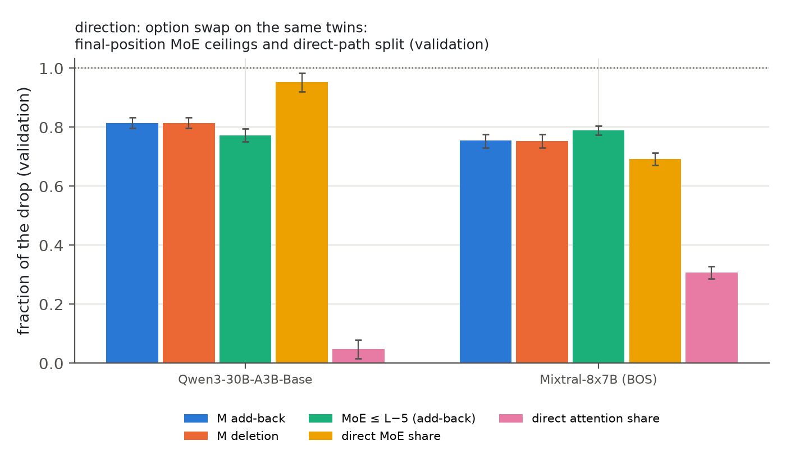
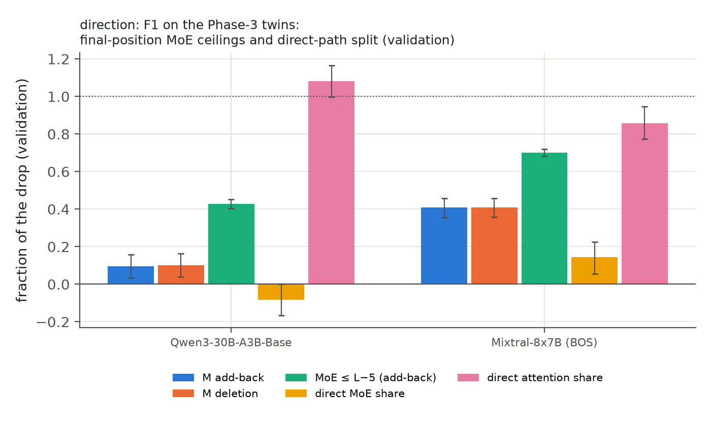
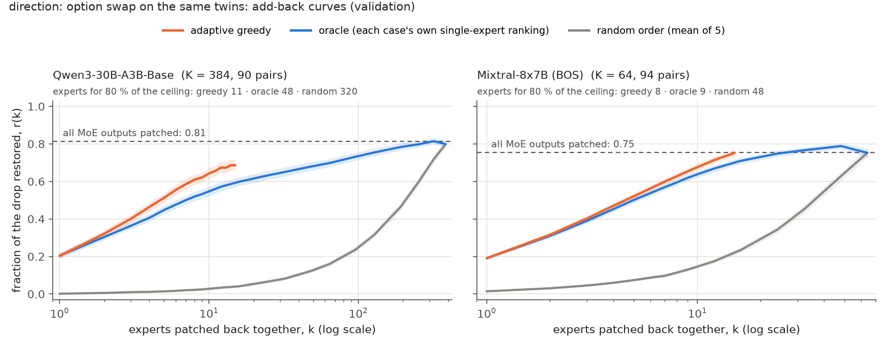
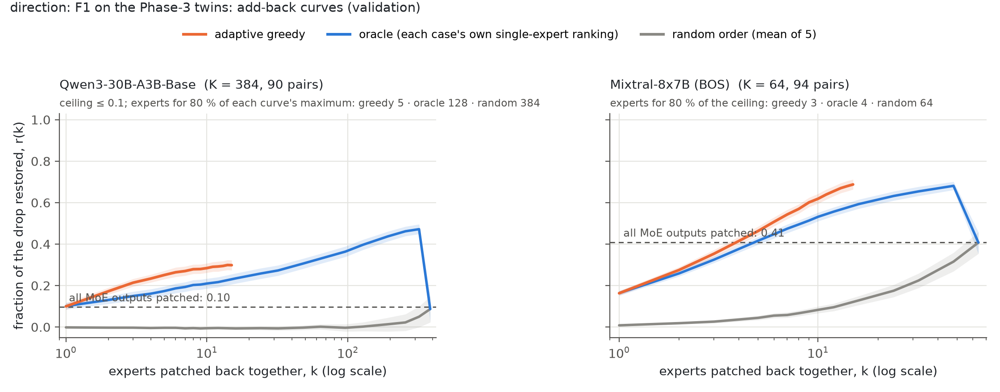
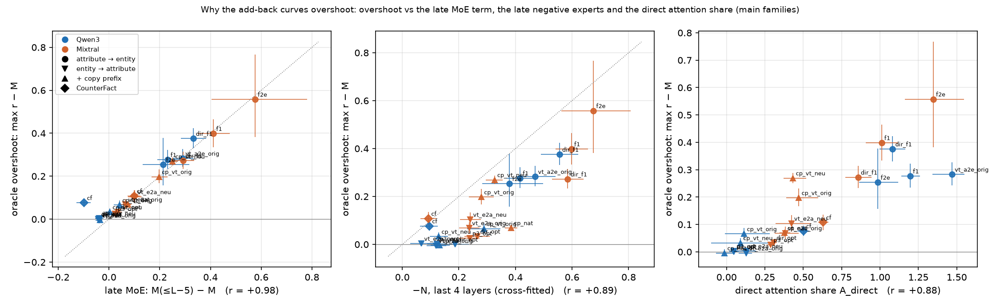

# WinoGrande Phase 5 brief

Expert-aware causal tracing in MoE LMs · Qwen3-30B-A3B and Mixtral-8x7B · bf16 · Phase 5

This follows up the team meeting on the [WinoGrande STR brief](team_brief_winogrande_str.md). The main point raised there was that our WinoGrande setup asks the question backwards. We asked it the original way, added the suggested controls, and reran the full analysis on every condition. Live page: https://claude.ai/artifact/JQ9nWn4wno8CuJ8Gte3qZw

## Answers at a glance

- **The option swap is not the original task.** Asking for the entity instead of the adjective flips the picture. On the same twins, attention's share of the repair rises from 0.19 to 0.71 (Qwen3) and from 0.35 to 0.52 (Mixtral). In this direction attention writes the answer, as in IOI.
- **Having the answer in context barely matters.** Listing both adjectives in the prompt, so the answer can be copied, moves the share by only +0.07 / +0.04.
- **Association, verbs and memorisation have small effects.**
  - Association balance changes the share by at most 0.11.
  - A neutral verb changes nothing measurable.
  - An unrelated verb removes the effect, so the models read the verb.
  - Original names do no better than new names, so we see no memorisation.
- **The tasks form two blocks, not a gradient.** "Which attribute" tasks are MoE-heavy and "which entity" tasks are attention-heavy. CounterFact sits between them and IOI above both.
- **Why the add-back curves differ.** Experts in the last four layers push against the answer. When attention writes the answer, an experts-only add-back overshoots the all-MoE line. When the experts write it, the curve rises to the line. We tested this directly.
- **Attribution patching (OLMoE pilot)** matches exact patching for experts (r 0.96–0.97) but underestimates early heads.

## 1. Setup: the same twins, asked two ways

Phase 3/4, entity → attribute (swap the filled noun, read the adjective):

```
A: The janitor tried to clean the mirror with the spray but the mirror was too  → " dirty"
B: The janitor tried to clean the mirror with the spray but the spray  was too  → " weak"
```

Phase 5, attribute → entity (swap the trigger, read the noun):

```
A: Fill in the blank: The janitor tried to clean the mirror with the spray but the _ was too dirty.
   Answer: the  → " mirror"
B: Fill in the blank: … the _ was too weak.
   Answer: the  → " spray"
```

- **Prompts.** Every prompt contains the whole sentence; only the answer is withheld.
- **Filters.**
  - The answers are single tokens.
  - The twins have equal token length and differ in at most 3 tokens.
  - The model gets both twins right by at least 1 logit.
- **Association balance.** A probe shows the model each trigger and the two candidates without the sentence, e.g. `Word: dirty. Which fits better, the mirror or the spray?`, plus a second probe in the fill-in-the-blank format. The main sets keep only the pairs where neither trigger points to an answer on its own (|probe| < 1 logit).

| Name in figures | What it is | Example | Validation pairs (Qwen3 · Mixtral) |
|---|---|---|---|
| `dir_opt` · `dir_f1` | the same Phase-3 twins, asked both ways | the janitor pair | 90 · 94 |
| `f1` | attribute → entity, fill-in-the-blank, large pool | as above | 128 · 101 |
| `f2e` | attribute → entity, natural sentence, no instruction | "… because music sounded synthetic coming from the" → " keyboard" | 32 · 18 |
| `vt_e2a_orig` · `_neu` | name templates, entity → attribute, original / neutral verb | "Sarah gave Laura a hand … because Sarah was feeling" → " helpful" (neutral: "supported") | 128 · 128 |
| `vt_a2e_orig` | same templates, attribute → entity | "Fill in the blank: … because _ was feeling helpful." → " Sarah" | 37 · – |
| `cp_nat` · `cp_vt_*` | copy control: both attributes listed up front, both orders | "Options: helpful, overwhelmed." + the entity → attribute prompt | 140 · 204 |

## 2. Asking for the entity moves the repair from experts to attention




The bars mean the same as in the earlier brief: M add-back, M deletion, MoE ≤ L−5, and the direct MoE and direct attention shares, each as a fraction of the drop.

**Takeaway.** The experts alone undo 0.81 / 0.75 of the damage when we ask for the adjective, but only 0.10 / 0.41 when we ask for the entity. Attention then writes the answer directly (1.08 / 0.86). The natural sentence without "Fill in the blank" gives the same picture (attention share 0.69 / 0.65), so the wrapper is not the cause.

## 3. Controls

| Change (same items, paired) | Attention share, Qwen3 | Mixtral |
|---|---|---|
| ask for the entity instead of the attribute | +0.52 [0.46, 0.56] | +0.18 [0.15, 0.20] |
| make the attribute copyable ("Options: …"), natural twins | +0.07 [0.01, 0.11] | +0.04 [0.02, 0.05] |
| make the attribute copyable, name templates | −0.06 to +0.04 | +0.01 |
| neutral verb instead of the original | +0.01 [−0.04, +0.05] | +0.01 [−0.01, +0.03] |
| association strata within a condition | ≤ 0.11 | ≤ 0.11 |
| name items vs object items within a condition | +0.08 to +0.16 | +0.08 to +0.16 |

- **Unrelated verb.** With an unrelated verb ("talked with" instead of "gave a hand") the effect disappears: the drop falls from about 5 logits to 0.2 / 0.0.
- **Memorisation.** The original WinoGrande names pass no more often than new names (0.31 vs 0.38 in Qwen3, 0.31 vs 0.29 in Mixtral).
- **Copy prefix.** Our first prefix, "Of Sarah and Laura, one was helpful and the other was overwhelmed", let the models match names to adjectives by position. Mixtral passed 43 % of the items in one order and 0 % in the other, even with an unrelated verb. We replaced it with a neutral list before any patching.

## 4. The task ladder


**Two blocks, not a gradient.** Attention share, Qwen3 / Mixtral:

| Tasks | Attention share |
|---|---|
| "Which attribute" tasks, with or without a copyable answer | 0.16–0.31 / 0.34–0.42 |
| CounterFact | 0.54 / 0.58 |
| "Which entity" tasks | 0.69–0.79 / 0.52–0.65 |
| IOI | 0.92 / 0.80 |

The two models order the tasks alike (Spearman 0.90). The attention-heavy subset is attribute → entity on name items, where 9 of the first 10 head + expert picks are heads (Qwen3).

Caveat: the direction also changes the answer type and the prompt length. The instruction wrapper is ruled out by the natural-sentence condition.

## 5. Which experts

Fraction of the clean margin lost when the Phase-3 WinoGrande expert is knocked out:

| Condition | Qwen3 L41E117 | Mixtral L20E000 |
|---|---|---|
| entity → attribute, Phase-3 twins | 0.025 | 0.025 |
| entity → attribute + "Options:" list | 0.027 | 0.045 |
| attribute → entity, same twins | 0.001 | 0.002 |
| name templates, entity → attribute | 0.001 | 0.012 (n.s.) |

- **Where the WinoGrande expert matters.** It is needed only for entity → attribute on object items, including when the answer could be copied. On name items Mixtral uses L19E006 instead (0.017–0.042).
- **Qwen3's attribute → entity expert, L37E032.** It is selected in the fill-in-the-blank pool and on the name templates, and knocking it out costs 0.042. It writes almost nothing to the answer directly (direct share 0.01). It computes, and heads L40H2 / L42H10 move the entity to the answer.
- **Top-10 sets.** Each condition's own top-10 experts cost 0.02–0.29 when knocked out together; matched random sets cost ≤ 0.04.

## 6. Why the add-back curves look different





The overshoot of the best expert subset over the all-MoE line equals the late-MoE term (r = 0.98 across conditions and models). The mechanism:
1. Experts in the last four layers write against the answer, harder the more evidence is already in the residual stream.
2. An experts-only add-back restores the experts' evidence but not attention's.
3. When attention writes the answer, the all-MoE line therefore contains the late experts' push-back against evidence the patched run lacks, and leaving those experts out beats the line.

Direct test, Qwen3, fraction of the drop:

| | Attribute question | Entity question |
|---|---|---|
| all MoE outputs put back | 0.81 | 0.10 |
| all except the experts that hurt | 0.80 | 0.47 |
| best oracle subset | 0.82 | 0.47 |

## 7. Attribution patching (pilot on OLMoE)

| Component | Gradient estimate vs exact patching, r (WinoGrande · IOI) | Noise ceiling |
|---|---|---|
| single experts | 0.96 · 0.97 | 0.97 · 0.96 |
| MoE layers | 0.96 · 0.99 | 1.00 · 0.99 |
| attention heads | 0.83 · 0.95 | 0.92 · 0.94 |

- Early heads are underestimated.
- About a third of single-expert patches change downstream routing.
- No gradient engine is needed for the 30B models: exact patching at the last token costs about 5 GPU minutes per 256 prompts.

## 8. Not done, and caveats

- **Not run.** The A/B letter format, synonym averaging, a model-size series and MIB remain for discussion. Qwen3-235B does not fit on our disk; the dense Qwen3 family is a possible scale series.
- **Base models fail some formats.** They mostly fail the entity question on the name templates (3.7 % / 0.1 % pass) and a restated format (9 %). Both are reported as behaviour only.
- **Small samples.** The natural-sentence condition has 32 / 18 pairs and the entity question on templates 5 validation templates. Mixtral has few name items in the entity direction.
- **Scope.** The curve-shape test was run on Qwen3 only.
- **Full results.** `results/sections/ext13_synthesis.md`; Directions 13–13h of `results/EXTENSIONS_REPORT.md`.
