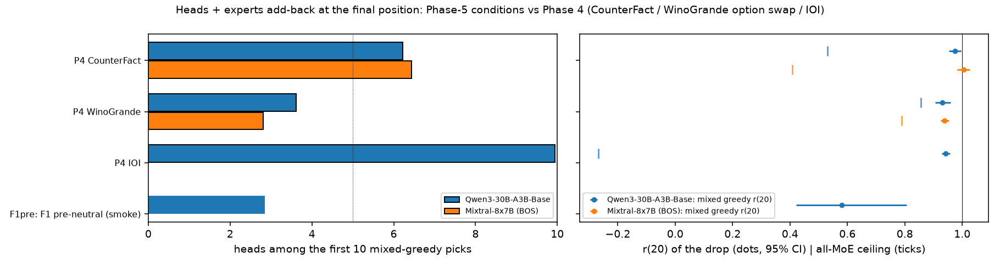

**Summary.** Mixed head + expert greedy add-back at the final position (validation directed cases, 20 exact joint steps, ceiling 1 = all heads): Qwen3 F1pre r(20) 0.58 [0.42, 0.81], heads among the first 10 picks 2.8, k80 never. Phase 4 references: Qwen3 CounterFact STR r(20) 0.97, heads in first 10 6.2; Qwen3 WinoGrande STR r(20) 0.93, heads in first 10 3.6; Qwen3 IOI STR (S2 -> IO) r(20) 0.94, heads in first 10 9.9; Mixtral CounterFact STR r(20) 1.00, heads in first 10 6.4; Mixtral WinoGrande STR r(20) 0.94, heads in first 10 2.8.
Best single heads (rescue / drop; attention label from the clean run's final-position attention): Qwen3 F1pre: L40H2 +0.274 (self (final token)), L42H10 +0.242 (mover (mention, clean side)), L36H28 +0.142 (other context tokens).

### What was run

Rows = the validation directed cases (family main) of every Phase-5 condition with a finished base run (data/wino_ref/p5_conditions.json, '[p5-data] BASE READY' lines), Qwen3-30B-A3B-Base and Mixtral-8x7B with BOS, bf16, STR corruption, denoising at the final position. Machinery = Phase 4 Direction 10 (moetrace/ext10_circuit.py, reused read-only through moetrace/ext13ci.py). Step 1 (scripts/ext13ci_heads_run.py): one attn_head patch per (layer, head) and one attn_layer patch per layer per row, patch-free head DLA and expert DLA, and the final position's attention distribution of the clean and corrupted prompts reduced to position classes from the pair files (mention_* = candidate mentions, attr_* = the in-context attributes of the copy prefix, prefix_ment_* = the names in the copy prefix, blank, str = STR site, pos0, final; _clean = the side of the clean prompt). Step 2 (scripts/ext13ci_circuit_run.py): mixed greedy over the row's top-32 heads ∪ its expert pool (Qwen3 top-32, Mixtral all 64 clean-active experts by single-expert rescue of the base run), head-only greedy, static orderings (single-patch oracle and DLA, mixed and heads only), in-pass ceilings (all heads, all attention, all MoE) and sanity rows; several conditions of one model share every pass. Bootstrap clusters = WinoGrande twins (HIT id) and, for the verb templates, the seed (template).

| Model | Condition | Description | Rows / clusters | Cluster | Mean drop | Step-1 passes | Step-1 GPU min | Step-1 peak GB | Step-2 group |
|---|---|---|---|---|---|---|---|---|---|
| Qwen3-30B-A3B-Base | F1pre | F1 pre-neutral (smoke) | 6 / 3 | twin (q_a HIT id) | 3.96 | 1 | 1.0 | 3.8 | gsmoke (1 conditions, 2 passes, 1.7 min, peak 3.6 GB) |

### Step 1. Single heads at every layer, head DLA, attention of the top heads

| Run | Rows / units | Mean drop | Heads Z8 + / − (both halves) | Σ single heads / drop (all; positive) | Pop. heads for 50/80/90 % (additive) | Best head / best expert per row (median) | Rows best head > best expert | Heads in joint top-32 | DLA vs single heads: pop. r / top-1 agree | experts: row r (DLA vs single) | Σ head DLA vs direct split (r, ratio) | Σ heads vs attn_layer (row-layer r) |
|---|---|---|---|---|---|---|---|---|---|---|---|---|
| Qwen3-30B-A3B-Base, F1 pre-neutral (smoke) | 6 / 3 | 3.96 | 31 / 24 (24) | -0.42, 8.63 | 2/5/5 | 0.367 / 0.120 | 1.00 | 26 [24, 28] | 0.55 / 0.33 | 0.47 | 0.996, 1.026 | 0.33 |

**Top and bottom heads (validation).**

| Run | Head | Rank | Rescue / drop [95% CI] | Rescue (logits) | z (all / halves) | Z8 both halves | DLA / drop | Row top-5 / top-1 share | Attention (clean run) |
|---|---|---|---|---|---|---|---|---|---|
| Qwen3-30B-A3B-Base, F1 pre-neutral (smoke) | L40H2 | 1 | +0.274 [+0.217, +0.340] | +1.08 | +12.0 / +11.9, +8.8 | yes | +0.019 | 1.00 / 0.67 | self (final token) |
| Qwen3-30B-A3B-Base, F1 pre-neutral (smoke) | L42H10 | 2 | +0.242 [+0.120, +0.360] | +0.96 | +10.6 / +9.3, +10.0 | yes | +0.489 | 1.00 / 0.33 | mover (mention, clean side) |
| Qwen3-30B-A3B-Base, F1 pre-neutral (smoke) | L36H28 | 3 | +0.142 [+0.098, +0.250] | +0.56 | +6.2 / +4.8, +7.1 | yes | +0.013 | 0.33 / 0.00 | other context tokens |
| Qwen3-30B-A3B-Base, F1 pre-neutral (smoke) | L40H0 | 4 | +0.132 [+0.042, +0.220] | +0.52 | +5.8 / +7.4, +1.3 | no | +0.015 | 0.50 / 0.00 | other context tokens |
| Qwen3-30B-A3B-Base, F1 pre-neutral (smoke) | L41H20 | 5 | +0.132 [+0.080, +0.250] | +0.52 | +5.8 / +4.1, +7.1 | yes | +0.060 | 0.50 / 0.00 | mover (mention, clean side) |
| Qwen3-30B-A3B-Base, F1 pre-neutral (smoke) | L43H24 | 6 | +0.121 [+0.087, +0.160] | +0.48 | +5.3 / +5.1, +4.2 | yes | +0.147 | 0.17 / 0.00 | sink (pos0) |
| Qwen3-30B-A3B-Base, F1 pre-neutral (smoke) | L39H29 | 7 | +0.116 [+0.060, +0.167] | +0.46 | +5.1 / +4.5, +4.8 | yes | +0.016 | 0.17 / 0.00 | other context tokens |
| Qwen3-30B-A3B-Base, F1 pre-neutral (smoke) | L38H20 | 8 | +0.111 [+0.065, +0.167] | +0.44 | +4.8 / +4.1, +4.8 | yes | +0.002 | 0.17 / 0.00 | other context tokens |
| Qwen3-30B-A3B-Base, F1 pre-neutral (smoke) | L44H15 | 1536 | -0.289 [-0.521, -0.160] | -1.15 | -12.7 / -9.8, -14.3 | yes | -0.174 | 0.00 / 0.00 | mover (mention, clean side) |
| Qwen3-30B-A3B-Base, F1 pre-neutral (smoke) | L44H31 | 1535 | -0.137 [-0.152, -0.100] | -0.54 | -6.0 / -6.2, -3.9 | yes | -0.110 | 0.00 / 0.00 | mover (mention, clean side) |
| Qwen3-30B-A3B-Base, F1 pre-neutral (smoke) | L36H31 | 1534 | -0.132 [-0.250, -0.087] | -0.52 | -5.7 / -4.3, -6.8 | yes | -0.009 | 0.00 / 0.00 | other context tokens |

**Layers with the largest attention-output patch.**

| Run | Layer | attn_layer / drop | Σ heads / drop | r(Σ heads, attn_layer) rows | Top head | Top head / drop | Z8 + / − |
|---|---|---|---|---|---|---|---|
| Qwen3-30B-A3B-Base, F1 pre-neutral (smoke) | L42 | +0.353 [+0.283, +0.460] | +0.195 | 0.70 | L42H10 | +0.242 | 2 / 1 |
| Qwen3-30B-A3B-Base, F1 pre-neutral (smoke) | L43 | +0.268 [+0.200, +0.293] | +0.047 | 0.43 | L43H24 | +0.121 | 4 / 2 |
| Qwen3-30B-A3B-Base, F1 pre-neutral (smoke) | L39 | +0.258 [+0.140, +0.521] | +0.189 | 0.15 | L39H29 | +0.116 | 4 / 2 |
| Qwen3-30B-A3B-Base, F1 pre-neutral (smoke) | L38 | +0.153 [+0.120, +0.229] | +0.121 | -0.40 | L38H20 | +0.111 | 3 / 1 |
| Qwen3-30B-A3B-Base, F1 pre-neutral (smoke) | L41 | +0.121 [+0.100, +0.146] | -0.011 | 0.53 | L41H20 | +0.132 | 2 / 1 |
| Qwen3-30B-A3B-Base, F1 pre-neutral (smoke) | L35 | +0.105 [+0.054, +0.229] | +0.237 | 0.39 | L35H9 | +0.111 | 2 / 1 |

**Final-position attention of the top heads (clean → corrupted run; mean over validation rows).** Classes as in 'What was run'. Label = the largest class of the clean run, ignoring pos0 / final.

| Run | Head | Rescue / drop | Label | str (clean → corr) | mention_clean (clean → corr) | mention_corr (clean → corr) | blank (clean → corr) | pos0 (clean → corr) | final (clean → corr) |
|---|---|---|---|---|---|---|---|---|---|
| Qwen3-30B-A3B-Base, F1 pre-neutral (smoke) | L40H2 | +0.274 | self (final token) | 0.00 → 0.00 | 0.00 → 0.00 | 0.00 → 0.00 | 0.00 → 0.00 | 0.06 → 0.06 | 0.57 → 0.57 |
| Qwen3-30B-A3B-Base, F1 pre-neutral (smoke) | L42H10 | +0.242 | mover (mention, clean side) | 0.00 → 0.00 | 0.70 → 0.15 | 0.15 → 0.70 | 0.01 → 0.01 | 0.08 → 0.08 | 0.01 → 0.01 |
| Qwen3-30B-A3B-Base, F1 pre-neutral (smoke) | L36H28 | +0.142 | other context tokens | 0.06 → 0.06 | 0.22 → 0.09 | 0.09 → 0.22 | 0.09 → 0.09 | 0.11 → 0.11 | 0.02 → 0.02 |
| Qwen3-30B-A3B-Base, F1 pre-neutral (smoke) | L40H0 | +0.132 | other context tokens | 0.09 → 0.09 | 0.00 → 0.00 | 0.00 → 0.00 | 0.01 → 0.01 | 0.35 → 0.35 | 0.06 → 0.06 |
| Qwen3-30B-A3B-Base, F1 pre-neutral (smoke) | L41H20 | +0.132 | mover (mention, clean side) | 0.00 → 0.00 | 0.39 → 0.13 | 0.13 → 0.39 | 0.01 → 0.01 | 0.30 → 0.30 | 0.00 → 0.00 |
| Qwen3-30B-A3B-Base, F1 pre-neutral (smoke) | L43H24 | +0.121 | sink (pos0) | 0.01 → 0.01 | 0.00 → 0.00 | 0.00 → 0.00 | 0.02 → 0.02 | 0.46 → 0.46 | 0.36 → 0.36 |
| Qwen3-30B-A3B-Base, F1 pre-neutral (smoke) | L39H29 | +0.116 | other context tokens | 0.01 → 0.01 | 0.21 → 0.13 | 0.13 → 0.21 | 0.09 → 0.09 | 0.12 → 0.12 | 0.04 → 0.04 |
| Qwen3-30B-A3B-Base, F1 pre-neutral (smoke) | L38H20 | +0.111 | other context tokens | 0.02 → 0.02 | 0.00 → 0.00 | 0.00 → 0.00 | 0.02 → 0.02 | 0.14 → 0.14 | 0.37 → 0.37 |
| Qwen3-30B-A3B-Base, F1 pre-neutral (smoke) | L44H15 | -0.289 | mover (mention, clean side) | 0.00 → 0.00 | 0.45 → 0.14 | 0.14 → 0.45 | 0.00 → 0.00 | 0.23 → 0.23 | 0.03 → 0.03 |
| Qwen3-30B-A3B-Base, F1 pre-neutral (smoke) | L44H31 | -0.137 | mover (mention, clean side) | 0.00 → 0.00 | 0.41 → 0.09 | 0.09 → 0.41 | 0.02 → 0.02 | 0.20 → 0.20 | 0.04 → 0.04 |

**Population.** all heads = mean over every head; rescue-weighted = heads weighted by their positive single-head effect; top-10 = the ten best heads; row top-1 = the best head of each row, read in that row.

| Run | str: all heads / rescue-weighted pos. / top-10 / row top-1 head (clean → corr) | mention_clean: all heads / rescue-weighted pos. / top-10 / row top-1 head (clean → corr) | mention_corr: all heads / rescue-weighted pos. / top-10 / row top-1 head (clean → corr) | blank: all heads / rescue-weighted pos. / top-10 / row top-1 head (clean → corr) | pos0: all heads / rescue-weighted pos. / top-10 / row top-1 head (clean → corr) | final: all heads / rescue-weighted pos. / top-10 / row top-1 head (clean → corr) | top-10 labels |
|---|---|---|---|---|---|---|---|
| Qwen3-30B-A3B-Base, F1 pre-neutral (smoke) | 0.02 / 0.03 / 0.04 / 0.00 → 0.00 | 0.02 / 0.07 / 0.21 / 0.18 → 0.01 | 0.02 / 0.03 / 0.07 / 0.11 → 0.31 | 0.04 / 0.04 / 0.03 / 0.01 → 0.00 | 0.50 / 0.37 / 0.16 / 0.07 → 0.04 | 0.12 / 0.12 / 0.19 / 0.35 → 0.37 | other context tokens 6, mover (mention, clean side) 2, self (final token) 1, sink (pos0) 1 |

### Step 2. Heads + experts added back jointly

| Run | Curve | r(1) | r(5) | r(10) | r(20) [95% CI] | r(128) | max r (k) | k50/80/90 of drop | AUC log k (1..20) | all-MoE ceiling |
|---|---|---|---|---|---|---|---|---|---|---|
| Qwen3-30B-A3B-Base, F1 pre-neutral (smoke) | greedy_mix | 0.307 |  |  |  |  | 0.580 (3) | 3/never/never |  | -0.040 |
| Qwen3-30B-A3B-Base, F1 pre-neutral (smoke) | greedy_head | 0.307 |  |  |  |  | 0.574 (3) | 3/never/never |  | -0.040 |
| Qwen3-30B-A3B-Base, F1 pre-neutral (smoke) | static_mix_oracle | 0.307 | 0.688 | 0.778 |  | 1.085 | 1.085 (128) | 3/12/24 | 0.629 | -0.040 |
| Qwen3-30B-A3B-Base, F1 pre-neutral (smoke) | static_mix_dla | 0.239 | 0.426 | 0.602 |  | 1.176 | 1.176 (128) | 7/24/32 | 0.453 | -0.040 |
| Qwen3-30B-A3B-Base, F1 pre-neutral (smoke) | static_head_oracle | 0.307 | 0.676 | 0.807 |  | 1.040 | 1.040 (128) | 3/10/24 | 0.633 | -0.040 |
| Qwen3-30B-A3B-Base, F1 pre-neutral (smoke) | static_head_dla | 0.239 | 0.415 | 0.597 |  | 1.153 | 1.153 (128) | 7/24/32 | 0.460 | -0.040 |

| Run | Greedy | row k50/80/90 (median; reached) | rows restored k=1/5/10/20 | rows r ≥ 0.9 k=5/10/20 | rows top-1 at last step | heads among first 1/5/10/20 | first picks (share) | most frequent in first 5 |
|---|---|---|---|---|---|---|---|---|
| Qwen3-30B-A3B-Base, F1 pre-neutral (smoke) | mix | 2/never/never; 0.67/0.17/0.00 | 0.17/nan/nan/nan | nan/nan/nan | 0.83 | 1.0/2.8/2.8/2.8 | L40H2 0.67, L42H10 0.33 | L40H2 1.00, L40H0 0.67, L42H10 0.50, L43H31 0.17, L39H31 0.17 |
| Qwen3-30B-A3B-Base, F1 pre-neutral (smoke) | head | 2/never/never; 0.67/0.17/0.00 | 0.17/nan/nan/nan | nan/nan/nan | 0.83 | 1.0/3.0/3.0/3.0 | L40H2 0.67, L42H10 0.33 | L40H2 1.00, L40H0 0.67, L42H10 0.50, L36H28 0.33, L43H31 0.17 |

**In-pass ceilings and sanity.**

| Run | rows / units | all heads (= 1) | all attention | all MoE | all heads: max |Δ − Δ_clean| | layer heads vs attn_layer: median / max |ΔΔ|, r | passes | complete |
|---|---|---|---|---|---|---|---|---|
| Qwen3-30B-A3B-Base, F1 pre-neutral (smoke) | 6 / 3 | 1.017 | 1.000 | -0.040 [-0.341, 0.500] | 0.250 | 0.125 / 0.500, 0.9929 | 2 | no |

### Cross-condition overview (key panel of the task ladder)

| Condition | Qwen3-30B-A3B-Base: heads in first 10 / r(20) [CI] / k80 / all-MoE | Mixtral-8x7B (BOS): heads in first 10 / r(20) [CI] / k80 / all-MoE |
|---|---|---|
| P4 CounterFact | 6.2 / 0.97 [0.95, 1.00] / 8 / 0.53 | 6.4 / 1.00 [0.98, 1.03] / 9 / 0.41 |
| P4 WinoGrande | 3.6 / 0.93 [0.91, 0.96] / 10 / 0.86 | 2.8 / 0.94 [0.93, 0.95] / 10 / 0.79 |
| P4 IOI | 9.9 / 0.94 [0.93, 0.96] / 11 / -0.27 |  |
| F1pre (F1 pre-neutral (smoke)) | 2.8 / 0.58 [0.42, 0.81] / never / -0.04 |  |

### Contrasts (paired over shared clusters)

Per cluster (twin or template seed): r = Σ rescue / Σ drop over its rows, heads = mean count among the first 10 mixed-greedy picks; difference A − B averaged over the clusters present in both conditions, 95 % percentile bootstrap over clusters (5,000 resamples). 'P3wino' = Phase 4's WinoGrande option-swap rows (Direction 10).

(table ext13ci_contrasts not yet available)

### Files

Code moetrace/ext13ci.py, scripts/ext13ci_{heads_run,circuit_run,analyze,chain,text}.py; runs results/p5_<cond>_<proto>_ci/ (step 1), results/p5_<proto>_ci/<group>/ (step 2); numbers results/ext13ci_summary.json; tables results/tables/ext13ci_*; figures results/figures/ext13ci_{heads_heatmap,heads_dla_layers,heads_attn,circuit_curves,circuit_composition}_<cond>.png and ext13ci_overview.png.

_Generated 2026-10-11T06:15:37Z by scripts/ext13ci_text.py._
