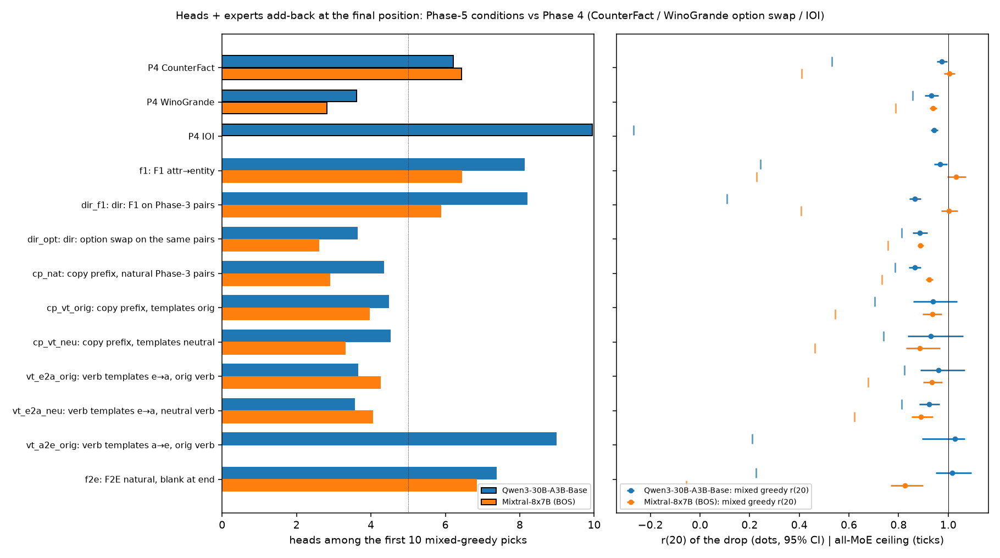

**Summary.** Mixed head + expert greedy add-back at the final position (validation directed cases, 20 exact joint steps, ceiling 1 = all heads): Qwen3 f1 r(20) 0.97 [0.94, 1.00], heads among the first 10 picks 8.1, k80 7; Mixtral f1 r(20) 1.03 [1.00, 1.07], heads among the first 10 picks 6.4, k80 8; Qwen3 dir_f1 r(20) 0.87 [0.84, 0.89], heads among the first 10 picks 8.2, k80 13; Mixtral dir_f1 r(20) 1.00 [0.97, 1.04], heads among the first 10 picks 5.9, k80 9; Qwen3 dir_opt r(20) 0.88 [0.86, 0.92], heads among the first 10 picks 3.6, k80 13; Mixtral dir_opt r(20) 0.89 [0.88, 0.90], heads among the first 10 picks 2.6, k80 14; Qwen3 cp_nat r(20) 0.87 [0.84, 0.89], heads among the first 10 picks 4.3, k80 14; Mixtral cp_nat r(20) 0.92 [0.91, 0.94], heads among the first 10 picks 2.9, k80 11; Qwen3 cp_vt_orig r(20) 0.94 [0.86, 1.04], heads among the first 10 picks 4.5, k80 11; Mixtral cp_vt_orig r(20) 0.94 [0.90, 0.97], heads among the first 10 picks 4.0, k80 10; Qwen3 cp_vt_neu r(20) 0.93 [0.84, 1.06], heads among the first 10 picks 4.5, k80 11; Mixtral cp_vt_neu r(20) 0.89 [0.83, 0.97], heads among the first 10 picks 3.3, k80 13; Qwen3 vt_e2a_orig r(20) 0.96 [0.89, 1.07], heads among the first 10 picks 3.6, k80 10; Mixtral vt_e2a_orig r(20) 0.93 [0.90, 0.98], heads among the first 10 picks 4.2, k80 11; Qwen3 vt_e2a_neu r(20) 0.92 [0.88, 0.97], heads among the first 10 picks 3.6, k80 10; Mixtral vt_e2a_neu r(20) 0.89 [0.85, 0.94], heads among the first 10 picks 4.0, k80 12; Qwen3 vt_a2e_orig r(20) 1.03 [0.90, 1.07], heads among the first 10 picks 9.0, k80 6; Qwen3 f2e r(20) 1.02 [0.95, 1.09], heads among the first 10 picks 7.4, k80 8; Mixtral f2e r(20) 0.83 [0.77, 0.90], heads among the first 10 picks 6.8, k80 17. Phase 4 references: Qwen3 CounterFact STR r(20) 0.97, heads in first 10 6.2; Qwen3 WinoGrande STR r(20) 0.93, heads in first 10 3.6; Qwen3 IOI STR (S2 -> IO) r(20) 0.94, heads in first 10 9.9; Mixtral CounterFact STR r(20) 1.00, heads in first 10 6.4; Mixtral WinoGrande STR r(20) 0.94, heads in first 10 2.8.
Best single heads (rescue / drop; attention label from the clean run's final-position attention): Qwen3 f1: L40H2 +0.257 (self (final token)), L42H10 +0.212 (mover (mention: answer)), L41H20 +0.134 (mover (mention: answer)); Mixtral f1: L18H10 +0.092 (other context tokens), L20H21 +0.083 (self (final token)), L20H27 +0.081 (STR site (trigger)); Qwen3 dir_f1: L40H2 +0.210 (self (final token)), L36H23 +0.108 (STR site (trigger)), L42H10 +0.101 (mover (mention: answer)); Mixtral dir_f1: L20H27 +0.121 (STR site (trigger)), L21H11 +0.106 (mover (mention: answer)), L12H21 +0.100 (STR site (trigger)); Qwen3 dir_opt: L46H24 +0.074 (diffuse), L41H27 +0.056 (sink (pos0)), L38H18 +0.052 (sink (pos0)); Mixtral dir_opt: L25H9 +0.064 (STR site (filled entity)), L22H20 +0.056 (STR site (filled entity)), L19H13 +0.043 (STR site (filled entity)); Qwen3 cp_nat: L46H24 +0.146 (other context tokens), L41H27 +0.099 (diffuse), L38H18 +0.062 (sink (pos0)); Mixtral cp_nat: L22H20 +0.074 (STR site (filled entity)), L25H9 +0.074 (other context tokens), L19H13 +0.050 (STR site (filled entity)); Qwen3 cp_vt_orig: L41H0 +0.077 (STR site (filled entity)), L42H30 +0.076 (STR site (filled entity)), L41H5 +0.048 (diffuse); Mixtral cp_vt_orig: L13H18 +0.077 (STR site (filled entity)), L8H8 +0.056 (STR site (filled entity)), L22H20 +0.048 (other context tokens); Qwen3 cp_vt_neu: L41H0 +0.104 (STR site (filled entity)), L42H30 +0.063 (STR site (filled entity)), L31H16 +0.054 (STR site (filled entity)); Mixtral cp_vt_neu: L13H18 +0.069 (STR site (filled entity)), L19H13 +0.065 (STR site (filled entity)), L18H17 +0.041 (other context tokens); Qwen3 vt_e2a_orig: L42H30 +0.047 (diffuse), L38H3 +0.046 (STR site (filled entity)), L41H27 +0.043 (sink (pos0)); Mixtral vt_e2a_orig: L13H18 +0.066 (STR site (filled entity)), L8H8 +0.063 (STR site (filled entity)), L19H13 +0.057 (STR site (filled entity)); Qwen3 vt_e2a_neu: L38H3 +0.058 (other context tokens), L42H30 +0.048 (diffuse), L19H16 +0.044 (STR site (filled entity)); Mixtral vt_e2a_neu: L13H18 +0.068 (STR site (filled entity)), L19H13 +0.060 (STR site (filled entity)), L8H8 +0.044 (STR site (filled entity)); Qwen3 vt_a2e_orig: L40H2 +0.315 (self (final token)), L42H10 +0.303 (mover (mention: answer)), L36H23 +0.191 (STR site (trigger)); Qwen3 f2e: L40H2 +0.243 (other context tokens), L42H10 +0.119 (mover (mention: answer)), L41H18 +0.073 (mover (mention: answer)); Mixtral f2e: L20H21 +0.114 (other context tokens), L18H10 +0.103 (other context tokens), L19H8 +0.099 (mover (mention: answer)).

### What was run

Rows = the validation directed cases (family main) of every Phase-5 condition with a finished base run (data/wino_ref/p5_conditions.json, '[p5-data] BASE READY' lines), Qwen3-30B-A3B-Base and Mixtral-8x7B with BOS, bf16, STR corruption, denoising at the final position. Machinery = Phase 4 Direction 10 (moetrace/ext10_circuit.py, reused read-only through moetrace/ext13ci.py). Step 1 (scripts/ext13ci_heads_run.py): one attn_head patch per (layer, head) and one attn_layer patch per layer per row, patch-free head DLA and expert DLA, and the final position's attention distribution of the clean and corrupted prompts reduced to position classes from the pair files (mention_* = candidate mentions, attr_* = the in-context attributes of the copy prefix, prefix_ment_* = the names in the copy prefix, blank, str = STR site, pos0, final; _clean = the side of the clean prompt). Step 2 (scripts/ext13ci_circuit_run.py): mixed greedy over the row's top-32 heads ∪ its expert pool (Qwen3 top-32, Mixtral all 64 clean-active experts by single-expert rescue of the base run), head-only greedy, static orderings (single-patch oracle and DLA, mixed and heads only), in-pass ceilings (all heads, all attention, all MoE) and sanity rows; several conditions of one model share every pass. Bootstrap clusters = WinoGrande twins (HIT id) and, for the verb templates, the seed (template).

| Model | Condition | Description | Rows / clusters | Cluster | Mean drop | Step-1 passes | Step-1 GPU min | Step-1 peak GB | Step-2 group |
|---|---|---|---|---|---|---|---|---|---|
| Qwen3-30B-A3B-Base | f1 | F1 attr→entity | 256 / 128 | twin (q_a HIT id) | 4.60 | 2 | 2.2 | 17.2 | g1 (3 conditions, 19 passes, 18.2 min, peak 11.9 GB) |
| Mixtral-8x7B (BOS) | f1 | F1 attr→entity | 202 / 101 | twin (q_a HIT id) | 4.37 | 2 | 3.2 | 13.6 | g1 (3 conditions, 19 passes, 29.3 min, peak 16.1 GB) |
| Qwen3-30B-A3B-Base | dir_f1 | dir: F1 on Phase-3 pairs | 180 / 90 | twin (q_a HIT id) | 5.23 | 2 | 2.0 | 12.8 | g1 (3 conditions, 19 passes, 18.2 min, peak 11.9 GB) |
| Mixtral-8x7B (BOS) | dir_f1 | dir: F1 on Phase-3 pairs | 188 / 94 | twin (q_a HIT id) | 4.66 | 2 | 3.2 | 12.8 | g1 (3 conditions, 19 passes, 29.3 min, peak 16.1 GB) |
| Qwen3-30B-A3B-Base | dir_opt | dir: option swap on the same pairs | 180 / 90 | twin (q_a HIT id) | 8.73 | 2 | 1.8 | 12.7 | g1 (3 conditions, 19 passes, 18.2 min, peak 11.9 GB) |
| Mixtral-8x7B (BOS) | dir_opt | dir: option swap on the same pairs | 188 / 94 | twin (q_a HIT id) | 9.64 | 2 | 3.1 | 12.5 | g1 (3 conditions, 19 passes, 29.3 min, peak 16.1 GB) |
| Qwen3-30B-A3B-Base | cp_nat | copy prefix, natural Phase-3 pairs | 280 / 70 | twin (q_a HIT id) | 5.99 | 2 | 2.3 | 18.5 | g2 (3 conditions, 19 passes, 18.2 min, peak 12.4 GB) |
| Mixtral-8x7B (BOS) | cp_nat | copy prefix, natural Phase-3 pairs | 408 / 102 | twin (q_a HIT id) | 7.15 | 4 | 6.3 | 13.4 | g2a (1 conditions, 19 passes, 29.9 min, peak 14.1 GB) |
| Qwen3-30B-A3B-Base | cp_vt_orig | copy prefix, templates orig | 256 / 13 | seed | 5.56 | 2 | 2.1 | 17.1 | g2 (3 conditions, 19 passes, 18.2 min, peak 12.4 GB) |
| Mixtral-8x7B (BOS) | cp_vt_orig | copy prefix, templates orig | 256 / 10 | seed | 5.29 | 3 | 4.7 | 11.8 | g2b (2 conditions, 19 passes, 29.3 min, peak 14.6 GB) |
| Qwen3-30B-A3B-Base | cp_vt_neu | copy prefix, templates neutral | 256 / 8 | seed | 5.63 | 2 | 2.2 | 17.1 | g2 (3 conditions, 19 passes, 18.2 min, peak 12.4 GB) |
| Mixtral-8x7B (BOS) | cp_vt_neu | copy prefix, templates neutral | 256 / 8 | seed | 5.41 | 3 | 4.8 | 11.8 | g2b (2 conditions, 19 passes, 29.3 min, peak 14.6 GB) |
| Qwen3-30B-A3B-Base | vt_e2a_orig | verb templates e→a, orig verb | 256 / 17 | seed | 6.47 | 2 | 2.1 | 17.0 | g3 (3 conditions, 19 passes, 18.7 min, peak 11.8 GB) |
| Mixtral-8x7B (BOS) | vt_e2a_orig | verb templates e→a, orig verb | 256 / 18 | seed | 6.51 | 3 | 4.7 | 11.7 | g3 (2 conditions, 19 passes, 29.3 min, peak 14.4 GB) |
| Qwen3-30B-A3B-Base | vt_e2a_neu | verb templates e→a, neutral verb | 256 / 12 | seed | 6.06 | 2 | 2.2 | 17.0 | g3 (3 conditions, 19 passes, 18.7 min, peak 11.8 GB) |
| Mixtral-8x7B (BOS) | vt_e2a_neu | verb templates e→a, neutral verb | 256 / 12 | seed | 5.81 | 3 | 4.7 | 11.7 | g3 (2 conditions, 19 passes, 29.3 min, peak 14.4 GB) |
| Qwen3-30B-A3B-Base | vt_a2e_orig | verb templates a→e, orig verb | 74 / 5 | seed | 3.66 | 1 | 1.0 | 10.8 | g3 (3 conditions, 19 passes, 18.7 min, peak 11.8 GB) |
| Qwen3-30B-A3B-Base | f2e | F2E natural, blank at end | 64 / 32 | twin (q_a HIT id) | 8.38 | 1 | 1.0 | 9.7 | g4 (1 conditions, 19 passes, 18.5 min, peak 4.1 GB) |
| Mixtral-8x7B (BOS) | f2e | F2E natural, blank at end | 36 / 18 | twin (q_a HIT id) | 6.94 | 1 | 1.6 | 8.1 | g4 (1 conditions, 19 passes, 28.9 min, peak 6.5 GB) |

### Step 1. Single heads at every layer, head DLA, attention of the top heads

| Run | Rows / units | Mean drop | Heads Z8 + / − (both halves) | Σ single heads / drop (all; positive) | Pop. heads for 50/80/90 % (additive) | Best head / best expert per row (median) | Rows best head > best expert | Heads in joint top-32 | DLA vs single heads: pop. r / top-1 agree | experts: row r (DLA vs single) | Σ head DLA vs direct split (r, ratio) | Σ heads vs attn_layer (row-layer r) |
|---|---|---|---|---|---|---|---|---|---|---|---|---|
| Qwen3-30B-A3B-Base, F1 attr→entity | 256 / 128 | 4.60 | 30 / 26 (49) | -1.03, 4.04 | 3/5/6 | 0.304 / 0.143 | 0.88 | 24 [18, 28] | 0.56 / 0.26 | 0.38 | 0.981, 0.991 | 0.34 |
| Mixtral-8x7B (BOS), F1 attr→entity | 202 / 101 | 4.37 | 27 / 24 (40) | 2.34, 3.66 | 7/12/14 | 0.217 / 0.160 | 0.64 | 21 [16, 24] | 0.50 / 0.15 | 0.71 | 0.996, 1.008 | 0.34 |
| Qwen3-30B-A3B-Base, dir: F1 on Phase-3 pairs | 180 / 90 | 5.23 | 42 / 30 (61) | 3.16, 5.62 | 4/8/10 | 0.238 / 0.111 | 0.88 | 26 [21, 29] | 0.54 / 0.19 | 0.53 | 0.985, 0.995 | 0.33 |
| Mixtral-8x7B (BOS), dir: F1 on Phase-3 pairs | 188 / 94 | 4.66 | 20 / 20 (38) | 2.68, 3.92 | 5/10/12 | 0.209 / 0.161 | 0.66 | 20 [17, 23] | 0.54 / 0.15 | 0.72 | 0.991, 1.004 | 0.33 |
| Qwen3-30B-A3B-Base, dir: option swap on the same pairs | 180 / 90 | 8.73 | 21 / 13 (26) | -0.13, 1.32 | 22/83/120 | 0.114 / 0.189 | 0.12 | 12 [8, 17] | 0.86 / 0.36 | 0.56 | 0.992, 0.992 | 0.37 |
| Mixtral-8x7B (BOS), dir: option swap on the same pairs | 188 / 94 | 9.64 | 21 / 6 (24) | 0.17, 0.78 | 31/None/None | 0.087 / 0.186 | 0.10 | 13 [10, 15] | 0.79 / 0.35 | 0.82 | 0.999, 0.999 | 0.30 |
| Qwen3-30B-A3B-Base, copy prefix, natural Phase-3 pairs | 280 / 70 | 5.99 | 16 / 14 (26) | -0.95, 1.53 | 10/33/45 | 0.192 / 0.174 | 0.53 | 14 [8, 21] | 0.91 / 0.58 | 0.39 | 0.983, 0.807 | 0.37 |
| Mixtral-8x7B (BOS), copy prefix, natural Phase-3 pairs | 408 / 102 | 7.15 | 20 / 5 (22) | 0.71, 1.11 | 19/71/118 | 0.108 / 0.179 | 0.15 | 14 [11, 17] | 0.77 / 0.37 | 0.82 | 0.997, 1.001 | 0.31 |
| Qwen3-30B-A3B-Base, copy prefix, templates orig | 256 / 13 | 5.56 | 38 / 26 (41) | -0.83, 2.05 | 12/27/33 | 0.154 / 0.185 | 0.36 | 15 [10, 21] | 0.81 / 0.25 | 0.44 | 0.984, 1.083 | 0.37 |
| Mixtral-8x7B (BOS), copy prefix, templates orig | 256 / 10 | 5.29 | 30 / 15 (18) | 0.66, 1.54 | 15/35/46 | 0.172 / 0.179 | 0.44 | 14 [11, 18] | 0.62 / 0.25 | 0.76 | 0.995, 1.004 | 0.33 |
| Qwen3-30B-A3B-Base, copy prefix, templates neutral | 256 / 8 | 5.63 | 32 / 33 (29) | 0.53, 2.45 | 13/30/38 | 0.164 / 0.200 | 0.27 | 14 [9, 21] | 0.77 / 0.20 | 0.40 | 0.987, 1.069 | 0.36 |
| Mixtral-8x7B (BOS), copy prefix, templates neutral | 256 / 8 | 5.41 | 31 / 21 (16) | 1.76, 2.36 | 15/32/40 | 0.118 / 0.158 | 0.28 | 14 [11, 18] | 0.66 / 0.26 | 0.79 | 0.994, 0.979 | 0.31 |
| Qwen3-30B-A3B-Base, verb templates e→a, orig verb | 256 / 17 | 6.47 | 35 / 21 (29) | -1.06, 1.25 | 21/58/81 | 0.144 / 0.213 | 0.20 | 12 [8, 18] | 0.83 / 0.43 | 0.58 | 0.976, 1.011 | 0.40 |
| Mixtral-8x7B (BOS), verb templates e→a, orig verb | 256 / 18 | 6.51 | 32 / 10 (25) | 0.69, 1.26 | 17/41/59 | 0.175 / 0.193 | 0.41 | 13 [10, 17] | 0.67 / 0.30 | 0.83 | 0.999, 1.000 | 0.34 |
| Qwen3-30B-A3B-Base, verb templates e→a, neutral verb | 256 / 12 | 6.06 | 27 / 23 (19) | 1.25, 2.34 | 18/45/59 | 0.140 / 0.209 | 0.22 | 12 [7, 18] | 0.82 / 0.40 | 0.55 | 0.987, 1.023 | 0.43 |
| Mixtral-8x7B (BOS), verb templates e→a, neutral verb | 256 / 12 | 5.81 | 32 / 12 (17) | 0.30, 1.18 | 17/40/56 | 0.185 / 0.186 | 0.37 | 14 [11, 18] | 0.67 / 0.27 | 0.82 | 0.999, 1.001 | 0.33 |
| Qwen3-30B-A3B-Base, verb templates a→e, orig verb | 74 / 5 | 3.66 | 27 / 22 (30) | 2.48, 7.65 | 2/3/4 | 0.323 / 0.100 | 1.00 | 28 [24, 31] | 0.53 / 0.30 | 0.47 | 0.954, 0.990 | 0.34 |
| Qwen3-30B-A3B-Base, F2E natural, blank at end | 64 / 32 | 8.38 | 26 / 23 (38) | 0.35, 3.78 | 4/10/12 | 0.249 / 0.152 | 0.69 | 24 [17, 27] | 0.57 / 0.06 | 0.48 | 0.965, 1.022 | 0.38 |
| Mixtral-8x7B (BOS), F2E natural, blank at end | 36 / 18 | 6.94 | 22 / 15 (29) | 2.01, 3.02 | 6/14/18 | 0.175 / 0.118 | 0.64 | 20 [18, 24] | 0.54 / 0.08 | 0.83 | 0.996, 0.997 | 0.39 |

**Top and bottom heads (validation).**

| Run | Head | Rank | Rescue / drop [95% CI] | Rescue (logits) | z (all / halves) | Z8 both halves | DLA / drop | Row top-5 / top-1 share | Attention (clean run) |
|---|---|---|---|---|---|---|---|---|---|
| Qwen3-30B-A3B-Base, F1 attr→entity | L40H2 | 1 | +0.257 [+0.242, +0.272] | +1.18 | +14.8 / +14.3, +15.0 | yes | +0.005 | 0.93 / 0.46 | self (final token) |
| Qwen3-30B-A3B-Base, F1 attr→entity | L42H10 | 2 | +0.212 [+0.191, +0.234] | +0.97 | +12.2 / +12.0, +12.2 | yes | +0.397 | 0.73 / 0.25 | mover (mention: answer) |
| Qwen3-30B-A3B-Base, F1 attr→entity | L41H20 | 3 | +0.134 [+0.121, +0.148] | +0.62 | +7.7 / +7.8, +7.6 | yes | +0.052 | 0.41 / 0.00 | mover (mention: answer) |
| Qwen3-30B-A3B-Base, F1 attr→entity | L39H29 | 4 | +0.119 [+0.108, +0.132] | +0.55 | +6.9 / +6.9, +6.8 | yes | +0.005 | 0.28 / 0.02 | mover (mention: answer) |
| Qwen3-30B-A3B-Base, F1 attr→entity | L43H24 | 5 | +0.110 [+0.099, +0.122] | +0.51 | +6.4 / +6.0, +6.6 | yes | +0.090 | 0.25 / 0.00 | sink (pos0) |
| Qwen3-30B-A3B-Base, F1 attr→entity | L36H28 | 6 | +0.107 [+0.095, +0.121] | +0.49 | +6.2 / +6.1, +6.3 | yes | +0.002 | 0.21 / 0.02 | diffuse |
| Qwen3-30B-A3B-Base, F1 attr→entity | L36H23 | 7 | +0.096 [+0.082, +0.111] | +0.44 | +5.5 / +5.9, +5.1 | yes | +0.001 | 0.21 / 0.05 | STR site (trigger) |
| Qwen3-30B-A3B-Base, F1 attr→entity | L38H20 | 8 | +0.093 [+0.083, +0.103] | +0.43 | +5.4 / +5.2, +5.5 | yes | +0.001 | 0.13 / 0.00 | self (final token) |
| Qwen3-30B-A3B-Base, F1 attr→entity | L44H15 | 1536 | -0.244 [-0.278, -0.212] | -1.12 | -14.0 / -14.2, -13.5 | yes | -0.104 | 0.00 / 0.00 | mover (mention: answer) |
| Qwen3-30B-A3B-Base, F1 attr→entity | L44H31 | 1535 | -0.104 [-0.116, -0.092] | -0.48 | -5.9 / -6.0, -5.8 | yes | -0.064 | 0.00 / 0.00 | mover (mention: answer) |
| Qwen3-30B-A3B-Base, F1 attr→entity | L36H31 | 1534 | -0.100 [-0.111, -0.090] | -0.46 | -5.7 / -5.6, -5.8 | yes | -0.001 | 0.00 / 0.00 | diffuse |
| Mixtral-8x7B (BOS), F1 attr→entity | L18H10 | 1 | +0.092 [+0.080, +0.105] | +0.40 | +8.3 / +8.4, +8.0 | yes | +0.003 | 0.37 / 0.07 | other context tokens |
| Mixtral-8x7B (BOS), F1 attr→entity | L20H21 | 2 | +0.083 [+0.066, +0.102] | +0.36 | +7.4 / +8.0, +6.6 | yes | +0.008 | 0.30 / 0.05 | self (final token) |
| Mixtral-8x7B (BOS), F1 attr→entity | L20H27 | 3 | +0.081 [+0.064, +0.100] | +0.36 | +7.3 / +5.6, +8.8 | yes | +0.024 | 0.38 / 0.15 | STR site (trigger) |
| Mixtral-8x7B (BOS), F1 attr→entity | L21H11 | 4 | +0.072 [+0.057, +0.089] | +0.32 | +6.4 / +6.0, +6.7 | yes | +0.082 | 0.30 / 0.08 | diffuse |
| Mixtral-8x7B (BOS), F1 attr→entity | L31H22 | 5 | +0.068 [+0.060, +0.077] | +0.30 | +6.1 / +5.4, +6.5 | yes | +0.057 | 0.19 / 0.02 | other context tokens |
| Mixtral-8x7B (BOS), F1 attr→entity | L19H12 | 6 | +0.068 [+0.057, +0.080] | +0.30 | +6.0 / +6.2, +5.7 | yes | +0.011 | 0.27 / 0.02 | STR site (trigger) |
| Mixtral-8x7B (BOS), F1 attr→entity | L12H21 | 7 | +0.066 [+0.051, +0.082] | +0.29 | +5.9 / +6.6, +4.9 | yes | +0.001 | 0.25 / 0.12 | STR site (trigger) |
| Mixtral-8x7B (BOS), F1 attr→entity | L16H1 | 8 | +0.063 [+0.050, +0.077] | +0.27 | +5.6 / +6.0, +5.0 | yes | +0.002 | 0.21 / 0.07 | other context tokens |
| Mixtral-8x7B (BOS), F1 attr→entity | L20H25 | 1024 | -0.058 [-0.069, -0.048] | -0.25 | -5.5 / -4.8, -6.2 | yes | -0.029 | 0.00 / 0.00 | diffuse |
| Mixtral-8x7B (BOS), F1 attr→entity | L28H2 | 1023 | -0.054 [-0.063, -0.046] | -0.24 | -5.2 / -4.9, -5.4 | yes | -0.035 | 0.00 / 0.00 | mover (mention: answer) |
| Mixtral-8x7B (BOS), F1 attr→entity | L18H11 | 1022 | -0.049 [-0.056, -0.042] | -0.21 | -4.7 / -4.7, -4.6 | yes | -0.002 | 0.00 / 0.00 | other context tokens |
| Qwen3-30B-A3B-Base, dir: F1 on Phase-3 pairs | L40H2 | 1 | +0.210 [+0.194, +0.227] | +1.10 | +15.6 / +15.1, +15.8 | yes | +0.013 | 0.94 / 0.61 | self (final token) |
| Qwen3-30B-A3B-Base, dir: F1 on Phase-3 pairs | L36H23 | 2 | +0.108 [+0.098, +0.120] | +0.57 | +8.0 / +8.4, +7.3 | yes | +0.002 | 0.42 / 0.04 | STR site (trigger) |
| Qwen3-30B-A3B-Base, dir: F1 on Phase-3 pairs | L42H10 | 3 | +0.101 [+0.082, +0.121] | +0.53 | +7.4 / +7.6, +7.0 | yes | +0.176 | 0.35 / 0.06 | mover (mention: answer) |
| Qwen3-30B-A3B-Base, dir: F1 on Phase-3 pairs | L42H31 | 4 | +0.092 [+0.075, +0.110] | +0.48 | +6.7 / +7.7, +5.6 | yes | +0.054 | 0.37 / 0.18 | self (final token) |
| Qwen3-30B-A3B-Base, dir: F1 on Phase-3 pairs | L39H29 | 5 | +0.089 [+0.076, +0.103] | +0.47 | +6.6 / +6.3, +6.6 | yes | +0.008 | 0.28 / 0.01 | diffuse |
| Qwen3-30B-A3B-Base, dir: F1 on Phase-3 pairs | L39H27 | 6 | +0.074 [+0.066, +0.083] | +0.39 | +5.4 / +4.8, +5.8 | yes | +0.024 | 0.13 / 0.01 | other context tokens |
| Qwen3-30B-A3B-Base, dir: F1 on Phase-3 pairs | L41H20 | 7 | +0.073 [+0.061, +0.087] | +0.38 | +5.4 / +4.8, +5.8 | yes | +0.023 | 0.16 / 0.00 | mover (mention: answer) |
| Qwen3-30B-A3B-Base, dir: F1 on Phase-3 pairs | L38H3 | 8 | +0.071 [+0.064, +0.078] | +0.37 | +5.2 / +5.5, +4.7 | yes | +0.010 | 0.25 / 0.01 | STR site (trigger) |
| Qwen3-30B-A3B-Base, dir: F1 on Phase-3 pairs | L44H15 | 1536 | -0.100 [-0.119, -0.081] | -0.52 | -7.6 / -7.7, -7.4 | yes | -0.046 | 0.00 / 0.00 | mover (mention: answer) |
| Qwen3-30B-A3B-Base, dir: F1 on Phase-3 pairs | L36H31 | 1535 | -0.080 [-0.090, -0.071] | -0.42 | -6.1 / -5.8, -6.3 | yes | -0.003 | 0.00 / 0.00 | STR site (trigger) |
| Qwen3-30B-A3B-Base, dir: F1 on Phase-3 pairs | L37H3 | 1534 | -0.080 [-0.088, -0.071] | -0.42 | -6.1 / -6.4, -5.7 | yes | -0.002 | 0.00 / 0.00 | STR site (trigger) |
| Mixtral-8x7B (BOS), dir: F1 on Phase-3 pairs | L20H27 | 1 | +0.121 [+0.103, +0.139] | +0.56 | +9.9 / +12.1, +7.5 | yes | +0.036 | 0.55 / 0.24 | STR site (trigger) |
| Mixtral-8x7B (BOS), dir: F1 on Phase-3 pairs | L21H11 | 2 | +0.106 [+0.090, +0.123] | +0.50 | +8.7 / +7.2, +10.1 | yes | +0.115 | 0.49 / 0.16 | mover (mention: answer) |
| Mixtral-8x7B (BOS), dir: F1 on Phase-3 pairs | L12H21 | 3 | +0.100 [+0.084, +0.118] | +0.47 | +8.2 / +7.1, +9.1 | yes | +0.002 | 0.39 / 0.20 | STR site (trigger) |
| Mixtral-8x7B (BOS), dir: F1 on Phase-3 pairs | L19H12 | 4 | +0.093 [+0.082, +0.104] | +0.43 | +7.6 / +8.0, +7.0 | yes | +0.014 | 0.36 / 0.05 | STR site (trigger) |
| Mixtral-8x7B (BOS), dir: F1 on Phase-3 pairs | L18H10 | 5 | +0.085 [+0.076, +0.095] | +0.40 | +6.9 / +6.6, +7.1 | yes | +0.003 | 0.35 / 0.02 | diffuse |
| Mixtral-8x7B (BOS), dir: F1 on Phase-3 pairs | L15H8 | 6 | +0.083 [+0.070, +0.096] | +0.39 | +6.7 / +6.9, +6.4 | yes | +0.002 | 0.30 / 0.09 | STR site (trigger) |
| Mixtral-8x7B (BOS), dir: F1 on Phase-3 pairs | L16H23 | 7 | +0.082 [+0.071, +0.092] | +0.38 | +6.6 / +6.9, +6.2 | yes | +0.005 | 0.38 / 0.11 | STR site (trigger) |
| Mixtral-8x7B (BOS), dir: F1 on Phase-3 pairs | L20H21 | 8 | +0.061 [+0.050, +0.072] | +0.28 | +4.9 / +4.2, +5.4 | yes | +0.005 | 0.19 / 0.01 | self (final token) |
| Mixtral-8x7B (BOS), dir: F1 on Phase-3 pairs | L20H25 | 1024 | -0.083 [-0.095, -0.071] | -0.39 | -7.2 / -7.8, -6.4 | yes | -0.037 | 0.00 / 0.00 | diffuse |
| Mixtral-8x7B (BOS), dir: F1 on Phase-3 pairs | L28H2 | 1023 | -0.060 [-0.069, -0.052] | -0.28 | -5.3 / -5.4, -5.0 | yes | -0.037 | 0.00 / 0.00 | mover (mention: answer) |
| Mixtral-8x7B (BOS), dir: F1 on Phase-3 pairs | L18H28 | 1022 | -0.056 [-0.065, -0.048] | -0.26 | -5.0 / -4.5, -5.3 | yes | -0.002 | 0.00 / 0.00 | mover (mention: answer) |
| Qwen3-30B-A3B-Base, dir: option swap on the same pairs | L46H24 | 1 | +0.074 [+0.064, +0.084] | +0.64 | +14.7 / +14.6, +13.7 | yes | +0.090 | 0.56 / 0.22 | diffuse |
| Qwen3-30B-A3B-Base, dir: option swap on the same pairs | L41H27 | 2 | +0.056 [+0.047, +0.066] | +0.49 | +11.2 / +10.1, +11.6 | yes | +0.031 | 0.51 / 0.19 | sink (pos0) |
| Qwen3-30B-A3B-Base, dir: option swap on the same pairs | L38H18 | 3 | +0.052 [+0.043, +0.062] | +0.46 | +10.5 / +9.7, +10.5 | yes | +0.028 | 0.46 / 0.13 | sink (pos0) |
| Qwen3-30B-A3B-Base, dir: option swap on the same pairs | L38H21 | 4 | +0.036 [+0.028, +0.047] | +0.32 | +7.3 / +5.8, +8.3 | yes | +0.021 | 0.21 / 0.06 | sink (pos0) |
| Qwen3-30B-A3B-Base, dir: option swap on the same pairs | L41H0 | 5 | +0.025 [+0.019, +0.031] | +0.22 | +5.0 / +4.6, +5.0 | yes | +0.003 | 0.17 / 0.03 | STR site (filled entity) |
| Qwen3-30B-A3B-Base, dir: option swap on the same pairs | L42H30 | 6 | +0.024 [+0.020, +0.028] | +0.21 | +4.9 / +5.4, +4.0 | yes | +0.014 | 0.11 / 0.01 | STR site (filled entity) |
| Qwen3-30B-A3B-Base, dir: option swap on the same pairs | L39H5 | 7 | +0.022 [+0.017, +0.028] | +0.19 | +4.4 / +3.6, +4.9 | yes | -0.001 | 0.12 / 0.02 | STR site (filled entity) |
| Qwen3-30B-A3B-Base, dir: option swap on the same pairs | L38H19 | 8 | +0.020 [+0.016, +0.024] | +0.17 | +4.0 / +2.9, +4.9 | yes | +0.010 | 0.04 / 0.01 | diffuse |
| Qwen3-30B-A3B-Base, dir: option swap on the same pairs | L46H25 | 1536 | -0.085 [-0.094, -0.076] | -0.74 | -17.0 / -15.6, -17.2 | yes | -0.112 | 0.00 / 0.00 | self (final token) |
| Qwen3-30B-A3B-Base, dir: option swap on the same pairs | L38H16 | 1535 | -0.064 [-0.075, -0.055] | -0.56 | -12.8 / -12.9, -11.8 | yes | -0.049 | 0.00 / 0.00 | self (final token) |
| Qwen3-30B-A3B-Base, dir: option swap on the same pairs | L41H24 | 1534 | -0.037 [-0.042, -0.032] | -0.32 | -7.4 / -7.1, -7.1 | yes | -0.021 | 0.00 / 0.00 | self (final token) |
| Mixtral-8x7B (BOS), dir: option swap on the same pairs | L25H9 | 1 | +0.064 [+0.058, +0.071] | +0.62 | +15.4 / +16.6, +13.8 | yes | +0.077 | 0.80 / 0.25 | STR site (filled entity) |
| Mixtral-8x7B (BOS), dir: option swap on the same pairs | L22H20 | 2 | +0.056 [+0.048, +0.064] | +0.54 | +13.4 / +10.6, +15.4 | yes | +0.036 | 0.66 / 0.27 | STR site (filled entity) |
| Mixtral-8x7B (BOS), dir: option swap on the same pairs | L19H13 | 3 | +0.043 [+0.037, +0.049] | +0.41 | +10.2 / +10.8, +9.4 | yes | -0.000 | 0.61 / 0.14 | STR site (filled entity) |
| Mixtral-8x7B (BOS), dir: option swap on the same pairs | L20H26 | 4 | +0.028 [+0.023, +0.034] | +0.27 | +6.7 / +8.2, +5.1 | yes | +0.001 | 0.39 / 0.07 | STR site (filled entity) |
| Mixtral-8x7B (BOS), dir: option swap on the same pairs | L13H4 | 5 | +0.021 [+0.017, +0.026] | +0.21 | +5.1 / +5.7, +4.4 | yes | +0.000 | 0.20 / 0.05 | STR site (filled entity) |
| Mixtral-8x7B (BOS), dir: option swap on the same pairs | L13H18 | 6 | +0.021 [+0.017, +0.025] | +0.20 | +5.0 / +4.8, +5.0 | yes | +0.000 | 0.23 / 0.03 | STR site (filled entity) |
| Mixtral-8x7B (BOS), dir: option swap on the same pairs | L15H9 | 7 | +0.019 [+0.015, +0.022] | +0.18 | +4.4 / +3.7, +4.9 | yes | +0.002 | 0.18 / 0.03 | mover (mention: answer) |
| Mixtral-8x7B (BOS), dir: option swap on the same pairs | L31H22 | 8 | +0.018 [+0.016, +0.020] | +0.18 | +4.4 / +4.5, +4.1 | yes | +0.019 | 0.09 / 0.00 | diffuse |
| Mixtral-8x7B (BOS), dir: option swap on the same pairs | L22H23 | 1024 | -0.030 [-0.033, -0.026] | -0.29 | -7.2 / -6.1, -7.9 | yes | -0.020 | 0.00 / 0.00 | self (final token) |
| Mixtral-8x7B (BOS), dir: option swap on the same pairs | L25H11 | 1023 | -0.024 [-0.028, -0.021] | -0.23 | -5.8 / -5.7, -5.8 | yes | -0.027 | 0.00 / 0.00 | sink (pos0) |
| Mixtral-8x7B (BOS), dir: option swap on the same pairs | L18H18 | 1022 | -0.015 [-0.018, -0.013] | -0.15 | -3.7 / -3.3, -4.0 | yes | -0.003 | 0.00 / 0.00 | self (final token) |
| Qwen3-30B-A3B-Base, copy prefix, natural Phase-3 pairs | L46H24 | 1 | +0.146 [+0.125, +0.167] | +0.87 | +18.8 / +18.6, +18.3 | yes | +0.169 | 0.72 / 0.51 | other context tokens |
| Qwen3-30B-A3B-Base, copy prefix, natural Phase-3 pairs | L41H27 | 2 | +0.099 [+0.086, +0.113] | +0.59 | +12.8 / +11.9, +13.1 | yes | +0.057 | 0.62 / 0.09 | diffuse |
| Qwen3-30B-A3B-Base, copy prefix, natural Phase-3 pairs | L38H18 | 3 | +0.062 [+0.053, +0.073] | +0.37 | +8.1 / +8.5, +7.4 | yes | +0.038 | 0.34 / 0.10 | sink (pos0) |
| Qwen3-30B-A3B-Base, copy prefix, natural Phase-3 pairs | L38H21 | 4 | +0.041 [+0.034, +0.049] | +0.25 | +5.4 / +5.4, +5.2 | yes | +0.030 | 0.19 / 0.01 | sink (pos0) |
| Qwen3-30B-A3B-Base, copy prefix, natural Phase-3 pairs | L29H0 | 5 | +0.032 [+0.021, +0.044] | +0.19 | +4.2 / +4.4, +4.0 | yes | +0.001 | 0.21 / 0.06 | STR site (filled entity) |
| Qwen3-30B-A3B-Base, copy prefix, natural Phase-3 pairs | L40H2 | 6 | +0.031 [+0.025, +0.037] | +0.19 | +4.1 / +4.5, +3.5 | yes | +0.010 | 0.09 / 0.00 | sink (pos0) |
| Qwen3-30B-A3B-Base, copy prefix, natural Phase-3 pairs | L42H30 | 7 | +0.024 [+0.019, +0.031] | +0.15 | +3.2 / +3.4, +2.9 | yes | +0.012 | 0.05 / 0.00 | diffuse |
| Qwen3-30B-A3B-Base, copy prefix, natural Phase-3 pairs | L38H20 | 8 | +0.024 [+0.019, +0.029] | +0.14 | +3.1 / +2.7, +3.4 | yes | +0.010 | 0.04 / 0.00 | other context tokens |
| Qwen3-30B-A3B-Base, copy prefix, natural Phase-3 pairs | L46H25 | 1536 | -0.134 [-0.153, -0.116] | -0.80 | -17.2 / -16.8, -16.8 | yes | -0.159 | 0.00 / 0.00 | self (final token) |
| Qwen3-30B-A3B-Base, copy prefix, natural Phase-3 pairs | L38H16 | 1535 | -0.104 [-0.120, -0.089] | -0.62 | -13.3 / -12.6, -13.4 | yes | -0.088 | 0.00 / 0.00 | self (final token) |
| Qwen3-30B-A3B-Base, copy prefix, natural Phase-3 pairs | L41H24 | 1534 | -0.047 [-0.052, -0.043] | -0.28 | -6.0 / -6.6, -5.3 | yes | -0.028 | 0.00 / 0.00 | self (final token) |
| Mixtral-8x7B (BOS), copy prefix, natural Phase-3 pairs | L22H20 | 1 | +0.074 [+0.065, +0.084] | +0.53 | +14.9 / +15.1, +14.5 | yes | +0.050 | 0.75 / 0.20 | STR site (filled entity) |
| Mixtral-8x7B (BOS), copy prefix, natural Phase-3 pairs | L25H9 | 2 | +0.074 [+0.067, +0.081] | +0.53 | +14.9 / +14.4, +15.2 | yes | +0.106 | 0.79 / 0.29 | other context tokens |
| Mixtral-8x7B (BOS), copy prefix, natural Phase-3 pairs | L19H13 | 3 | +0.050 [+0.043, +0.056] | +0.35 | +9.9 / +9.1, +10.6 | yes | +0.001 | 0.57 / 0.19 | STR site (filled entity) |
| Mixtral-8x7B (BOS), copy prefix, natural Phase-3 pairs | L13H18 | 4 | +0.031 [+0.025, +0.037] | +0.22 | +6.1 / +6.1, +6.0 | yes | -0.000 | 0.25 / 0.06 | STR site (filled entity) |
| Mixtral-8x7B (BOS), copy prefix, natural Phase-3 pairs | L31H22 | 5 | +0.029 [+0.026, +0.032] | +0.21 | +5.7 / +5.6, +5.7 | yes | +0.030 | 0.17 / 0.00 | diffuse |
| Mixtral-8x7B (BOS), copy prefix, natural Phase-3 pairs | L19H12 | 6 | +0.027 [+0.022, +0.033] | +0.19 | +5.4 / +5.9, +4.8 | yes | +0.011 | 0.24 / 0.02 | STR site (filled entity) |
| Mixtral-8x7B (BOS), copy prefix, natural Phase-3 pairs | L13H11 | 7 | +0.026 [+0.019, +0.035] | +0.19 | +5.2 / +5.8, +4.5 | yes | +0.001 | 0.14 / 0.04 | STR site (filled entity) |
| Mixtral-8x7B (BOS), copy prefix, natural Phase-3 pairs | L16H10 | 8 | +0.023 [+0.018, +0.029] | +0.16 | +4.5 / +4.7, +4.3 | yes | +0.006 | 0.13 / 0.01 | other context tokens |
| Mixtral-8x7B (BOS), copy prefix, natural Phase-3 pairs | L22H23 | 1024 | -0.037 [-0.041, -0.033] | -0.26 | -7.6 / -7.4, -7.7 | yes | -0.029 | 0.00 / 0.00 | self (final token) |
| Mixtral-8x7B (BOS), copy prefix, natural Phase-3 pairs | L25H11 | 1023 | -0.020 [-0.022, -0.018] | -0.14 | -4.2 / -4.2, -4.2 | yes | -0.027 | 0.00 / 0.00 | diffuse |
| Mixtral-8x7B (BOS), copy prefix, natural Phase-3 pairs | L31H20 | 1022 | -0.015 [-0.017, -0.013] | -0.11 | -3.2 / -3.2, -3.0 | yes | -0.015 | 0.00 / 0.00 | diffuse |
| Qwen3-30B-A3B-Base, copy prefix, templates orig | L41H0 | 1 | +0.077 [+0.034, +0.116] | +0.43 | +11.4 / +7.7, +13.8 | yes | +0.023 | 0.36 / 0.18 | STR site (filled entity) |
| Qwen3-30B-A3B-Base, copy prefix, templates orig | L42H30 | 2 | +0.076 [+0.052, +0.099] | +0.42 | +11.2 / +9.9, +11.2 | yes | +0.062 | 0.46 / 0.05 | STR site (filled entity) |
| Qwen3-30B-A3B-Base, copy prefix, templates orig | L41H5 | 3 | +0.048 [+0.009, +0.111] | +0.27 | +7.1 / +9.7, +3.7 | yes | +0.035 | 0.18 / 0.10 | diffuse |
| Qwen3-30B-A3B-Base, copy prefix, templates orig | L38H3 | 4 | +0.043 [+0.030, +0.057] | +0.24 | +6.4 / +6.7, +5.3 | yes | +0.022 | 0.13 / 0.01 | STR site (filled entity) |
| Qwen3-30B-A3B-Base, copy prefix, templates orig | L31H16 | 5 | +0.042 [+0.019, +0.068] | +0.23 | +6.2 / +5.4, +6.3 | yes | +0.016 | 0.29 / 0.16 | STR site (filled entity) |
| Qwen3-30B-A3B-Base, copy prefix, templates orig | L38H19 | 6 | +0.039 [+0.017, +0.069] | +0.21 | +5.7 / +7.7, +3.0 | yes | +0.009 | 0.11 / 0.06 | diffuse |
| Qwen3-30B-A3B-Base, copy prefix, templates orig | L38H18 | 7 | +0.037 [+0.021, +0.056] | +0.21 | +5.5 / +6.5, +3.8 | yes | +0.017 | 0.11 / 0.00 | diffuse |
| Qwen3-30B-A3B-Base, copy prefix, templates orig | L40H2 | 8 | +0.036 [+0.018, +0.062] | +0.20 | +5.3 / +5.9, +4.1 | yes | +0.014 | 0.15 / 0.03 | sink (pos0) |
| Qwen3-30B-A3B-Base, copy prefix, templates orig | L42H26 | 1536 | -0.080 [-0.101, -0.057] | -0.44 | -11.5 / -9.2, -12.5 | yes | -0.068 | 0.00 / 0.00 | self (final token) |
| Qwen3-30B-A3B-Base, copy prefix, templates orig | L38H16 | 1535 | -0.060 [-0.083, -0.040] | -0.33 | -8.7 / -8.5, -7.9 | yes | -0.023 | 0.00 / 0.00 | self (final token) |
| Qwen3-30B-A3B-Base, copy prefix, templates orig | L36H18 | 1534 | -0.041 [-0.062, -0.022] | -0.23 | -5.8 / -5.1, -6.0 | yes | -0.008 | 0.00 / 0.00 | self (final token) |
| Mixtral-8x7B (BOS), copy prefix, templates orig | L13H18 | 1 | +0.077 [+0.031, +0.136] | +0.41 | +12.9 / +6.6, +15.9 | yes | +0.007 | 0.37 / 0.21 | STR site (filled entity) |
| Mixtral-8x7B (BOS), copy prefix, templates orig | L8H8 | 2 | +0.056 [+0.011, +0.119] | +0.29 | +9.3 / +11.3, +5.6 | yes | +0.000 | 0.25 / 0.11 | STR site (filled entity) |
| Mixtral-8x7B (BOS), copy prefix, templates orig | L22H20 | 3 | +0.048 [+0.014, +0.083] | +0.25 | +8.0 / +9.9, +4.6 | yes | +0.024 | 0.31 / 0.10 | other context tokens |
| Mixtral-8x7B (BOS), copy prefix, templates orig | L19H13 | 4 | +0.044 [+0.005, +0.097] | +0.23 | +7.3 / +1.2, +11.3 | no | +0.015 | 0.21 / 0.11 | other context tokens |
| Mixtral-8x7B (BOS), copy prefix, templates orig | L19H12 | 5 | +0.037 [+0.009, +0.080] | +0.19 | +6.1 / +10.7, +0.7 | no | +0.025 | 0.30 / 0.14 | other context tokens |
| Mixtral-8x7B (BOS), copy prefix, templates orig | L19H1 | 6 | +0.035 [+0.019, +0.053] | +0.19 | +5.9 / +5.6, +4.9 | yes | +0.003 | 0.19 / 0.02 | other context tokens |
| Mixtral-8x7B (BOS), copy prefix, templates orig | L18H10 | 7 | +0.031 [+0.014, +0.057] | +0.17 | +5.2 / +7.9, +1.7 | no | +0.007 | 0.24 / 0.03 | other context tokens |
| Mixtral-8x7B (BOS), copy prefix, templates orig | L27H19 | 8 | +0.029 [-0.003, +0.087] | +0.15 | +4.8 / -0.2, +8.3 | no | +0.026 | 0.11 / 0.04 | other context tokens |
| Mixtral-8x7B (BOS), copy prefix, templates orig | L22H23 | 1024 | -0.038 [-0.069, -0.008] | -0.20 | -6.5 / -5.8, -5.7 | yes | -0.025 | 0.00 / 0.00 | self (final token) |
| Mixtral-8x7B (BOS), copy prefix, templates orig | L18H18 | 1023 | -0.026 [-0.049, -0.008] | -0.14 | -4.4 / -2.4, -5.4 | yes | -0.010 | 0.00 / 0.00 | self (final token) |
| Mixtral-8x7B (BOS), copy prefix, templates orig | L31H20 | 1022 | -0.023 [-0.038, -0.011] | -0.12 | -3.9 / -2.3, -4.6 | yes | -0.023 | 0.00 / 0.00 | diffuse |
| Qwen3-30B-A3B-Base, copy prefix, templates neutral | L41H0 | 1 | +0.104 [+0.032, +0.164] | +0.58 | +15.8 / +21.2, +5.6 | yes | +0.027 | 0.49 / 0.23 | STR site (filled entity) |
| Qwen3-30B-A3B-Base, copy prefix, templates neutral | L42H30 | 2 | +0.063 [+0.033, +0.093] | +0.35 | +9.5 / +7.3, +9.7 | yes | +0.045 | 0.40 / 0.07 | STR site (filled entity) |
| Qwen3-30B-A3B-Base, copy prefix, templates neutral | L31H16 | 3 | +0.054 [+0.018, +0.089] | +0.30 | +8.2 / +10.6, +3.4 | yes | +0.018 | 0.30 / 0.15 | STR site (filled entity) |
| Qwen3-30B-A3B-Base, copy prefix, templates neutral | L42H27 | 4 | +0.042 [+0.008, +0.079] | +0.23 | +6.3 / +6.9, +4.1 | yes | +0.022 | 0.24 / 0.02 | sink (pos0) |
| Qwen3-30B-A3B-Base, copy prefix, templates neutral | L38H3 | 5 | +0.037 [+0.020, +0.056] | +0.21 | +5.6 / +5.4, +4.4 | yes | +0.018 | 0.09 / 0.00 | other context tokens |
| Qwen3-30B-A3B-Base, copy prefix, templates neutral | L40H2 | 6 | +0.036 [+0.011, +0.081] | +0.20 | +5.4 / +4.8, +4.7 | yes | +0.012 | 0.10 / 0.04 | sink (pos0) |
| Qwen3-30B-A3B-Base, copy prefix, templates neutral | L38H18 | 7 | +0.030 [+0.015, +0.054] | +0.17 | +4.5 / +2.0, +6.2 | yes | +0.015 | 0.07 / 0.00 | diffuse |
| Qwen3-30B-A3B-Base, copy prefix, templates neutral | L41H5 | 8 | +0.028 [+0.006, +0.068] | +0.16 | +4.2 / +2.4, +5.2 | yes | +0.020 | 0.13 / 0.04 | diffuse |
| Qwen3-30B-A3B-Base, copy prefix, templates neutral | L42H26 | 1536 | -0.067 [-0.100, -0.043] | -0.38 | -10.4 / -7.4, -11.2 | yes | -0.059 | 0.00 / 0.00 | self (final token) |
| Qwen3-30B-A3B-Base, copy prefix, templates neutral | L38H16 | 1535 | -0.051 [-0.081, -0.031] | -0.29 | -7.9 / -6.4, -7.6 | yes | -0.027 | 0.00 / 0.00 | self (final token) |
| Qwen3-30B-A3B-Base, copy prefix, templates neutral | L41H7 | 1534 | -0.042 [-0.090, +0.016] | -0.24 | -6.5 / -12.2, +1.7 | no | -0.009 | 0.00 / 0.00 | self (final token) |
| Mixtral-8x7B (BOS), copy prefix, templates neutral | L13H18 | 1 | +0.069 [+0.020, +0.175] | +0.37 | +11.0 / +7.0, +10.9 | yes | +0.021 | 0.39 / 0.14 | STR site (filled entity) |
| Mixtral-8x7B (BOS), copy prefix, templates neutral | L19H13 | 2 | +0.065 [+0.008, +0.198] | +0.35 | +10.4 / +0.4, +13.4 | no | +0.038 | 0.32 / 0.22 | STR site (filled entity) |
| Mixtral-8x7B (BOS), copy prefix, templates neutral | L18H17 | 3 | +0.041 [+0.012, +0.058] | +0.22 | +6.4 / +1.5, +7.6 | no | +0.009 | 0.35 / 0.04 | other context tokens |
| Mixtral-8x7B (BOS), copy prefix, templates neutral | L31H22 | 4 | +0.040 [+0.016, +0.064] | +0.22 | +6.4 / +2.0, +7.3 | yes | +0.034 | 0.27 / 0.08 | other context tokens |
| Mixtral-8x7B (BOS), copy prefix, templates neutral | L18H10 | 5 | +0.034 [+0.012, +0.082] | +0.19 | +5.4 / +10.9, +1.7 | no | +0.009 | 0.28 / 0.15 | other context tokens |
| Mixtral-8x7B (BOS), copy prefix, templates neutral | L20H27 | 6 | +0.031 [+0.007, +0.052] | +0.17 | +4.8 / +2.1, +5.3 | yes | +0.011 | 0.25 / 0.02 | other context tokens |
| Mixtral-8x7B (BOS), copy prefix, templates neutral | L19H12 | 7 | +0.027 [+0.005, +0.074] | +0.15 | +4.2 / +9.7, +0.7 | no | +0.012 | 0.28 / 0.02 | other context tokens |
| Mixtral-8x7B (BOS), copy prefix, templates neutral | L15H9 | 8 | +0.027 [+0.003, +0.053] | +0.15 | +4.2 / +0.1, +5.4 | no | +0.000 | 0.18 / 0.09 | other context tokens |
| Mixtral-8x7B (BOS), copy prefix, templates neutral | L18H18 | 1024 | -0.048 [-0.074, -0.018] | -0.26 | -8.1 / -3.5, -8.9 | yes | -0.016 | 0.00 / 0.00 | self (final token) |
| Mixtral-8x7B (BOS), copy prefix, templates neutral | L31H20 | 1023 | -0.038 [-0.056, -0.018] | -0.20 | -6.4 / -3.0, -6.9 | yes | -0.038 | 0.00 / 0.00 | diffuse |
| Mixtral-8x7B (BOS), copy prefix, templates neutral | L16H2 | 1022 | -0.025 [-0.048, -0.009] | -0.14 | -4.4 / -7.1, -2.3 | yes | -0.005 | 0.00 / 0.00 | self (final token) |
| Qwen3-30B-A3B-Base, verb templates e→a, orig verb | L42H30 | 1 | +0.047 [+0.030, +0.066] | +0.31 | +10.0 / +9.4, +8.8 | yes | +0.030 | 0.38 / 0.06 | diffuse |
| Qwen3-30B-A3B-Base, verb templates e→a, orig verb | L38H3 | 2 | +0.046 [+0.020, +0.073] | +0.30 | +9.8 / +6.4, +11.1 | yes | +0.016 | 0.32 / 0.06 | STR site (filled entity) |
| Qwen3-30B-A3B-Base, verb templates e→a, orig verb | L41H27 | 3 | +0.043 [+0.008, +0.087] | +0.28 | +9.2 / +8.6, +7.9 | yes | +0.019 | 0.24 / 0.13 | sink (pos0) |
| Qwen3-30B-A3B-Base, verb templates e→a, orig verb | L19H16 | 4 | +0.031 [+0.006, +0.065] | +0.20 | +6.6 / +8.3, +3.8 | yes | +0.004 | 0.14 / 0.09 | STR site (filled entity) |
| Qwen3-30B-A3B-Base, verb templates e→a, orig verb | L43H28 | 5 | +0.030 [+0.007, +0.066] | +0.19 | +6.4 / +1.5, +9.5 | no | +0.025 | 0.11 / 0.04 | self (final token) |
| Qwen3-30B-A3B-Base, verb templates e→a, orig verb | L31H16 | 6 | +0.028 [+0.013, +0.047] | +0.18 | +6.0 / +6.6, +4.4 | yes | +0.008 | 0.13 / 0.06 | diffuse |
| Qwen3-30B-A3B-Base, verb templates e→a, orig verb | L38H19 | 7 | +0.027 [+0.016, +0.041] | +0.17 | +5.8 / +7.7, +3.0 | yes | +0.008 | 0.19 / 0.02 | diffuse |
| Qwen3-30B-A3B-Base, verb templates e→a, orig verb | L40H15 | 8 | +0.026 [+0.006, +0.054] | +0.17 | +5.7 / +2.9, +7.1 | yes | +0.012 | 0.12 / 0.04 | diffuse |
| Qwen3-30B-A3B-Base, verb templates e→a, orig verb | L42H26 | 1536 | -0.056 [-0.072, -0.041] | -0.36 | -11.5 / -8.8, -11.8 | yes | -0.035 | 0.00 / 0.00 | sink (pos0) |
| Qwen3-30B-A3B-Base, verb templates e→a, orig verb | L38H16 | 1535 | -0.055 [-0.091, -0.026] | -0.35 | -11.3 / -17.4, -3.8 | yes | -0.024 | 0.02 / 0.00 | self (final token) |
| Qwen3-30B-A3B-Base, verb templates e→a, orig verb | L38H0 | 1534 | -0.040 [-0.067, -0.011] | -0.26 | -8.3 / -7.0, -7.9 | yes | -0.019 | 0.01 / 0.00 | self (final token) |
| Mixtral-8x7B (BOS), verb templates e→a, orig verb | L13H18 | 1 | +0.066 [+0.039, +0.102] | +0.43 | +12.6 / +14.0, +9.2 | yes | +0.007 | 0.42 / 0.14 | STR site (filled entity) |
| Mixtral-8x7B (BOS), verb templates e→a, orig verb | L8H8 | 2 | +0.063 [+0.030, +0.109] | +0.41 | +12.0 / +11.3, +11.8 | yes | +0.000 | 0.31 / 0.11 | STR site (filled entity) |
| Mixtral-8x7B (BOS), verb templates e→a, orig verb | L19H13 | 3 | +0.057 [+0.026, +0.090] | +0.37 | +10.8 / +11.8, +8.2 | yes | +0.012 | 0.39 / 0.22 | STR site (filled entity) |
| Mixtral-8x7B (BOS), verb templates e→a, orig verb | L19H12 | 4 | +0.045 [+0.011, +0.088] | +0.29 | +8.4 / +7.5, +8.9 | yes | +0.023 | 0.25 / 0.18 | diffuse |
| Mixtral-8x7B (BOS), verb templates e→a, orig verb | L19H1 | 5 | +0.034 [+0.024, +0.043] | +0.22 | +6.3 / +5.8, +6.4 | yes | +0.005 | 0.24 / 0.01 | STR site (filled entity) |
| Mixtral-8x7B (BOS), verb templates e→a, orig verb | L22H20 | 6 | +0.030 [+0.010, +0.056] | +0.19 | +5.6 / +3.0, +8.8 | yes | +0.013 | 0.19 / 0.07 | STR site (filled entity) |
| Mixtral-8x7B (BOS), verb templates e→a, orig verb | L15H8 | 7 | +0.024 [+0.012, +0.041] | +0.16 | +4.5 / +4.9, +3.4 | yes | +0.006 | 0.14 / 0.02 | other context tokens |
| Mixtral-8x7B (BOS), verb templates e→a, orig verb | L18H10 | 8 | +0.023 [+0.010, +0.038] | +0.15 | +4.2 / +3.9, +4.3 | yes | +0.006 | 0.16 / 0.00 | diffuse |
| Mixtral-8x7B (BOS), verb templates e→a, orig verb | L18H18 | 1024 | -0.023 [-0.041, -0.009] | -0.15 | -4.6 / -4.6, -4.0 | yes | -0.008 | 0.02 / 0.00 | self (final token) |
| Mixtral-8x7B (BOS), verb templates e→a, orig verb | L22H23 | 1023 | -0.021 [-0.039, -0.007] | -0.13 | -4.1 / -3.2, -4.9 | yes | -0.010 | 0.00 / 0.00 | self (final token) |
| Mixtral-8x7B (BOS), verb templates e→a, orig verb | L19H3 | 1022 | -0.019 [-0.027, -0.012] | -0.13 | -3.9 / -4.2, -3.0 | yes | -0.003 | 0.00 / 0.00 | self (final token) |
| Qwen3-30B-A3B-Base, verb templates e→a, neutral verb | L38H3 | 1 | +0.058 [+0.027, +0.093] | +0.35 | +11.1 / +14.1, +4.6 | yes | +0.016 | 0.30 / 0.10 | other context tokens |
| Qwen3-30B-A3B-Base, verb templates e→a, neutral verb | L42H30 | 2 | +0.048 [+0.029, +0.070] | +0.29 | +9.1 / +7.7, +8.5 | yes | +0.028 | 0.34 / 0.08 | diffuse |
| Qwen3-30B-A3B-Base, verb templates e→a, neutral verb | L19H16 | 3 | +0.044 [-0.000, +0.124] | +0.26 | +8.2 / +1.8, +13.9 | no | +0.004 | 0.19 / 0.12 | STR site (filled entity) |
| Qwen3-30B-A3B-Base, verb templates e→a, neutral verb | L41H0 | 4 | +0.037 [+0.009, +0.069] | +0.22 | +7.0 / +5.2, +7.3 | yes | +0.009 | 0.26 / 0.14 | STR site (filled entity) |
| Qwen3-30B-A3B-Base, verb templates e→a, neutral verb | L43H28 | 5 | +0.035 [+0.006, +0.084] | +0.21 | +6.5 / +9.9, +0.9 | no | +0.030 | 0.10 / 0.05 | self (final token) |
| Qwen3-30B-A3B-Base, verb templates e→a, neutral verb | L31H16 | 6 | +0.031 [+0.014, +0.054] | +0.19 | +5.8 / +3.9, +6.7 | yes | +0.010 | 0.18 / 0.05 | STR site (filled entity) |
| Qwen3-30B-A3B-Base, verb templates e→a, neutral verb | L41H27 | 7 | +0.031 [+0.004, +0.068] | +0.19 | +5.7 / +0.2, +10.9 | no | +0.019 | 0.29 / 0.15 | mover (mention: other candidate) |
| Qwen3-30B-A3B-Base, verb templates e→a, neutral verb | L38H19 | 8 | +0.029 [+0.015, +0.046] | +0.18 | +5.5 / +2.4, +7.8 | yes | +0.009 | 0.18 / 0.01 | diffuse |
| Qwen3-30B-A3B-Base, verb templates e→a, neutral verb | L38H16 | 1536 | -0.071 [-0.114, -0.039] | -0.43 | -13.8 / -8.7, -16.3 | yes | -0.027 | 0.00 / 0.00 | self (final token) |
| Qwen3-30B-A3B-Base, verb templates e→a, neutral verb | L42H26 | 1535 | -0.054 [-0.070, -0.037] | -0.32 | -10.5 / -10.3, -8.1 | yes | -0.033 | 0.00 / 0.00 | sink (pos0) |
| Qwen3-30B-A3B-Base, verb templates e→a, neutral verb | L38H0 | 1534 | -0.053 [-0.086, -0.027] | -0.32 | -10.4 / -12.4, -5.4 | yes | -0.015 | 0.00 / 0.00 | self (final token) |
| Mixtral-8x7B (BOS), verb templates e→a, neutral verb | L13H18 | 1 | +0.068 [+0.027, +0.118] | +0.39 | +12.5 / +9.0, +13.2 | yes | +0.007 | 0.36 / 0.16 | STR site (filled entity) |
| Mixtral-8x7B (BOS), verb templates e→a, neutral verb | L19H13 | 2 | +0.060 [+0.021, +0.109] | +0.35 | +11.1 / +7.8, +12.0 | yes | +0.011 | 0.44 / 0.17 | STR site (filled entity) |
| Mixtral-8x7B (BOS), verb templates e→a, neutral verb | L8H8 | 3 | +0.044 [+0.010, +0.103] | +0.26 | +8.1 / +12.8, +2.2 | yes | +0.001 | 0.17 / 0.06 | STR site (filled entity) |
| Mixtral-8x7B (BOS), verb templates e→a, neutral verb | L19H12 | 4 | +0.034 [+0.005, +0.080] | +0.20 | +6.3 / +11.3, +0.5 | no | +0.017 | 0.24 / 0.17 | diffuse |
| Mixtral-8x7B (BOS), verb templates e→a, neutral verb | L21H20 | 5 | +0.031 [+0.003, +0.087] | +0.18 | +5.6 / +9.4, +1.0 | no | +0.022 | 0.10 / 0.09 | other context tokens |
| Mixtral-8x7B (BOS), verb templates e→a, neutral verb | L15H8 | 6 | +0.028 [+0.011, +0.053] | +0.17 | +5.2 / +7.6, +2.0 | no | +0.006 | 0.17 / 0.01 | other context tokens |
| Mixtral-8x7B (BOS), verb templates e→a, neutral verb | L19H1 | 7 | +0.028 [+0.014, +0.042] | +0.16 | +5.1 / +3.3, +5.8 | yes | +0.005 | 0.16 / 0.05 | STR site (filled entity) |
| Mixtral-8x7B (BOS), verb templates e→a, neutral verb | L13H16 | 8 | +0.027 [+0.005, +0.051] | +0.16 | +4.9 / +1.3, +7.3 | no | +0.003 | 0.21 / 0.04 | diffuse |
| Mixtral-8x7B (BOS), verb templates e→a, neutral verb | L18H18 | 1024 | -0.040 [-0.063, -0.020] | -0.23 | -7.4 / -5.6, -7.7 | yes | -0.009 | 0.00 / 0.00 | self (final token) |
| Mixtral-8x7B (BOS), verb templates e→a, neutral verb | L21H21 | 1023 | -0.026 [-0.060, -0.004] | -0.15 | -4.8 / -6.9, -1.9 | no | -0.015 | 0.00 / 0.00 | self (final token) |
| Mixtral-8x7B (BOS), verb templates e→a, neutral verb | L19H3 | 1022 | -0.018 [-0.026, -0.010] | -0.11 | -3.4 / -1.9, -4.3 | no | -0.003 | 0.00 / 0.00 | self (final token) |
| Qwen3-30B-A3B-Base, verb templates a→e, orig verb | L40H2 | 1 | +0.315 [+0.264, +0.337] | +1.15 | +13.0 / +13.3, +12.8 | yes | +0.001 | 1.00 / 0.66 | self (final token) |
| Qwen3-30B-A3B-Base, verb templates a→e, orig verb | L42H10 | 2 | +0.303 [+0.174, +0.312] | +1.11 | +12.5 / +9.1, +12.6 | yes | +0.482 | 0.95 / 0.30 | mover (mention: answer) |
| Qwen3-30B-A3B-Base, verb templates a→e, orig verb | L36H23 | 3 | +0.191 [+0.165, +0.254] | +0.70 | +7.8 / +8.4, +7.7 | yes | +0.000 | 0.81 / 0.01 | STR site (trigger) |
| Qwen3-30B-A3B-Base, verb templates a→e, orig verb | L43H24 | 4 | +0.148 [+0.094, +0.152] | +0.54 | +6.1 / +4.2, +6.1 | yes | +0.128 | 0.26 / 0.00 | sink (pos0) |
| Qwen3-30B-A3B-Base, verb templates a→e, orig verb | L36H28 | 5 | +0.145 [+0.050, +0.153] | +0.53 | +6.0 / +3.1, +6.1 | yes | +0.001 | 0.35 / 0.00 | mover (mention: answer) |
| Qwen3-30B-A3B-Base, verb templates a→e, orig verb | L39H27 | 6 | +0.138 [+0.078, +0.194] | +0.51 | +5.7 / +5.4, +5.6 | yes | +0.005 | 0.24 / 0.00 | STR site (trigger) |
| Qwen3-30B-A3B-Base, verb templates a→e, orig verb | L39H29 | 7 | +0.137 [+0.132, +0.234] | +0.50 | +5.6 / +7.5, +5.4 | yes | +0.004 | 0.24 / 0.01 | diffuse |
| Qwen3-30B-A3B-Base, verb templates a→e, orig verb | L33H20 | 8 | +0.136 [+0.009, +0.148] | +0.50 | +5.6 / +0.7, +5.9 | no | +0.001 | 0.31 / 0.00 | STR site (trigger) |
| Qwen3-30B-A3B-Base, verb templates a→e, orig verb | L44H15 | 1536 | -0.332 [-0.336, -0.291] | -1.21 | -13.8 / -13.4, -13.6 | yes | -0.167 | 0.00 / 0.00 | mover (mention: answer) |
| Qwen3-30B-A3B-Base, verb templates a→e, orig verb | L40H30 | 1535 | -0.179 [-0.188, -0.064] | -0.66 | -7.5 / -4.6, -7.6 | yes | -0.004 | 0.00 / 0.00 | diffuse |
| Qwen3-30B-A3B-Base, verb templates a→e, orig verb | L36H31 | 1534 | -0.171 [-0.177, -0.109] | -0.63 | -7.2 / -4.6, -7.3 | yes | -0.001 | 0.00 / 0.00 | STR site (trigger) |
| Qwen3-30B-A3B-Base, F2E natural, blank at end | L40H2 | 1 | +0.243 [+0.208, +0.278] | +2.03 | +20.5 / +21.0, +17.9 | yes | +0.010 | 0.88 / 0.53 | other context tokens |
| Qwen3-30B-A3B-Base, F2E natural, blank at end | L42H10 | 2 | +0.119 [+0.095, +0.143] | +1.00 | +10.0 / +8.3, +10.9 | yes | +0.199 | 0.44 / 0.05 | mover (mention: answer) |
| Qwen3-30B-A3B-Base, F2E natural, blank at end | L41H18 | 3 | +0.073 [+0.059, +0.089] | +0.62 | +6.2 / +5.4, +6.4 | yes | +0.017 | 0.16 / 0.00 | mover (mention: answer) |
| Qwen3-30B-A3B-Base, F2E natural, blank at end | L43H28 | 4 | +0.068 [+0.053, +0.084] | +0.57 | +5.7 / +5.9, +5.0 | yes | +0.058 | 0.25 / 0.05 | other context tokens |
| Qwen3-30B-A3B-Base, F2E natural, blank at end | L41H20 | 5 | +0.061 [+0.042, +0.083] | +0.51 | +5.1 / +3.8, +6.1 | yes | +0.020 | 0.19 / 0.02 | mover (mention: answer) |
| Qwen3-30B-A3B-Base, F2E natural, blank at end | L42H12 | 6 | +0.059 [+0.043, +0.076] | +0.49 | +5.0 / +5.5, +3.9 | yes | +0.051 | 0.11 / 0.00 | mover (mention: answer) |
| Qwen3-30B-A3B-Base, F2E natural, blank at end | L39H29 | 7 | +0.057 [+0.040, +0.077] | +0.48 | +4.8 / +3.7, +5.6 | yes | +0.007 | 0.11 / 0.02 | mover (mention: answer) |
| Qwen3-30B-A3B-Base, F2E natural, blank at end | L43H24 | 8 | +0.056 [+0.042, +0.073] | +0.47 | +4.7 / +3.6, +5.4 | yes | +0.039 | 0.03 / 0.00 | sink (pos0) |
| Qwen3-30B-A3B-Base, F2E natural, blank at end | L44H15 | 1536 | -0.118 [-0.155, -0.088] | -0.99 | -10.0 / -8.7, -10.5 | yes | -0.053 | 0.00 / 0.00 | mover (mention: answer) |
| Qwen3-30B-A3B-Base, F2E natural, blank at end | L40H7 | 1535 | -0.080 [-0.094, -0.067] | -0.67 | -6.8 / -6.6, -6.4 | yes | -0.004 | 0.00 / 0.00 | sink (pos0) |
| Qwen3-30B-A3B-Base, F2E natural, blank at end | L47H29 | 1534 | -0.079 [-0.095, -0.065] | -0.66 | -6.7 / -7.5, -5.3 | yes | -0.087 | 0.00 / 0.00 | self (final token) |
| Mixtral-8x7B (BOS), F2E natural, blank at end | L20H21 | 1 | +0.114 [+0.084, +0.144] | +0.79 | +11.7 / +11.2, +11.7 | yes | +0.015 | 0.67 / 0.19 | other context tokens |
| Mixtral-8x7B (BOS), F2E natural, blank at end | L18H10 | 2 | +0.103 [+0.085, +0.121] | +0.71 | +10.6 / +10.4, +10.0 | yes | +0.001 | 0.72 / 0.19 | other context tokens |
| Mixtral-8x7B (BOS), F2E natural, blank at end | L19H8 | 3 | +0.099 [+0.064, +0.146] | +0.69 | +10.2 / +11.3, +8.0 | yes | +0.045 | 0.47 / 0.14 | mover (mention: answer) |
| Mixtral-8x7B (BOS), F2E natural, blank at end | L16H0 | 4 | +0.095 [+0.060, +0.138] | +0.66 | +9.8 / +7.4, +12.3 | yes | +0.003 | 0.56 / 0.22 | other context tokens |
| Mixtral-8x7B (BOS), F2E natural, blank at end | L16H3 | 5 | +0.056 [+0.025, +0.092] | +0.39 | +5.6 / +5.1, +5.9 | yes | +0.005 | 0.28 / 0.11 | mover (mention: other candidate) |
| Mixtral-8x7B (BOS), F2E natural, blank at end | L17H21 | 6 | +0.042 [+0.031, +0.054] | +0.29 | +4.2 / +3.6, +4.6 | yes | +0.001 | 0.19 / 0.00 | other context tokens |
| Mixtral-8x7B (BOS), F2E natural, blank at end | L31H22 | 7 | +0.041 [+0.031, +0.051] | +0.28 | +4.1 / +3.9, +4.0 | yes | +0.041 | 0.06 / 0.00 | diffuse |
| Mixtral-8x7B (BOS), F2E natural, blank at end | L19H9 | 8 | +0.040 [+0.024, +0.058] | +0.27 | +4.0 / +4.1, +3.4 | yes | +0.028 | 0.06 / 0.00 | mover (mention: answer) |
| Mixtral-8x7B (BOS), F2E natural, blank at end | L20H22 | 1024 | -0.059 [-0.071, -0.048] | -0.41 | -6.4 / -5.8, -6.6 | yes | -0.022 | 0.00 / 0.00 | self (final token) |
| Mixtral-8x7B (BOS), F2E natural, blank at end | L21H21 | 1023 | -0.044 [-0.063, -0.026] | -0.31 | -4.8 / -4.7, -4.6 | yes | -0.051 | 0.00 / 0.00 | self (final token) |
| Mixtral-8x7B (BOS), F2E natural, blank at end | L17H24 | 1022 | -0.043 [-0.060, -0.031] | -0.30 | -4.7 / -4.1, -5.2 | yes | -0.002 | 0.00 / 0.00 | mover (mention: answer) |

**Layers with the largest attention-output patch.**

| Run | Layer | attn_layer / drop | Σ heads / drop | r(Σ heads, attn_layer) rows | Top head | Top head / drop | Z8 + / − |
|---|---|---|---|---|---|---|---|
| Qwen3-30B-A3B-Base, F1 attr→entity | L39 | +0.297 [+0.268, +0.326] | +0.225 | 0.37 | L39H29 | +0.119 | 4 / 1 |
| Qwen3-30B-A3B-Base, F1 attr→entity | L43 | +0.249 [+0.237, +0.261] | +0.198 | 0.30 | L43H24 | +0.110 | 4 / 3 |
| Qwen3-30B-A3B-Base, F1 attr→entity | L42 | +0.224 [+0.204, +0.243] | +0.183 | 0.35 | L42H10 | +0.212 | 1 / 1 |
| Qwen3-30B-A3B-Base, F1 attr→entity | L45 | +0.201 [+0.182, +0.220] | +0.172 | 0.42 | L45H29 | +0.026 | 0 / 0 |
| Qwen3-30B-A3B-Base, F1 attr→entity | L38 | +0.153 [+0.139, +0.167] | +0.122 | 0.43 | L38H20 | +0.093 | 3 / 1 |
| Qwen3-30B-A3B-Base, F1 attr→entity | L41 | +0.111 [+0.095, +0.128] | +0.062 | 0.30 | L41H20 | +0.134 | 2 / 1 |
| Mixtral-8x7B (BOS), F1 attr→entity | L16 | +0.287 [+0.263, +0.313] | +0.300 | 0.43 | L16H1 | +0.063 | 7 / 2 |
| Mixtral-8x7B (BOS), F1 attr→entity | L19 | +0.220 [+0.193, +0.249] | +0.244 | 0.35 | L19H12 | +0.068 | 5 / 3 |
| Mixtral-8x7B (BOS), F1 attr→entity | L21 | +0.109 [+0.085, +0.132] | +0.125 | 0.35 | L21H11 | +0.072 | 1 / 1 |
| Mixtral-8x7B (BOS), F1 attr→entity | L15 | +0.096 [+0.079, +0.116] | +0.134 | 0.36 | L15H8 | +0.060 | 3 / 0 |
| Mixtral-8x7B (BOS), F1 attr→entity | L20 | +0.094 [+0.077, +0.111] | +0.122 | 0.31 | L20H21 | +0.083 | 2 / 2 |
| Mixtral-8x7B (BOS), F1 attr→entity | L18 | +0.077 [+0.063, +0.092] | +0.118 | 0.37 | L18H10 | +0.092 | 4 / 5 |
| Qwen3-30B-A3B-Base, dir: F1 on Phase-3 pairs | L43 | +0.213 [+0.198, +0.229] | +0.256 | 0.33 | L43H24 | +0.060 | 5 / 2 |
| Qwen3-30B-A3B-Base, dir: F1 on Phase-3 pairs | L39 | +0.203 [+0.178, +0.229] | +0.240 | 0.31 | L39H29 | +0.089 | 4 / 2 |
| Qwen3-30B-A3B-Base, dir: F1 on Phase-3 pairs | L42 | +0.162 [+0.146, +0.179] | +0.195 | 0.36 | L42H10 | +0.101 | 3 / 2 |
| Qwen3-30B-A3B-Base, dir: F1 on Phase-3 pairs | L38 | +0.162 [+0.147, +0.177] | +0.210 | 0.36 | L38H3 | +0.071 | 6 / 1 |
| Qwen3-30B-A3B-Base, dir: F1 on Phase-3 pairs | L45 | +0.148 [+0.124, +0.173] | +0.190 | 0.47 | L45H13 | +0.029 | 1 / 0 |
| Qwen3-30B-A3B-Base, dir: F1 on Phase-3 pairs | L30 | +0.082 [+0.071, +0.094] | +0.107 | 0.31 | L30H15 | +0.031 | 2 / 0 |
| Mixtral-8x7B (BOS), dir: F1 on Phase-3 pairs | L16 | +0.278 [+0.261, +0.296] | +0.301 | 0.41 | L16H23 | +0.082 | 4 / 1 |
| Mixtral-8x7B (BOS), dir: F1 on Phase-3 pairs | L19 | +0.205 [+0.182, +0.229] | +0.244 | 0.33 | L19H12 | +0.093 | 3 / 3 |
| Mixtral-8x7B (BOS), dir: F1 on Phase-3 pairs | L21 | +0.140 [+0.119, +0.162] | +0.176 | 0.31 | L21H11 | +0.106 | 1 / 1 |
| Mixtral-8x7B (BOS), dir: F1 on Phase-3 pairs | L20 | +0.095 [+0.078, +0.112] | +0.144 | 0.30 | L20H27 | +0.121 | 2 / 2 |
| Mixtral-8x7B (BOS), dir: F1 on Phase-3 pairs | L12 | +0.094 [+0.078, +0.111] | +0.151 | 0.36 | L12H21 | +0.100 | 1 / 0 |
| Mixtral-8x7B (BOS), dir: F1 on Phase-3 pairs | L15 | +0.093 [+0.079, +0.108] | +0.164 | 0.42 | L15H8 | +0.083 | 2 / 0 |
| Qwen3-30B-A3B-Base, dir: option swap on the same pairs | L42 | +0.039 [+0.031, +0.048] | +0.044 | 0.43 | L42H30 | +0.024 | 3 / 1 |
| Qwen3-30B-A3B-Base, dir: option swap on the same pairs | L38 | +0.029 [+0.011, +0.049] | +0.069 | 0.45 | L38H18 | +0.052 | 5 / 3 |
| Qwen3-30B-A3B-Base, dir: option swap on the same pairs | L40 | +0.026 [+0.019, +0.033] | +0.024 | 0.38 | L40H2 | +0.012 | 1 / 0 |
| Qwen3-30B-A3B-Base, dir: option swap on the same pairs | L39 | +0.023 [+0.014, +0.032] | +0.027 | 0.34 | L39H5 | +0.022 | 2 / 1 |
| Qwen3-30B-A3B-Base, dir: option swap on the same pairs | L41 | +0.022 [+0.013, +0.030] | +0.020 | 0.42 | L41H27 | +0.056 | 2 / 3 |
| Qwen3-30B-A3B-Base, dir: option swap on the same pairs | L43 | +0.019 [+0.015, +0.023] | +0.016 | 0.31 | L43H28 | +0.012 | 1 / 0 |
| Mixtral-8x7B (BOS), dir: option swap on the same pairs | L13 | +0.126 [+0.110, +0.142] | +0.048 | 0.31 | L13H4 | +0.021 | 3 / 0 |
| Mixtral-8x7B (BOS), dir: option swap on the same pairs | L19 | +0.096 [+0.085, +0.107] | +0.070 | 0.28 | L19H13 | +0.043 | 3 / 0 |
| Mixtral-8x7B (BOS), dir: option swap on the same pairs | L25 | +0.073 [+0.066, +0.080] | +0.065 | 0.45 | L25H9 | +0.064 | 2 / 1 |
| Mixtral-8x7B (BOS), dir: option swap on the same pairs | L15 | +0.054 [+0.046, +0.062] | +0.030 | 0.34 | L15H9 | +0.019 | 2 / 0 |
| Mixtral-8x7B (BOS), dir: option swap on the same pairs | L20 | +0.044 [+0.038, +0.049] | +0.033 | 0.33 | L20H26 | +0.028 | 3 / 1 |
| Mixtral-8x7B (BOS), dir: option swap on the same pairs | L31 | +0.043 [+0.040, +0.046] | +0.029 | 0.51 | L31H22 | +0.018 | 2 / 1 |
| Qwen3-30B-A3B-Base, copy prefix, natural Phase-3 pairs | L43 | +0.058 [+0.050, +0.068] | +0.063 | 0.47 | L43H28 | +0.017 | 1 / 0 |
| Qwen3-30B-A3B-Base, copy prefix, natural Phase-3 pairs | L41 | +0.057 [+0.043, +0.071] | +0.071 | 0.38 | L41H27 | +0.099 | 2 / 1 |
| Qwen3-30B-A3B-Base, copy prefix, natural Phase-3 pairs | L42 | +0.047 [+0.038, +0.056] | +0.046 | 0.28 | L42H30 | +0.024 | 1 / 1 |
| Qwen3-30B-A3B-Base, copy prefix, natural Phase-3 pairs | L34 | +0.023 [+0.013, +0.033] | +0.006 | 0.33 | L34H19 | +0.007 | 0 / 0 |
| Qwen3-30B-A3B-Base, copy prefix, natural Phase-3 pairs | L25 | +0.015 [+0.004, +0.026] | +0.016 | 0.38 | L25H8 | +0.005 | 0 / 0 |
| Qwen3-30B-A3B-Base, copy prefix, natural Phase-3 pairs | L39 | +0.014 [+0.005, +0.025] | +0.020 | 0.36 | L39H5 | +0.018 | 2 / 0 |
| Mixtral-8x7B (BOS), copy prefix, natural Phase-3 pairs | L13 | +0.152 [+0.135, +0.170] | +0.099 | 0.32 | L13H18 | +0.031 | 3 / 0 |
| Mixtral-8x7B (BOS), copy prefix, natural Phase-3 pairs | L19 | +0.139 [+0.129, +0.149] | +0.126 | 0.42 | L19H13 | +0.050 | 5 / 0 |
| Mixtral-8x7B (BOS), copy prefix, natural Phase-3 pairs | L25 | +0.082 [+0.075, +0.089] | +0.079 | 0.36 | L25H9 | +0.074 | 2 / 1 |
| Mixtral-8x7B (BOS), copy prefix, natural Phase-3 pairs | L15 | +0.076 [+0.067, +0.086] | +0.064 | 0.30 | L15H8 | +0.021 | 3 / 0 |
| Mixtral-8x7B (BOS), copy prefix, natural Phase-3 pairs | L31 | +0.050 [+0.046, +0.055] | +0.045 | 0.43 | L31H22 | +0.029 | 2 / 1 |
| Mixtral-8x7B (BOS), copy prefix, natural Phase-3 pairs | L16 | +0.047 [+0.039, +0.055] | +0.053 | 0.38 | L16H10 | +0.023 | 2 / 0 |
| Qwen3-30B-A3B-Base, copy prefix, templates orig | L41 | +0.081 [+0.043, +0.131] | +0.092 | 0.34 | L41H0 | +0.077 | 6 / 4 |
| Qwen3-30B-A3B-Base, copy prefix, templates orig | L42 | +0.071 [+0.039, +0.106] | +0.081 | 0.38 | L42H30 | +0.076 | 5 / 2 |
| Qwen3-30B-A3B-Base, copy prefix, templates orig | L43 | +0.069 [+0.038, +0.110] | +0.071 | 0.31 | L43H28 | +0.028 | 3 / 0 |
| Qwen3-30B-A3B-Base, copy prefix, templates orig | L38 | +0.042 [+0.004, +0.083] | +0.056 | 0.27 | L38H3 | +0.043 | 4 / 4 |
| Qwen3-30B-A3B-Base, copy prefix, templates orig | L35 | +0.041 [+0.026, +0.056] | +0.051 | 0.25 | L35H12 | +0.021 | 2 / 1 |
| Qwen3-30B-A3B-Base, copy prefix, templates orig | L39 | +0.035 [-0.000, +0.081] | +0.042 | 0.32 | L39H30 | +0.026 | 4 / 2 |
| Mixtral-8x7B (BOS), copy prefix, templates orig | L19 | +0.146 [+0.102, +0.199] | +0.134 | 0.34 | L19H13 | +0.044 | 5 / 2 |
| Mixtral-8x7B (BOS), copy prefix, templates orig | L13 | +0.125 [+0.074, +0.176] | +0.095 | 0.47 | L13H18 | +0.077 | 2 / 0 |
| Mixtral-8x7B (BOS), copy prefix, templates orig | L12 | +0.066 [+0.029, +0.120] | +0.029 | 0.38 | L12H23 | +0.021 | 2 / 0 |
| Mixtral-8x7B (BOS), copy prefix, templates orig | L8 | +0.049 [+0.011, +0.107] | +0.058 | 0.47 | L8H8 | +0.056 | 1 / 0 |
| Mixtral-8x7B (BOS), copy prefix, templates orig | L15 | +0.048 [+0.023, +0.079] | +0.028 | 0.28 | L15H8 | +0.020 | 2 / 0 |
| Mixtral-8x7B (BOS), copy prefix, templates orig | L31 | +0.045 [+0.029, +0.063] | +0.044 | 0.42 | L31H22 | +0.027 | 2 / 1 |
| Qwen3-30B-A3B-Base, copy prefix, templates neutral | L42 | +0.101 [+0.060, +0.138] | +0.103 | 0.29 | L42H30 | +0.063 | 4 / 2 |
| Qwen3-30B-A3B-Base, copy prefix, templates neutral | L43 | +0.059 [+0.023, +0.125] | +0.060 | 0.28 | L43H24 | +0.020 | 3 / 0 |
| Qwen3-30B-A3B-Base, copy prefix, templates neutral | L41 | +0.054 [+0.033, +0.081] | +0.082 | 0.28 | L41H0 | +0.104 | 6 / 4 |
| Qwen3-30B-A3B-Base, copy prefix, templates neutral | L35 | +0.032 [+0.015, +0.048] | +0.027 | 0.24 | L35H12 | +0.020 | 2 / 1 |
| Qwen3-30B-A3B-Base, copy prefix, templates neutral | L39 | +0.026 [-0.010, +0.077] | +0.028 | 0.28 | L39H1 | +0.023 | 2 / 1 |
| Qwen3-30B-A3B-Base, copy prefix, templates neutral | L37 | +0.021 [-0.009, +0.045] | +0.031 | 0.27 | L37H4 | +0.025 | 2 / 4 |
| Mixtral-8x7B (BOS), copy prefix, templates neutral | L13 | +0.133 [+0.107, +0.188] | +0.144 | 0.29 | L13H18 | +0.069 | 2 / 0 |
| Mixtral-8x7B (BOS), copy prefix, templates neutral | L19 | +0.128 [+0.072, +0.186] | +0.154 | 0.31 | L19H13 | +0.065 | 4 / 2 |
| Mixtral-8x7B (BOS), copy prefix, templates neutral | L15 | +0.075 [+0.042, +0.096] | +0.098 | 0.29 | L15H9 | +0.027 | 3 / 0 |
| Mixtral-8x7B (BOS), copy prefix, templates neutral | L24 | +0.056 [+0.034, +0.064] | +0.083 | 0.27 | L24H13 | +0.022 | 2 / 0 |
| Mixtral-8x7B (BOS), copy prefix, templates neutral | L18 | +0.043 [+0.027, +0.057] | +0.087 | 0.36 | L18H17 | +0.041 | 4 / 2 |
| Mixtral-8x7B (BOS), copy prefix, templates neutral | L16 | +0.040 [+0.024, +0.077] | +0.079 | 0.28 | L16H0 | +0.025 | 3 / 3 |
| Qwen3-30B-A3B-Base, verb templates e→a, orig verb | L42 | +0.048 [+0.023, +0.075] | +0.018 | 0.35 | L42H30 | +0.047 | 3 / 1 |
| Qwen3-30B-A3B-Base, verb templates e→a, orig verb | L41 | +0.046 [+0.018, +0.081] | +0.017 | 0.47 | L41H27 | +0.043 | 3 / 1 |
| Qwen3-30B-A3B-Base, verb templates e→a, orig verb | L43 | +0.038 [+0.016, +0.062] | +0.022 | 0.41 | L43H28 | +0.030 | 1 / 0 |
| Qwen3-30B-A3B-Base, verb templates e→a, orig verb | L26 | +0.033 [+0.011, +0.056] | +0.035 | 0.54 | L26H3 | +0.020 | 2 / 0 |
| Qwen3-30B-A3B-Base, verb templates e→a, orig verb | L40 | +0.026 [+0.007, +0.044] | -0.006 | 0.50 | L40H15 | +0.026 | 3 / 3 |
| Qwen3-30B-A3B-Base, verb templates e→a, orig verb | L31 | +0.023 [+0.004, +0.046] | +0.015 | 0.25 | L31H16 | +0.028 | 1 / 1 |
| Mixtral-8x7B (BOS), verb templates e→a, orig verb | L19 | +0.152 [+0.116, +0.185] | +0.142 | 0.39 | L19H13 | +0.057 | 4 / 1 |
| Mixtral-8x7B (BOS), verb templates e→a, orig verb | L13 | +0.101 [+0.074, +0.132] | +0.091 | 0.37 | L13H18 | +0.066 | 2 / 0 |
| Mixtral-8x7B (BOS), verb templates e→a, orig verb | L12 | +0.066 [+0.035, +0.110] | +0.044 | 0.41 | L12H23 | +0.018 | 2 / 0 |
| Mixtral-8x7B (BOS), verb templates e→a, orig verb | L15 | +0.058 [+0.038, +0.079] | +0.049 | 0.32 | L15H8 | +0.024 | 1 / 0 |
| Mixtral-8x7B (BOS), verb templates e→a, orig verb | L16 | +0.056 [+0.032, +0.087] | +0.055 | 0.36 | L16H10 | +0.019 | 3 / 1 |
| Mixtral-8x7B (BOS), verb templates e→a, orig verb | L8 | +0.055 [+0.025, +0.094] | +0.058 | 0.51 | L8H8 | +0.063 | 1 / 0 |
| Qwen3-30B-A3B-Base, verb templates e→a, neutral verb | L42 | +0.062 [+0.026, +0.097] | +0.068 | 0.34 | L42H30 | +0.048 | 2 / 1 |
| Qwen3-30B-A3B-Base, verb templates e→a, neutral verb | L43 | +0.037 [+0.010, +0.071] | +0.041 | 0.32 | L43H28 | +0.035 | 1 / 1 |
| Qwen3-30B-A3B-Base, verb templates e→a, neutral verb | L41 | +0.034 [+0.014, +0.061] | +0.043 | 0.30 | L41H0 | +0.037 | 2 / 2 |
| Qwen3-30B-A3B-Base, verb templates e→a, neutral verb | L39 | +0.025 [+0.016, +0.040] | +0.031 | 0.26 | L39H13 | +0.015 | 1 / 1 |
| Qwen3-30B-A3B-Base, verb templates e→a, neutral verb | L37 | +0.024 [+0.003, +0.044] | +0.050 | 0.36 | L37H8 | +0.018 | 3 / 2 |
| Qwen3-30B-A3B-Base, verb templates e→a, neutral verb | L31 | +0.023 [+0.001, +0.045] | +0.063 | 0.53 | L31H16 | +0.031 | 1 / 2 |
| Mixtral-8x7B (BOS), verb templates e→a, neutral verb | L19 | +0.144 [+0.110, +0.186] | +0.123 | 0.40 | L19H13 | +0.060 | 4 / 1 |
| Mixtral-8x7B (BOS), verb templates e→a, neutral verb | L13 | +0.123 [+0.083, +0.163] | +0.079 | 0.39 | L13H18 | +0.068 | 2 / 0 |
| Mixtral-8x7B (BOS), verb templates e→a, neutral verb | L15 | +0.089 [+0.059, +0.124] | +0.058 | 0.31 | L15H8 | +0.028 | 2 / 0 |
| Mixtral-8x7B (BOS), verb templates e→a, neutral verb | L16 | +0.067 [+0.037, +0.109] | +0.041 | 0.37 | L16H10 | +0.019 | 5 / 2 |
| Mixtral-8x7B (BOS), verb templates e→a, neutral verb | L12 | +0.057 [+0.032, +0.090] | +0.017 | 0.26 | L12H22 | +0.011 | 1 / 0 |
| Mixtral-8x7B (BOS), verb templates e→a, neutral verb | L24 | +0.046 [+0.024, +0.065] | +0.033 | 0.36 | L24H13 | +0.017 | 2 / 0 |
| Qwen3-30B-A3B-Base, verb templates a→e, orig verb | L39 | +0.378 [+0.355, +0.555] | +0.393 | 0.37 | L39H27 | +0.138 | 5 / 2 |
| Qwen3-30B-A3B-Base, verb templates a→e, orig verb | L43 | +0.344 [+0.280, +0.348] | +0.368 | 0.38 | L43H24 | +0.148 | 2 / 0 |
| Qwen3-30B-A3B-Base, verb templates a→e, orig verb | L42 | +0.340 [+0.203, +0.352] | +0.366 | 0.44 | L42H10 | +0.303 | 1 / 1 |
| Qwen3-30B-A3B-Base, verb templates a→e, orig verb | L45 | +0.314 [+0.191, +0.350] | +0.369 | 0.47 | L45H20 | +0.043 | 0 / 0 |
| Qwen3-30B-A3B-Base, verb templates a→e, orig verb | L41 | +0.190 [+0.000, +0.204] | +0.193 | 0.37 | L41H20 | +0.129 | 2 / 0 |
| Qwen3-30B-A3B-Base, verb templates a→e, orig verb | L38 | +0.161 [+0.119, +0.234] | +0.154 | 0.57 | L38H3 | +0.082 | 3 / 0 |
| Qwen3-30B-A3B-Base, F2E natural, blank at end | L42 | +0.209 [+0.177, +0.240] | +0.158 | 0.48 | L42H10 | +0.119 | 2 / 1 |
| Qwen3-30B-A3B-Base, F2E natural, blank at end | L45 | +0.197 [+0.147, +0.252] | +0.166 | 0.72 | L45H29 | +0.029 | 1 / 0 |
| Qwen3-30B-A3B-Base, F2E natural, blank at end | L43 | +0.168 [+0.127, +0.212] | +0.152 | 0.58 | L43H28 | +0.068 | 4 / 3 |
| Qwen3-30B-A3B-Base, F2E natural, blank at end | L39 | +0.142 [+0.117, +0.168] | +0.060 | 0.52 | L39H29 | +0.057 | 3 / 1 |
| Qwen3-30B-A3B-Base, F2E natural, blank at end | L37 | +0.116 [+0.073, +0.171] | +0.171 | 0.77 | L37H24 | +0.053 | 6 / 2 |
| Qwen3-30B-A3B-Base, F2E natural, blank at end | L40 | +0.080 [+0.041, +0.121] | +0.082 | 0.50 | L40H2 | +0.243 | 4 / 6 |
| Mixtral-8x7B (BOS), F2E natural, blank at end | L19 | +0.249 [+0.187, +0.329] | +0.272 | 0.76 | L19H8 | +0.099 | 7 / 2 |
| Mixtral-8x7B (BOS), F2E natural, blank at end | L16 | +0.224 [+0.152, +0.299] | +0.195 | 0.56 | L16H0 | +0.095 | 3 / 1 |
| Mixtral-8x7B (BOS), F2E natural, blank at end | L20 | +0.109 [+0.081, +0.132] | +0.144 | 0.40 | L20H21 | +0.114 | 1 / 1 |
| Mixtral-8x7B (BOS), F2E natural, blank at end | L18 | +0.106 [+0.079, +0.132] | +0.132 | 0.34 | L18H10 | +0.103 | 3 / 3 |
| Mixtral-8x7B (BOS), F2E natural, blank at end | L29 | +0.105 [+0.079, +0.130] | +0.124 | 0.36 | L29H17 | +0.021 | 1 / 1 |
| Mixtral-8x7B (BOS), F2E natural, blank at end | L31 | +0.097 [+0.077, +0.115] | +0.093 | 0.45 | L31H22 | +0.041 | 2 / 1 |

**Final-position attention of the top heads (clean run, mean over validation rows).** Classes as in 'What was run'; a pair 'answer side / other' = the mass on the clean prompt's own candidate (the true answer's mention, or the true attribute in the copy prefix) vs on the other candidate; rest = all other tokens. Label = the largest of these. The corrupted prompts are the same set of prompts with the sides exchanged (both directions of every pair are rows), so their masses mirror the clean ones and are not shown.

| Run | Head | Rescue / drop | Label | str | mention (answer side / other) | blank | pos0 | final | rest | attr (answer side / other) | prefix_ment (answer side / other) |
|---|---|---|---|---|---|---|---|---|---|---|---|
| Qwen3-30B-A3B-Base, F1 attr→entity | L40H2 | +0.257 | self (final token) | 0.01 | 0.00 / 0.00 | 0.00 | 0.11 | 0.72 | 0.16 |  |  |
| Qwen3-30B-A3B-Base, F1 attr→entity | L42H10 | +0.212 | mover (mention: answer) | 0.01 | 0.57 / 0.10 | 0.02 | 0.15 | 0.02 | 0.14 |  |  |
| Qwen3-30B-A3B-Base, F1 attr→entity | L41H20 | +0.134 | mover (mention: answer) | 0.01 | 0.33 / 0.09 | 0.01 | 0.31 | 0.00 | 0.24 |  |  |
| Qwen3-30B-A3B-Base, F1 attr→entity | L39H29 | +0.119 | mover (mention: answer) | 0.03 | 0.22 / 0.10 | 0.04 | 0.17 | 0.04 | 0.41 |  |  |
| Qwen3-30B-A3B-Base, F1 attr→entity | L43H24 | +0.110 | sink (pos0) | 0.01 | 0.00 / 0.00 | 0.01 | 0.49 | 0.31 | 0.17 |  |  |
| Qwen3-30B-A3B-Base, F1 attr→entity | L36H28 | +0.107 | diffuse | 0.12 | 0.18 / 0.06 | 0.06 | 0.13 | 0.01 | 0.44 |  |  |
| Qwen3-30B-A3B-Base, F1 attr→entity | L36H23 | +0.096 | STR site (trigger) | 0.28 | 0.02 / 0.02 | 0.01 | 0.12 | 0.09 | 0.45 |  |  |
| Qwen3-30B-A3B-Base, F1 attr→entity | L38H20 | +0.093 | self (final token) | 0.03 | 0.00 / 0.00 | 0.02 | 0.23 | 0.39 | 0.33 |  |  |
| Qwen3-30B-A3B-Base, F1 attr→entity | L44H15 | -0.244 | mover (mention: answer) | 0.01 | 0.38 / 0.14 | 0.01 | 0.26 | 0.02 | 0.18 |  |  |
| Qwen3-30B-A3B-Base, F1 attr→entity | L44H31 | -0.104 | mover (mention: answer) | 0.02 | 0.29 / 0.07 | 0.03 | 0.19 | 0.06 | 0.33 |  |  |
| Mixtral-8x7B (BOS), F1 attr→entity | L18H10 | +0.092 | other context tokens | 0.15 | 0.02 / 0.02 | 0.01 | 0.08 | 0.20 | 0.53 |  |  |
| Mixtral-8x7B (BOS), F1 attr→entity | L20H21 | +0.083 | self (final token) | 0.03 | 0.01 / 0.01 | 0.01 | 0.10 | 0.31 | 0.53 |  |  |
| Mixtral-8x7B (BOS), F1 attr→entity | L20H27 | +0.081 | STR site (trigger) | 0.47 | 0.01 / 0.01 | 0.01 | 0.01 | 0.07 | 0.42 |  |  |
| Mixtral-8x7B (BOS), F1 attr→entity | L21H11 | +0.072 | diffuse | 0.02 | 0.20 / 0.05 | 0.00 | 0.23 | 0.04 | 0.47 |  |  |
| Mixtral-8x7B (BOS), F1 attr→entity | L31H22 | +0.068 | other context tokens | 0.01 | 0.00 / 0.00 | 0.01 | 0.10 | 0.24 | 0.63 |  |  |
| Mixtral-8x7B (BOS), F1 attr→entity | L19H12 | +0.068 | STR site (trigger) | 0.46 | 0.08 / 0.03 | 0.01 | 0.04 | 0.03 | 0.36 |  |  |
| Mixtral-8x7B (BOS), F1 attr→entity | L12H21 | +0.066 | STR site (trigger) | 0.46 | 0.00 / 0.00 | 0.01 | 0.07 | 0.01 | 0.45 |  |  |
| Mixtral-8x7B (BOS), F1 attr→entity | L16H1 | +0.063 | other context tokens | 0.10 | 0.11 / 0.06 | 0.02 | 0.08 | 0.03 | 0.60 |  |  |
| Mixtral-8x7B (BOS), F1 attr→entity | L20H25 | -0.058 | diffuse | 0.08 | 0.16 / 0.06 | 0.01 | 0.11 | 0.15 | 0.43 |  |  |
| Mixtral-8x7B (BOS), F1 attr→entity | L28H2 | -0.054 | mover (mention: answer) | 0.02 | 0.30 / 0.05 | 0.01 | 0.18 | 0.03 | 0.41 |  |  |
| Qwen3-30B-A3B-Base, dir: F1 on Phase-3 pairs | L40H2 | +0.210 | self (final token) | 0.00 | 0.00 / 0.00 | 0.00 | 0.06 | 0.67 | 0.26 |  |  |
| Qwen3-30B-A3B-Base, dir: F1 on Phase-3 pairs | L36H23 | +0.108 | STR site (trigger) | 0.44 | 0.03 / 0.03 | 0.01 | 0.11 | 0.15 | 0.23 |  |  |
| Qwen3-30B-A3B-Base, dir: F1 on Phase-3 pairs | L42H10 | +0.101 | mover (mention: answer) | 0.01 | 0.35 / 0.06 | 0.02 | 0.27 | 0.04 | 0.25 |  |  |
| Qwen3-30B-A3B-Base, dir: F1 on Phase-3 pairs | L42H31 | +0.092 | self (final token) | 0.01 | 0.00 / 0.00 | 0.01 | 0.09 | 0.35 | 0.52 |  |  |
| Qwen3-30B-A3B-Base, dir: F1 on Phase-3 pairs | L39H29 | +0.089 | diffuse | 0.05 | 0.19 / 0.04 | 0.04 | 0.23 | 0.05 | 0.39 |  |  |
| Qwen3-30B-A3B-Base, dir: F1 on Phase-3 pairs | L39H27 | +0.074 | other context tokens | 0.16 | 0.20 / 0.05 | 0.01 | 0.06 | 0.02 | 0.51 |  |  |
| Qwen3-30B-A3B-Base, dir: F1 on Phase-3 pairs | L41H20 | +0.073 | mover (mention: answer) | 0.02 | 0.25 / 0.05 | 0.01 | 0.44 | 0.01 | 0.23 |  |  |
| Qwen3-30B-A3B-Base, dir: F1 on Phase-3 pairs | L38H3 | +0.071 | STR site (trigger) | 0.34 | 0.01 / 0.00 | 0.01 | 0.00 | 0.27 | 0.36 |  |  |
| Qwen3-30B-A3B-Base, dir: F1 on Phase-3 pairs | L44H15 | -0.100 | mover (mention: answer) | 0.01 | 0.23 / 0.07 | 0.02 | 0.32 | 0.04 | 0.31 |  |  |
| Qwen3-30B-A3B-Base, dir: F1 on Phase-3 pairs | L36H31 | -0.080 | STR site (trigger) | 0.25 | 0.16 / 0.04 | 0.04 | 0.17 | 0.04 | 0.29 |  |  |
| Mixtral-8x7B (BOS), dir: F1 on Phase-3 pairs | L20H27 | +0.121 | STR site (trigger) | 0.63 | 0.01 / 0.00 | 0.00 | 0.01 | 0.06 | 0.29 |  |  |
| Mixtral-8x7B (BOS), dir: F1 on Phase-3 pairs | L21H11 | +0.106 | mover (mention: answer) | 0.02 | 0.27 / 0.05 | 0.00 | 0.19 | 0.04 | 0.43 |  |  |
| Mixtral-8x7B (BOS), dir: F1 on Phase-3 pairs | L12H21 | +0.100 | STR site (trigger) | 0.58 | 0.00 / 0.00 | 0.00 | 0.06 | 0.01 | 0.35 |  |  |
| Mixtral-8x7B (BOS), dir: F1 on Phase-3 pairs | L19H12 | +0.093 | STR site (trigger) | 0.57 | 0.07 / 0.02 | 0.00 | 0.04 | 0.03 | 0.28 |  |  |
| Mixtral-8x7B (BOS), dir: F1 on Phase-3 pairs | L18H10 | +0.085 | diffuse | 0.16 | 0.03 / 0.02 | 0.00 | 0.08 | 0.22 | 0.48 |  |  |
| Mixtral-8x7B (BOS), dir: F1 on Phase-3 pairs | L15H8 | +0.083 | STR site (trigger) | 0.36 | 0.05 / 0.01 | 0.01 | 0.02 | 0.01 | 0.53 |  |  |
| Mixtral-8x7B (BOS), dir: F1 on Phase-3 pairs | L16H23 | +0.082 | STR site (trigger) | 0.67 | 0.01 / 0.01 | 0.01 | 0.00 | 0.01 | 0.29 |  |  |
| Mixtral-8x7B (BOS), dir: F1 on Phase-3 pairs | L20H21 | +0.061 | self (final token) | 0.03 | 0.01 / 0.01 | 0.01 | 0.10 | 0.34 | 0.51 |  |  |
| Mixtral-8x7B (BOS), dir: F1 on Phase-3 pairs | L20H25 | -0.083 | diffuse | 0.11 | 0.18 / 0.06 | 0.00 | 0.10 | 0.15 | 0.39 |  |  |
| Mixtral-8x7B (BOS), dir: F1 on Phase-3 pairs | L28H2 | -0.060 | mover (mention: answer) | 0.01 | 0.32 / 0.04 | 0.01 | 0.17 | 0.03 | 0.41 |  |  |
| Qwen3-30B-A3B-Base, dir: option swap on the same pairs | L46H24 | +0.074 | diffuse | 0.18 | 0.02 / 0.02 |  | 0.24 | 0.16 | 0.37 |  |  |
| Qwen3-30B-A3B-Base, dir: option swap on the same pairs | L41H27 | +0.056 | sink (pos0) | 0.17 | 0.02 / 0.02 |  | 0.45 | 0.07 | 0.27 |  |  |
| Qwen3-30B-A3B-Base, dir: option swap on the same pairs | L38H18 | +0.052 | sink (pos0) | 0.15 | 0.06 / 0.03 |  | 0.45 | 0.11 | 0.20 |  |  |
| Qwen3-30B-A3B-Base, dir: option swap on the same pairs | L38H21 | +0.036 | sink (pos0) | 0.06 | 0.06 / 0.03 |  | 0.47 | 0.07 | 0.31 |  |  |
| Qwen3-30B-A3B-Base, dir: option swap on the same pairs | L41H0 | +0.025 | STR site (filled entity) | 0.43 | 0.02 / 0.02 |  | 0.30 | 0.06 | 0.17 |  |  |
| Qwen3-30B-A3B-Base, dir: option swap on the same pairs | L42H30 | +0.024 | STR site (filled entity) | 0.37 | 0.03 / 0.02 |  | 0.17 | 0.13 | 0.28 |  |  |
| Qwen3-30B-A3B-Base, dir: option swap on the same pairs | L39H5 | +0.022 | STR site (filled entity) | 0.38 | 0.14 / 0.04 |  | 0.27 | 0.03 | 0.14 |  |  |
| Qwen3-30B-A3B-Base, dir: option swap on the same pairs | L38H19 | +0.020 | diffuse | 0.14 | 0.02 / 0.01 |  | 0.38 | 0.08 | 0.37 |  |  |
| Qwen3-30B-A3B-Base, dir: option swap on the same pairs | L46H25 | -0.085 | self (final token) | 0.04 | 0.02 / 0.02 |  | 0.25 | 0.51 | 0.16 |  |  |
| Qwen3-30B-A3B-Base, dir: option swap on the same pairs | L38H16 | -0.064 | self (final token) | 0.02 | 0.01 / 0.01 |  | 0.19 | 0.64 | 0.12 |  |  |
| Mixtral-8x7B (BOS), dir: option swap on the same pairs | L25H9 | +0.064 | STR site (filled entity) | 0.26 | 0.05 / 0.01 |  | 0.18 | 0.11 | 0.38 |  |  |
| Mixtral-8x7B (BOS), dir: option swap on the same pairs | L22H20 | +0.056 | STR site (filled entity) | 0.30 | 0.02 / 0.02 |  | 0.15 | 0.20 | 0.31 |  |  |
| Mixtral-8x7B (BOS), dir: option swap on the same pairs | L19H13 | +0.043 | STR site (filled entity) | 0.60 | 0.09 / 0.02 |  | 0.09 | 0.04 | 0.16 |  |  |
| Mixtral-8x7B (BOS), dir: option swap on the same pairs | L20H26 | +0.028 | STR site (filled entity) | 0.59 | 0.15 / 0.03 |  | 0.08 | 0.04 | 0.12 |  |  |
| Mixtral-8x7B (BOS), dir: option swap on the same pairs | L13H4 | +0.021 | STR site (filled entity) | 0.65 | 0.04 / 0.02 |  | 0.06 | 0.03 | 0.19 |  |  |
| Mixtral-8x7B (BOS), dir: option swap on the same pairs | L13H18 | +0.021 | STR site (filled entity) | 0.27 | 0.08 / 0.03 |  | 0.21 | 0.03 | 0.38 |  |  |
| Mixtral-8x7B (BOS), dir: option swap on the same pairs | L15H9 | +0.019 | mover (mention: answer) | 0.24 | 0.24 / 0.05 |  | 0.14 | 0.02 | 0.31 |  |  |
| Mixtral-8x7B (BOS), dir: option swap on the same pairs | L31H22 | +0.018 | diffuse | 0.16 | 0.02 / 0.01 |  | 0.27 | 0.22 | 0.32 |  |  |
| Mixtral-8x7B (BOS), dir: option swap on the same pairs | L22H23 | -0.030 | self (final token) | 0.03 | 0.01 / 0.01 |  | 0.39 | 0.42 | 0.14 |  |  |
| Mixtral-8x7B (BOS), dir: option swap on the same pairs | L25H11 | -0.024 | sink (pos0) | 0.03 | 0.03 / 0.02 |  | 0.53 | 0.15 | 0.25 |  |  |
| Qwen3-30B-A3B-Base, copy prefix, natural Phase-3 pairs | L46H24 | +0.146 | other context tokens | 0.08 | 0.02 / 0.02 |  | 0.08 | 0.25 | 0.53 | 0.01 / 0.01 |  |
| Qwen3-30B-A3B-Base, copy prefix, natural Phase-3 pairs | L41H27 | +0.099 | diffuse | 0.10 | 0.01 / 0.01 |  | 0.39 | 0.14 | 0.35 | 0.00 / 0.00 |  |
| Qwen3-30B-A3B-Base, copy prefix, natural Phase-3 pairs | L38H18 | +0.062 | sink (pos0) | 0.10 | 0.04 / 0.02 |  | 0.45 | 0.11 | 0.24 | 0.02 / 0.02 |  |
| Qwen3-30B-A3B-Base, copy prefix, natural Phase-3 pairs | L38H21 | +0.041 | sink (pos0) | 0.04 | 0.03 / 0.01 |  | 0.42 | 0.05 | 0.43 | 0.01 / 0.01 |  |
| Qwen3-30B-A3B-Base, copy prefix, natural Phase-3 pairs | L29H0 | +0.032 | STR site (filled entity) | 0.48 | 0.03 / 0.03 |  | 0.27 | 0.02 | 0.17 | 0.00 / 0.00 |  |
| Qwen3-30B-A3B-Base, copy prefix, natural Phase-3 pairs | L40H2 | +0.031 | sink (pos0) | 0.09 | 0.00 / 0.00 |  | 0.47 | 0.24 | 0.18 | 0.00 / 0.00 |  |
| Qwen3-30B-A3B-Base, copy prefix, natural Phase-3 pairs | L42H30 | +0.024 | diffuse | 0.17 | 0.04 / 0.02 |  | 0.12 | 0.24 | 0.37 | 0.02 / 0.02 |  |
| Qwen3-30B-A3B-Base, copy prefix, natural Phase-3 pairs | L38H20 | +0.024 | other context tokens | 0.11 | 0.02 / 0.02 |  | 0.19 | 0.07 | 0.57 | 0.01 / 0.01 |  |
| Qwen3-30B-A3B-Base, copy prefix, natural Phase-3 pairs | L46H25 | -0.134 | self (final token) | 0.02 | 0.01 / 0.01 |  | 0.24 | 0.53 | 0.17 | 0.01 / 0.01 |  |
| Qwen3-30B-A3B-Base, copy prefix, natural Phase-3 pairs | L38H16 | -0.104 | self (final token) | 0.01 | 0.01 / 0.01 |  | 0.14 | 0.70 | 0.12 | 0.00 / 0.00 |  |
| Mixtral-8x7B (BOS), copy prefix, natural Phase-3 pairs | L22H20 | +0.074 | STR site (filled entity) | 0.22 | 0.02 / 0.01 |  | 0.11 | 0.19 | 0.44 | 0.00 / 0.00 |  |
| Mixtral-8x7B (BOS), copy prefix, natural Phase-3 pairs | L25H9 | +0.074 | other context tokens | 0.20 | 0.04 / 0.01 |  | 0.09 | 0.12 | 0.53 | 0.01 / 0.01 |  |
| Mixtral-8x7B (BOS), copy prefix, natural Phase-3 pairs | L19H13 | +0.050 | STR site (filled entity) | 0.55 | 0.12 / 0.03 |  | 0.06 | 0.02 | 0.22 | 0.00 / 0.00 |  |
| Mixtral-8x7B (BOS), copy prefix, natural Phase-3 pairs | L13H18 | +0.031 | STR site (filled entity) | 0.29 | 0.09 / 0.03 |  | 0.12 | 0.02 | 0.45 | 0.00 / 0.00 |  |
| Mixtral-8x7B (BOS), copy prefix, natural Phase-3 pairs | L31H22 | +0.029 | diffuse | 0.09 | 0.01 / 0.01 |  | 0.18 | 0.22 | 0.49 | 0.00 / 0.00 |  |
| Mixtral-8x7B (BOS), copy prefix, natural Phase-3 pairs | L19H12 | +0.027 | STR site (filled entity) | 0.33 | 0.16 / 0.03 |  | 0.09 | 0.05 | 0.31 | 0.02 / 0.01 |  |
| Mixtral-8x7B (BOS), copy prefix, natural Phase-3 pairs | L13H11 | +0.026 | STR site (filled entity) | 0.33 | 0.05 / 0.03 |  | 0.18 | 0.03 | 0.37 | 0.00 / 0.00 |  |
| Mixtral-8x7B (BOS), copy prefix, natural Phase-3 pairs | L16H10 | +0.023 | other context tokens | 0.14 | 0.06 / 0.04 |  | 0.14 | 0.06 | 0.55 | 0.00 / 0.00 |  |
| Mixtral-8x7B (BOS), copy prefix, natural Phase-3 pairs | L22H23 | -0.037 | self (final token) | 0.03 | 0.01 / 0.01 |  | 0.28 | 0.35 | 0.31 | 0.00 / 0.00 |  |
| Mixtral-8x7B (BOS), copy prefix, natural Phase-3 pairs | L25H11 | -0.020 | diffuse | 0.04 | 0.02 / 0.01 |  | 0.33 | 0.11 | 0.48 | 0.01 / 0.00 |  |
| Qwen3-30B-A3B-Base, copy prefix, templates orig | L41H0 | +0.077 | STR site (filled entity) | 0.26 | 0.01 / 0.01 |  | 0.29 | 0.14 | 0.28 | 0.00 / 0.00 |  |
| Qwen3-30B-A3B-Base, copy prefix, templates orig | L42H30 | +0.076 | STR site (filled entity) | 0.20 | 0.01 / 0.01 |  | 0.10 | 0.19 | 0.47 | 0.01 / 0.01 |  |
| Qwen3-30B-A3B-Base, copy prefix, templates orig | L41H5 | +0.048 | diffuse | 0.10 | 0.06 / 0.05 |  | 0.27 | 0.07 | 0.28 | 0.11 / 0.07 |  |
| Qwen3-30B-A3B-Base, copy prefix, templates orig | L38H3 | +0.043 | STR site (filled entity) | 0.20 | 0.01 / 0.01 |  | 0.04 | 0.21 | 0.51 | 0.01 / 0.01 |  |
| Qwen3-30B-A3B-Base, copy prefix, templates orig | L31H16 | +0.042 | STR site (filled entity) | 0.26 | 0.06 / 0.05 |  | 0.19 | 0.04 | 0.35 | 0.02 / 0.02 |  |
| Qwen3-30B-A3B-Base, copy prefix, templates orig | L38H19 | +0.039 | diffuse | 0.18 | 0.04 / 0.04 |  | 0.16 | 0.09 | 0.47 | 0.01 / 0.01 |  |
| Qwen3-30B-A3B-Base, copy prefix, templates orig | L38H18 | +0.037 | diffuse | 0.08 | 0.03 / 0.02 |  | 0.29 | 0.14 | 0.37 | 0.06 / 0.03 |  |
| Qwen3-30B-A3B-Base, copy prefix, templates orig | L40H2 | +0.036 | sink (pos0) | 0.10 | 0.00 / 0.00 |  | 0.41 | 0.22 | 0.26 | 0.00 / 0.00 |  |
| Qwen3-30B-A3B-Base, copy prefix, templates orig | L42H26 | -0.080 | self (final token) | 0.06 | 0.02 / 0.02 |  | 0.33 | 0.32 | 0.20 | 0.03 / 0.02 |  |
| Qwen3-30B-A3B-Base, copy prefix, templates orig | L38H16 | -0.060 | self (final token) | 0.02 | 0.02 / 0.01 |  | 0.14 | 0.68 | 0.13 | 0.00 / 0.00 |  |
| Mixtral-8x7B (BOS), copy prefix, templates orig | L13H18 | +0.077 | STR site (filled entity) | 0.25 | 0.05 / 0.01 |  | 0.13 | 0.03 | 0.52 | 0.01 / 0.00 |  |
| Mixtral-8x7B (BOS), copy prefix, templates orig | L8H8 | +0.056 | STR site (filled entity) | 0.45 | 0.04 / 0.02 |  | 0.13 | 0.02 | 0.34 | 0.00 / 0.00 |  |
| Mixtral-8x7B (BOS), copy prefix, templates orig | L22H20 | +0.048 | other context tokens | 0.12 | 0.01 / 0.01 |  | 0.11 | 0.16 | 0.59 | 0.00 / 0.00 |  |
| Mixtral-8x7B (BOS), copy prefix, templates orig | L19H13 | +0.044 | other context tokens | 0.18 | 0.04 / 0.03 |  | 0.13 | 0.05 | 0.55 | 0.02 / 0.01 |  |
| Mixtral-8x7B (BOS), copy prefix, templates orig | L19H12 | +0.037 | other context tokens | 0.16 | 0.06 / 0.02 |  | 0.12 | 0.06 | 0.51 | 0.05 / 0.03 |  |
| Mixtral-8x7B (BOS), copy prefix, templates orig | L19H1 | +0.035 | other context tokens | 0.14 | 0.00 / 0.00 |  | 0.17 | 0.13 | 0.56 | 0.00 / 0.00 |  |
| Mixtral-8x7B (BOS), copy prefix, templates orig | L18H10 | +0.031 | other context tokens | 0.09 | 0.01 / 0.01 |  | 0.19 | 0.18 | 0.51 | 0.00 / 0.00 |  |
| Mixtral-8x7B (BOS), copy prefix, templates orig | L27H19 | +0.029 | other context tokens | 0.10 | 0.00 / 0.00 |  | 0.29 | 0.06 | 0.54 | 0.00 / 0.00 |  |
| Mixtral-8x7B (BOS), copy prefix, templates orig | L22H23 | -0.038 | self (final token) | 0.02 | 0.00 / 0.00 |  | 0.30 | 0.42 | 0.25 | 0.00 / 0.00 |  |
| Mixtral-8x7B (BOS), copy prefix, templates orig | L18H18 | -0.026 | self (final token) | 0.03 | 0.01 / 0.01 |  | 0.17 | 0.44 | 0.32 | 0.01 / 0.01 |  |
| Qwen3-30B-A3B-Base, copy prefix, templates neutral | L41H0 | +0.104 | STR site (filled entity) | 0.27 | 0.01 / 0.01 |  | 0.33 | 0.12 | 0.26 | 0.00 / 0.00 |  |
| Qwen3-30B-A3B-Base, copy prefix, templates neutral | L42H30 | +0.063 | STR site (filled entity) | 0.23 | 0.02 / 0.01 |  | 0.12 | 0.20 | 0.40 | 0.01 / 0.01 |  |
| Qwen3-30B-A3B-Base, copy prefix, templates neutral | L31H16 | +0.054 | STR site (filled entity) | 0.29 | 0.05 / 0.04 |  | 0.14 | 0.04 | 0.41 | 0.01 / 0.01 |  |
| Qwen3-30B-A3B-Base, copy prefix, templates neutral | L42H27 | +0.042 | sink (pos0) | 0.08 | 0.01 / 0.00 |  | 0.46 | 0.19 | 0.24 | 0.01 / 0.01 |  |
| Qwen3-30B-A3B-Base, copy prefix, templates neutral | L38H3 | +0.037 | other context tokens | 0.18 | 0.02 / 0.01 |  | 0.04 | 0.24 | 0.51 | 0.01 / 0.00 |  |
| Qwen3-30B-A3B-Base, copy prefix, templates neutral | L40H2 | +0.036 | sink (pos0) | 0.12 | 0.00 / 0.00 |  | 0.41 | 0.25 | 0.21 | 0.00 / 0.00 |  |
| Qwen3-30B-A3B-Base, copy prefix, templates neutral | L38H18 | +0.030 | diffuse | 0.08 | 0.03 / 0.02 |  | 0.26 | 0.13 | 0.41 | 0.04 / 0.03 |  |
| Qwen3-30B-A3B-Base, copy prefix, templates neutral | L41H5 | +0.028 | diffuse | 0.06 | 0.04 / 0.05 |  | 0.22 | 0.06 | 0.39 | 0.10 / 0.08 |  |
| Qwen3-30B-A3B-Base, copy prefix, templates neutral | L42H26 | -0.067 | self (final token) | 0.06 | 0.01 / 0.01 |  | 0.33 | 0.35 | 0.19 | 0.03 / 0.02 |  |
| Qwen3-30B-A3B-Base, copy prefix, templates neutral | L38H16 | -0.051 | self (final token) | 0.02 | 0.01 / 0.01 |  | 0.14 | 0.68 | 0.13 | 0.00 / 0.00 |  |
| Mixtral-8x7B (BOS), copy prefix, templates neutral | L13H18 | +0.069 | STR site (filled entity) | 0.27 | 0.04 / 0.01 |  | 0.16 | 0.03 | 0.49 | 0.01 / 0.00 |  |
| Mixtral-8x7B (BOS), copy prefix, templates neutral | L19H13 | +0.065 | STR site (filled entity) | 0.20 | 0.04 / 0.02 |  | 0.13 | 0.05 | 0.54 | 0.01 / 0.01 |  |
| Mixtral-8x7B (BOS), copy prefix, templates neutral | L18H17 | +0.041 | other context tokens | 0.10 | 0.00 / 0.00 |  | 0.16 | 0.07 | 0.66 | 0.00 / 0.00 |  |
| Mixtral-8x7B (BOS), copy prefix, templates neutral | L31H22 | +0.040 | other context tokens | 0.07 | 0.01 / 0.01 |  | 0.22 | 0.14 | 0.55 | 0.00 / 0.00 |  |
| Mixtral-8x7B (BOS), copy prefix, templates neutral | L18H10 | +0.034 | other context tokens | 0.08 | 0.01 / 0.00 |  | 0.19 | 0.20 | 0.51 | 0.00 / 0.00 |  |
| Mixtral-8x7B (BOS), copy prefix, templates neutral | L20H27 | +0.031 | other context tokens | 0.07 | 0.01 / 0.01 |  | 0.16 | 0.12 | 0.58 | 0.03 / 0.02 |  |
| Mixtral-8x7B (BOS), copy prefix, templates neutral | L19H12 | +0.027 | other context tokens | 0.15 | 0.04 / 0.03 |  | 0.11 | 0.03 | 0.55 | 0.05 / 0.04 |  |
| Mixtral-8x7B (BOS), copy prefix, templates neutral | L15H9 | +0.027 | other context tokens | 0.08 | 0.03 / 0.01 |  | 0.16 | 0.02 | 0.67 | 0.02 / 0.01 |  |
| Mixtral-8x7B (BOS), copy prefix, templates neutral | L18H18 | -0.048 | self (final token) | 0.02 | 0.01 / 0.01 |  | 0.15 | 0.51 | 0.28 | 0.01 / 0.01 |  |
| Mixtral-8x7B (BOS), copy prefix, templates neutral | L31H20 | -0.038 | diffuse | 0.04 | 0.01 / 0.01 |  | 0.21 | 0.28 | 0.44 | 0.00 / 0.00 |  |
| Qwen3-30B-A3B-Base, verb templates e→a, orig verb | L42H30 | +0.047 | diffuse | 0.19 | 0.08 / 0.06 |  | 0.18 | 0.15 | 0.34 |  |  |
| Qwen3-30B-A3B-Base, verb templates e→a, orig verb | L38H3 | +0.046 | STR site (filled entity) | 0.20 | 0.02 / 0.02 |  | 0.06 | 0.16 | 0.53 |  |  |
| Qwen3-30B-A3B-Base, verb templates e→a, orig verb | L41H27 | +0.043 | sink (pos0) | 0.13 | 0.19 / 0.19 |  | 0.47 | 0.09 | 0.00 |  |  |
| Qwen3-30B-A3B-Base, verb templates e→a, orig verb | L19H16 | +0.031 | STR site (filled entity) | 0.37 | 0.10 / 0.11 |  | 0.23 | 0.02 | 0.17 |  |  |
| Qwen3-30B-A3B-Base, verb templates e→a, orig verb | L43H28 | +0.030 | self (final token) | 0.12 | 0.03 / 0.02 |  | 0.06 | 0.47 | 0.30 |  |  |
| Qwen3-30B-A3B-Base, verb templates e→a, orig verb | L31H16 | +0.028 | diffuse | 0.19 | 0.13 / 0.13 |  | 0.26 | 0.03 | 0.25 |  |  |
| Qwen3-30B-A3B-Base, verb templates e→a, orig verb | L38H19 | +0.027 | diffuse | 0.17 | 0.14 / 0.13 |  | 0.34 | 0.09 | 0.14 |  |  |
| Qwen3-30B-A3B-Base, verb templates e→a, orig verb | L40H15 | +0.026 | diffuse | 0.17 | 0.05 / 0.04 |  | 0.10 | 0.26 | 0.37 |  |  |
| Qwen3-30B-A3B-Base, verb templates e→a, orig verb | L42H26 | -0.056 | sink (pos0) | 0.05 | 0.17 / 0.17 |  | 0.47 | 0.32 | 0.00 |  |  |
| Qwen3-30B-A3B-Base, verb templates e→a, orig verb | L38H16 | -0.055 | self (final token) | 0.02 | 0.06 / 0.06 |  | 0.16 | 0.71 | 0.00 |  |  |
| Mixtral-8x7B (BOS), verb templates e→a, orig verb | L13H18 | +0.066 | STR site (filled entity) | 0.26 | 0.03 / 0.01 |  | 0.21 | 0.05 | 0.44 |  |  |
| Mixtral-8x7B (BOS), verb templates e→a, orig verb | L8H8 | +0.063 | STR site (filled entity) | 0.45 | 0.04 / 0.02 |  | 0.24 | 0.02 | 0.23 |  |  |
| Mixtral-8x7B (BOS), verb templates e→a, orig verb | L19H13 | +0.057 | STR site (filled entity) | 0.24 | 0.03 / 0.01 |  | 0.20 | 0.05 | 0.47 |  |  |
| Mixtral-8x7B (BOS), verb templates e→a, orig verb | L19H12 | +0.045 | diffuse | 0.16 | 0.03 / 0.02 |  | 0.35 | 0.06 | 0.39 |  |  |
| Mixtral-8x7B (BOS), verb templates e→a, orig verb | L19H1 | +0.034 | STR site (filled entity) | 0.27 | 0.00 / 0.00 |  | 0.20 | 0.10 | 0.42 |  |  |
| Mixtral-8x7B (BOS), verb templates e→a, orig verb | L22H20 | +0.030 | STR site (filled entity) | 0.23 | 0.00 / 0.00 |  | 0.15 | 0.14 | 0.46 |  |  |
| Mixtral-8x7B (BOS), verb templates e→a, orig verb | L15H8 | +0.024 | other context tokens | 0.10 | 0.04 / 0.01 |  | 0.22 | 0.05 | 0.58 |  |  |
| Mixtral-8x7B (BOS), verb templates e→a, orig verb | L18H10 | +0.023 | diffuse | 0.15 | 0.01 / 0.00 |  | 0.29 | 0.19 | 0.36 |  |  |
| Mixtral-8x7B (BOS), verb templates e→a, orig verb | L18H18 | -0.023 | self (final token) | 0.04 | 0.01 / 0.01 |  | 0.28 | 0.43 | 0.23 |  |  |
| Mixtral-8x7B (BOS), verb templates e→a, orig verb | L22H23 | -0.021 | self (final token) | 0.03 | 0.00 / 0.00 |  | 0.38 | 0.49 | 0.09 |  |  |
| Qwen3-30B-A3B-Base, verb templates e→a, neutral verb | L38H3 | +0.058 | other context tokens | 0.18 | 0.03 / 0.02 |  | 0.06 | 0.17 | 0.54 |  |  |
| Qwen3-30B-A3B-Base, verb templates e→a, neutral verb | L42H30 | +0.048 | diffuse | 0.18 | 0.07 / 0.07 |  | 0.18 | 0.16 | 0.34 |  |  |
| Qwen3-30B-A3B-Base, verb templates e→a, neutral verb | L19H16 | +0.044 | STR site (filled entity) | 0.36 | 0.13 / 0.13 |  | 0.24 | 0.03 | 0.11 |  |  |
| Qwen3-30B-A3B-Base, verb templates e→a, neutral verb | L41H0 | +0.037 | STR site (filled entity) | 0.22 | 0.16 / 0.15 |  | 0.37 | 0.10 | 0.00 |  |  |
| Qwen3-30B-A3B-Base, verb templates e→a, neutral verb | L43H28 | +0.035 | self (final token) | 0.11 | 0.02 / 0.01 |  | 0.04 | 0.44 | 0.38 |  |  |
| Qwen3-30B-A3B-Base, verb templates e→a, neutral verb | L31H16 | +0.031 | STR site (filled entity) | 0.21 | 0.13 / 0.14 |  | 0.25 | 0.03 | 0.24 |  |  |
| Qwen3-30B-A3B-Base, verb templates e→a, neutral verb | L41H27 | +0.031 | mover (mention: other candidate) | 0.14 | 0.21 / 0.22 |  | 0.49 | 0.09 | 0.00 |  |  |
| Qwen3-30B-A3B-Base, verb templates e→a, neutral verb | L38H19 | +0.029 | diffuse | 0.16 | 0.15 / 0.16 |  | 0.39 | 0.10 | 0.04 |  |  |
| Qwen3-30B-A3B-Base, verb templates e→a, neutral verb | L38H16 | -0.071 | self (final token) | 0.02 | 0.07 / 0.07 |  | 0.16 | 0.69 | 0.00 |  |  |
| Qwen3-30B-A3B-Base, verb templates e→a, neutral verb | L42H26 | -0.054 | sink (pos0) | 0.05 | 0.18 / 0.19 |  | 0.46 | 0.33 | 0.00 |  |  |
| Mixtral-8x7B (BOS), verb templates e→a, neutral verb | L13H18 | +0.068 | STR site (filled entity) | 0.28 | 0.03 / 0.02 |  | 0.24 | 0.04 | 0.40 |  |  |
| Mixtral-8x7B (BOS), verb templates e→a, neutral verb | L19H13 | +0.060 | STR site (filled entity) | 0.26 | 0.03 / 0.01 |  | 0.18 | 0.04 | 0.47 |  |  |
| Mixtral-8x7B (BOS), verb templates e→a, neutral verb | L8H8 | +0.044 | STR site (filled entity) | 0.38 | 0.03 / 0.02 |  | 0.30 | 0.02 | 0.25 |  |  |
| Mixtral-8x7B (BOS), verb templates e→a, neutral verb | L19H12 | +0.034 | diffuse | 0.17 | 0.03 / 0.02 |  | 0.33 | 0.04 | 0.41 |  |  |
| Mixtral-8x7B (BOS), verb templates e→a, neutral verb | L21H20 | +0.031 | other context tokens | 0.11 | 0.01 / 0.01 |  | 0.19 | 0.13 | 0.56 |  |  |
| Mixtral-8x7B (BOS), verb templates e→a, neutral verb | L15H8 | +0.028 | other context tokens | 0.10 | 0.05 / 0.01 |  | 0.19 | 0.05 | 0.59 |  |  |
| Mixtral-8x7B (BOS), verb templates e→a, neutral verb | L19H1 | +0.028 | STR site (filled entity) | 0.26 | 0.00 / 0.00 |  | 0.21 | 0.09 | 0.44 |  |  |
| Mixtral-8x7B (BOS), verb templates e→a, neutral verb | L13H16 | +0.027 | diffuse | 0.12 | 0.02 / 0.03 |  | 0.32 | 0.03 | 0.48 |  |  |
| Mixtral-8x7B (BOS), verb templates e→a, neutral verb | L18H18 | -0.040 | self (final token) | 0.03 | 0.01 / 0.01 |  | 0.25 | 0.50 | 0.21 |  |  |
| Mixtral-8x7B (BOS), verb templates e→a, neutral verb | L21H21 | -0.026 | self (final token) | 0.03 | 0.01 / 0.01 |  | 0.33 | 0.31 | 0.31 |  |  |
| Qwen3-30B-A3B-Base, verb templates a→e, orig verb | L40H2 | +0.315 | self (final token) | 0.01 | 0.00 / 0.00 | 0.00 | 0.20 | 0.76 | 0.03 |  |  |
| Qwen3-30B-A3B-Base, verb templates a→e, orig verb | L42H10 | +0.303 | mover (mention: answer) | 0.01 | 0.58 / 0.18 | 0.02 | 0.11 | 0.00 | 0.09 |  |  |
| Qwen3-30B-A3B-Base, verb templates a→e, orig verb | L36H23 | +0.191 | STR site (trigger) | 0.53 | 0.01 / 0.01 | 0.00 | 0.15 | 0.07 | 0.23 |  |  |
| Qwen3-30B-A3B-Base, verb templates a→e, orig verb | L43H24 | +0.148 | sink (pos0) | 0.03 | 0.00 / 0.00 | 0.01 | 0.50 | 0.36 | 0.08 |  |  |
| Qwen3-30B-A3B-Base, verb templates a→e, orig verb | L36H28 | +0.145 | mover (mention: answer) | 0.20 | 0.30 / 0.13 | 0.01 | 0.10 | 0.01 | 0.25 |  |  |
| Qwen3-30B-A3B-Base, verb templates a→e, orig verb | L39H27 | +0.138 | STR site (trigger) | 0.21 | 0.15 / 0.07 | 0.01 | 0.11 | 0.01 | 0.43 |  |  |
| Qwen3-30B-A3B-Base, verb templates a→e, orig verb | L39H29 | +0.137 | diffuse | 0.07 | 0.19 / 0.12 | 0.02 | 0.17 | 0.04 | 0.39 |  |  |
| Qwen3-30B-A3B-Base, verb templates a→e, orig verb | L33H20 | +0.136 | STR site (trigger) | 0.72 | 0.04 / 0.02 | 0.00 | 0.12 | 0.01 | 0.08 |  |  |
| Qwen3-30B-A3B-Base, verb templates a→e, orig verb | L44H15 | -0.332 | mover (mention: answer) | 0.01 | 0.50 / 0.22 | 0.01 | 0.18 | 0.01 | 0.08 |  |  |
| Qwen3-30B-A3B-Base, verb templates a→e, orig verb | L40H30 | -0.179 | diffuse | 0.14 | 0.18 / 0.10 | 0.03 | 0.27 | 0.06 | 0.22 |  |  |
| Qwen3-30B-A3B-Base, F2E natural, blank at end | L40H2 | +0.243 | other context tokens | 0.11 | 0.02 / 0.02 |  | 0.14 | 0.14 | 0.57 |  |  |
| Qwen3-30B-A3B-Base, F2E natural, blank at end | L42H10 | +0.119 | mover (mention: answer) | 0.00 | 0.55 / 0.08 |  | 0.23 | 0.01 | 0.12 |  |  |
| Qwen3-30B-A3B-Base, F2E natural, blank at end | L41H18 | +0.073 | mover (mention: answer) | 0.01 | 0.34 / 0.14 |  | 0.28 | 0.03 | 0.19 |  |  |
| Qwen3-30B-A3B-Base, F2E natural, blank at end | L43H28 | +0.068 | other context tokens | 0.12 | 0.05 / 0.03 |  | 0.06 | 0.18 | 0.56 |  |  |
| Qwen3-30B-A3B-Base, F2E natural, blank at end | L41H20 | +0.061 | mover (mention: answer) | 0.00 | 0.28 / 0.08 |  | 0.51 | 0.02 | 0.11 |  |  |
| Qwen3-30B-A3B-Base, F2E natural, blank at end | L42H12 | +0.059 | mover (mention: answer) | 0.01 | 0.26 / 0.12 |  | 0.49 | 0.01 | 0.10 |  |  |
| Qwen3-30B-A3B-Base, F2E natural, blank at end | L39H29 | +0.057 | mover (mention: answer) | 0.02 | 0.28 / 0.07 |  | 0.23 | 0.06 | 0.34 |  |  |
| Qwen3-30B-A3B-Base, F2E natural, blank at end | L43H24 | +0.056 | sink (pos0) | 0.04 | 0.06 / 0.06 |  | 0.60 | 0.12 | 0.13 |  |  |
| Qwen3-30B-A3B-Base, F2E natural, blank at end | L44H15 | -0.118 | mover (mention: answer) | 0.01 | 0.32 / 0.10 |  | 0.49 | 0.03 | 0.05 |  |  |
| Qwen3-30B-A3B-Base, F2E natural, blank at end | L40H7 | -0.080 | sink (pos0) | 0.05 | 0.04 / 0.05 |  | 0.44 | 0.30 | 0.13 |  |  |
| Mixtral-8x7B (BOS), F2E natural, blank at end | L20H21 | +0.114 | other context tokens | 0.06 | 0.01 / 0.01 |  | 0.15 | 0.20 | 0.57 |  |  |
| Mixtral-8x7B (BOS), F2E natural, blank at end | L18H10 | +0.103 | other context tokens | 0.12 | 0.00 / 0.00 |  | 0.08 | 0.07 | 0.72 |  |  |
| Mixtral-8x7B (BOS), F2E natural, blank at end | L19H8 | +0.099 | mover (mention: answer) | 0.00 | 0.68 / 0.08 |  | 0.12 | 0.01 | 0.11 |  |  |
| Mixtral-8x7B (BOS), F2E natural, blank at end | L16H0 | +0.095 | other context tokens | 0.12 | 0.01 / 0.01 |  | 0.08 | 0.04 | 0.73 |  |  |
| Mixtral-8x7B (BOS), F2E natural, blank at end | L16H3 | +0.056 | mover (mention: other candidate) | 0.02 | 0.04 / 0.21 |  | 0.27 | 0.01 | 0.45 |  |  |
| Mixtral-8x7B (BOS), F2E natural, blank at end | L17H21 | +0.042 | other context tokens | 0.08 | 0.03 / 0.02 |  | 0.27 | 0.10 | 0.51 |  |  |
| Mixtral-8x7B (BOS), F2E natural, blank at end | L31H22 | +0.041 | diffuse | 0.06 | 0.01 / 0.00 |  | 0.31 | 0.14 | 0.48 |  |  |
| Mixtral-8x7B (BOS), F2E natural, blank at end | L19H9 | +0.040 | mover (mention: answer) | 0.00 | 0.28 / 0.05 |  | 0.52 | 0.01 | 0.14 |  |  |
| Mixtral-8x7B (BOS), F2E natural, blank at end | L20H22 | -0.059 | self (final token) | 0.01 | 0.02 / 0.01 |  | 0.20 | 0.59 | 0.16 |  |  |
| Mixtral-8x7B (BOS), F2E natural, blank at end | L21H21 | -0.044 | self (final token) | 0.01 | 0.08 / 0.03 |  | 0.26 | 0.42 | 0.20 |  |  |

**Population.** all heads = mean over every head; rescue-weighted = heads weighted by their positive single-head effect; top-10 = the ten best heads; row top-1 = the best head of each row, read in that row.

| Run | Heads | str | mention (answer side / other) | blank | pos0 | final | attr (answer side / other) | prefix_ment (answer side / other) |
|---|---|---|---|---|---|---|---|---|
| Qwen3-30B-A3B-Base, F1 attr→entity | all heads | 0.02 | 0.02 / 0.01 | 0.03 | 0.51 | 0.12 |  |  |
| Qwen3-30B-A3B-Base, F1 attr→entity | positive heads, rescue-weighted | 0.06 | 0.10 / 0.04 | 0.03 | 0.28 | 0.15 |  |  |
| Qwen3-30B-A3B-Base, F1 attr→entity | top-10 heads, rescue-weighted | 0.06 | 0.17 / 0.04 | 0.02 | 0.20 | 0.24 |  |  |
| Qwen3-30B-A3B-Base, F1 attr→entity | best head of each row | 0.07 | 0.19 / 0.04 | 0.01 | 0.09 | 0.37 |  |  |
| Qwen3-30B-A3B-Base, F1 attr→entity | labels of the top-10 heads | mover (mention: answer) 3, diffuse 3, self (final token) 2, sink (pos0) 1, STR site (trigger) 1 |  |  |  |  |  |  |
| Mixtral-8x7B (BOS), F1 attr→entity | all heads | 0.03 | 0.02 / 0.02 | 0.02 | 0.36 | 0.06 |  |  |
| Mixtral-8x7B (BOS), F1 attr→entity | positive heads, rescue-weighted | 0.10 | 0.05 / 0.02 | 0.01 | 0.22 | 0.07 |  |  |
| Mixtral-8x7B (BOS), F1 attr→entity | top-10 heads, rescue-weighted | 0.24 | 0.05 / 0.02 | 0.01 | 0.08 | 0.11 |  |  |
| Mixtral-8x7B (BOS), F1 attr→entity | best head of each row | 0.37 | 0.11 / 0.05 | 0.01 | 0.05 | 0.06 |  |  |
| Mixtral-8x7B (BOS), F1 attr→entity | labels of the top-10 heads | STR site (trigger) 5, other context tokens 3, self (final token) 1, diffuse 1 |  |  |  |  |  |  |
| Qwen3-30B-A3B-Base, dir: F1 on Phase-3 pairs | all heads | 0.04 | 0.02 / 0.01 | 0.04 | 0.48 | 0.12 |  |  |
| Qwen3-30B-A3B-Base, dir: F1 on Phase-3 pairs | positive heads, rescue-weighted | 0.09 | 0.05 / 0.02 | 0.03 | 0.33 | 0.14 |  |  |
| Qwen3-30B-A3B-Base, dir: F1 on Phase-3 pairs | top-10 heads, rescue-weighted | 0.12 | 0.11 / 0.03 | 0.02 | 0.16 | 0.24 |  |  |
| Qwen3-30B-A3B-Base, dir: F1 on Phase-3 pairs | best head of each row | 0.04 | 0.06 / 0.01 | 0.01 | 0.07 | 0.53 |  |  |
| Qwen3-30B-A3B-Base, dir: F1 on Phase-3 pairs | labels of the top-10 heads | mover (mention: answer) 3, self (final token) 2, STR site (trigger) 2, diffuse 2, other context tokens 1 |  |  |  |  |  |  |
| Mixtral-8x7B (BOS), dir: F1 on Phase-3 pairs | all heads | 0.04 | 0.02 / 0.01 | 0.01 | 0.36 | 0.06 |  |  |
| Mixtral-8x7B (BOS), dir: F1 on Phase-3 pairs | positive heads, rescue-weighted | 0.14 | 0.05 / 0.02 | 0.01 | 0.21 | 0.07 |  |  |
| Mixtral-8x7B (BOS), dir: F1 on Phase-3 pairs | top-10 heads, rescue-weighted | 0.35 | 0.07 / 0.02 | 0.01 | 0.07 | 0.09 |  |  |
| Mixtral-8x7B (BOS), dir: F1 on Phase-3 pairs | best head of each row | 0.51 | 0.12 / 0.02 | 0.00 | 0.04 | 0.03 |  |  |
| Mixtral-8x7B (BOS), dir: F1 on Phase-3 pairs | labels of the top-10 heads | STR site (trigger) 5, mover (mention: answer) 2, diffuse 1, self (final token) 1, other context tokens 1 |  |  |  |  |  |  |
| Qwen3-30B-A3B-Base, dir: option swap on the same pairs | all heads | 0.05 | 0.03 / 0.02 |  | 0.59 | 0.09 |  |  |
| Qwen3-30B-A3B-Base, dir: option swap on the same pairs | positive heads, rescue-weighted | 0.14 | 0.04 / 0.02 |  | 0.45 | 0.11 |  |  |
| Qwen3-30B-A3B-Base, dir: option swap on the same pairs | top-10 heads, rescue-weighted | 0.23 | 0.04 / 0.02 |  | 0.33 | 0.10 |  |  |
| Qwen3-30B-A3B-Base, dir: option swap on the same pairs | best head of each row | 0.26 | 0.04 / 0.02 |  | 0.26 | 0.17 |  |  |
| Qwen3-30B-A3B-Base, dir: option swap on the same pairs | labels of the top-10 heads | STR site (filled entity) 5, sink (pos0) 3, diffuse 2 |  |  |  |  |  |  |
| Mixtral-8x7B (BOS), dir: option swap on the same pairs | all heads | 0.05 | 0.02 / 0.02 |  | 0.64 | 0.05 |  |  |
| Mixtral-8x7B (BOS), dir: option swap on the same pairs | positive heads, rescue-weighted | 0.26 | 0.06 / 0.02 |  | 0.27 | 0.10 |  |  |
| Mixtral-8x7B (BOS), dir: option swap on the same pairs | top-10 heads, rescue-weighted | 0.36 | 0.08 / 0.02 |  | 0.16 | 0.09 |  |  |
| Mixtral-8x7B (BOS), dir: option swap on the same pairs | best head of each row | 0.45 | 0.06 / 0.01 |  | 0.10 | 0.11 |  |  |
| Mixtral-8x7B (BOS), dir: option swap on the same pairs | labels of the top-10 heads | STR site (filled entity) 7, diffuse 2, mover (mention: answer) 1 |  |  |  |  |  |  |
| Qwen3-30B-A3B-Base, copy prefix, natural Phase-3 pairs | all heads | 0.04 | 0.02 / 0.02 |  | 0.54 | 0.10 | 0.02 / 0.01 | nan / nan |
| Qwen3-30B-A3B-Base, copy prefix, natural Phase-3 pairs | positive heads, rescue-weighted | 0.08 | 0.03 / 0.02 |  | 0.38 | 0.14 | 0.02 / 0.02 | 0.00 / 0.00 |
| Qwen3-30B-A3B-Base, copy prefix, natural Phase-3 pairs | top-10 heads, rescue-weighted | 0.12 | 0.02 / 0.01 |  | 0.28 | 0.16 | 0.01 / 0.01 | 0.00 / 0.00 |
| Qwen3-30B-A3B-Base, copy prefix, natural Phase-3 pairs | best head of each row | 0.13 | 0.03 / 0.01 |  | 0.12 | 0.25 | 0.01 / 0.01 | 0.00 / 0.00 |
| Qwen3-30B-A3B-Base, copy prefix, natural Phase-3 pairs | labels of the top-10 heads | other context tokens 3, sink (pos0) 3, diffuse 2, STR site (filled entity) 2 |  |  |  |  |  |  |
| Mixtral-8x7B (BOS), copy prefix, natural Phase-3 pairs | all heads | 0.05 | 0.02 / 0.02 |  | 0.41 | 0.05 | 0.01 / 0.01 | nan / nan |
| Mixtral-8x7B (BOS), copy prefix, natural Phase-3 pairs | positive heads, rescue-weighted | 0.17 | 0.05 / 0.02 |  | 0.21 | 0.09 | 0.02 / 0.01 | 0.00 / 0.00 |
| Mixtral-8x7B (BOS), copy prefix, natural Phase-3 pairs | top-10 heads, rescue-weighted | 0.28 | 0.07 / 0.02 |  | 0.11 | 0.09 | 0.01 / 0.00 | 0.00 / 0.00 |
| Mixtral-8x7B (BOS), copy prefix, natural Phase-3 pairs | best head of each row | 0.38 | 0.07 / 0.01 |  | 0.06 | 0.10 | 0.01 / 0.00 | 0.00 / 0.00 |
| Mixtral-8x7B (BOS), copy prefix, natural Phase-3 pairs | labels of the top-10 heads | STR site (filled entity) 6, other context tokens 2, diffuse 1, mover (mention: answer) 1 |  |  |  |  |  |  |
| Qwen3-30B-A3B-Base, copy prefix, templates orig | all heads | 0.04 | 0.02 / 0.02 |  | 0.52 | 0.10 | 0.02 / 0.01 | nan / nan |
| Qwen3-30B-A3B-Base, copy prefix, templates orig | positive heads, rescue-weighted | 0.10 | 0.03 / 0.02 |  | 0.37 | 0.11 | 0.04 / 0.02 | 0.00 / 0.00 |
| Qwen3-30B-A3B-Base, copy prefix, templates orig | top-10 heads, rescue-weighted | 0.17 | 0.03 / 0.02 |  | 0.22 | 0.15 | 0.02 / 0.02 | 0.00 / 0.00 |
| Qwen3-30B-A3B-Base, copy prefix, templates orig | best head of each row | 0.31 | 0.02 / 0.02 |  | 0.17 | 0.18 | 0.05 / 0.01 | 0.00 / 0.00 |
| Qwen3-30B-A3B-Base, copy prefix, templates orig | labels of the top-10 heads | STR site (filled entity) 4, diffuse 3, sink (pos0) 2, self (final token) 1 |  |  |  |  |  |  |
| Mixtral-8x7B (BOS), copy prefix, templates orig | all heads | 0.03 | 0.01 / 0.01 |  | 0.42 | 0.05 | 0.02 / 0.01 | nan / nan |
| Mixtral-8x7B (BOS), copy prefix, templates orig | positive heads, rescue-weighted | 0.09 | 0.02 / 0.01 |  | 0.24 | 0.08 | 0.03 / 0.02 | 0.00 / 0.00 |
| Mixtral-8x7B (BOS), copy prefix, templates orig | top-10 heads, rescue-weighted | 0.19 | 0.03 / 0.01 |  | 0.16 | 0.08 | 0.02 / 0.01 | 0.00 / 0.00 |
| Mixtral-8x7B (BOS), copy prefix, templates orig | best head of each row | 0.32 | 0.04 / 0.01 |  | 0.06 | 0.09 | 0.01 / 0.00 | 0.00 / 0.00 |
| Mixtral-8x7B (BOS), copy prefix, templates orig | labels of the top-10 heads | other context tokens 6, STR site (filled entity) 2, diffuse 1, copy (attr: answer) 1 |  |  |  |  |  |  |
| Qwen3-30B-A3B-Base, copy prefix, templates neutral | all heads | 0.04 | 0.02 / 0.02 |  | 0.51 | 0.10 | 0.02 / 0.01 | nan / nan |
| Qwen3-30B-A3B-Base, copy prefix, templates neutral | positive heads, rescue-weighted | 0.09 | 0.02 / 0.02 |  | 0.39 | 0.11 | 0.03 / 0.02 | 0.00 / 0.00 |
| Qwen3-30B-A3B-Base, copy prefix, templates neutral | top-10 heads, rescue-weighted | 0.19 | 0.02 / 0.02 |  | 0.25 | 0.14 | 0.02 / 0.01 | 0.00 / 0.00 |
| Qwen3-30B-A3B-Base, copy prefix, templates neutral | best head of each row | 0.28 | 0.02 / 0.01 |  | 0.18 | 0.23 | 0.02 / 0.01 | 0.00 / 0.00 |
| Qwen3-30B-A3B-Base, copy prefix, templates neutral | labels of the top-10 heads | diffuse 4, STR site (filled entity) 3, sink (pos0) 2, other context tokens 1 |  |  |  |  |  |  |
| Mixtral-8x7B (BOS), copy prefix, templates neutral | all heads | 0.03 | 0.01 / 0.01 |  | 0.42 | 0.05 | 0.01 / 0.01 | nan / nan |
| Mixtral-8x7B (BOS), copy prefix, templates neutral | positive heads, rescue-weighted | 0.07 | 0.01 / 0.01 |  | 0.30 | 0.06 | 0.02 / 0.01 | 0.00 / 0.00 |
| Mixtral-8x7B (BOS), copy prefix, templates neutral | top-10 heads, rescue-weighted | 0.14 | 0.02 / 0.01 |  | 0.15 | 0.08 | 0.01 / 0.01 | 0.00 / 0.00 |
| Mixtral-8x7B (BOS), copy prefix, templates neutral | best head of each row | 0.26 | 0.03 / 0.01 |  | 0.10 | 0.09 | 0.01 / 0.01 | 0.00 / 0.00 |
| Mixtral-8x7B (BOS), copy prefix, templates neutral | labels of the top-10 heads | other context tokens 8, STR site (filled entity) 2 |  |  |  |  |  |  |
| Qwen3-30B-A3B-Base, verb templates e→a, orig verb | all heads | 0.04 | 0.22 / 0.22 |  | 0.59 | 0.10 |  |  |
| Qwen3-30B-A3B-Base, verb templates e→a, orig verb | positive heads, rescue-weighted | 0.11 | 0.16 / 0.15 |  | 0.39 | 0.13 |  |  |
| Qwen3-30B-A3B-Base, verb templates e→a, orig verb | top-10 heads, rescue-weighted | 0.19 | 0.10 / 0.09 |  | 0.24 | 0.15 |  |  |
| Qwen3-30B-A3B-Base, verb templates e→a, orig verb | best head of each row | 0.31 | 0.09 / 0.07 |  | 0.20 | 0.14 |  |  |
| Qwen3-30B-A3B-Base, verb templates e→a, orig verb | labels of the top-10 heads | diffuse 4, STR site (filled entity) 3, sink (pos0) 2, self (final token) 1 |  |  |  |  |  |  |
| Mixtral-8x7B (BOS), verb templates e→a, orig verb | all heads | 0.04 | 0.01 / 0.01 |  | 0.65 | 0.05 |  |  |
| Mixtral-8x7B (BOS), verb templates e→a, orig verb | positive heads, rescue-weighted | 0.14 | 0.02 / 0.01 |  | 0.36 | 0.08 |  |  |
| Mixtral-8x7B (BOS), verb templates e→a, orig verb | top-10 heads, rescue-weighted | 0.25 | 0.02 / 0.01 |  | 0.25 | 0.07 |  |  |
| Mixtral-8x7B (BOS), verb templates e→a, orig verb | best head of each row | 0.41 | 0.03 / 0.01 |  | 0.09 | 0.07 |  |  |
| Mixtral-8x7B (BOS), verb templates e→a, orig verb | labels of the top-10 heads | STR site (filled entity) 6, diffuse 2, other context tokens 2 |  |  |  |  |  |  |
| Qwen3-30B-A3B-Base, verb templates e→a, neutral verb | all heads | 0.04 | 0.24 / 0.24 |  | 0.58 | 0.10 |  |  |
| Qwen3-30B-A3B-Base, verb templates e→a, neutral verb | positive heads, rescue-weighted | 0.08 | 0.19 / 0.20 |  | 0.46 | 0.11 |  |  |
| Qwen3-30B-A3B-Base, verb templates e→a, neutral verb | top-10 heads, rescue-weighted | 0.19 | 0.11 / 0.11 |  | 0.24 | 0.15 |  |  |
| Qwen3-30B-A3B-Base, verb templates e→a, neutral verb | best head of each row | 0.25 | 0.10 / 0.07 |  | 0.20 | 0.17 |  |  |
| Qwen3-30B-A3B-Base, verb templates e→a, neutral verb | labels of the top-10 heads | diffuse 3, STR site (filled entity) 3, mover (mention: other candidate) 2, other context tokens 1, self (final token) 1 |  |  |  |  |  |  |
| Mixtral-8x7B (BOS), verb templates e→a, neutral verb | all heads | 0.04 | 0.01 / 0.01 |  | 0.65 | 0.05 |  |  |
| Mixtral-8x7B (BOS), verb templates e→a, neutral verb | positive heads, rescue-weighted | 0.13 | 0.02 / 0.01 |  | 0.33 | 0.08 |  |  |
| Mixtral-8x7B (BOS), verb templates e→a, neutral verb | top-10 heads, rescue-weighted | 0.22 | 0.02 / 0.01 |  | 0.23 | 0.06 |  |  |
| Mixtral-8x7B (BOS), verb templates e→a, neutral verb | best head of each row | 0.41 | 0.02 / 0.01 |  | 0.09 | 0.05 |  |  |
| Mixtral-8x7B (BOS), verb templates e→a, neutral verb | labels of the top-10 heads | STR site (filled entity) 4, other context tokens 4, diffuse 2 |  |  |  |  |  |  |
| Qwen3-30B-A3B-Base, verb templates a→e, orig verb | all heads | 0.03 | 0.02 / 0.01 | 0.03 | 0.55 | 0.13 |  |  |
| Qwen3-30B-A3B-Base, verb templates a→e, orig verb | positive heads, rescue-weighted | 0.12 | 0.08 / 0.04 | 0.02 | 0.34 | 0.13 |  |  |
| Qwen3-30B-A3B-Base, verb templates a→e, orig verb | top-10 heads, rescue-weighted | 0.17 | 0.19 / 0.08 | 0.01 | 0.20 | 0.18 |  |  |
| Qwen3-30B-A3B-Base, verb templates a→e, orig verb | best head of each row | 0.02 | 0.18 / 0.06 | 0.01 | 0.17 | 0.50 |  |  |
| Qwen3-30B-A3B-Base, verb templates a→e, orig verb | labels of the top-10 heads | mover (mention: answer) 4, STR site (trigger) 3, self (final token) 1, sink (pos0) 1, diffuse 1 |  |  |  |  |  |  |
| Qwen3-30B-A3B-Base, F2E natural, blank at end | all heads | 0.03 | 0.09 / 0.08 |  | 0.56 | 0.09 |  |  |
| Qwen3-30B-A3B-Base, F2E natural, blank at end | positive heads, rescue-weighted | 0.05 | 0.12 / 0.07 |  | 0.42 | 0.11 |  |  |
| Qwen3-30B-A3B-Base, F2E natural, blank at end | top-10 heads, rescue-weighted | 0.06 | 0.18 / 0.06 |  | 0.25 | 0.13 |  |  |
| Qwen3-30B-A3B-Base, F2E natural, blank at end | best head of each row | 0.06 | 0.08 / 0.02 |  | 0.15 | 0.17 |  |  |
| Qwen3-30B-A3B-Base, F2E natural, blank at end | labels of the top-10 heads | mover (mention: answer) 5, other context tokens 2, sink (pos0) 1, self (final token) 1, diffuse 1 |  |  |  |  |  |  |
| Mixtral-8x7B (BOS), F2E natural, blank at end | all heads | 0.03 | 0.04 / 0.03 |  | 0.60 | 0.05 |  |  |
| Mixtral-8x7B (BOS), F2E natural, blank at end | positive heads, rescue-weighted | 0.04 | 0.09 / 0.04 |  | 0.42 | 0.06 |  |  |
| Mixtral-8x7B (BOS), F2E natural, blank at end | top-10 heads, rescue-weighted | 0.06 | 0.14 / 0.05 |  | 0.19 | 0.07 |  |  |
| Mixtral-8x7B (BOS), F2E natural, blank at end | best head of each row | 0.07 | 0.12 / 0.05 |  | 0.07 | 0.04 |  |  |
| Mixtral-8x7B (BOS), F2E natural, blank at end | labels of the top-10 heads | other context tokens 5, mover (mention: answer) 2, mover (mention: other candidate) 1, diffuse 1, sink (pos0) 1 |  |  |  |  |  |  |

**Copy heads vs entity movers (attribute → entity and copy conditions).**

- Qwen3 f1: top-10 heads' rescue-weighted attention (answer side / other) mention 0.17 / 0.04; str 0.06; pos0 0.20; final 0.24; labels mover (mention: answer) 3, diffuse 3, self (final token) 2, sink (pos0) 1, STR site (trigger) 1.
- Mixtral f1: top-10 heads' rescue-weighted attention (answer side / other) mention 0.05 / 0.02; str 0.24; pos0 0.08; final 0.11; labels STR site (trigger) 5, other context tokens 3, self (final token) 1, diffuse 1.
- Qwen3 dir_f1: top-10 heads' rescue-weighted attention (answer side / other) mention 0.11 / 0.03; str 0.12; pos0 0.16; final 0.24; labels mover (mention: answer) 3, self (final token) 2, STR site (trigger) 2, diffuse 2, other context tokens 1.
- Mixtral dir_f1: top-10 heads' rescue-weighted attention (answer side / other) mention 0.07 / 0.02; str 0.35; pos0 0.07; final 0.09; labels STR site (trigger) 5, mover (mention: answer) 2, diffuse 1, self (final token) 1, other context tokens 1.
- Qwen3 cp_nat: top-10 heads' rescue-weighted attention (answer side / other) attr 0.01 / 0.01; prefix_ment 0.00 / 0.00; mention 0.02 / 0.01; str 0.12; pos0 0.28; final 0.16; labels other context tokens 3, sink (pos0) 3, diffuse 2, STR site (filled entity) 2.
- Mixtral cp_vt_orig: top-10 heads' rescue-weighted attention (answer side / other) attr 0.02 / 0.01; prefix_ment 0.00 / 0.00; mention 0.03 / 0.01; str 0.19; pos0 0.16; final 0.08; labels other context tokens 6, STR site (filled entity) 2, diffuse 1, copy (attr: answer) 1.
- Qwen3 cp_vt_orig: top-10 heads' rescue-weighted attention (answer side / other) attr 0.02 / 0.02; prefix_ment 0.00 / 0.00; mention 0.03 / 0.02; str 0.17; pos0 0.22; final 0.15; labels STR site (filled entity) 4, diffuse 3, sink (pos0) 2, self (final token) 1.
- Qwen3 cp_vt_neu: top-10 heads' rescue-weighted attention (answer side / other) attr 0.02 / 0.01; prefix_ment 0.00 / 0.00; mention 0.02 / 0.02; str 0.19; pos0 0.25; final 0.14; labels diffuse 4, STR site (filled entity) 3, sink (pos0) 2, other context tokens 1.
- Mixtral cp_vt_neu: top-10 heads' rescue-weighted attention (answer side / other) attr 0.01 / 0.01; prefix_ment 0.00 / 0.00; mention 0.02 / 0.01; str 0.14; pos0 0.15; final 0.08; labels other context tokens 8, STR site (filled entity) 2.
- Mixtral cp_nat: top-10 heads' rescue-weighted attention (answer side / other) attr 0.01 / 0.00; prefix_ment 0.00 / 0.00; mention 0.07 / 0.02; str 0.28; pos0 0.11; final 0.09; labels STR site (filled entity) 6, other context tokens 2, diffuse 1, mover (mention: answer) 1.
- Qwen3 vt_a2e_orig: top-10 heads' rescue-weighted attention (answer side / other) mention 0.19 / 0.08; str 0.17; pos0 0.20; final 0.18; labels mover (mention: answer) 4, STR site (trigger) 3, self (final token) 1, sink (pos0) 1, diffuse 1.
- Qwen3 f2e: top-10 heads' rescue-weighted attention (answer side / other) mention 0.18 / 0.06; str 0.06; pos0 0.25; final 0.13; labels mover (mention: answer) 5, other context tokens 2, sink (pos0) 1, self (final token) 1, diffuse 1.
- Mixtral f2e: top-10 heads' rescue-weighted attention (answer side / other) mention 0.14 / 0.05; str 0.06; pos0 0.19; final 0.07; labels other context tokens 5, mover (mention: answer) 2, mover (mention: other candidate) 1, diffuse 1, sink (pos0) 1.

### Step 2. Heads + experts added back jointly

| Run | Curve | r(1) | r(5) | r(10) | r(20) [95% CI] | r(128) | max r (k) | k50/80/90 of drop | AUC log k (1..20) | all-MoE ceiling |
|---|---|---|---|---|---|---|---|---|---|---|
| Qwen3-30B-A3B-Base, F1 attr→entity | greedy_mix | 0.300 | 0.723 | 0.881 | 0.968 [0.942, 0.996] |  | 0.968 (20) | 3/7/12 | 0.677 | 0.243 |
| Qwen3-30B-A3B-Base, F1 attr→entity | greedy_head | 0.296 | 0.701 | 0.856 | 0.930 [0.904, 0.956] |  | 0.933 (19) | 3/8/14 | 0.657 | 0.243 |
| Qwen3-30B-A3B-Base, F1 attr→entity | greedy_expert_ab | 0.123 | 0.277 | 0.304 | 0.321 (k=15) |  | 0.321 (15) | never/never/never |  | 0.243 |
| Qwen3-30B-A3B-Base, F1 attr→entity | static_mix_oracle | 0.300 | 0.643 | 0.762 |  | 0.978 | 0.978 (128) | 3/16/48 | 0.603 | 0.243 |
| Qwen3-30B-A3B-Base, F1 attr→entity | static_mix_dla | 0.220 | 0.480 | 0.676 |  | 1.157 | 1.157 (128) | 6/16/24 | 0.493 | 0.243 |
| Qwen3-30B-A3B-Base, F1 attr→entity | static_head_oracle | 0.294 | 0.630 | 0.765 |  | 0.975 | 0.975 (128) | 3/16/48 | 0.601 | 0.243 |
| Qwen3-30B-A3B-Base, F1 attr→entity | static_head_dla | 0.215 | 0.455 | 0.639 |  | 1.110 | 1.110 (128) | 6/24/32 | 0.469 | 0.243 |
| Mixtral-8x7B (BOS), F1 attr→entity | greedy_mix | 0.229 | 0.668 | 0.871 | 1.031 [0.995, 1.072] |  | 1.031 (20) | 3/8/12 | 0.633 | 0.227 |
| Mixtral-8x7B (BOS), F1 attr→entity | greedy_head | 0.215 | 0.630 | 0.799 | 0.882 [0.853, 0.914] |  | 0.882 (20) | 4/11/never | 0.583 | 0.227 |
| Mixtral-8x7B (BOS), F1 attr→entity | greedy_expert_ab | 0.151 | 0.437 | 0.579 | 0.643 (k=15) |  | 0.643 (15) | 7/never/never |  | 0.227 |
| Mixtral-8x7B (BOS), F1 attr→entity | static_mix_oracle | 0.229 | 0.579 | 0.719 |  | 0.957 | 0.957 (128) | 4/24/48 | 0.543 | 0.227 |
| Mixtral-8x7B (BOS), F1 attr→entity | static_mix_dla | 0.110 | 0.348 | 0.522 |  | 1.080 | 1.080 (128) | 10/32/48 | 0.360 | 0.227 |
| Mixtral-8x7B (BOS), F1 attr→entity | static_head_oracle | 0.215 | 0.565 | 0.708 |  | 0.945 | 0.945 (128) | 4/24/96 | 0.530 | 0.227 |
| Mixtral-8x7B (BOS), F1 attr→entity | static_head_dla | 0.100 | 0.305 | 0.457 |  | 1.037 | 1.037 (128) | 12/48/48 | 0.320 | 0.227 |
| Qwen3-30B-A3B-Base, dir: F1 on Phase-3 pairs | greedy_mix | 0.239 | 0.592 | 0.760 | 0.866 [0.843, 0.891] |  | 0.866 (20) | 4/13/never | 0.564 | 0.109 |
| Qwen3-30B-A3B-Base, dir: F1 on Phase-3 pairs | greedy_head | 0.238 | 0.576 | 0.740 | 0.830 [0.802, 0.857] |  | 0.830 (20) | 4/15/never | 0.549 | 0.109 |
| Qwen3-30B-A3B-Base, dir: F1 on Phase-3 pairs | greedy_expert_ab | 0.100 | 0.251 | 0.284 | 0.298 (k=15) |  | 0.299 (14) | never/never/never |  | 0.109 |
| Qwen3-30B-A3B-Base, dir: F1 on Phase-3 pairs | static_mix_oracle | 0.236 | 0.535 | 0.656 |  | 0.922 | 0.922 (128) | 5/32/96 | 0.509 | 0.109 |
| Qwen3-30B-A3B-Base, dir: F1 on Phase-3 pairs | static_mix_dla | 0.152 | 0.410 | 0.589 |  | 1.115 | 1.115 (128) | 8/24/32 | 0.419 | 0.109 |
| Qwen3-30B-A3B-Base, dir: F1 on Phase-3 pairs | static_head_oracle | 0.236 | 0.526 | 0.655 |  | 0.928 | 0.928 (128) | 5/32/96 | 0.505 | 0.109 |
| Qwen3-30B-A3B-Base, dir: F1 on Phase-3 pairs | static_head_dla | 0.149 | 0.381 | 0.547 |  | 1.099 | 1.099 (128) | 9/24/48 | 0.389 | 0.109 |
| Mixtral-8x7B (BOS), dir: F1 on Phase-3 pairs | greedy_mix | 0.230 | 0.662 | 0.855 | 1.003 [0.973, 1.038] |  | 1.003 (20) | 3/9/13 | 0.624 | 0.408 |
| Mixtral-8x7B (BOS), dir: F1 on Phase-3 pairs | greedy_head | 0.212 | 0.626 | 0.781 | 0.857 [0.829, 0.885] |  | 0.857 (20) | 4/12/never | 0.575 | 0.408 |
| Mixtral-8x7B (BOS), dir: F1 on Phase-3 pairs | greedy_expert_ab | 0.163 | 0.463 | 0.619 | 0.688 (k=15) |  | 0.688 (15) | 6/never/never |  | 0.408 |
| Mixtral-8x7B (BOS), dir: F1 on Phase-3 pairs | static_mix_oracle | 0.230 | 0.571 | 0.713 |  | 0.946 | 0.946 (128) | 4/24/48 | 0.538 | 0.408 |
| Mixtral-8x7B (BOS), dir: F1 on Phase-3 pairs | static_mix_dla | 0.118 | 0.367 | 0.543 |  | 1.060 | 1.060 (128) | 9/32/48 | 0.374 | 0.408 |
| Mixtral-8x7B (BOS), dir: F1 on Phase-3 pairs | static_head_oracle | 0.212 | 0.562 | 0.689 |  | 0.914 | 0.914 (128) | 4/24/96 | 0.519 | 0.408 |
| Mixtral-8x7B (BOS), dir: F1 on Phase-3 pairs | static_head_dla | 0.096 | 0.292 | 0.444 |  | 1.005 | 1.005 (128) | 16/48/64 | 0.306 | 0.408 |
| Qwen3-30B-A3B-Base, dir: option swap on the same pairs | greedy_mix | 0.212 | 0.564 | 0.750 | 0.885 [0.857, 0.915] |  | 0.885 (20) | 4/13/never | 0.545 | 0.812 |
| Qwen3-30B-A3B-Base, dir: option swap on the same pairs | greedy_head | 0.116 | 0.366 | 0.477 | 0.545 [0.511, 0.579] |  | 0.545 (20) | 12/never/never | 0.342 | 0.812 |
| Qwen3-30B-A3B-Base, dir: option swap on the same pairs | greedy_expert_ab | 0.203 | 0.513 | 0.643 | 0.686 (k=15) |  | 0.686 (14) | 5/never/never |  | 0.812 |
| Qwen3-30B-A3B-Base, dir: option swap on the same pairs | static_mix_oracle | 0.213 | 0.493 | 0.623 |  | 0.882 | 0.882 (128) | 6/48/never | 0.471 | 0.812 |
| Qwen3-30B-A3B-Base, dir: option swap on the same pairs | static_mix_dla | 0.164 | 0.470 | 0.646 |  | 1.064 | 1.064 (128) | 6/24/48 | 0.460 | 0.812 |
| Qwen3-30B-A3B-Base, dir: option swap on the same pairs | static_head_oracle | 0.117 | 0.300 | 0.382 |  | 0.630 | 0.630 (128) | 32/never/never | 0.287 | 0.812 |
| Qwen3-30B-A3B-Base, dir: option swap on the same pairs | static_head_dla | 0.094 | 0.272 | 0.374 |  | 0.755 | 0.755 (128) | 24/never/never | 0.267 | 0.812 |
| Mixtral-8x7B (BOS), dir: option swap on the same pairs | greedy_mix | 0.193 | 0.549 | 0.732 | 0.888 [0.876, 0.900] |  | 0.888 (20) | 5/14/never | 0.529 | 0.756 |
| Mixtral-8x7B (BOS), dir: option swap on the same pairs | greedy_head | 0.093 | 0.358 | 0.536 | 0.619 [0.597, 0.641] |  | 0.619 (20) | 9/never/never | 0.348 | 0.756 |
| Mixtral-8x7B (BOS), dir: option swap on the same pairs | greedy_expert_ab | 0.191 | 0.521 | 0.676 | 0.753 (k=15) |  | 0.753 (15) | 5/never/never |  | 0.756 |
| Mixtral-8x7B (BOS), dir: option swap on the same pairs | static_mix_oracle | 0.193 | 0.522 | 0.677 |  | 0.934 | 0.934 (128) | 5/24/64 | 0.498 | 0.756 |
| Mixtral-8x7B (BOS), dir: option swap on the same pairs | static_mix_dla | 0.155 | 0.461 | 0.652 |  | 1.029 | 1.029 (128) | 6/24/32 | 0.459 | 0.756 |
| Mixtral-8x7B (BOS), dir: option swap on the same pairs | static_head_oracle | 0.092 | 0.317 | 0.460 |  | 0.744 | 0.744 (128) | 16/never/never | 0.310 | 0.756 |
| Mixtral-8x7B (BOS), dir: option swap on the same pairs | static_head_dla | 0.079 | 0.207 | 0.282 |  | 0.775 | 0.775 (128) | 48/never/never | 0.207 | 0.756 |
| Qwen3-30B-A3B-Base, copy prefix, natural Phase-3 pairs | greedy_mix | 0.222 | 0.593 | 0.762 | 0.865 [0.840, 0.890] |  | 0.865 (20) | 4/14/never | 0.558 | 0.786 |
| Qwen3-30B-A3B-Base, copy prefix, natural Phase-3 pairs | greedy_head | 0.181 | 0.461 | 0.559 | 0.598 [0.570, 0.628] |  | 0.598 (20) | 7/never/never | 0.424 | 0.786 |
| Qwen3-30B-A3B-Base, copy prefix, natural Phase-3 pairs | greedy_expert_ab | 0.171 | 0.461 | 0.569 | 0.598 (k=15) |  | 0.598 (15) | 6/never/never |  | 0.786 |
| Qwen3-30B-A3B-Base, copy prefix, natural Phase-3 pairs | static_mix_oracle | 0.220 | 0.505 | 0.598 |  | 0.868 | 0.868 (128) | 5/96/never | 0.467 | 0.786 |
| Qwen3-30B-A3B-Base, copy prefix, natural Phase-3 pairs | static_mix_dla | 0.171 | 0.486 | 0.645 |  | 1.077 | 1.077 (128) | 6/24/48 | 0.469 | 0.786 |
| Qwen3-30B-A3B-Base, copy prefix, natural Phase-3 pairs | static_head_oracle | 0.180 | 0.382 | 0.456 |  | 0.679 | 0.679 (128) | 24/never/never | 0.363 | 0.786 |
| Qwen3-30B-A3B-Base, copy prefix, natural Phase-3 pairs | static_head_dla | 0.158 | 0.369 | 0.468 |  | 0.853 | 0.853 (128) | 16/96/never | 0.357 | 0.786 |
| Mixtral-8x7B (BOS), copy prefix, natural Phase-3 pairs | greedy_mix | 0.194 | 0.590 | 0.783 | 0.923 [0.910, 0.938] |  | 0.923 (20) | 4/11/18 | 0.560 | 0.732 |
| Mixtral-8x7B (BOS), copy prefix, natural Phase-3 pairs | greedy_head | 0.117 | 0.427 | 0.595 | 0.657 [0.635, 0.680] |  | 0.657 (20) | 7/never/never | 0.399 | 0.732 |
| Mixtral-8x7B (BOS), copy prefix, natural Phase-3 pairs | greedy_expert_ab | 0.182 | 0.537 | 0.699 | 0.772 (k=15) |  | 0.772 (15) | 5/never/never |  | 0.732 |
| Mixtral-8x7B (BOS), copy prefix, natural Phase-3 pairs | static_mix_oracle | 0.194 | 0.548 | 0.715 |  | 0.950 | 0.950 (128) | 5/16/48 | 0.521 | 0.732 |
| Mixtral-8x7B (BOS), copy prefix, natural Phase-3 pairs | static_mix_dla | 0.134 | 0.449 | 0.650 |  | 1.033 | 1.033 (128) | 6/24/32 | 0.444 | 0.732 |
| Mixtral-8x7B (BOS), copy prefix, natural Phase-3 pairs | static_head_oracle | 0.117 | 0.369 | 0.506 |  | 0.758 | 0.758 (128) | 10/never/never | 0.353 | 0.732 |
| Mixtral-8x7B (BOS), copy prefix, natural Phase-3 pairs | static_head_dla | 0.089 | 0.228 | 0.307 |  | 0.776 | 0.776 (128) | 32/never/never | 0.227 | 0.732 |
| Qwen3-30B-A3B-Base, copy prefix, templates orig | greedy_mix | 0.207 | 0.586 | 0.795 | 0.939 [0.859, 1.035] |  | 0.939 (20) | 4/11/17 | 0.567 | 0.703 |
| Qwen3-30B-A3B-Base, copy prefix, templates orig | greedy_head | 0.164 | 0.476 | 0.620 | 0.688 [0.610, 0.773] |  | 0.688 (20) | 6/never/never | 0.447 | 0.703 |
| Qwen3-30B-A3B-Base, copy prefix, templates orig | greedy_expert_ab | 0.174 | 0.477 | 0.607 | 0.655 (k=15) |  | 0.655 (15) | 6/never/never |  | 0.703 |
| Qwen3-30B-A3B-Base, copy prefix, templates orig | static_mix_oracle | 0.209 | 0.495 | 0.624 |  | 0.917 | 0.917 (128) | 6/48/128 | 0.472 | 0.703 |
| Qwen3-30B-A3B-Base, copy prefix, templates orig | static_mix_dla | 0.176 | 0.418 | 0.598 |  | 1.112 | 1.112 (128) | 7/24/48 | 0.423 | 0.703 |
| Qwen3-30B-A3B-Base, copy prefix, templates orig | static_head_oracle | 0.168 | 0.401 | 0.496 |  | 0.787 | 0.787 (128) | 12/never/never | 0.379 | 0.703 |
| Qwen3-30B-A3B-Base, copy prefix, templates orig | static_head_dla | 0.124 | 0.360 | 0.485 |  | 0.979 | 0.979 (128) | 12/48/96 | 0.355 | 0.703 |
| Mixtral-8x7B (BOS), copy prefix, templates orig | greedy_mix | 0.240 | 0.626 | 0.809 | 0.936 [0.896, 0.975] |  | 0.936 (20) | 4/10/16 | 0.596 | 0.545 |
| Mixtral-8x7B (BOS), copy prefix, templates orig | greedy_head | 0.188 | 0.537 | 0.671 | 0.721 [0.640, 0.804] |  | 0.721 (20) | 5/never/never | 0.492 | 0.545 |
| Mixtral-8x7B (BOS), copy prefix, templates orig | greedy_expert_ab | 0.191 | 0.519 | 0.667 | 0.726 (k=15) |  | 0.726 (15) | 5/never/never |  | 0.545 |
| Mixtral-8x7B (BOS), copy prefix, templates orig | static_mix_oracle | 0.241 | 0.572 | 0.710 |  | 0.943 | 0.943 (128) | 4/24/48 | 0.541 | 0.545 |
| Mixtral-8x7B (BOS), copy prefix, templates orig | static_mix_dla | 0.174 | 0.470 | 0.632 |  | 1.050 | 1.050 (128) | 6/24/32 | 0.466 | 0.545 |
| Mixtral-8x7B (BOS), copy prefix, templates orig | static_head_oracle | 0.188 | 0.461 | 0.592 |  | 0.806 | 0.806 (128) | 7/128/never | 0.439 | 0.545 |
| Mixtral-8x7B (BOS), copy prefix, templates orig | static_head_dla | 0.096 | 0.238 | 0.371 |  | 0.922 | 0.922 (128) | 24/96/128 | 0.255 | 0.545 |
| Qwen3-30B-A3B-Base, copy prefix, templates neutral | greedy_mix | 0.208 | 0.584 | 0.787 | 0.930 [0.836, 1.059] |  | 0.930 (20) | 4/11/17 | 0.566 | 0.739 |
| Qwen3-30B-A3B-Base, copy prefix, templates neutral | greedy_head | 0.162 | 0.478 | 0.618 | 0.683 [0.603, 0.776] |  | 0.683 (20) | 6/never/never | 0.447 | 0.739 |
| Qwen3-30B-A3B-Base, copy prefix, templates neutral | greedy_expert_ab | 0.184 | 0.482 | 0.612 | 0.659 (k=15) |  | 0.659 (15) | 6/never/never |  | 0.739 |
| Qwen3-30B-A3B-Base, copy prefix, templates neutral | static_mix_oracle | 0.210 | 0.474 | 0.610 |  | 0.912 | 0.912 (128) | 6/48/128 | 0.461 | 0.739 |
| Qwen3-30B-A3B-Base, copy prefix, templates neutral | static_mix_dla | 0.155 | 0.425 | 0.592 |  | 1.078 | 1.078 (128) | 7/24/48 | 0.422 | 0.739 |
| Qwen3-30B-A3B-Base, copy prefix, templates neutral | static_head_oracle | 0.162 | 0.399 | 0.493 |  | 0.779 | 0.779 (128) | 12/never/never | 0.376 | 0.739 |
| Qwen3-30B-A3B-Base, copy prefix, templates neutral | static_head_dla | 0.098 | 0.343 | 0.466 |  | 0.995 | 0.995 (128) | 12/48/96 | 0.335 | 0.739 |
| Mixtral-8x7B (BOS), copy prefix, templates neutral | greedy_mix | 0.174 | 0.543 | 0.735 | 0.885 [0.830, 0.967] |  | 0.885 (20) | 5/13/never | 0.523 | 0.463 |
| Mixtral-8x7B (BOS), copy prefix, templates neutral | greedy_head | 0.129 | 0.442 | 0.620 | 0.706 [0.665, 0.823] |  | 0.706 (20) | 7/never/never | 0.424 | 0.463 |
| Mixtral-8x7B (BOS), copy prefix, templates neutral | greedy_expert_ab | 0.160 | 0.488 | 0.637 | 0.701 (k=15) |  | 0.701 (15) | 6/never/never |  | 0.463 |
| Mixtral-8x7B (BOS), copy prefix, templates neutral | static_mix_oracle | 0.174 | 0.504 | 0.662 |  | 0.936 | 0.936 (128) | 5/24/64 | 0.482 | 0.463 |
| Mixtral-8x7B (BOS), copy prefix, templates neutral | static_mix_dla | 0.142 | 0.448 | 0.623 |  | 1.049 | 1.049 (128) | 7/24/48 | 0.436 | 0.463 |
| Mixtral-8x7B (BOS), copy prefix, templates neutral | static_head_oracle | 0.128 | 0.390 | 0.544 |  | 0.813 | 0.813 (128) | 9/128/never | 0.381 | 0.463 |
| Mixtral-8x7B (BOS), copy prefix, templates neutral | static_head_dla | 0.087 | 0.260 | 0.376 |  | 1.040 | 1.040 (128) | 24/48/64 | 0.258 | 0.463 |
| Qwen3-30B-A3B-Base, verb templates e→a, orig verb | greedy_mix | 0.240 | 0.623 | 0.826 | 0.962 [0.888, 1.067] |  | 0.962 (20) | 4/10/15 | 0.600 | 0.823 |
| Qwen3-30B-A3B-Base, verb templates e→a, orig verb | greedy_head | 0.147 | 0.440 | 0.574 | 0.627 [0.546, 0.722] |  | 0.627 (20) | 7/never/never | 0.411 | 0.823 |
| Qwen3-30B-A3B-Base, verb templates e→a, orig verb | greedy_expert_ab | 0.221 | 0.539 | 0.676 | 0.722 (k=15) |  | 0.722 (15) | 5/never/never |  | 0.823 |
| Qwen3-30B-A3B-Base, verb templates e→a, orig verb | static_mix_oracle | 0.239 | 0.551 | 0.692 |  | 0.955 | 0.955 (128) | 4/24/64 | 0.526 | 0.823 |
| Qwen3-30B-A3B-Base, verb templates e→a, orig verb | static_mix_dla | 0.206 | 0.517 | 0.668 |  | 1.118 | 1.118 (128) | 5/24/32 | 0.498 | 0.823 |
| Qwen3-30B-A3B-Base, verb templates e→a, orig verb | static_head_oracle | 0.147 | 0.373 | 0.457 |  | 0.726 | 0.726 (128) | 16/never/never | 0.348 | 0.823 |
| Qwen3-30B-A3B-Base, verb templates e→a, orig verb | static_head_dla | 0.120 | 0.309 | 0.432 |  | 0.966 | 0.966 (128) | 16/64/96 | 0.313 | 0.823 |
| Mixtral-8x7B (BOS), verb templates e→a, orig verb | greedy_mix | 0.243 | 0.618 | 0.797 | 0.935 [0.899, 0.975] |  | 0.935 (20) | 4/11/17 | 0.592 | 0.677 |
| Mixtral-8x7B (BOS), verb templates e→a, orig verb | greedy_head | 0.183 | 0.519 | 0.671 | 0.737 [0.668, 0.799] |  | 0.737 (20) | 5/never/never | 0.484 | 0.677 |
| Mixtral-8x7B (BOS), verb templates e→a, orig verb | greedy_expert_ab | 0.205 | 0.517 | 0.652 | 0.718 (k=15) |  | 0.718 (15) | 5/never/never |  | 0.677 |
| Mixtral-8x7B (BOS), verb templates e→a, orig verb | static_mix_oracle | 0.243 | 0.580 | 0.716 |  | 0.957 | 0.957 (128) | 4/24/48 | 0.548 | 0.677 |
| Mixtral-8x7B (BOS), verb templates e→a, orig verb | static_mix_dla | 0.186 | 0.507 | 0.679 |  | 1.059 | 1.059 (128) | 5/24/32 | 0.495 | 0.677 |
| Mixtral-8x7B (BOS), verb templates e→a, orig verb | static_head_oracle | 0.183 | 0.459 | 0.601 |  | 0.831 | 0.831 (128) | 7/96/never | 0.441 | 0.677 |
| Mixtral-8x7B (BOS), verb templates e→a, orig verb | static_head_dla | 0.117 | 0.301 | 0.411 |  | 0.959 | 0.959 (128) | 16/64/96 | 0.298 | 0.677 |
| Qwen3-30B-A3B-Base, verb templates e→a, neutral verb | greedy_mix | 0.246 | 0.625 | 0.805 | 0.922 [0.882, 0.966] |  | 0.922 (20) | 4/10/18 | 0.593 | 0.813 |
| Qwen3-30B-A3B-Base, verb templates e→a, neutral verb | greedy_head | 0.149 | 0.424 | 0.530 | 0.578 [0.514, 0.646] |  | 0.578 (20) | 9/never/never | 0.391 | 0.813 |
| Qwen3-30B-A3B-Base, verb templates e→a, neutral verb | greedy_expert_ab | 0.226 | 0.542 | 0.674 | 0.712 (k=15) |  | 0.712 (15) | 5/never/never |  | 0.813 |
| Qwen3-30B-A3B-Base, verb templates e→a, neutral verb | static_mix_oracle | 0.246 | 0.552 | 0.673 |  | 0.924 | 0.924 (128) | 4/32/96 | 0.520 | 0.813 |
| Qwen3-30B-A3B-Base, verb templates e→a, neutral verb | static_mix_dla | 0.208 | 0.520 | 0.682 |  | 1.118 | 1.118 (128) | 5/24/32 | 0.504 | 0.813 |
| Qwen3-30B-A3B-Base, verb templates e→a, neutral verb | static_head_oracle | 0.149 | 0.346 | 0.425 |  | 0.694 | 0.694 (128) | 24/never/never | 0.330 | 0.813 |
| Qwen3-30B-A3B-Base, verb templates e→a, neutral verb | static_head_dla | 0.107 | 0.314 | 0.419 |  | 0.975 | 0.975 (128) | 16/64/96 | 0.306 | 0.813 |
| Mixtral-8x7B (BOS), verb templates e→a, neutral verb | greedy_mix | 0.230 | 0.591 | 0.760 | 0.890 [0.853, 0.939] |  | 0.890 (20) | 4/12/never | 0.564 | 0.623 |
| Mixtral-8x7B (BOS), verb templates e→a, neutral verb | greedy_head | 0.181 | 0.488 | 0.642 | 0.722 [0.664, 0.782] |  | 0.722 (20) | 6/never/never | 0.465 | 0.623 |
| Mixtral-8x7B (BOS), verb templates e→a, neutral verb | greedy_expert_ab | 0.191 | 0.496 | 0.635 | 0.696 (k=15) |  | 0.696 (15) | 6/never/never |  | 0.623 |
| Mixtral-8x7B (BOS), verb templates e→a, neutral verb | static_mix_oracle | 0.228 | 0.545 | 0.682 |  | 0.934 | 0.934 (128) | 4/24/64 | 0.519 | 0.623 |
| Mixtral-8x7B (BOS), verb templates e→a, neutral verb | static_mix_dla | 0.171 | 0.475 | 0.652 |  | 1.059 | 1.059 (128) | 6/24/32 | 0.468 | 0.623 |
| Mixtral-8x7B (BOS), verb templates e→a, neutral verb | static_head_oracle | 0.180 | 0.445 | 0.580 |  | 0.830 | 0.830 (128) | 7/96/never | 0.430 | 0.623 |
| Mixtral-8x7B (BOS), verb templates e→a, neutral verb | static_head_dla | 0.110 | 0.284 | 0.393 |  | 0.994 | 0.994 (128) | 16/48/96 | 0.284 | 0.623 |
| Qwen3-30B-A3B-Base, verb templates a→e, orig verb | greedy_mix | 0.329 | 0.758 | 0.920 | 1.027 [0.895, 1.066] |  | 1.027 (20) | 2/6/10 | 0.718 | 0.211 |
| Qwen3-30B-A3B-Base, verb templates a→e, orig verb | greedy_head | 0.329 | 0.755 | 0.914 | 1.004 [0.870, 1.016] |  | 1.006 (19) | 2/7/10 | 0.714 | 0.211 |
| Qwen3-30B-A3B-Base, verb templates a→e, orig verb | greedy_expert_ab | 0.038 | 0.168 | 0.217 | 0.233 (k=15) |  | 0.233 (15) | never/never/never |  | 0.211 |
| Qwen3-30B-A3B-Base, verb templates a→e, orig verb | static_mix_oracle | 0.330 | 0.719 | 0.836 |  | 1.055 | 1.055 (128) | 2/8/16 | 0.673 | 0.211 |
| Qwen3-30B-A3B-Base, verb templates a→e, orig verb | static_mix_dla | 0.307 | 0.602 | 0.797 |  | 1.258 | 1.258 (128) | 3/12/16 | 0.610 | 0.211 |
| Qwen3-30B-A3B-Base, verb templates a→e, orig verb | static_head_oracle | 0.330 | 0.722 | 0.851 |  | 1.056 | 1.056 (128) | 2/8/16 | 0.678 | 0.211 |
| Qwen3-30B-A3B-Base, verb templates a→e, orig verb | static_head_dla | 0.307 | 0.602 | 0.797 |  | 1.244 | 1.244 (128) | 3/12/16 | 0.610 | 0.211 |
| Qwen3-30B-A3B-Base, F2E natural, blank at end | greedy_mix | 0.272 | 0.707 | 0.895 | 1.015 [0.949, 1.094] |  | 1.015 (20) | 3/8/12 | 0.658 | 0.227 |
| Qwen3-30B-A3B-Base, F2E natural, blank at end | greedy_head | 0.270 | 0.676 | 0.822 | 0.894 [0.828, 0.961] |  | 0.894 (20) | 3/9/never | 0.614 | 0.227 |
| Qwen3-30B-A3B-Base, F2E natural, blank at end | greedy_expert_ab | 0.126 | 0.347 | 0.418 | 0.457 (k=15) |  | 0.457 (15) | never/never/never |  | 0.227 |
| Qwen3-30B-A3B-Base, F2E natural, blank at end | static_mix_oracle | 0.272 | 0.551 | 0.687 |  | 0.956 | 0.956 (128) | 4/24/64 | 0.536 | 0.227 |
| Qwen3-30B-A3B-Base, F2E natural, blank at end | static_mix_dla | 0.139 | 0.471 | 0.641 |  | 1.148 | 1.148 (128) | 6/24/32 | 0.454 | 0.227 |
| Qwen3-30B-A3B-Base, F2E natural, blank at end | static_head_oracle | 0.269 | 0.535 | 0.680 |  | 0.926 | 0.926 (128) | 5/24/96 | 0.528 | 0.227 |
| Qwen3-30B-A3B-Base, F2E natural, blank at end | static_head_dla | 0.121 | 0.436 | 0.620 |  | 1.081 | 1.081 (128) | 7/24/32 | 0.422 | 0.227 |
| Mixtral-8x7B (BOS), F2E natural, blank at end | greedy_mix | 0.197 | 0.524 | 0.690 | 0.826 [0.769, 0.899] |  | 0.826 (20) | 5/17/never | 0.505 | -0.056 |
| Mixtral-8x7B (BOS), F2E natural, blank at end | greedy_head | 0.185 | 0.482 | 0.629 | 0.725 [0.669, 0.786] |  | 0.725 (20) | 6/never/never | 0.463 | -0.056 |
| Mixtral-8x7B (BOS), F2E natural, blank at end | greedy_expert_ab | 0.141 | 0.352 | 0.449 | 0.502 (k=15) |  | 0.502 (15) | 15/never/never |  | -0.056 |
| Mixtral-8x7B (BOS), F2E natural, blank at end | static_mix_oracle | 0.197 | 0.475 | 0.591 |  | 0.875 | 0.875 (128) | 6/48/never | 0.449 | -0.056 |
| Mixtral-8x7B (BOS), F2E natural, blank at end | static_mix_dla | 0.088 | 0.284 | 0.434 |  | 1.036 | 1.036 (128) | 16/48/64 | 0.294 | -0.056 |
| Mixtral-8x7B (BOS), F2E natural, blank at end | static_head_oracle | 0.184 | 0.440 | 0.556 |  | 0.816 | 0.816 (128) | 7/96/never | 0.424 | -0.056 |
| Mixtral-8x7B (BOS), F2E natural, blank at end | static_head_dla | 0.071 | 0.273 | 0.421 |  | 1.001 | 1.001 (128) | 16/48/64 | 0.279 | -0.056 |

| Run | Greedy | row k50/80/90 (median; reached) | rows restored k=1/5/10/20 | rows r ≥ 0.9 k=5/10/20 | rows top-1 at last step | heads among first 1/5/10/20 | first picks (share) | most frequent in first 5 |
|---|---|---|---|---|---|---|---|---|
| Qwen3-30B-A3B-Base, F1 attr→entity | mix | 3/7/10; 1.00/0.92/0.77 | 0.16/0.84/0.97/0.99 | 0.20/0.45/0.66 | 0.89 | 0.9/4.3/8.1/13.7 | L40H2 0.39, L42H10 0.25, L37E032 0.05 | L40H2 0.84, L42H10 0.50, L36H28 0.25, L36H23 0.25, L37E032 0.23 |
| Qwen3-30B-A3B-Base, F1 attr→entity | head | 3/7/11; 0.99/0.87/0.71 | 0.14/0.80/0.94/0.98 | 0.15/0.42/0.57 | 0.88 | 1.0/5.0/10.0/20.0 | L40H2 0.46, L42H10 0.25, L36H23 0.05 | L40H2 0.87, L42H10 0.53, L36H23 0.30, L36H28 0.27, L41H20 0.24 |
| Mixtral-8x7B (BOS), F1 attr→entity | mix | 3/8/11; 1.00/0.93/0.76 | 0.05/0.82/0.95/0.99 | 0.13/0.48/0.76 | 0.83 | 0.6/3.4/6.4/11.3 | L20H27 0.12, L12H21 0.07, L21H11 0.07 | L20H27 0.30, L18H10 0.28, L16H1 0.24, L19H12 0.21, L12H21 0.20 |
| Mixtral-8x7B (BOS), F1 attr→entity | head | 4/10/17; 0.98/0.71/0.51 | 0.04/0.70/0.89/0.93 | 0.11/0.33/0.47 | 0.74 | 1.0/5.0/10.0/20.0 | L20H27 0.15, L12H21 0.12, L21H11 0.08 | L18H10 0.40, L20H27 0.35, L16H23 0.32, L12H21 0.31, L16H1 0.28 |
| Qwen3-30B-A3B-Base, dir: F1 on Phase-3 pairs | mix | 4/11/19; 0.98/0.81/0.54 | 0.06/0.63/0.91/0.97 | 0.04/0.16/0.41 | 0.77 | 0.9/4.3/8.2/14.4 | L40H2 0.57, L42H31 0.16, L42H10 0.06 | L40H2 0.89, L36H23 0.46, L42H31 0.41, L42H10 0.25, L38H3 0.18 |
| Qwen3-30B-A3B-Base, dir: F1 on Phase-3 pairs | head | 4/12/never; 0.97/0.73/0.47 | 0.07/0.64/0.86/0.93 | 0.03/0.14/0.34 | 0.75 | 1.0/5.0/10.0/20.0 | L40H2 0.61, L42H31 0.18, L42H10 0.06 | L40H2 0.93, L36H23 0.57, L42H31 0.42, L38H3 0.27, L42H10 0.26 |
| Mixtral-8x7B (BOS), dir: F1 on Phase-3 pairs | mix | 3/8/12; 1.00/0.93/0.73 | 0.09/0.73/0.93/0.99 | 0.13/0.40/0.72 | 0.80 | 0.7/3.2/5.9/10.8 | L20H27 0.18, L12H21 0.14, L21H11 0.14 | L20H27 0.43, L12H21 0.36, L16H23 0.34, L15H8 0.31, L19H12 0.30 |
| Mixtral-8x7B (BOS), dir: F1 on Phase-3 pairs | head | 4/11/never; 0.96/0.70/0.43 | 0.07/0.64/0.84/0.93 | 0.12/0.26/0.41 | 0.68 | 1.0/5.0/10.0/20.0 | L20H27 0.24, L12H21 0.20, L21H11 0.16 | L16H23 0.53, L20H27 0.52, L12H21 0.48, L15H8 0.47, L19H12 0.40 |
| Qwen3-30B-A3B-Base, dir: option swap on the same pairs | mix | 5/13/19; 0.99/0.71/0.52 | 0.06/0.57/0.88/0.97 | 0.04/0.19/0.41 | 0.47 | 0.1/1.6/3.6/7.9 | L41E117 0.16, L31E124 0.16, L43E081 0.07 | L41E117 0.29, L46H24 0.29, L41H27 0.27, L43E081 0.25, L44E122 0.24 |
| Qwen3-30B-A3B-Base, dir: option swap on the same pairs | head | 11/never/never; 0.64/0.19/0.12 | 0.01/0.24/0.43/0.52 | 0.02/0.04/0.09 | 0.22 | 1.0/5.0/10.0/20.0 | L46H24 0.22, L41H27 0.19, L38H18 0.13 | L41H27 0.53, L46H24 0.53, L38H18 0.47, L38H21 0.22, L29H0 0.21 |
| Mixtral-8x7B (BOS), dir: option swap on the same pairs | mix | 5/13/never; 1.00/0.91/0.45 | 0.02/0.64/0.90/1.00 | 0.01/0.06/0.44 | 0.64 | 0.1/0.8/2.6/6.2 | L20E000 0.23, L26E002 0.13, L19E006 0.12 | L20E000 0.63, L19E006 0.60, L26E002 0.43, L21E006 0.41, L18E005 0.35 |
| Mixtral-8x7B (BOS), dir: option swap on the same pairs | head | 9/never/never; 0.72/0.23/0.11 | 0.00/0.23/0.54/0.66 | 0.00/0.03/0.10 | 0.43 | 1.0/5.0/10.0/20.0 | L22H20 0.27, L25H9 0.25, L19H13 0.14 | L25H9 0.70, L19H13 0.61, L22H20 0.58, L20H26 0.38, L13H4 0.32 |
| Qwen3-30B-A3B-Base, copy prefix, natural Phase-3 pairs | mix | 4/11/20; 0.99/0.75/0.50 | 0.04/0.64/0.89/0.95 | 0.04/0.16/0.41 | 0.23 | 0.5/2.3/4.3/8.3 | L46H24 0.36, L41E117 0.09, L31E124 0.06 | L46H24 0.65, L41H27 0.49, L43E081 0.42, L41E117 0.37, L38H18 0.21 |
| Qwen3-30B-A3B-Base, copy prefix, natural Phase-3 pairs | head | 6/never/never; 0.78/0.20/0.09 | 0.01/0.40/0.57/0.64 | 0.01/0.05/0.07 | 0.11 | 1.0/5.0/10.0/20.0 | L46H24 0.51, L38H18 0.10, L41H27 0.09 | L46H24 0.74, L41H27 0.64, L38H18 0.39, L38H21 0.26, L29H0 0.24 |
| Mixtral-8x7B (BOS), copy prefix, natural Phase-3 pairs | mix | 4/11/17; 1.00/0.95/0.65 | 0.00/0.69/0.97/1.00 | 0.02/0.11/0.64 | 0.82 | 0.1/1.2/2.9/6.4 | L20E000 0.35, L19E006 0.17, L22H20 0.06 | L20E000 0.74, L19E006 0.72, L25H9 0.38, L16E007 0.33, L21E006 0.30 |
| Mixtral-8x7B (BOS), copy prefix, natural Phase-3 pairs | head | 7/never/never; 0.83/0.25/0.09 | 0.00/0.34/0.67/0.77 | 0.01/0.04/0.08 | 0.63 | 1.0/5.0/10.0/20.0 | L25H9 0.29, L22H20 0.20, L19H13 0.19 | L25H9 0.68, L22H20 0.64, L19H13 0.62, L13H18 0.43, L13H4 0.32 |
| Qwen3-30B-A3B-Base, copy prefix, templates orig | mix | 4/10/15; 0.99/0.81/0.64 | 0.02/0.65/0.84/0.95 | 0.04/0.23/0.58 | 0.33 | 0.4/2.1/4.5/8.7 | L42E123 0.16, L41H0 0.12, L41H5 0.09 | L42H30 0.34, L41H0 0.28, L42E123 0.21, L39E121 0.19, L31H16 0.16 |
| Qwen3-30B-A3B-Base, copy prefix, templates orig | head | 6/never/never; 0.84/0.36/0.22 | 0.02/0.46/0.61/0.70 | 0.03/0.10/0.16 | 0.21 | 1.0/5.0/10.0/20.0 | L41H0 0.18, L31H16 0.16, L41H5 0.10 | L42H30 0.45, L41H0 0.37, L31H16 0.31, L41H5 0.18, L38H3 0.16 |
| Mixtral-8x7B (BOS), copy prefix, templates orig | mix | 4/11/16; 1.00/0.93/0.61 | 0.17/0.63/0.93/1.00 | 0.04/0.27/0.60 | 0.77 | 0.4/1.9/4.0/7.5 | L19E006 0.18, L13H18 0.12, L19H12 0.10 | L19E006 0.54, L13H18 0.23, L19H13 0.21, L16E007 0.18, L19H12 0.17 |
| Mixtral-8x7B (BOS), copy prefix, templates orig | head | 5/never/never; 0.78/0.46/0.28 | 0.13/0.47/0.74/0.77 | 0.04/0.15/0.24 | 0.65 | 1.0/5.0/10.0/20.0 | L13H18 0.21, L19H12 0.14, L8H8 0.11 | L13H18 0.43, L19H12 0.29, L8H8 0.27, L22H20 0.26, L19H1 0.26 |
| Qwen3-30B-A3B-Base, copy prefix, templates neutral | mix | 4/10/15; 0.98/0.80/0.64 | 0.07/0.68/0.79/0.91 | 0.05/0.28/0.59 | 0.25 | 0.3/2.2/4.5/8.7 | L41H0 0.19, L43E043 0.18, L39E001 0.12 | L42H30 0.39, L41H0 0.39, L31H16 0.23, L43E043 0.18, L39E121 0.16 |
| Qwen3-30B-A3B-Base, copy prefix, templates neutral | head | 5/never/never; 0.81/0.41/0.26 | 0.05/0.48/0.62/0.68 | 0.01/0.08/0.20 | 0.16 | 1.0/5.0/10.0/20.0 | L41H0 0.23, L31H16 0.15, L42H30 0.07 | L41H0 0.50, L42H30 0.43, L31H16 0.32, L42H27 0.25, L29H0 0.17 |
| Mixtral-8x7B (BOS), copy prefix, templates neutral | mix | 5/13/never; 1.00/0.89/0.44 | 0.02/0.52/0.97/1.00 | 0.00/0.12/0.40 | 0.63 | 0.3/1.3/3.3/7.4 | L19H13 0.16, L18E000 0.16, L18E003 0.14 | L19H13 0.32, L13H18 0.31, L20E001 0.30, L19E006 0.30, L22E001 0.29 |
| Mixtral-8x7B (BOS), copy prefix, templates neutral | head | 7/never/never; 0.91/0.31/0.17 | 0.02/0.34/0.73/0.83 | 0.00/0.05/0.16 | 0.55 | 1.0/5.0/10.0/20.0 | L19H13 0.22, L18H10 0.15, L13H18 0.14 | L13H18 0.48, L18H17 0.43, L19H13 0.32, L8H8 0.30, L16H0 0.27 |
| Qwen3-30B-A3B-Base, verb templates e→a, orig verb | mix | 4/10/15; 1.00/0.91/0.64 | 0.13/0.69/0.91/0.97 | 0.03/0.28/0.59 | 0.36 | 0.2/1.7/3.6/7.6 | L42E123 0.13, L39E001 0.07, L43E043 0.07 | L42E123 0.25, L41H27 0.21, L42H30 0.18, L41H0 0.18, L39E121 0.17 |
| Qwen3-30B-A3B-Base, verb templates e→a, orig verb | head | 7/never/never; 0.74/0.27/0.16 | 0.07/0.39/0.59/0.66 | 0.01/0.07/0.10 | 0.16 | 1.0/5.0/10.0/20.0 | L41H5 0.13, L41H27 0.13, L41H0 0.11 | L42H30 0.36, L38H3 0.36, L41H27 0.25, L38H19 0.21, L31H16 0.20 |
| Mixtral-8x7B (BOS), verb templates e→a, orig verb | mix | 4/10/16; 1.00/0.96/0.62 | 0.16/0.68/0.88/0.94 | 0.04/0.25/0.61 | 0.35 | 0.4/2.0/4.2/8.1 | L19E006 0.22, L19H12 0.13, L20E000 0.11 | L19E006 0.56, L19H13 0.32, L13H18 0.25, L20E000 0.21, L19H12 0.21 |
| Mixtral-8x7B (BOS), verb templates e→a, orig verb | head | 5/never/never; 0.86/0.48/0.24 | 0.11/0.55/0.70/0.75 | 0.05/0.17/0.22 | 0.25 | 1.0/5.0/10.0/20.0 | L19H13 0.22, L19H12 0.18, L13H18 0.14 | L13H18 0.52, L19H13 0.39, L8H8 0.36, L19H1 0.28, L19H12 0.24 |
| Qwen3-30B-A3B-Base, verb templates e→a, neutral verb | mix | 4/10/16; 1.00/0.84/0.65 | 0.14/0.66/0.90/0.95 | 0.05/0.26/0.58 | 0.28 | 0.2/1.7/3.6/7.2 | L42E123 0.15, L39E001 0.10, L43E043 0.10 | L41H27 0.24, L41H0 0.23, L42H30 0.20, L38H3 0.17, L42E123 0.16 |
| Qwen3-30B-A3B-Base, verb templates e→a, neutral verb | head | 7/never/never; 0.71/0.23/0.14 | 0.06/0.37/0.54/0.61 | 0.00/0.05/0.07 | 0.14 | 1.0/5.0/10.0/20.0 | L41H27 0.15, L41H0 0.14, L19H16 0.12 | L42H30 0.36, L38H3 0.32, L41H27 0.29, L38H19 0.26, L41H0 0.25 |
| Mixtral-8x7B (BOS), verb templates e→a, neutral verb | mix | 4/11/19; 1.00/0.90/0.54 | 0.10/0.69/0.93/0.96 | 0.02/0.16/0.49 | 0.35 | 0.4/2.0/4.0/7.8 | L19E006 0.16, L20E000 0.14, L21H20 0.09 | L19E006 0.40, L19H13 0.31, L13H18 0.29, L20E000 0.26, L22E001 0.19 |
| Mixtral-8x7B (BOS), verb templates e→a, neutral verb | head | 5/never/never; 0.86/0.44/0.18 | 0.04/0.48/0.75/0.82 | 0.01/0.05/0.15 | 0.29 | 1.0/5.0/10.0/20.0 | L19H12 0.17, L19H13 0.17, L13H18 0.16 | L13H18 0.46, L19H13 0.44, L19H12 0.24, L8H8 0.21, L13H16 0.20 |
| Qwen3-30B-A3B-Base, verb templates a→e, orig verb | mix | 2/6/8; 1.00/0.97/0.93 | 0.07/0.95/1.00/1.00 | 0.18/0.57/0.80 | 0.99 | 1.0/4.8/9.0/15.3 | L40H2 0.66, L42H10 0.30, L39H29 0.01 | L40H2 1.00, L42H10 0.96, L36H23 0.76, L36H28 0.36, L33H20 0.34 |
| Qwen3-30B-A3B-Base, verb templates a→e, orig verb | head | 2/6/8; 1.00/0.97/0.88 | 0.07/0.95/1.00/1.00 | 0.19/0.55/0.78 | 0.99 | 1.0/5.0/10.0/20.0 | L40H2 0.66, L42H10 0.30, L39H29 0.01 | L40H2 1.00, L42H10 0.96, L36H23 0.78, L36H28 0.42, L33H20 0.36 |
| Qwen3-30B-A3B-Base, F2E natural, blank at end | mix | 3/8/12; 1.00/0.91/0.78 | 0.17/0.78/0.95/0.98 | 0.19/0.42/0.66 | 0.77 | 0.7/3.7/7.4/12.8 | L40H2 0.42, L42H10 0.05, L37H24 0.05 | L40H2 0.81, L42H10 0.31, L43H28 0.22, L40H0 0.19, L38H20 0.14 |
| Qwen3-30B-A3B-Base, F2E natural, blank at end | head | 3/9/13; 0.97/0.78/0.59 | 0.17/0.75/0.92/0.94 | 0.17/0.36/0.47 | 0.73 | 1.0/5.0/10.0/20.0 | L40H2 0.53, L43H28 0.05, L42H10 0.05 | L40H2 0.89, L42H10 0.31, L38H20 0.22, L43H28 0.20, L40H0 0.20 |
| Mixtral-8x7B (BOS), F2E natural, blank at end | mix | 6/19/never; 1.00/0.56/0.31 | 0.11/0.42/0.81/0.97 | 0.06/0.14/0.31 | 0.81 | 0.6/3.6/6.8/12.2 | L20H21 0.17, L16H0 0.17, L15E006 0.14 | L20H21 0.69, L18H10 0.69, L16H0 0.61, L19H8 0.31, L19E004 0.31 |
| Mixtral-8x7B (BOS), F2E natural, blank at end | head | 6/never/never; 0.94/0.39/0.19 | 0.03/0.42/0.78/0.86 | 0.00/0.03/0.17 | 0.72 | 1.0/5.0/10.0/20.0 | L16H0 0.22, L20H21 0.19, L18H10 0.19 | L20H21 0.72, L18H10 0.69, L16H0 0.61, L19H8 0.36, L31H22 0.25 |

**In-pass ceilings and sanity.**

| Run | rows / units | all heads (= 1) | all attention | all MoE | all heads: max |Δ − Δ_clean| | layer heads vs attn_layer: median / max |ΔΔ|, r | passes | complete |
|---|---|---|---|---|---|---|---|---|
| Qwen3-30B-A3B-Base, F1 attr→entity | 256 / 128 | 1.001 | 1.000 | 0.243 [0.184, 0.299] | 0.500 | 0.125 / 0.875, 0.9898 | 19 | yes |
| Mixtral-8x7B (BOS), F1 attr→entity | 202 / 101 | 1.002 | 1.001 | 0.227 [0.134, 0.318] | 0.250 | 0.000 / 0.500, 0.9980 | 19 | yes |
| Qwen3-30B-A3B-Base, dir: F1 on Phase-3 pairs | 180 / 90 | 0.998 | 1.002 | 0.109 [0.045, 0.170] | 0.500 | 0.125 / 0.875, 0.9958 | 19 | yes |
| Mixtral-8x7B (BOS), dir: F1 on Phase-3 pairs | 188 / 94 | 1.003 | 1.002 | 0.408 [0.355, 0.457] | 0.500 | 0.000 / 0.500, 0.9982 | 19 | yes |
| Qwen3-30B-A3B-Base, dir: option swap on the same pairs | 180 / 90 | 0.994 | 0.999 | 0.812 [0.795, 0.829] | 3.500 | 0.125 / 1.375, 0.9955 | 19 | yes |
| Mixtral-8x7B (BOS), dir: option swap on the same pairs | 188 / 94 | 1.002 | 1.001 | 0.756 [0.732, 0.778] | 0.250 | 0.000 / 0.375, 0.9991 | 19 | yes |
| Qwen3-30B-A3B-Base, copy prefix, natural Phase-3 pairs | 280 / 70 | 0.999 | 0.995 | 0.786 [0.760, 0.812] | 1.375 | 0.125 / 0.875, 0.9934 | 19 | yes |
| Mixtral-8x7B (BOS), copy prefix, natural Phase-3 pairs | 408 / 102 | 0.999 | 0.999 | 0.732 [0.701, 0.760] | 0.250 | 0.000 / 0.250, 0.9984 | 19 | yes |
| Qwen3-30B-A3B-Base, copy prefix, templates orig | 256 / 13 | 0.995 | 0.998 | 0.703 [0.582, 0.804] | 4.000 | 0.125 / 0.875, 0.9967 | 19 | yes |
| Mixtral-8x7B (BOS), copy prefix, templates orig | 256 / 10 | 1.000 | 0.999 | 0.545 [0.380, 0.679] | 0.500 | 0.000 / 0.250, 0.9989 | 19 | yes |
| Qwen3-30B-A3B-Base, copy prefix, templates neutral | 256 / 8 | 1.000 | 0.990 | 0.739 [0.621, 0.831] | 4.125 | 0.125 / 0.750, 0.9983 | 19 | yes |
| Mixtral-8x7B (BOS), copy prefix, templates neutral | 256 / 8 | 0.999 | 1.000 | 0.463 [0.376, 0.630] | 0.125 | 0.000 / 0.250, 0.9990 | 19 | yes |
| Qwen3-30B-A3B-Base, verb templates e→a, orig verb | 256 / 17 | 0.982 | 0.988 | 0.823 [0.786, 0.863] | 4.250 | 0.125 / 1.000, 0.9978 | 19 | yes |
| Mixtral-8x7B (BOS), verb templates e→a, orig verb | 256 / 18 | 1.000 | 1.000 | 0.677 [0.576, 0.758] | 0.250 | 0.000 / 0.375, 0.9996 | 19 | yes |
| Qwen3-30B-A3B-Base, verb templates e→a, neutral verb | 256 / 12 | 0.984 | 0.989 | 0.813 [0.762, 0.863] | 2.250 | 0.000 / 0.875, 0.9977 | 19 | yes |
| Mixtral-8x7B (BOS), verb templates e→a, neutral verb | 256 / 12 | 0.998 | 1.000 | 0.623 [0.475, 0.745] | 0.375 | 0.000 / 0.375, 0.9992 | 19 | yes |
| Qwen3-30B-A3B-Base, verb templates a→e, orig verb | 74 / 5 | 1.014 | 1.015 | 0.211 [0.189, 0.486] | 0.500 | 0.125 / 0.500, 0.9876 | 19 | yes |
| Qwen3-30B-A3B-Base, F2E natural, blank at end | 64 / 32 | 1.011 | 1.000 | 0.227 [0.054, 0.380] | 4.375 | 0.125 / 1.875, 0.9964 | 19 | yes |
| Mixtral-8x7B (BOS), F2E natural, blank at end | 36 / 18 | 0.999 | 1.000 | -0.056 [-0.328, 0.193] | 0.125 | 0.000 / 0.250, 0.9991 | 19 | yes |

### Cross-condition overview (key panel of the task ladder)

| Condition | Qwen3-30B-A3B-Base: heads in first 10 / r(20) [CI] / k80 / all-MoE | Mixtral-8x7B (BOS): heads in first 10 / r(20) [CI] / k80 / all-MoE |
|---|---|---|
| P4 CounterFact | 6.2 / 0.97 [0.95, 1.00] / 8 / 0.53 | 6.4 / 1.00 [0.98, 1.03] / 9 / 0.41 |
| P4 WinoGrande | 3.6 / 0.93 [0.91, 0.96] / 10 / 0.86 | 2.8 / 0.94 [0.93, 0.95] / 10 / 0.79 |
| P4 IOI | 9.9 / 0.94 [0.93, 0.96] / 11 / -0.27 |  |
| f1 (F1 attr→entity) | 8.1 / 0.97 [0.94, 1.00] / 7 / 0.24 | 6.4 / 1.03 [1.00, 1.07] / 8 / 0.23 |
| dir_f1 (dir: F1 on Phase-3 pairs) | 8.2 / 0.87 [0.84, 0.89] / 13 / 0.11 | 5.9 / 1.00 [0.97, 1.04] / 9 / 0.41 |
| dir_opt (dir: option swap on the same pairs) | 3.6 / 0.88 [0.86, 0.92] / 13 / 0.81 | 2.6 / 0.89 [0.88, 0.90] / 14 / 0.76 |
| cp_nat (copy prefix, natural Phase-3 pairs) | 4.3 / 0.87 [0.84, 0.89] / 14 / 0.79 | 2.9 / 0.92 [0.91, 0.94] / 11 / 0.73 |
| cp_vt_orig (copy prefix, templates orig) | 4.5 / 0.94 [0.86, 1.04] / 11 / 0.70 | 4.0 / 0.94 [0.90, 0.97] / 10 / 0.54 |
| cp_vt_neu (copy prefix, templates neutral) | 4.5 / 0.93 [0.84, 1.06] / 11 / 0.74 | 3.3 / 0.89 [0.83, 0.97] / 13 / 0.46 |
| vt_e2a_orig (verb templates e→a, orig verb) | 3.6 / 0.96 [0.89, 1.07] / 10 / 0.82 | 4.2 / 0.93 [0.90, 0.98] / 11 / 0.68 |
| vt_e2a_neu (verb templates e→a, neutral verb) | 3.6 / 0.92 [0.88, 0.97] / 10 / 0.81 | 4.0 / 0.89 [0.85, 0.94] / 12 / 0.62 |
| vt_a2e_orig (verb templates a→e, orig verb) | 9.0 / 1.03 [0.90, 1.07] / 6 / 0.21 |  |
| f2e (F2E natural, blank at end) | 7.4 / 1.02 [0.95, 1.09] / 8 / 0.23 | 6.8 / 0.83 [0.77, 0.90] / 17 / -0.06 |

### Contrasts (paired over shared clusters)

Per cluster (twin or template seed): r = Σ rescue / Σ drop over its rows, heads = mean count among the first 10 mixed-greedy picks; difference A − B averaged over the clusters present in both conditions, 95 % percentile bootstrap over clusters (5,000 resamples). 'P3wino' = Phase 4's WinoGrande option-swap rows (Direction 10).

| Contrast | Model | A − B | shared clusters (A / B) | r(20): A vs B: diff [95% CI] | r(10) | heads among first 10 |
|---|---|---|---|---|---|---|
| direction on identical twins: attribute→entity (F1) − entity→attribute (option swap) | Qwen3-30B-A3B-Base | dir_f1 − dir_opt | 90 (90 / 90) | 0.87 vs 0.90: -0.03 [-0.08, +0.01] | 0.77 vs 0.77: +0.00 [-0.04, +0.04] | 8.19 vs 3.63: +4.56 [+4.20, +4.92] |
| direction on identical twins: attribute→entity (F1) − entity→attribute (option swap) | Mixtral-8x7B (BOS) | dir_f1 − dir_opt | 94 (94 / 94) | 1.03 vs 0.90: +0.13 [+0.10, +0.17] | 0.88 vs 0.74: +0.14 [+0.11, +0.16] | 5.87 vs 2.59: +3.28 [+2.82, +3.72] |
| direction on the verb templates, original verb (a→e − e→a) | Qwen3-30B-A3B-Base | vt_a2e_orig − vt_e2a_orig | 2 (5 / 17) | 1.03 vs 0.96 (unpaired) | 0.92 vs 0.83 (unpaired) | 8.47 vs 3.65 (unpaired) |
| copy availability on the templates, original verb (C2 − C1) | Qwen3-30B-A3B-Base | cp_vt_orig − vt_e2a_orig | 9 (13 / 17) | 0.95 vs 0.92: +0.03 [-0.05, +0.12] | 0.82 vs 0.79: +0.02 [-0.06, +0.10] | 4.50 vs 3.71: +0.79 [+0.15, +1.44] |
| copy availability on the templates, original verb (C2 − C1) | Mixtral-8x7B (BOS) | cp_vt_orig − vt_e2a_orig | 9 (10 / 18) | 0.94 vs 0.96: -0.02 [-0.05, +0.02] | 0.81 vs 0.83: -0.02 [-0.05, +0.02] | 3.87 vs 4.08: -0.21 [-0.86, +0.45] |
| copy availability on the templates, neutral verb (C2 − C1) | Qwen3-30B-A3B-Base | cp_vt_neu − vt_e2a_neu | 4 (8 / 12) | 0.93 vs 0.92 (unpaired) | 0.79 vs 0.80 (unpaired) | 4.68 vs 3.56 (unpaired) |
| copy availability on the templates, neutral verb (C2 − C1) | Mixtral-8x7B (BOS) | cp_vt_neu − vt_e2a_neu | 6 (8 / 12) | 0.89 vs 0.89 (unpaired) | 0.74 vs 0.76 (unpaired) | 4.28 vs 3.94 (unpaired) |
| copy availability on natural pairs (C2 − Phase-3 option swap C1) | Qwen3-30B-A3B-Base | cp_nat − P3wino | 70 (70 / 128) | 0.87 vs 0.95: -0.08 [-0.12, -0.03] | 0.77 vs 0.81: -0.04 [-0.08, -0.00] | 4.34 vs 3.53: +0.81 [+0.51, +1.11] |
| copy availability on natural pairs (C2 − Phase-3 option swap C1) | Mixtral-8x7B (BOS) | cp_nat − P3wino | 102 (102 / 128) | 0.93 vs 0.94: -0.02 [-0.03, -0.00] | 0.79 vs 0.81: -0.02 [-0.03, -0.01] | 2.89 vs 2.71: +0.19 [-0.00, +0.38] |
| direction with copy fixed, original verb (C3 − C2) | Qwen3-30B-A3B-Base | vt_a2e_orig − cp_vt_orig | 4 (5 / 13) | 1.03 vs 0.94 (unpaired) | 0.92 vs 0.79 (unpaired) | 8.47 vs 4.64 (unpaired) |
| direction with copy fixed on natural pairs (C3 − C2) | Qwen3-30B-A3B-Base | dir_f1 − cp_nat | 10 (90 / 70) | 0.85 vs 0.88: -0.03 [-0.11, +0.04] | 0.76 vs 0.78: -0.03 [-0.07, +0.03] | 7.40 vs 4.33: +3.08 [+1.62, +4.45] |
| direction with copy fixed on natural pairs (C3 − C2) | Mixtral-8x7B (BOS) | dir_f1 − cp_nat | 5 (94 / 102) | 1.00 vs 0.92 (unpaired) | 0.86 vs 0.78 (unpaired) | 5.87 vs 2.89 (unpaired) |
| F1 attribute→entity vs Phase-3 option swap (shared twins only) | Qwen3-30B-A3B-Base | f1 − P3wino | 2 (128 / 128) | 0.97 vs 0.93 (unpaired) | 0.88 vs 0.80 (unpaired) | 8.11 vs 3.61 (unpaired) |
| F1 attribute→entity vs Phase-3 option swap (shared twins only) | Mixtral-8x7B (BOS) | f1 − P3wino | 3 (101 / 128) | 1.03 vs 0.94 (unpaired) | 0.87 vs 0.80 (unpaired) | 6.44 vs 2.81 (unpaired) |

### Deviations and caveats

- Σ of single-head effects (step-1 summary, additive k for q) carries the wavefront-vs-prefill bf16 offset of every
  single patch (about −0.0015 of the drop per head; visible as a constant negative Σ-heads curve at early layers in the
  layer figures); the joint patches of step 2 are exact and do not have it.
- Expert pool / oracle order of step 2 = the base run's single-expert rescue (W6 rows); entries missing there are replaced by
  the step-1 expert DLA (count per condition in the step-1 summary JSON, experts.n_single_proxied_by_dla).
- Attention masses are shown for the clean prompts only: with both directions of every pair as rows, the corrupted prompts
  are the same set of prompts with the sides exchanged.
- Head labels are a descriptive rule on mean attention (see the attention table caption), not a causal test of copying.
- Not run (registry behaviour-only, too few pairs): vt_a2e_neu (both models), vt_a2e_orig for Mixtral. f2e Mixtral has
  18 validation pairs (36 rows): wide CIs.
- Phase-4 reference values (CounterFact, WinoGrande option swap, IOI) come from ext10 on different items; the paired
  contrasts use only shared clusters (twins / template seeds), the f1 − P3wino comparison is unpaired (2–3 shared twins).
- k50/80/90 = 'never' when the mixed greedy does not reach that fraction within its 20 steps.
### Files

Code moetrace/ext13ci.py, scripts/ext13ci_{heads_run,circuit_run,analyze,chain,text}.py; runs results/p5_<cond>_<proto>_ci/ (step 1), results/p5_<proto>_ci/<group>/ (step 2); numbers results/ext13ci_summary.json; tables results/tables/ext13ci_*; figures results/figures/ext13ci_{heads_heatmap,heads_dla_layers,heads_attn,circuit_curves,circuit_composition}_<cond>.png and ext13ci_overview.png.

_Generated 2026-10-12T05:38:01Z by scripts/ext13ci_text.py._
