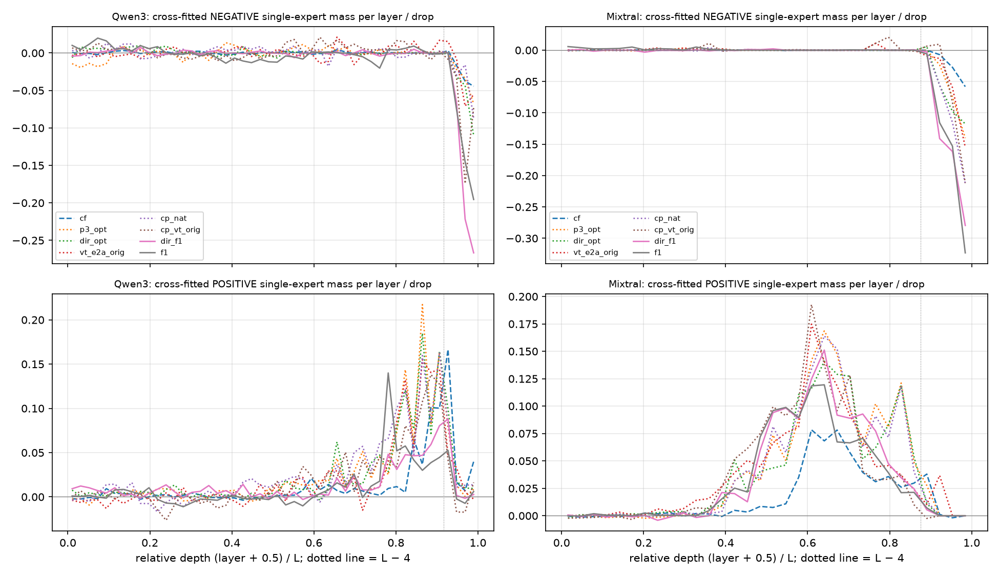
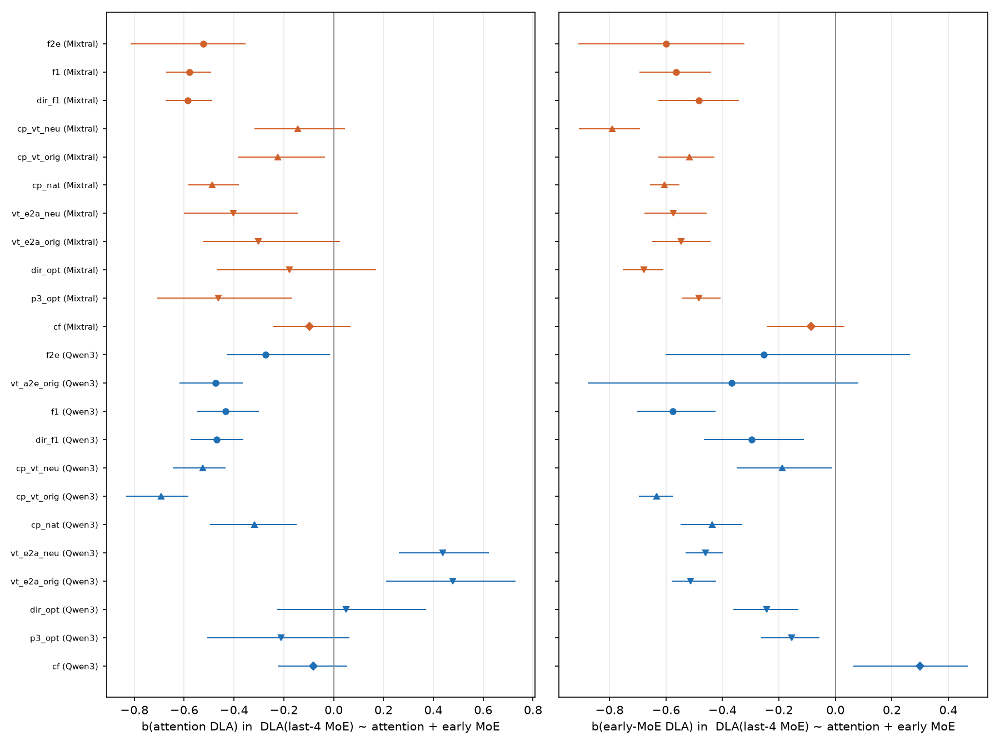
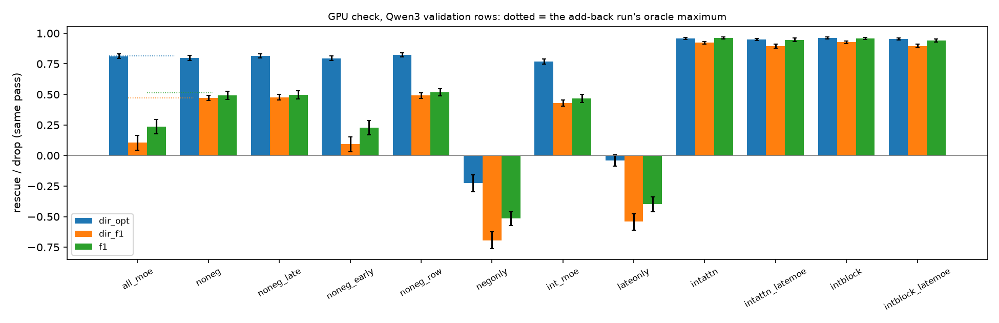

**Summary.** Why the expert add-back curves have different shapes (P5-4; agent p5-synth; validation cases of every add-back run, Qwen3-30B-A3B-Base and Mixtral-8x7B with BOS, STR, final position). The overshoot of the oracle add-back curve over the all-MoE ceiling M is, condition by condition, the late-MoE term M(≤ L−5) − M: across the 23 main-family conditions of both models Pearson r = +0.98 [+0.93, +1.00] (slope 0.89), and inside every condition that overshoots by ≥ 0.15 the per-case overshoot tracks the per-case late term (r 0.88–1.00). Every task has experts with a negative single-expert effect, and the cross-fitted negative mass sits in the last four layers (last-four-layer over total negative mass: median 1.03 over the conditions with a clear negative mass; the earlier layers net to about zero), where it writes against the answer directly (DLA / total of the negative set in the last four layers 0.77–1.83). The option swap has such experts too (Mixtral −N in the last four layers +0.24 [+0.20, +0.27]), yet it does not overshoot (+0.03 [+0.01, +0.04]), so the negative experts alone do not decide the shape. What decides it is where the answer evidence they react to comes from: the late MoE writes against the answer in proportion to the evidence already in the residual (per-case regression of the last-four-layer MoE DLA: median coefficient -0.40 per logit of attention DLA, CI below zero in 14 of 21 conditions; -0.51 per logit of earlier-MoE DLA, CI below zero in 19 of 21; CounterFact excluded). An expert-only add-back restores the MoE-written evidence but not the attention-written evidence, so when attention writes much of the answer (attribute → entity, CounterFact) the ceiling M contains the late experts' clean reaction to evidence the patched run does not carry, and any subset that leaves the late negatives at their recomputed values overshoots M (f1 +0.28 [+0.23, +0.32] Qwen3, +0.40 [+0.33, +0.46] Mixtral); when the MoE writes the answer (option swap) the recomputed late experts react as in the clean run and nothing is gained (Qwen3 +0.00 [-0.01, +0.01]). Across conditions the overshoot also tracks the direct attention share (r +0.88 [+0.81, +0.96]). GPU check (Qwen3 f1): adding back every expert except the discovery-negative ones gives 0.492 [0.459, 0.525] vs M 0.238 [0.177, 0.296] (oracle maximum 0.512); excluding only the last-four-layer negatives gives 0.496 [0.462, 0.530], excluding only the earlier ones 0.229 [0.170, 0.287]; and the late MoE's mismatch (recomputed − clean) is +0.228 [+0.189, +0.269] when only the MoE upstream is restored but +0.018 [+0.011, +0.025] when attention and MoE upstream are restored. In the option swap (dir_opt) the same negative set patched alone costs -0.226 [-0.296, -0.158], yet leaving it out of the full expert patch changes nothing (-0.016 [-0.031, -0.003]): recomputed in a run whose earlier experts are clean, these experts produce their clean anti-answer output again.

### What was computed

Runs: every add-back run with a complete A0 / A1 set (`results/p5_<cond>_<proto>[_rep]_ab`, Phase 3 `results/{qwen3,mixtral_bos}_str_addback` (CounterFact) and `results/wino_{qwen3,mixtral_bos}_str_addback` (option swap)), their source runs' single-expert rows (`str_expert_rows`, all layers, discovery and validation), the add-back runs' expert DLA (`addback_dla`) and the source runs' per-layer DLA (`dla_rows`). Per condition, on the validation cases (ratios = sum over cases / sum of drops; unit-cluster bootstrap, 5,000 resamples, seed 0):

- **overshoot**: max_k r_oracle(k) - M (population curve: sum of rescues / sum of drops; oracle = each case's own single-expert ranking).
- **late**: M(<= L-5) - M: A0 'int_moe' minus 'all_moe'; > 0 = the last four MoE layers (at their clean values) work against the answer.
- **N**: cross-fitted negative single-expert mass: validation sum of the singles of the (layer, expert) pairs whose discovery all-case population effect is < 0, / drop.
- **D**: DLA of delta_e (final norm frozen at the corrupted run), same sets / bands, / drop.
- **compensation**: per case OLS y = DLA(last-4 MoE outputs) ~ x_A = DLA(all attention outputs) + x_M = DLA(MoE outputs below L-4 + embedding), logits; base run dla_rows (exact); CounterFact: addback_direct + clean-active expert DLA (approximation).
- Why cross-fitted: a single-expert rescue carries bf16 noise (SD ≈ 0.17 logits per single in Qwen3, ≈ 0.12 in Mixtral's early layers) and a Qwen3 row has 384 singles, so 'the sum of a row's negative singles' is mostly noise (the 'Nrow' column of the CSV: −1.7 to −4.6 of the drop in Qwen3). Fixing each (layer, expert)'s sign on the discovery cases and summing on the validation cases removes that selection bias; experts unseen in discovery (U) carry ≤ 0.02 of the drop.
- GPU check (`scripts/ext13syn_gpucheck.py`, one queued job, Qwen3 f1 / dir_f1 / dir_opt validation rows, engine kind `multi` read-only): every expert := clean except the discovery-negative set (noneg), the same restricted to the last four or to the earlier layers, the negative set alone, the row's own negative singles, the last four MoE layers alone, and attention (+ MoE) restored below L−4 with or without the late MoE at clean values (reaction test). All values same pass.

### 1. The overshoot is the late-MoE term

**Add-back curve shape per condition (validation cases; fraction of the drop; unit-cluster bootstrap 95% CIs)**

| Model | Condition | Cases (units) | All-MoE M | Oracle max r (k*) | Overshoot | Late MoE: M(≤L−5) − M | −N (cross-fitted neg. singles) | −N in last 4 layers | D/T of neg. set, last 4 | All experts, last 4: T / D | Σ singles (P+N+U) | A_direct | Attention share |
|---|---|---|---|---|---|---|---|---|---|---|---|---|---|
| Qwen3 | cf | 108 (108) | 0.531 [0.489, 0.570] | 0.607 (320) | +0.076 [+0.058, +0.096] | -0.098 [-0.128, -0.072] | +0.082 [+0.020, +0.142] | +0.095 [+0.063, +0.126] | 1.36 | +0.136 / +0.114 | 0.59 | 0.50 [0.46, 0.54] | 0.54 [0.51, 0.57] |
| Qwen3 | p3_opt | 256 (128) | 0.843 [0.827, 0.859] | 0.846 (320) | +0.003 [-0.006, +0.013] | -0.035 [-0.043, -0.027] | +0.130 [-0.057, +0.328] | +0.122 [+0.087, +0.159] | 1.20 | -0.022 / -0.004 | 1.09 | 0.05 [0.02, 0.08] | 0.16 [0.13, 0.20] |
| Qwen3 | dir_opt | 180 (90) | 0.814 [0.797, 0.833] | 0.815 (320) | +0.000 [-0.009, +0.010] | -0.042 [-0.053, -0.031] | +0.139 [-0.059, +0.333] | +0.186 [+0.139, +0.235] | 1.30 | -0.050 / -0.023 | 1.05 | 0.05 [0.02, 0.08] | 0.19 [0.16, 0.24] |
| Qwen3 | vt_e2a_orig | 256 (128) | 0.824 [0.811, 0.837] | 0.819 (320) | -0.005 [-0.016, +0.007] | -0.039 [-0.052, -0.026] | +0.082 [-0.061, +0.235] | +0.119 [+0.086, +0.155] | 1.12 | -0.029 / -0.068 | 0.88 | 0.13 [0.08, 0.17] | 0.28 [0.20, 0.36] |
| Qwen3 | vt_e2a_neu | 256 (128) | 0.816 [0.800, 0.831] | 0.820 (320) | +0.004 [-0.006, +0.014] | -0.038 [-0.055, -0.022] | -0.107 [-0.250, +0.035] | +0.067 [+0.028, +0.109] | 1.51 | +0.006 / -0.030 | 1.46 | 0.13 [0.05, 0.19] | 0.22 [0.17, 0.30] |
| Qwen3 | cp_nat | 280 (140) | 0.787 [0.768, 0.806] | 0.783 (384) | -0.004 [-0.013, +0.009] | -0.036 [-0.045, -0.027] | +0.058 [-0.056, +0.177] | +0.132 [+0.100, +0.167] | 1.34 | -0.011 / -0.009 | 1.21 | -0.01 [-0.07, 0.04] | 0.21 [0.20, 0.24] |
| Qwen3 | cp_vt_orig | 256 (128) | 0.699 [0.664, 0.733] | 0.764 (320) | +0.065 [+0.045, +0.087] | +0.042 [+0.019, +0.066] | +0.161 [-0.009, +0.337] | +0.288 [+0.229, +0.347] | 1.00 | -0.269 / -0.309 | 0.75 | 0.11 [-0.01, 0.28] | 0.31 [0.26, 0.38] |
| Qwen3 | cp_vt_neu | 256 (128) | 0.737 [0.706, 0.767] | 0.770 (320) | +0.033 [+0.017, +0.050] | +0.003 [-0.015, +0.022] | +0.139 [-0.017, +0.303] | +0.129 [+0.097, +0.161] | 0.77 | -0.099 / -0.065 | 0.72 | 0.09 [-0.10, 0.27] | 0.26 [0.23, 0.38] |
| Qwen3 | dir_f1 | 180 (90) | 0.097 [0.032, 0.159] | 0.472 (320) | +0.375 [+0.331, +0.423] | +0.332 [+0.282, +0.384] | +0.544 [+0.429, +0.664] | +0.555 [+0.490, +0.622] | 1.21 | -0.465 / -0.510 | 0.15 | 1.08 [1.00, 1.17] | 0.71 [0.68, 0.73] |
| Qwen3 | f1 | 256 (128) | 0.236 [0.174, 0.295] | 0.512 (320) | +0.276 [+0.235, +0.322] | +0.232 [+0.191, +0.275] | +0.434 [+0.253, +0.614] | +0.416 [+0.368, +0.464] | 1.20 | -0.365 / -0.393 | 0.09 | 1.20 [1.14, 1.26] | 0.76 [0.73, 0.77] |
| Qwen3 | vt_a2e_orig | 74 (37) | 0.197 [0.151, 0.242] | 0.480 (320) | +0.283 [+0.243, +0.327] | +0.290 [+0.253, +0.332] | +0.511 [-0.309, +1.400] | +0.470 [+0.402, +0.542] | 1.14 | -0.441 / -0.526 | -0.19 | 1.47 [1.34, 1.55] | 0.79 [0.64, 0.80] |
| Qwen3 | f2e | 64 (32) | 0.211 [0.051, 0.359] | 0.465 (192) | +0.254 [+0.157, +0.378] | +0.214 [+0.133, +0.316] | +0.408 [-0.066, +0.893] | +0.379 [+0.282, +0.498] | 1.10 | -0.320 / -0.324 | -0.10 | 0.99 [0.87, 1.12] | 0.69 [0.60, 0.75] |
| Qwen3 | cp_nat [rep] | 316 (158) | 0.756 [0.736, 0.776] | 0.767 (320) | +0.011 [-0.002, +0.024] | -0.020 [-0.029, -0.010] | +0.186 [+0.081, +0.298] | +0.158 [+0.124, +0.192] | 1.31 | -0.066 / -0.047 | 0.79 | -0.02 [-0.08, 0.04] | 0.23 [0.21, 0.27] |
| Qwen3 | f1 [rep] | 256 (128) | 0.170 [0.107, 0.230] | 0.475 (320) | +0.305 [+0.266, +0.349] | +0.268 [+0.230, +0.310] | +0.439 [+0.227, +0.636] | +0.442 [+0.399, +0.489] | 1.26 | -0.410 / -0.446 | -0.08 | 1.20 [1.14, 1.26] | 0.78 [0.75, 0.80] |
| Mixtral | cf | 106 (106) | 0.409 [0.367, 0.451] | 0.517 (48) | +0.108 [+0.080, +0.136] | +0.099 [+0.073, +0.125] | +0.093 [+0.065, +0.121] | +0.093 [+0.065, +0.121] | 1.25 | -0.055 / -0.094 | 0.47 | 0.63 [0.60, 0.66] | 0.58 [0.55, 0.60] |
| Mixtral | p3_opt | 256 (128) | 0.787 [0.764, 0.809] | 0.813 (48) | +0.026 [+0.015, +0.037] | +0.023 [+0.012, +0.035] | +0.234 [+0.195, +0.270] | +0.238 [+0.201, +0.273] | 1.23 | -0.211 / -0.277 | 1.08 | 0.29 [0.27, 0.31] | 0.34 [0.33, 0.36] |
| Mixtral | dir_opt | 188 (94) | 0.755 [0.731, 0.777] | 0.788 (48) | +0.034 [+0.022, +0.047] | +0.035 [+0.021, +0.050] | +0.257 [+0.210, +0.302] | +0.266 [+0.220, +0.309] | 1.36 | -0.256 / -0.351 | 0.98 | 0.31 [0.29, 0.33] | 0.35 [0.33, 0.36] |
| Mixtral | vt_e2a_orig | 256 (128) | 0.677 [0.643, 0.708] | 0.746 (48) | +0.069 [+0.046, +0.093] | +0.065 [+0.044, +0.088] | +0.212 [+0.177, +0.249] | +0.237 [+0.202, +0.273] | 1.28 | -0.196 / -0.279 | 1.06 | 0.38 [0.31, 0.47] | 0.41 [0.36, 0.46] |
| Mixtral | vt_e2a_neu | 256 (128) | 0.626 [0.587, 0.664] | 0.730 (48) | +0.104 [+0.075, +0.134] | +0.102 [+0.075, +0.130] | +0.185 [+0.155, +0.218] | +0.240 [+0.204, +0.277] | 1.23 | -0.255 / -0.339 | 0.98 | 0.42 [0.32, 0.55] | 0.42 [0.37, 0.48] |
| Mixtral | cp_nat | 408 (204) | 0.733 [0.710, 0.754] | 0.802 (48) | +0.069 [+0.057, +0.081] | +0.074 [+0.062, +0.087] | +0.380 [+0.355, +0.404] | +0.385 [+0.363, +0.406] | 1.33 | -0.372 / -0.502 | 0.92 | 0.38 [0.34, 0.41] | 0.37 [0.36, 0.39] |
| Mixtral | cp_vt_orig | 256 (128) | 0.543 [0.496, 0.584] | 0.740 (48) | +0.197 [+0.167, +0.232] | +0.197 [+0.168, +0.231] | +0.236 [+0.192, +0.278] | +0.279 [+0.235, +0.323] | 1.72 | -0.294 / -0.535 | 1.02 | 0.47 [0.39, 0.60] | 0.39 [0.33, 0.47] |
| Mixtral | cp_vt_neu | 256 (128) | 0.461 [0.436, 0.487] | 0.730 (48) | +0.269 [+0.251, +0.288] | +0.251 [+0.229, +0.272] | +0.257 [+0.218, +0.293] | +0.326 [+0.296, +0.355] | 1.83 | -0.328 / -0.617 | 0.98 | 0.43 [0.37, 0.52] | 0.38 [0.33, 0.42] |
| Mixtral | dir_f1 | 188 (94) | 0.409 [0.356, 0.459] | 0.681 (48) | +0.272 [+0.234, +0.314] | +0.292 [+0.253, +0.336] | +0.585 [+0.524, +0.646] | +0.585 [+0.529, +0.640] | 1.45 | -0.588 / -0.853 | 0.54 | 0.86 [0.77, 0.95] | 0.52 [0.50, 0.54] |
| Mixtral | f1 | 202 (101) | 0.229 [0.135, 0.322] | 0.627 (48) | +0.398 [+0.334, +0.465] | +0.412 [+0.349, +0.477] | +0.562 [+0.495, +0.629] | +0.598 [+0.542, +0.656] | 1.48 | -0.591 / -0.858 | 0.45 | 1.01 [0.91, 1.12] | 0.56 [0.53, 0.59] |
| Mixtral | f2e | 36 (18) | -0.051 [-0.325, 0.198] | 0.506 (48) | +0.557 [+0.382, +0.767] | +0.576 [+0.405, +0.780] | +0.621 [+0.480, +0.783] | +0.675 [+0.562, +0.806] | 1.39 | -0.675 / -0.936 | 0.15 | 1.35 [1.16, 1.55] | 0.65 [0.59, 0.70] |
| Mixtral | cp_nat [rep] | 444 (222) | 0.706 [0.688, 0.724] | 0.779 (48) | +0.072 [+0.062, +0.083] | +0.080 [+0.070, +0.090] | +0.364 [+0.340, +0.388] | +0.377 [+0.355, +0.400] | 1.31 | -0.378 / -0.506 | 0.89 | 0.41 [0.38, 0.43] | 0.38 [0.37, 0.40] |

- both models (23 conditions): -N r +0.86 [+0.74, +0.93]; -N_late r +0.89 [+0.77, +0.95]; late r +0.98 [+0.93, +1.00]; -T_late r +0.85 [+0.70, +0.94]; -DT_late r +0.84 [+0.67, +0.93]; A_direct r +0.88 [+0.81, +0.96]; share r +0.78 [+0.67, +0.90]; M r -0.95 [-0.98, -0.89].
- Qwen3 (12 conditions): -N r +0.94 [+0.82, +0.99]; -N_late r +0.95 [+0.80, +0.99]; late r +0.96 [+0.82, +1.00]; -T_late r +0.88 [+0.64, +0.99]; -DT_late r +0.88 [+0.68, +0.99]; A_direct r +0.94 [+0.90, +0.99]; share r +0.94 [+0.87, +1.00]; M r -0.99 [-1.00, -0.96].
- Mixtral (11 conditions): -N r +0.78 [+0.22, +0.93]; -N_late r +0.83 [+0.42, +0.95]; late r +1.00 [+0.99, +1.00]; -T_late r +0.84 [+0.42, +0.96]; -DT_late r +0.87 [+0.67, +0.98]; A_direct r +0.92 [+0.55, +0.99]; share r +0.76 [+0.12, +0.98]; M r -0.95 [-1.00, -0.74].

Reading. M is the all-MoE ceiling and the oracle maximum sits at k* = 320 of 384 (Qwen3) or 48 of 64 (Mixtral), i.e. just before the most negative singles of the row enter. M(≤ L−5) − M compares the same expert patch with and without the last four MoE layers forced to their clean values; it is the overshoot's counterpart in a single joint patch. The two agree within about 0.05 everywhere except Qwen3 CounterFact, where the last four layers also hold the positive factual expert L44E069 (late term -0.10 [-0.13, -0.07], but the negative experts inside that band still give −N +0.10 [+0.06, +0.13] and the overshoot +0.08 [+0.06, +0.10]).

### 2. Where the negative experts are, and how they write

**Cross-fitted negative (N) / positive (P) single-expert mass and all experts (T) by depth band, with their direct parts (D)**

| Model | Condition | Band | N / drop | DN / drop | P / drop | T (all) / drop | DT (all) / drop |
|---|---|---|---|---|---|---|---|
| Qwen3 | cf | first half | +0.005 | -0.003 | +0.015 | +0.022 | -0.002 |
| Qwen3 | cf | L/2..L-9 | +0.009 | +0.006 | +0.115 | +0.126 | +0.072 |
| Qwen3 | cf | L-8..L-5 | -0.001 | +0.000 | +0.303 | +0.303 | +0.288 |
| Qwen3 | cf | last 4 | -0.095 | -0.130 | +0.230 | +0.136 | +0.114 |
| Qwen3 | p3_opt | first half | -0.059 | +0.012 | +0.049 | -0.009 | +0.025 |
| Qwen3 | p3_opt | L/2..L-9 | +0.051 | +0.029 | +0.545 | +0.597 | +0.337 |
| Qwen3 | p3_opt | L-8..L-5 | -0.000 | +0.001 | +0.522 | +0.524 | +0.575 |
| Qwen3 | p3_opt | last 4 | -0.122 | -0.146 | +0.100 | -0.022 | -0.004 |
| Qwen3 | dir_opt | first half | +0.059 | +0.016 | +0.076 | +0.131 | +0.049 |
| Qwen3 | dir_opt | L/2..L-9 | -0.013 | +0.002 | +0.477 | +0.463 | +0.322 |
| Qwen3 | dir_opt | L-8..L-5 | +0.002 | +0.003 | +0.496 | +0.503 | +0.585 |
| Qwen3 | dir_opt | last 4 | -0.186 | -0.243 | +0.136 | -0.050 | -0.023 |
| Qwen3 | vt_e2a_orig | first half | -0.002 | +0.009 | -0.039 | -0.048 | +0.027 |
| Qwen3 | vt_e2a_orig | L/2..L-9 | +0.004 | +0.071 | +0.416 | +0.420 | +0.324 |
| Qwen3 | vt_e2a_orig | L-8..L-5 | +0.035 | +0.024 | +0.492 | +0.533 | +0.573 |
| Qwen3 | vt_e2a_orig | last 4 | -0.119 | -0.133 | +0.083 | -0.029 | -0.068 |
| Qwen3 | vt_e2a_neu | first half | +0.055 | +0.001 | +0.127 | +0.189 | +0.030 |
| Qwen3 | vt_e2a_neu | L/2..L-9 | +0.109 | +0.037 | +0.660 | +0.781 | +0.349 |
| Qwen3 | vt_e2a_neu | L-8..L-5 | +0.010 | +0.006 | +0.480 | +0.484 | +0.507 |
| Qwen3 | vt_e2a_neu | last 4 | -0.067 | -0.102 | +0.035 | +0.006 | -0.030 |
| Qwen3 | cp_nat | first half | +0.065 | +0.014 | +0.063 | +0.129 | +0.031 |
| Qwen3 | cp_nat | L/2..L-9 | +0.008 | +0.060 | +0.617 | +0.637 | +0.400 |
| Qwen3 | cp_nat | L-8..L-5 | +0.001 | -0.006 | +0.454 | +0.459 | +0.559 |
| Qwen3 | cp_nat | last 4 | -0.132 | -0.177 | +0.120 | -0.011 | -0.009 |
| Qwen3 | cp_vt_orig | first half | -0.012 | +0.017 | -0.052 | -0.069 | +0.059 |
| Qwen3 | cp_vt_orig | L/2..L-9 | +0.148 | +0.048 | +0.469 | +0.645 | +0.347 |
| Qwen3 | cp_vt_orig | L-8..L-5 | -0.009 | +0.026 | +0.439 | +0.440 | +0.765 |
| Qwen3 | cp_vt_orig | last 4 | -0.288 | -0.287 | +0.024 | -0.269 | -0.309 |
| Qwen3 | cp_vt_neu | first half | -0.054 | +0.006 | -0.017 | -0.064 | +0.050 |
| Qwen3 | cp_vt_neu | L/2..L-9 | +0.028 | +0.050 | +0.386 | +0.407 | +0.286 |
| Qwen3 | cp_vt_neu | L-8..L-5 | +0.016 | +0.017 | +0.436 | +0.477 | +0.623 |
| Qwen3 | cp_vt_neu | last 4 | -0.129 | -0.099 | +0.031 | -0.099 | -0.065 |
| Qwen3 | dir_f1 | first half | +0.020 | +0.000 | +0.140 | +0.158 | -0.001 |
| Qwen3 | dir_f1 | L/2..L-9 | -0.013 | -0.000 | +0.218 | +0.214 | +0.041 |
| Qwen3 | dir_f1 | L-8..L-5 | +0.005 | +0.005 | +0.233 | +0.247 | +0.374 |
| Qwen3 | dir_f1 | last 4 | -0.555 | -0.675 | +0.091 | -0.465 | -0.510 |
| Qwen3 | f1 | first half | +0.021 | +0.000 | -0.015 | +0.011 | +0.001 |
| Qwen3 | f1 | L/2..L-9 | -0.050 | +0.002 | +0.319 | +0.280 | +0.013 |
| Qwen3 | f1 | L-8..L-5 | +0.010 | +0.010 | +0.155 | +0.167 | +0.182 |
| Qwen3 | f1 | last 4 | -0.416 | -0.499 | +0.049 | -0.365 | -0.393 |
| Qwen3 | vt_a2e_orig | first half | -0.030 | -0.004 | -0.010 | -0.041 | -0.002 |
| Qwen3 | vt_a2e_orig | L/2..L-9 | -0.011 | +0.008 | +0.223 | +0.227 | +0.011 |
| Qwen3 | vt_a2e_orig | L-8..L-5 | +0.000 | +0.001 | +0.068 | +0.062 | +0.022 |
| Qwen3 | vt_a2e_orig | last 4 | -0.470 | -0.536 | +0.035 | -0.441 | -0.526 |
| Qwen3 | f2e | first half | -0.040 | -0.000 | -0.035 | -0.086 | +0.001 |
| Qwen3 | f2e | L/2..L-9 | +0.001 | +0.030 | +0.133 | +0.108 | +0.055 |
| Qwen3 | f2e | L-8..L-5 | +0.010 | +0.007 | +0.178 | +0.198 | +0.252 |
| Qwen3 | f2e | last 4 | -0.379 | -0.418 | +0.065 | -0.320 | -0.324 |
| Qwen3 | cp_nat [rep] | first half | -0.023 | +0.014 | +0.009 | -0.019 | +0.044 |
| Qwen3 | cp_nat [rep] | L/2..L-9 | -0.015 | +0.041 | +0.498 | +0.482 | +0.427 |
| Qwen3 | cp_nat [rep] | L-8..L-5 | +0.009 | +0.007 | +0.380 | +0.390 | +0.554 |
| Qwen3 | cp_nat [rep] | last 4 | -0.158 | -0.207 | +0.090 | -0.066 | -0.047 |
| Qwen3 | f1 [rep] | first half | +0.002 | -0.001 | -0.046 | -0.044 | +0.000 |
| Qwen3 | f1 [rep] | L/2..L-9 | +0.005 | +0.002 | +0.258 | +0.262 | +0.018 |
| Qwen3 | f1 [rep] | L-8..L-5 | -0.003 | +0.018 | +0.109 | +0.112 | +0.222 |
| Qwen3 | f1 [rep] | last 4 | -0.442 | -0.557 | +0.033 | -0.410 | -0.446 |
| Mixtral | cf | first half | +0.000 | +0.001 | +0.022 | +0.023 | +0.010 |
| Mixtral | cf | L/2..L-9 | -0.000 | +0.000 | +0.376 | +0.375 | +0.300 |
| Mixtral | cf | L-8..L-5 | +0.000 | +0.000 | +0.123 | +0.123 | +0.105 |
| Mixtral | cf | last 4 | -0.093 | -0.116 | +0.037 | -0.055 | -0.094 |
| Mixtral | p3_opt | first half | +0.004 | +0.001 | +0.109 | +0.112 | +0.029 |
| Mixtral | p3_opt | L/2..L-9 | +0.000 | +0.000 | +0.831 | +0.832 | +0.492 |
| Mixtral | p3_opt | L-8..L-5 | -0.000 | -0.001 | +0.353 | +0.352 | +0.433 |
| Mixtral | p3_opt | last 4 | -0.238 | -0.293 | +0.028 | -0.211 | -0.277 |
| Mixtral | dir_opt | first half | +0.008 | +0.001 | +0.143 | +0.153 | +0.059 |
| Mixtral | dir_opt | L/2..L-9 | +0.000 | +0.000 | +0.766 | +0.767 | +0.542 |
| Mixtral | dir_opt | L-8..L-5 | +0.000 | +0.000 | +0.318 | +0.317 | +0.405 |
| Mixtral | dir_opt | last 4 | -0.266 | -0.360 | +0.011 | -0.256 | -0.351 |
| Mixtral | vt_e2a_orig | first half | +0.014 | +0.001 | +0.215 | +0.240 | +0.039 |
| Mixtral | vt_e2a_orig | L/2..L-9 | +0.000 | +0.000 | +0.819 | +0.850 | +0.617 |
| Mixtral | vt_e2a_orig | L-8..L-5 | +0.011 | +0.011 | +0.151 | +0.169 | +0.211 |
| Mixtral | vt_e2a_orig | last 4 | -0.237 | -0.304 | +0.047 | -0.196 | -0.279 |
| Mixtral | vt_e2a_neu | first half | +0.005 | +0.005 | +0.145 | +0.152 | +0.041 |
| Mixtral | vt_e2a_neu | L/2..L-9 | +0.040 | +0.052 | +0.838 | +0.907 | +0.627 |
| Mixtral | vt_e2a_neu | L-8..L-5 | +0.011 | +0.012 | +0.154 | +0.175 | +0.230 |
| Mixtral | vt_e2a_neu | last 4 | -0.240 | -0.296 | +0.001 | -0.255 | -0.339 |
| Mixtral | cp_nat | first half | +0.004 | +0.002 | +0.121 | +0.126 | +0.033 |
| Mixtral | cp_nat | L/2..L-9 | +0.000 | +0.000 | +0.846 | +0.847 | +0.584 |
| Mixtral | cp_nat | L-8..L-5 | +0.000 | +0.000 | +0.321 | +0.321 | +0.479 |
| Mixtral | cp_nat | last 4 | -0.385 | -0.510 | +0.013 | -0.372 | -0.502 |
| Mixtral | cp_vt_orig | first half | +0.012 | +0.002 | +0.225 | +0.239 | +0.046 |
| Mixtral | cp_vt_orig | L/2..L-9 | +0.001 | +0.002 | +0.891 | +0.933 | +0.815 |
| Mixtral | cp_vt_orig | L-8..L-5 | +0.030 | +0.043 | +0.113 | +0.147 | +0.168 |
| Mixtral | cp_vt_orig | last 4 | -0.279 | -0.480 | -0.002 | -0.294 | -0.535 |
| Mixtral | cp_vt_neu | first half | +0.000 | +0.003 | +0.190 | +0.197 | +0.061 |
| Mixtral | cp_vt_neu | L/2..L-9 | +0.003 | +0.003 | +0.968 | +1.017 | +0.930 |
| Mixtral | cp_vt_neu | L-8..L-5 | +0.066 | +0.080 | +0.025 | +0.096 | +0.166 |
| Mixtral | cp_vt_neu | last 4 | -0.326 | -0.597 | -0.002 | -0.328 | -0.617 |
| Mixtral | dir_f1 | first half | -0.004 | -0.000 | +0.109 | +0.102 | +0.006 |
| Mixtral | dir_f1 | L/2..L-9 | +0.002 | +0.000 | +0.830 | +0.836 | +0.618 |
| Mixtral | dir_f1 | L-8..L-5 | +0.001 | +0.003 | +0.184 | +0.185 | +0.345 |
| Mixtral | dir_f1 | last 4 | -0.585 | -0.847 | +0.005 | -0.588 | -0.853 |
| Mixtral | f1 | first half | +0.034 | +0.000 | +0.145 | +0.178 | +0.010 |
| Mixtral | f1 | L/2..L-9 | +0.001 | +0.001 | +0.727 | +0.728 | +0.499 |
| Mixtral | f1 | L-8..L-5 | +0.000 | +0.001 | +0.136 | +0.137 | +0.313 |
| Mixtral | f1 | last 4 | -0.598 | -0.888 | +0.007 | -0.591 | -0.858 |
| Mixtral | f2e | first half | +0.045 | +0.001 | +0.191 | +0.239 | +0.007 |
| Mixtral | f2e | L/2..L-9 | +0.005 | +0.003 | +0.510 | +0.522 | +0.471 |
| Mixtral | f2e | L-8..L-5 | +0.004 | +0.015 | +0.048 | +0.059 | +0.120 |
| Mixtral | f2e | last 4 | -0.675 | -0.936 | +0.001 | -0.675 | -0.936 |
| Mixtral | cp_nat [rep] | first half | +0.013 | +0.002 | +0.139 | +0.152 | +0.038 |
| Mixtral | cp_nat [rep] | L/2..L-9 | +0.000 | +0.000 | +0.821 | +0.823 | +0.592 |
| Mixtral | cp_nat [rep] | L-8..L-5 | +0.000 | +0.000 | +0.292 | +0.293 | +0.435 |
| Mixtral | cp_nat [rep] | last 4 | -0.377 | -0.495 | -0.000 | -0.378 | -0.506 |

The cross-fitted negative mass is concentrated in the last four layers in every condition and model (Qwen3 L44–L47, Mixtral L28–L31); earlier bands net to about zero once noise is not selected. Its DLA is about as large as or larger than its total effect (D/T 0.77–1.83), so these experts write against the answer directly at the final position, and the layers after them do not add to it (if anything they undo a part). The same experts are present in the option swap: Mixtral's last four layers write -0.21 of the drop (all experts; DLA -0.28) in the option swap and -0.59 (DLA -0.86) in f1. This matches the writer section's depth bands (`ext13_writer.md`: the last four layers' summed writes are negative with D/T ≈ 1–1.7 wherever their net write is clearly negative) and Phase 3's observation of a small negative last-layer MoE in every task (ext7_controls reading 2).

### 3. Per case

**Per-case relations within each condition (Pearson r, unit bootstrap 95% CI)**

| Model | Condition | Cases | SD of case overshoot at k* | r(overshoot, −N) | r(overshoot, −N late) | r(overshoot, late) | r(late, −N late) | r(late, −T late) | r(overshoot, A_direct) | r(late, A_direct) |
|---|---|---|---|---|---|---|---|---|---|---|
| Qwen3 | cf | 108 | 0.113 | +0.19 [+0.01, +0.38] | +0.45 [+0.23, +0.64] | +0.56 [+0.39, +0.71] | +0.47 [+0.20, +0.67] | +0.46 [+0.26, +0.63] | +0.62 [+0.50, +0.74] | +0.52 [+0.40, +0.63] |
| Qwen3 | p3_opt | 256 | 0.078 | +0.18 [+0.01, +0.35] | +0.15 [+0.01, +0.28] | +0.39 [+0.28, +0.51] | +0.16 [+0.03, +0.29] | +0.19 [+0.03, +0.33] | +0.16 [+0.03, +0.28] | +0.21 [+0.05, +0.37] |
| Qwen3 | dir_opt | 180 | 0.073 | +0.08 [-0.07, +0.24] | +0.22 [+0.09, +0.36] | +0.37 [+0.19, +0.55] | +0.29 [+0.09, +0.46] | +0.29 [+0.11, +0.43] | +0.08 [-0.09, +0.24] | -0.12 [-0.32, +0.11] |
| Qwen3 | vt_e2a_orig | 256 | 0.086 | -0.07 [-0.21, +0.08] | +0.15 [+0.04, +0.25] | +0.43 [+0.32, +0.53] | +0.39 [+0.28, +0.49] | +0.42 [+0.31, +0.52] | +0.08 [-0.01, +0.17] | -0.12 [-0.26, +0.04] |
| Qwen3 | vt_e2a_neu | 256 | 0.082 | +0.08 [-0.05, +0.20] | +0.12 [-0.02, +0.26] | +0.35 [+0.23, +0.47] | +0.41 [+0.32, +0.51] | +0.43 [+0.33, +0.53] | +0.16 [+0.05, +0.28] | +0.13 [-0.02, +0.28] |
| Qwen3 | cp_nat | 280 | 0.078 | -0.11 [-0.30, +0.10] | +0.13 [-0.05, +0.32] | -0.00 [-0.17, +0.17] | +0.18 [+0.02, +0.35] | +0.27 [+0.13, +0.39] | -0.26 [-0.44, -0.06] | +0.43 [+0.24, +0.56] |
| Qwen3 | cp_vt_orig | 256 | 0.163 | -0.09 [-0.21, +0.04] | +0.03 [-0.10, +0.17] | +0.81 [+0.74, +0.86] | -0.02 [-0.15, +0.13] | +0.04 [-0.08, +0.17] | +0.26 [+0.11, +0.41] | +0.36 [+0.21, +0.51] |
| Qwen3 | cp_vt_neu | 256 | 0.165 | -0.20 [-0.33, -0.04] | +0.10 [-0.06, +0.26] | +0.79 [+0.67, +0.87] | +0.01 [-0.14, +0.17] | +0.15 [-0.00, +0.30] | +0.16 [+0.05, +0.28] | +0.22 [+0.10, +0.35] |
| Qwen3 | dir_f1 | 180 | 0.237 | +0.07 [-0.11, +0.28] | +0.39 [+0.24, +0.53] | +0.95 [+0.93, +0.96] | +0.41 [+0.26, +0.55] | +0.32 [+0.17, +0.47] | +0.55 [+0.40, +0.67] | +0.67 [+0.54, +0.76] |
| Qwen3 | f1 | 256 | 0.250 | +0.08 [-0.04, +0.20] | +0.48 [+0.38, +0.57] | +0.88 [+0.82, +0.92] | +0.53 [+0.42, +0.63] | +0.47 [+0.35, +0.57] | +0.45 [+0.30, +0.58] | +0.60 [+0.45, +0.71] |
| Qwen3 | vt_a2e_orig | 74 | 0.156 | -0.10 [-0.40, +0.28] | +0.30 [+0.01, +0.56] | +0.94 [+0.87, +0.97] | +0.35 [+0.08, +0.60] | +0.25 [+0.02, +0.50] | +0.57 [+0.31, +0.72] | +0.64 [+0.40, +0.77] |
| Qwen3 | f2e | 64 | 0.442 | +0.02 [-0.18, +0.30] | +0.74 [+0.38, +0.86] | +0.94 [+0.83, +0.97] | +0.81 [+0.58, +0.87] | +0.75 [+0.48, +0.84] | +0.28 [-0.04, +0.54] | +0.42 [+0.18, +0.65] |
| Qwen3 | cp_nat [rep] | 316 | 0.115 | +0.07 [-0.12, +0.24] | +0.12 [+0.01, +0.23] | +0.45 [+0.37, +0.53] | +0.33 [+0.19, +0.46] | +0.41 [+0.29, +0.52] | +0.04 [-0.08, +0.15] | +0.15 [+0.01, +0.29] |
| Qwen3 | f1 [rep] | 256 | 0.278 | +0.16 [+0.05, +0.27] | +0.49 [+0.37, +0.59] | +0.93 [+0.89, +0.95] | +0.50 [+0.39, +0.60] | +0.41 [+0.29, +0.52] | +0.58 [+0.42, +0.69] | +0.66 [+0.52, +0.75] |
| Mixtral | cf | 106 | 0.158 | +0.62 [+0.45, +0.74] | +0.69 [+0.57, +0.78] | +0.91 [+0.83, +0.95] | +0.77 [+0.69, +0.86] | +0.80 [+0.70, +0.87] | +0.75 [+0.64, +0.82] | +0.71 [+0.60, +0.80] |
| Mixtral | p3_opt | 256 | 0.089 | +0.40 [+0.27, +0.52] | +0.35 [+0.22, +0.47] | +0.88 [+0.80, +0.93] | +0.46 [+0.34, +0.57] | +0.48 [+0.37, +0.58] | +0.63 [+0.44, +0.75] | +0.72 [+0.57, +0.81] |
| Mixtral | dir_opt | 188 | 0.080 | +0.40 [+0.21, +0.54] | +0.43 [+0.25, +0.57] | +0.89 [+0.83, +0.94] | +0.61 [+0.49, +0.70] | +0.61 [+0.49, +0.71] | +0.50 [+0.32, +0.63] | +0.53 [+0.38, +0.65] |
| Mixtral | vt_e2a_orig | 256 | 0.139 | +0.45 [+0.34, +0.55] | +0.54 [+0.45, +0.63] | +0.94 [+0.90, +0.96] | +0.64 [+0.58, +0.71] | +0.58 [+0.51, +0.65] | +0.75 [+0.61, +0.83] | +0.78 [+0.66, +0.84] |
| Mixtral | vt_e2a_neu | 256 | 0.168 | +0.09 [+0.00, +0.18] | +0.50 [+0.39, +0.62] | +0.97 [+0.95, +0.98] | +0.55 [+0.45, +0.65] | +0.53 [+0.43, +0.62] | +0.81 [+0.70, +0.87] | +0.82 [+0.71, +0.87] |
| Mixtral | cp_nat | 408 | 0.097 | +0.27 [+0.16, +0.37] | +0.42 [+0.32, +0.52] | +0.94 [+0.93, +0.96] | +0.45 [+0.34, +0.55] | +0.51 [+0.42, +0.59] | +0.59 [+0.50, +0.68] | +0.68 [+0.61, +0.75] |
| Mixtral | cp_vt_orig | 256 | 0.231 | +0.33 [+0.21, +0.45] | +0.39 [+0.27, +0.51] | +0.97 [+0.96, +0.98] | +0.41 [+0.29, +0.52] | +0.41 [+0.29, +0.52] | +0.68 [+0.55, +0.78] | +0.72 [+0.60, +0.81] |
| Mixtral | cp_vt_neu | 256 | 0.152 | +0.57 [+0.50, +0.64] | +0.58 [+0.51, +0.65] | +0.94 [+0.92, +0.95] | +0.74 [+0.69, +0.80] | +0.74 [+0.69, +0.80] | +0.34 [+0.09, +0.53] | +0.41 [+0.17, +0.58] |
| Mixtral | dir_f1 | 188 | 0.256 | +0.40 [+0.27, +0.53] | +0.31 [+0.16, +0.47] | +0.98 [+0.96, +0.99] | +0.33 [+0.17, +0.49] | +0.36 [+0.21, +0.52] | +0.54 [+0.40, +0.66] | +0.56 [+0.43, +0.67] |
| Mixtral | f1 | 202 | 0.339 | +0.07 [-0.11, +0.24] | +0.19 [+0.00, +0.39] | +0.98 [+0.97, +0.99] | +0.22 [+0.03, +0.42] | +0.20 [+0.01, +0.41] | +0.52 [+0.38, +0.64] | +0.54 [+0.40, +0.65] |
| Mixtral | f2e | 36 | 0.458 | +0.65 [+0.37, +0.87] | +0.66 [+0.41, +0.85] | +1.00 [+0.99, +1.00] | +0.65 [+0.38, +0.85] | +0.65 [+0.38, +0.85] | +0.69 [+0.33, +0.91] | +0.70 [+0.34, +0.90] |
| Mixtral | cp_nat [rep] | 444 | 0.098 | +0.33 [+0.22, +0.44] | +0.38 [+0.26, +0.49] | +0.93 [+0.91, +0.95] | +0.41 [+0.29, +0.52] | +0.45 [+0.33, +0.56] | +0.49 [+0.40, +0.57] | +0.56 [+0.47, +0.63] |

Within a condition, the case-level overshoot at k* is almost the case-level late term (r 0.56–1.00 in the 15 conditions that overshoot by ≥ 0.05), and both correlate only moderately with the case's own cross-fitted late negative mass (r 0.03–0.74): which experts react varies across cases, but the late band as a whole carries the overshoot. The case-level direct attention share predicts the case-level overshoot (CI above zero) in 19 of 23 conditions; the exceptions are Qwen3 entity → attribute conditions with almost no attention write (A_direct ≤ 0.13): dir_opt Qwen3 (+0.08 [-0.09, +0.24]); f2e Qwen3 (+0.28 [-0.04, +0.54]); vt_e2a_orig Qwen3 (+0.08 [-0.01, +0.17]); cp_nat Qwen3 (-0.26 [-0.44, -0.06]).

### 4. Do the late experts react to the answer evidence? (compensation regression)

**Compensation regression per case: DLA of the last-4 MoE outputs on the DLA of all attention outputs and of the earlier MoE outputs (logits; clean minus corrupted)**

| Model | Condition | Source | Cases | Mean late-MoE DLA (logits) | Mean attention DLA | Mean early-MoE DLA | b(attention) | b(early MoE) | clean-only b(attention) / b(early MoE) |
|---|---|---|---|---|---|---|---|---|---|
| Qwen3 | cf | addback DLA (approximation) | 108 | +1.33 | +5.83 | +4.58 | -0.082 [-0.224, +0.055] | +0.299 [+0.063, +0.470] | n/a |
| Qwen3 | p3_opt | dla_rows (exact) | 256 | +0.05 | +0.34 | +7.79 | -0.211 [-0.506, +0.064] | -0.154 [-0.262, -0.057] | n/a |
| Qwen3 | dir_opt | dla_rows (exact) | 180 | -0.20 | +0.35 | +8.50 | +0.050 [-0.227, +0.370] | -0.243 [-0.361, -0.131] | n/a |
| Qwen3 | vt_e2a_orig | dla_rows (exact) | 256 | -0.52 | +0.86 | +6.16 | +0.478 [+0.211, +0.729] | -0.513 [-0.580, -0.422] | n/a |
| Qwen3 | vt_e2a_neu | dla_rows (exact) | 256 | -0.25 | +0.93 | +5.42 | +0.437 [+0.262, +0.622] | -0.459 [-0.530, -0.399] | n/a |
| Qwen3 | cp_nat | dla_rows (exact) | 280 | +0.00 | -0.11 | +6.09 | -0.318 [-0.496, -0.148] | -0.436 [-0.548, -0.329] | n/a |
| Qwen3 | cp_vt_orig | dla_rows (exact) | 256 | -1.77 | +0.70 | +6.64 | -0.693 [-0.834, -0.583] | -0.634 [-0.696, -0.576] | n/a |
| Qwen3 | cp_vt_neu | dla_rows (exact) | 256 | -0.42 | +0.53 | +5.48 | -0.526 [-0.645, -0.435] | -0.188 [-0.350, -0.010] | n/a |
| Qwen3 | dir_f1 | dla_rows (exact) | 180 | -2.64 | +5.60 | +2.25 | -0.470 [-0.573, -0.362] | -0.297 [-0.466, -0.112] | n/a |
| Qwen3 | f1 | dla_rows (exact) | 256 | -1.84 | +5.47 | +0.98 | -0.433 [-0.548, -0.300] | -0.575 [-0.701, -0.425] | n/a |
| Qwen3 | vt_a2e_orig | dla_rows (exact) | 74 | -1.93 | +5.42 | +0.16 | -0.475 [-0.618, -0.365] | -0.366 [-0.876, +0.082] | n/a |
| Qwen3 | f2e | dla_rows (exact) | 64 | -2.73 | +8.35 | +2.65 | -0.274 [-0.429, -0.014] | -0.253 [-0.601, +0.265] | n/a |
| Qwen3 | cp_nat [rep] | dla_rows (exact) | 316 | -0.23 | -0.13 | +6.26 | -0.377 [-0.483, -0.248] | -0.436 [-0.531, -0.324] | n/a |
| Qwen3 | f1 [rep] | dla_rows (exact) | 256 | -2.14 | +5.70 | +1.19 | -0.438 [-0.505, -0.363] | -0.501 [-0.627, -0.366] | n/a |
| Mixtral | cf | addback DLA (approximation) | 106 | -1.23 | +8.18 | +5.97 | -0.096 [-0.245, +0.067] | -0.085 [-0.241, +0.033] | n/a |
| Mixtral | p3_opt | dla_rows (exact) | 256 | -2.15 | +2.23 | +7.60 | -0.462 [-0.708, -0.167] | -0.483 [-0.545, -0.406] | n/a |
| Mixtral | dir_opt | dla_rows (exact) | 188 | -3.42 | +2.98 | +10.11 | -0.177 [-0.468, +0.170] | -0.679 [-0.753, -0.609] | n/a |
| Mixtral | vt_e2a_orig | dla_rows (exact) | 256 | -1.81 | +2.50 | +5.83 | -0.303 [-0.525, +0.025] | -0.547 [-0.650, -0.443] | n/a |
| Mixtral | vt_e2a_neu | dla_rows (exact) | 256 | -1.98 | +2.47 | +5.33 | -0.402 [-0.602, -0.143] | -0.573 [-0.677, -0.456] | n/a |
| Mixtral | cp_nat | dla_rows (exact) | 408 | -3.61 | +2.70 | +8.07 | -0.488 [-0.583, -0.379] | -0.606 [-0.656, -0.553] | n/a |
| Mixtral | cp_vt_orig | dla_rows (exact) | 256 | -2.76 | +2.39 | +5.63 | -0.225 [-0.384, -0.034] | -0.516 [-0.626, -0.428] | n/a |
| Mixtral | cp_vt_neu | dla_rows (exact) | 256 | -3.30 | +2.28 | +6.42 | -0.144 [-0.318, +0.044] | -0.790 [-0.908, -0.692] | n/a |
| Mixtral | dir_f1 | dla_rows (exact) | 188 | -4.13 | +3.99 | +4.79 | -0.585 [-0.674, -0.488] | -0.483 [-0.627, -0.343] | n/a |
| Mixtral | f1 | dla_rows (exact) | 202 | -3.84 | +4.42 | +3.74 | -0.580 [-0.673, -0.491] | -0.565 [-0.694, -0.440] | n/a |
| Mixtral | f2e | dla_rows (exact) | 36 | -6.59 | +9.31 | +4.19 | -0.523 [-0.815, -0.354] | -0.600 [-0.909, -0.322] | n/a |
| Mixtral | cp_nat [rep] | dla_rows (exact) | 444 | -3.95 | +3.11 | +8.56 | -0.349 [-0.448, -0.259] | -0.665 [-0.712, -0.616] | n/a |

Per case (logits, clean minus corrupted): the last-four-layer MoE DLA falls with both the attention DLA and the earlier-MoE DLA (both CIs below zero) in 12 of 23 conditions — the late band suppresses the answer in proportion to how much evidence for it is already in the residual, whichever sublayer wrote it (a confidence-regulation / anti-overconfidence pattern; compare the late 'erasure' MLPs of McGrath et al. 2023, arXiv:2307.15771, the suppression neurons of the final layers in Gurnee et al. 2024, arXiv:2401.12181, and Stolfo et al. 2024, arXiv:2406.16254). Coefficients whose CI reaches zero or above: cf Qwen3 b(attention) -0.08 [-0.22, +0.05]; cf Qwen3 b(earlier MoE) +0.30 [+0.06, +0.47]; cf Mixtral b(attention) -0.10 [-0.25, +0.07]; cf Mixtral b(earlier MoE) -0.09 [-0.24, +0.03]; p3_opt Qwen3 b(attention) -0.21 [-0.51, +0.06]; dir_opt Qwen3 b(attention) +0.05 [-0.23, +0.37]; dir_opt Mixtral b(attention) -0.18 [-0.47, +0.17]; f2e Qwen3 b(earlier MoE) -0.25 [-0.60, +0.27]; vt_e2a_orig Qwen3 b(attention) +0.48 [+0.21, +0.73]; vt_e2a_orig Mixtral b(attention) -0.30 [-0.52, +0.02]; vt_e2a_neu Qwen3 b(attention) +0.44 [+0.26, +0.62]; vt_a2e_orig Qwen3 b(earlier MoE) -0.37 [-0.88, +0.08]; cp_vt_neu Mixtral b(attention) -0.14 [-0.32, +0.04]. The entity → attribute conditions of Qwen3 have a small attention DLA range (A_direct ≈ 0.05–0.13), and Qwen3 CounterFact's band contains the positive factual writer L44E069 (CounterFact rows use the add-back DLA approximation). This is correlational: items with stronger evidence could differ in other ways; the GPU check below tests the reaction directly.

### 5. GPU check

**GPU check (Qwen3, validation rows; same-pass values): add back all experts except the cross-fitted negative ones; late-MoE reaction test**

| Condition | Row | Value / drop | Kind |
|---|---|---|---|
| dir_opt_qwen3 | all_moe | +0.813 [+0.796, +0.831] | variant |
| dir_opt_qwen3 | int_moe | +0.769 [+0.748, +0.791] | variant |
| dir_opt_qwen3 | intattn | +0.957 [+0.949, +0.965] | variant |
| dir_opt_qwen3 | intattn_latemoe | +0.949 [+0.940, +0.958] | variant |
| dir_opt_qwen3 | intblock | +0.962 [+0.955, +0.968] | variant |
| dir_opt_qwen3 | intblock_latemoe | +0.954 [+0.946, +0.962] | variant |
| dir_opt_qwen3 | lateonly | -0.041 [-0.086, +0.004] | variant |
| dir_opt_qwen3 | negonly | -0.226 [-0.296, -0.158] | variant |
| dir_opt_qwen3 | noneg | +0.797 [+0.776, +0.817] | variant |
| dir_opt_qwen3 | noneg_early | +0.796 [+0.777, +0.815] | variant |
| dir_opt_qwen3 | noneg_late | +0.815 [+0.796, +0.834] | variant |
| dir_opt_qwen3 | noneg_row | +0.822 [+0.807, +0.838] | variant |
| dir_opt_qwen3 | noneg - all_moe | -0.016 [-0.031, -0.003] | difference |
| dir_opt_qwen3 | noneg_late - all_moe | +0.002 [-0.010, +0.014] | difference |
| dir_opt_qwen3 | noneg_early - all_moe | -0.017 [-0.022, -0.013] | difference |
| dir_opt_qwen3 | noneg_row - all_moe | +0.010 [+0.001, +0.020] | difference |
| dir_opt_qwen3 | late mismatch | MoE upstream (int_moe - all_moe) | -0.044 [-0.056, -0.032] | difference |
| dir_opt_qwen3 | late mismatch | attention upstream (intattn - intattn_latemoe) | +0.008 [+0.004, +0.013] | difference |
| dir_opt_qwen3 | late mismatch | both upstream (intblock - intblock_latemoe) | +0.008 [+0.004, +0.012] | difference |
| dir_opt_qwen3 | negonly + noneg - all_moe (additivity) | -0.242 [-0.302, -0.183] | difference |
| dir_opt_qwen3 | oracle overshoot (add-back run) | +0.000 [-0.009, +0.010] | reference |
| dir_f1_qwen3 | all_moe | +0.104 [+0.041, +0.165] | variant |
| dir_f1_qwen3 | int_moe | +0.428 [+0.405, +0.452] | variant |
| dir_f1_qwen3 | intattn | +0.922 [+0.910, +0.932] | variant |
| dir_f1_qwen3 | intattn_latemoe | +0.895 [+0.879, +0.911] | variant |
| dir_f1_qwen3 | intblock | +0.928 [+0.917, +0.938] | variant |
| dir_f1_qwen3 | intblock_latemoe | +0.895 [+0.880, +0.909] | variant |
| dir_f1_qwen3 | lateonly | -0.540 [-0.609, -0.476] | variant |
| dir_f1_qwen3 | negonly | -0.693 [-0.764, -0.625] | variant |
| dir_f1_qwen3 | noneg | +0.470 [+0.449, +0.492] | variant |
| dir_f1_qwen3 | noneg_early | +0.094 [+0.032, +0.153] | variant |
| dir_f1_qwen3 | noneg_late | +0.476 [+0.453, +0.499] | variant |
| dir_f1_qwen3 | noneg_row | +0.491 [+0.467, +0.514] | variant |
| dir_f1_qwen3 | noneg - all_moe | +0.366 [+0.319, +0.416] | difference |
| dir_f1_qwen3 | noneg_late - all_moe | +0.371 [+0.326, +0.420] | difference |
| dir_f1_qwen3 | noneg_early - all_moe | -0.011 [-0.019, -0.002] | difference |
| dir_f1_qwen3 | noneg_row - all_moe | +0.386 [+0.343, +0.432] | difference |
| dir_f1_qwen3 | late mismatch | MoE upstream (int_moe - all_moe) | +0.324 [+0.275, +0.375] | difference |
| dir_f1_qwen3 | late mismatch | attention upstream (intattn - intattn_latemoe) | +0.027 [+0.020, +0.034] | difference |
| dir_f1_qwen3 | late mismatch | both upstream (intblock - intblock_latemoe) | +0.033 [+0.026, +0.039] | difference |
| dir_f1_qwen3 | negonly + noneg - all_moe (additivity) | -0.328 [-0.364, -0.290] | difference |
| dir_f1_qwen3 | oracle overshoot (add-back run) | +0.375 [+0.331, +0.423] | reference |
| f1_qwen3 | all_moe | +0.238 [+0.177, +0.296] | variant |
| f1_qwen3 | int_moe | +0.466 [+0.432, +0.501] | variant |
| f1_qwen3 | intattn | +0.960 [+0.952, +0.969] | variant |
| f1_qwen3 | intattn_latemoe | +0.946 [+0.931, +0.960] | variant |
| f1_qwen3 | intblock | +0.959 [+0.950, +0.967] | variant |
| f1_qwen3 | intblock_latemoe | +0.941 [+0.927, +0.954] | variant |
| f1_qwen3 | lateonly | -0.398 [-0.460, -0.339] | variant |
| f1_qwen3 | negonly | -0.515 [-0.575, -0.460] | variant |
| f1_qwen3 | noneg | +0.492 [+0.459, +0.525] | variant |
| f1_qwen3 | noneg_early | +0.229 [+0.170, +0.287] | variant |
| f1_qwen3 | noneg_late | +0.496 [+0.462, +0.530] | variant |
| f1_qwen3 | noneg_row | +0.517 [+0.487, +0.548] | variant |
| f1_qwen3 | noneg - all_moe | +0.254 [+0.217, +0.294] | difference |
| f1_qwen3 | noneg_late - all_moe | +0.258 [+0.222, +0.297] | difference |
| f1_qwen3 | noneg_early - all_moe | -0.009 [-0.021, +0.003] | difference |
| f1_qwen3 | noneg_row - all_moe | +0.279 [+0.242, +0.319] | difference |
| f1_qwen3 | late mismatch | MoE upstream (int_moe - all_moe) | +0.228 [+0.189, +0.269] | difference |
| f1_qwen3 | late mismatch | attention upstream (intattn - intattn_latemoe) | +0.014 [+0.007, +0.023] | difference |
| f1_qwen3 | late mismatch | both upstream (intblock - intblock_latemoe) | +0.018 [+0.011, +0.025] | difference |
| f1_qwen3 | negonly + noneg - all_moe (additivity) | -0.261 [-0.302, -0.225] | difference |
| f1_qwen3 | oracle overshoot (add-back run) | +0.276 [+0.235, +0.322] | reference |

- **f1_qwen3** (256 validation cases; oracle maximum of the add-back run 0.512, overshoot +0.276 [+0.235, +0.322]): M 0.238 [0.177, 0.296]; all but the negatives 0.492 [0.459, 0.525] (gain +0.254 [+0.217, +0.294]), late negatives only excluded +0.258 [+0.222, +0.297], earlier ones only -0.009 [-0.021, +0.003], the row's own negatives excluded +0.279 [+0.242, +0.319]; negatives alone -0.515 [-0.575, -0.460]; last four MoE layers alone -0.398 [-0.460, -0.339]. Late-MoE mismatch (recomputed − clean): MoE upstream restored +0.228 [+0.189, +0.269], attention upstream +0.014 [+0.007, +0.023], both +0.018 [+0.011, +0.025]; additivity negonly + noneg − M -0.261 [-0.302, -0.225].
- **dir_f1_qwen3** (180 validation cases; oracle maximum of the add-back run 0.472, overshoot +0.375 [+0.331, +0.423]): M 0.104 [0.041, 0.165]; all but the negatives 0.470 [0.449, 0.492] (gain +0.366 [+0.319, +0.416]), late negatives only excluded +0.371 [+0.326, +0.420], earlier ones only -0.011 [-0.019, -0.002], the row's own negatives excluded +0.386 [+0.343, +0.432]; negatives alone -0.693 [-0.764, -0.625]; last four MoE layers alone -0.540 [-0.609, -0.476]. Late-MoE mismatch (recomputed − clean): MoE upstream restored +0.324 [+0.275, +0.375], attention upstream +0.027 [+0.020, +0.034], both +0.033 [+0.026, +0.039]; additivity negonly + noneg − M -0.328 [-0.364, -0.290].
- **dir_opt_qwen3** (180 validation cases; oracle maximum of the add-back run 0.815, overshoot +0.000 [-0.009, +0.010]): M 0.813 [0.796, 0.831]; all but the negatives 0.797 [0.776, 0.817] (gain -0.016 [-0.031, -0.003]), late negatives only excluded +0.002 [-0.010, +0.014], earlier ones only -0.017 [-0.022, -0.013], the row's own negatives excluded +0.010 [+0.001, +0.020]; negatives alone -0.226 [-0.296, -0.158]; last four MoE layers alone -0.041 [-0.086, +0.004]. Late-MoE mismatch (recomputed − clean): MoE upstream restored -0.044 [-0.056, -0.032], attention upstream +0.008 [+0.004, +0.013], both +0.008 [+0.004, +0.012]; additivity negonly + noneg − M -0.242 [-0.302, -0.183].

Reading. Leaving out the discovery-negative experts reproduces the oracle maximum, and all of the gain comes from the last four layers. The effects are not additive: patched alone into the corrupted run the negatives cost about twice what leaving them out gains in attribute → entity, and in the option swap leaving them out gains nothing although alone they cost about a quarter of the drop — recomputed in a run whose earlier experts are clean, they write part (attribute → entity) or all (option swap) of their clean anti-answer output again. The reaction test separates the sources: with only the MoE upstream restored, the recomputed late MoE falls short of its clean anti-answer write by about a quarter to a third of the drop in attribute → entity but not in the option swap. With the attention upstream restored the late MoE matches its clean values; that part is close to guaranteed, because at the final position restoring every attention output below L−4 also restores the earlier MoE outputs exactly (the MoE is per-token), so the late MoE inputs differ from the clean ones only through the recomputed late attention. The informative contrast is therefore the MoE-only one: the late experts' clean anti-answer write depends on the part of the residual that attention writes, and the add-back ceiling M contains that write although the expert-only patch does not restore its input.

### Readings

1. **Two shapes, one mechanism.** The rise-to-ceiling shape (option swap) and the overshoot-and-fall shape (CounterFact, attribute → entity, Mixtral's copy-prefix templates) differ in the late-MoE term, not in whether answer-opposing experts exist. The fall at the end of the curve is the last four layers' experts entering at their clean values.
2. **The hypothesis holds, with a refinement.** Overshoot appears when the answer is written by attention (across conditions r with A_direct +0.88 [+0.81, +0.96]; per case in 19 of 23 conditions). The late experts do not counter attention specifically: they also counter MoE-written evidence (regression; in dir_opt the recomputed negatives reproduce their clean output in a MoE-restored run), but only attention-written evidence is missing from an expert-only add-back, so only then is their clean reaction mismatched. When experts write the answer (option swap), the same late experts push back in the patched run as in the clean run and the curve saturates at M.
3. **Consequences for reading add-back curves.** The all-MoE ceiling understates what the early and middle experts deliver whenever attention writes part of the answer; 'k for 80 % of M' then counts experts toward a depressed target. The ≤ L−5 ceiling (or the oracle maximum) is the better reference for attention-written tasks, and the late band is better read as a regulator of confidence than as part of the circuit that computes the answer.

### Caveats

- Correlations across conditions use ~20 condition points (two models, overlapping item pools); the bootstrap over conditions treats them as independent.
- The negative set is defined by population sign on the discovery split; experts that help some cases and hurt others are assigned by their net effect. Template conditions have 8–18 seed clusters per split.
- CounterFact's compensation regression uses the add-back run's expert DLA for the late band (clean-active experts only; experts routed only in the corrupted run are missing) because the ext6 runs have no per-layer DLA.
- The GPU check covers three Qwen3 conditions; Mixtral is inferred from the CPU analyses (its oracle maximum at k* = 48 of 64 already excludes the late band's two most negative experts per layer).
- f2e and any later condition enter when their add-back runs are complete (`python scripts/ext13syn_all.py`).

Files: `moetrace/ext13syn_curves.py`, `scripts/ext13syn_curves_report.py`, `scripts/ext13syn_gpucheck.py`, tables `results/tables/ext13syn_curves_{summary,bands,rows,compensation,across,gpucheck}.{md,csv}`, figures `results/figures/ext13syn_curves_{overshoot,layers,compensation,gpucheck}.{png,pdf}`, GPU rows `results/ext13syn_gpucheck/`, numbers `results/ext13syn_summary.json` (key curves).
