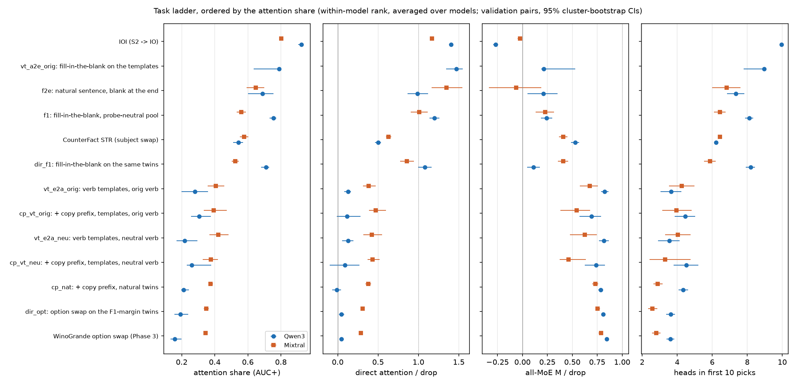
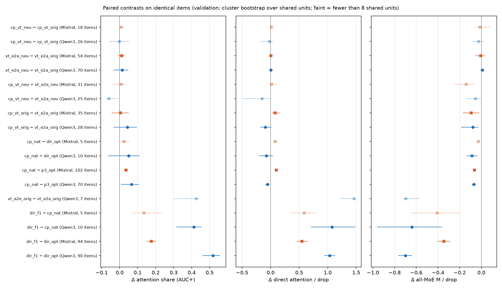

**Summary.** The task ladder of P5-2 (agent p5-synth): every Phase-3 / Phase-5 level and both models on one attention–MoE axis, recomputed from the run rows with one code path (validation pairs; attention share = AUC+ of the single-layer final-position curves; A_direct = direct path of all attention outputs; all-MoE M = every final-position MoE output patched; heads among the first 10 picks of the mixed head + expert greedy; knockout F of the condition's own expert and of Phase 3's WinoGrande expert). Ordered by the attention share (mean within-model rank), the levels fall into two blocks rather than a continuous gradient: every entity → attribute level, with or without the answer in a copy prefix, sits at 0.16–0.31 (Qwen3) / 0.34–0.42 (Mixtral), CounterFact at 0.54 [0.51, 0.57] / 0.58 [0.55, 0.60], every attribute → entity level at 0.69–0.79 / 0.52–0.65, and IOI at 0.92 [0.90, 0.94] / 0.80 [0.79, 0.81]. The two models order the shared levels alike (Spearman 0.90 over 12 levels). On identical twins, switching the direction (dir_f1 − dir_opt) raises the attention share by +0.52 [+0.46, +0.56] (Qwen3) / +0.18 [+0.15, +0.20] (Mixtral), A_direct by +1.03 [+0.94, +1.13] / +0.55 [+0.46, +0.64] and lowers M by -0.70 [-0.77, -0.64] / -0.35 [-0.40, -0.29]; making the attribute copyable (copy prefix − Phase-3 option swap, same twins) moves the share by only +0.07 [+0.01, +0.11] / +0.04 [+0.02, +0.05], and the neutral verb does nothing measurable. Within levels, the association strata (≥ 20 pairs) shift the share by at most about 0.1, in opposite directions for the two task directions, and name items are more attention-heavy than object items in every level. The ladder confounds direction with the prompt wrapper, the answer type, prompt length and item composition (listed below); only the paired contrasts hold items fixed.

### What was computed

Levels (RESEARCH_PLAN.md P5-2 and the Phase 5 condition table): CounterFact STR (Phase 3 three-task table; donor-level ext6 runs), WinoGrande option swap (Phase 3 run `wino_<proto>_str`, main family; names / objects strata), the Phase-5 conditions `dir_opt`, `vt_e2a_orig`, `vt_e2a_neu`, `cp_vt_orig`, `cp_vt_neu`, `cp_nat`, `dir_f1`, `f1` (names / objects strata), `vt_a2e_orig` (Qwen3 only), `f2e` (when its base run is ready) and IOI S2 → IO (Phase 3 `ioi_<proto>_s2io`). Every pair-run level is recomputed from `str_sweep_rows` (attention / MoE single-layer curves), `direct_split` and `joint_rows` with `moetrace/ext13syn.py`; the values reproduce the p5-data section exactly (e.g. f1 Qwen3 0.76 [0.73, 0.77], A_direct 1.20, M 0.24) and Phase 3 (option swap 0.16 / 0.34, IOI 0.92 / 0.80). Heads among the first 10 picks come from p5-circuit's circuit state (per row, `scripts/ext13ci_analyze.row_table`), Phase 4 for the option swap; CounterFact and IOI give a point value from the Phase-4 reference. Knockout F: p5-expert's `ext13ko_targets` for Phase 5, Phase 4 (`ext9_knockout_summary.json`) for CounterFact (own = the Direction-6 STR selections L44E069 / L21E001), the option swap (own = WinoGrande expert, margin items) and IOI. CIs: cluster bootstrap over the condition's unit (seed template for templates, WinoGrande twin for the copy prefix on natural twins, else the pair; 5,000 resamples, seed 0). Order key: the attention share's percentile rank within each model, averaged over the models that have the level (so the Qwen3-only level is placed by its rank). Order: p3_opt < dir_opt < cp_nat < cp_vt_neu < vt_e2a_neu < cp_vt_orig < vt_e2a_orig < dir_f1 < cf < f1 < f2e < vt_a2e_orig < ioi.

**Task ladder (validation pairs; ordered by the attention share's within-model rank averaged over the two models; fractions of the drop; 95% cluster-bootstrap CIs; heads for CounterFact / IOI are Phase-4 point values)**

| Rank | Level | Model | Pairs (units) | Attention share (AUC+) | A_direct / drop | All-MoE M / drop | Heads in first 10 mixed picks | Own expert: knockout F | WG expert: knockout F | Mean drop | T median | Names | Paired with (identical items) |
|---|---|---|---|---|---|---|---|---|---|---|---|---|---|
| 1 | WinoGrande option swap (Phase 3) | Qwen3 | 128 (128) | 0.16 [0.13, 0.20] | 0.05 [0.02, 0.08] | 0.84 [0.83, 0.86] | 3.6 [3.4, 3.8] | L41E117 (A): +0.033 [+0.028, +0.037] | L41E117: +0.033 [+0.028, +0.037] | 8.14 | 18 | 0.08 | cp_nat (copy) |
| 1 | WinoGrande option swap (Phase 3) | Mixtral | 128 (128) | 0.34 [0.33, 0.36] | 0.29 [0.27, 0.31] | 0.79 [0.76, 0.81] | 2.8 [2.6, 3.1] | L20E000 (A): +0.036 [+0.033, +0.040] | L20E000: +0.036 [+0.033, +0.040] | 7.69 | 19 | 0.08 | cp_nat (copy) |
|  | WinoGrande option swap (Phase 3) · objects | Qwen3 | 118 (118) | 0.15 [0.12, 0.19] | 0.03 [0.00, 0.05] | 0.86 [0.84, 0.87] | 3.5 [3.3, 3.7] |  |  | 8.09 | 18 | 0.00 |  |
|  | WinoGrande option swap (Phase 3) · objects | Mixtral | 118 (118) | 0.34 [0.32, 0.35] | 0.27 [0.25, 0.29] | 0.80 [0.78, 0.82] | 2.7 [2.5, 2.9] |  |  | 7.74 | 19 | 0.00 |  |
|  | WinoGrande option swap (Phase 3) · names | Qwen3 | 10 (10) | 0.28 [0.23, 0.36] | 0.25 [0.18, 0.34] | 0.72 [0.65, 0.80] | 4.7 [3.9, 5.5] |  |  | 8.69 | 20 | 1.00 |  |
|  | WinoGrande option swap (Phase 3) · names | Mixtral | 10 (10) | 0.44 [0.39, 0.51] | 0.52 [0.38, 0.69] | 0.61 [0.43, 0.76] | 4.4 [3.4, 5.5] |  |  | 6.98 | 22 | 1.00 |  |
| 2 | dir_opt: option swap on the F1-margin twins | Qwen3 | 90 (90) | 0.19 [0.16, 0.24] | 0.05 [0.02, 0.08] | 0.81 [0.79, 0.83] | 3.6 [3.4, 3.9] | L41E117 (A): +0.025 [+0.011, +0.041] | L41E117: +0.025 [+0.011, +0.041] | 8.70 | 18 | 0.07 | dir_f1 (direction), cp_nat (copy) |
| 2 | dir_opt: option swap on the F1-margin twins | Mixtral | 94 (94) | 0.35 [0.33, 0.36] | 0.31 [0.29, 0.33] | 0.75 [0.73, 0.78] | 2.6 [2.3, 2.9] | L20E000 (A): +0.025 [+0.016, +0.034] | L20E000: +0.025 [+0.016, +0.034] | 9.65 | 19 | 0.01 | dir_f1 (direction), cp_nat (copy) |
|  | dir_opt: option swap on the F1-margin twins · objects | Qwen3 | 84 (84) | 0.18 [0.15, 0.23] | 0.03 [0.00, 0.07] | 0.82 [0.80, 0.83] | 3.6 [3.3, 3.8] |  |  | 8.81 | 18 | 0.00 |  |
|  | dir_opt: option swap on the F1-margin twins · objects | Mixtral | 93 (93) | 0.35 [0.33, 0.36] | 0.31 [0.29, 0.33] | 0.76 [0.73, 0.78] | 2.6 [2.3, 2.8] |  |  | 9.67 | 19 | 0.00 |  |
| 3 | cp_nat: + copy prefix, natural twins | Qwen3 | 140 (70) | 0.21 [0.20, 0.24] | -0.01 [-0.07, 0.04] | 0.79 [0.76, 0.81] | 4.3 [4.1, 4.6] | L41E117 (A): +0.027 [+0.019, +0.034] | L41E117: +0.027 [+0.019, +0.034] | 5.97 | 23 | 0.07 | dir_f1 (direction), p3_opt (copy), dir_opt (copy) |
| 3 | cp_nat: + copy prefix, natural twins | Mixtral | 204 (102) | 0.37 [0.36, 0.39] | 0.38 [0.34, 0.41] | 0.73 [0.70, 0.76] | 2.9 [2.6, 3.2] | L21E006 (B): +0.023 [+0.019, +0.027] | L20E000: +0.045 [+0.039, +0.050] | 7.15 | 26 | 0.08 | dir_f1 (direction), p3_opt (copy), dir_opt (copy) |
|  | cp_nat: + copy prefix, natural twins · objects | Qwen3 | 130 (65) | 0.21 [0.19, 0.23] | -0.04 [-0.09, 0.01] | 0.80 [0.77, 0.82] | 4.2 [4.0, 4.5] |  |  | 5.91 | 23 | 0.00 |  |
|  | cp_nat: + copy prefix, natural twins · objects | Mixtral | 188 (94) | 0.36 [0.35, 0.37] | 0.35 [0.32, 0.38] | 0.75 [0.72, 0.78] | 2.7 [2.5, 2.9] |  |  | 7.10 | 26 | 0.00 |  |
|  | cp_nat: + copy prefix, natural twins · names | Qwen3 | 10 (5) | 0.35 [0.29, 0.47] | 0.30 [0.08, 0.51] | 0.64 [0.62, 0.67] | 5.5 [4.8, 6.3] |  |  | 6.66 | 23 | 1.00 |  |
|  | cp_nat: + copy prefix, natural twins · names | Mixtral | 16 (8) | 0.49 [0.44, 0.55] | 0.66 [0.53, 0.80] | 0.51 [0.35, 0.66] | 5.6 [4.5, 6.7] |  |  | 7.73 | 29 | 1.00 |  |
| 4 | cp_vt_neu: + copy prefix, templates, neutral verb | Qwen3 | 128 (8) | 0.26 [0.23, 0.38] | 0.09 [-0.10, 0.27] | 0.74 [0.62, 0.83] | 4.5 [3.8, 5.2] | L42E123 (B): -0.007 [-0.021, +0.010] | L41E117: +0.000 [-0.009, +0.011] | 5.59 | 23 | 1.00 | vt_e2a_neu (copy), cp_vt_orig (verb) |
| 4 | cp_vt_neu: + copy prefix, templates, neutral verb | Mixtral | 128 (8) | 0.38 [0.33, 0.42] | 0.43 [0.37, 0.52] | 0.46 [0.37, 0.63] | 3.3 [2.4, 4.8] | L19E006 (B): +0.035 [+0.012, +0.071] | L20E000: -0.001 [-0.017, +0.034] | 5.40 | 27 | 1.00 | vt_e2a_neu (copy), cp_vt_orig (verb) |
| 5 | vt_e2a_neu: verb templates, neutral verb | Qwen3 | 128 (12) | 0.22 [0.17, 0.30] | 0.13 [0.05, 0.19] | 0.82 [0.77, 0.87] | 3.6 [2.9, 4.1] | L42E123 (A): +0.020 [-0.006, +0.046] | L41E117: +0.001 [-0.009, +0.012] | 6.08 | 17 | 1.00 | cp_vt_neu (copy), vt_e2a_orig (verb) |
| 5 | vt_e2a_neu: verb templates, neutral verb | Mixtral | 128 (12) | 0.42 [0.37, 0.48] | 0.42 [0.32, 0.55] | 0.62 [0.48, 0.75] | 4.0 [3.3, 4.8] | L19E006 (A): +0.037 [+0.013, +0.064] | L20E000: +0.023 [-0.007, +0.056] | 5.81 | 18 | 1.00 | cp_vt_neu (copy), vt_e2a_orig (verb) |
| 6 | cp_vt_orig: + copy prefix, templates, orig verb | Qwen3 | 128 (13) | 0.31 [0.26, 0.38] | 0.11 [-0.01, 0.28] | 0.69 [0.57, 0.79] | 4.5 [3.9, 5.0] | L39E001 (A): +0.008 [-0.017, +0.035] | L41E117: -0.001 [-0.009, +0.006] | 5.61 | 23 | 1.00 | vt_e2a_orig (copy), cp_vt_neu (verb) |
| 6 | cp_vt_orig: + copy prefix, templates, orig verb | Mixtral | 128 (10) | 0.39 [0.33, 0.47] | 0.47 [0.39, 0.60] | 0.54 [0.38, 0.68] | 4.0 [3.2, 4.8] | L19E006 (A): +0.017 [-0.004, +0.036] | L20E000: +0.020 [-0.012, +0.062] | 5.26 | 26 | 1.00 | vt_e2a_orig (copy), cp_vt_neu (verb) |
| 7 | vt_e2a_orig: verb templates, orig verb | Qwen3 | 128 (17) | 0.28 [0.20, 0.36] | 0.13 [0.08, 0.17] | 0.82 [0.79, 0.86] | 3.6 [3.0, 4.2] | L39E121 (A): +0.005 [-0.013, +0.030] | L41E117: +0.001 [-0.009, +0.013] | 6.50 | 17 | 1.00 | vt_a2e_orig (direction), cp_vt_orig (copy), vt_e2a_neu (verb) |
| 7 | vt_e2a_orig: verb templates, orig verb | Mixtral | 128 (18) | 0.41 [0.36, 0.46] | 0.38 [0.31, 0.47] | 0.68 [0.58, 0.76] | 4.2 [3.5, 5.0] | L19E006 (A): +0.042 [+0.024, +0.061] | L20E000: +0.012 [-0.016, +0.040] | 6.51 | 18 | 1.00 | vt_a2e_orig (direction), cp_vt_orig (copy), vt_e2a_neu (verb) |
| 8 | dir_f1: fill-in-the-blank on the same twins | Qwen3 | 90 (90) | 0.71 [0.68, 0.73] | 1.08 [1.00, 1.17] | 0.11 [0.05, 0.17] | 8.2 [7.9, 8.4] | L44E116 (A): +0.021 [+0.007, +0.036] | L41E117: +0.001 [-0.008, +0.011] | 5.23 | 27 | 0.07 | dir_opt (direction), cp_nat (direction) |
| 8 | dir_f1: fill-in-the-blank on the same twins | Mixtral | 94 (94) | 0.52 [0.50, 0.54] | 0.86 [0.77, 0.95] | 0.41 [0.35, 0.46] | 5.9 [5.5, 6.2] | L20E001 (A): -0.005 [-0.021, +0.011] | L20E000: +0.002 [-0.004, +0.008] | 4.65 | 31 | 0.01 | dir_opt (direction), cp_nat (direction) |
|  | dir_f1: fill-in-the-blank on the same twins · objects | Qwen3 | 84 (84) | 0.70 [0.67, 0.72] | 1.06 [0.97, 1.15] | 0.10 [0.03, 0.16] | 8.1 [7.9, 8.4] |  |  | 5.28 | 28 | 0.00 |  |
|  | dir_f1: fill-in-the-blank on the same twins · objects | Mixtral | 93 (93) | 0.52 [0.50, 0.54] | 0.85 [0.77, 0.94] | 0.42 [0.37, 0.46] | 5.8 [5.5, 6.2] |  |  | 4.66 | 31 | 0.00 |  |
| 9 | CounterFact STR (subject swap) | Qwen3 | 108 (108) | 0.54 [0.51, 0.57] | 0.50 [0.46, 0.54] | 0.53 [0.49, 0.57] | 6.2 | L44E069 (A): +0.033 [+0.026, +0.039] | L41E117: -0.001 [-0.002, +0.001] | 11.67 | n/a | 0.00 |  |
| 9 | CounterFact STR (subject swap) | Mixtral | 106 (106) | 0.58 [0.55, 0.60] | 0.63 [0.60, 0.66] | 0.41 [0.37, 0.45] | 6.4 | L21E001 (A (tie L19-L21)): +0.004 [+0.001, +0.008] | L20E000: -0.001 [-0.003, +0.001] | 12.97 | n/a | 0.00 |  |
| 10 | f1: fill-in-the-blank, probe-neutral pool | Qwen3 | 128 (128) | 0.76 [0.73, 0.77] | 1.20 [1.14, 1.26] | 0.24 [0.18, 0.30] | 8.1 [7.9, 8.3] | L37E032 (A): +0.042 [+0.029, +0.055] | L41E117: -0.004 [-0.009, +0.002] | 4.63 | 27 | 0.55 |  |
| 10 | f1: fill-in-the-blank, probe-neutral pool | Mixtral | 101 (101) | 0.56 [0.53, 0.59] | 1.01 [0.91, 1.12] | 0.23 [0.13, 0.32] | 6.4 [6.1, 6.8] | L20E001 (B): +0.008 [-0.006, +0.022] | L20E000: +0.005 [-0.002, +0.012] | 4.34 | 32 | 0.12 |  |
|  | f1: fill-in-the-blank, probe-neutral pool · objects | Qwen3 | 58 (58) | 0.71 [0.68, 0.74] | 1.10 [1.01, 1.21] | 0.15 [0.06, 0.23] | 8.0 [7.7, 8.4] |  |  | 5.25 | 28 | 0.00 |  |
|  | f1: fill-in-the-blank, probe-neutral pool · objects | Mixtral | 89 (89) | 0.55 [0.52, 0.57] | 0.96 [0.85, 1.07] | 0.26 [0.17, 0.35] | 6.3 [5.9, 6.6] |  |  | 4.41 | 32 | 0.00 |  |
|  | f1: fill-in-the-blank, probe-neutral pool · names | Qwen3 | 70 (70) | 0.78 [0.75, 0.81] | 1.29 [1.24, 1.34] | 0.34 [0.27, 0.41] | 8.2 [7.9, 8.5] |  |  | 4.12 | 26 | 1.00 |  |
|  | f1: fill-in-the-blank, probe-neutral pool · names | Mixtral | 12 (12) | 0.68 [0.62, 0.75] | 1.43 [1.21, 1.61] | -0.09 [-0.36, 0.26] | 7.7 [7.2, 8.2] |  |  | 3.82 | 32 | 1.00 |  |
| 11 | f2e: natural sentence, blank at the end | Qwen3 | 32 (32) | 0.69 [0.60, 0.75] | 0.99 [0.87, 1.12] | 0.21 [0.05, 0.35] | 7.4 [6.8, 7.8] | L43E036 (A): +0.015 [-0.004, +0.032] | L41E117: +0.004 [-0.009, +0.017] | 8.32 | 20 | 0.19 |  |
| 11 | f2e: natural sentence, blank at the end | Mixtral | 18 (18) | 0.65 [0.59, 0.70] | 1.35 [1.16, 1.55] | -0.06 [-0.34, 0.19] | 6.8 [6.0, 7.6] | L19E004 (A): +0.030 [+0.005, +0.056] | L20E000: +0.000 [-0.007, +0.008] | 6.98 | 22 | 0.11 |  |
| 12 | vt_a2e_orig: fill-in-the-blank on the templates | Qwen3 | 37 (5) | 0.79 [0.64, 0.80] | 1.47 [1.34, 1.55] | 0.21 [0.19, 0.53] | 9.0 [7.8, 9.1] | L37E032 (A): +0.034 [+0.024, +0.118] | L41E117: -0.009 [-0.031, -0.006] | 3.66 | 27 | 1.00 | vt_e2a_orig (direction) |
| 13 | IOI (S2 -> IO) | Qwen3 | 128 (128) | 0.92 [0.90, 0.94] | 1.40 [1.38, 1.43] | -0.27 [-0.29, -0.25] | 9.9 | none (no expert pass) : n/a | L41E117: -0.000 [-0.002, +0.002] | 12.65 | 15 | 0.00 |  |
| 13 | IOI (S2 -> IO) | Mixtral | 128 (128) | 0.80 [0.79, 0.81] | 1.17 [1.14, 1.19] | -0.02 [-0.05, -0.00] | n/a | none (no expert pass) : n/a | L20E000: +0.001 [-0.000, +0.002] | 11.28 | 16 | 0.00 |  |

### Paired contrasts on identical items

Each contrast restricts both conditions to the items they share (natural twins: twin id; templates: seed × name pair, both copy-prefix attribute orders pooled) and applies the same unit resamples to both, so the CI is that of the paired difference. 'validation' = the ladder's split; 'all' = discovery + validation (nothing is selected on these quantities, so the larger set is legitimate). Contrasts with fewer than 8 shared units are listed, but their percentile CIs are not reliable.

**Direction.**

- dir_f1 − dir_opt, Qwen3 (90 shared items, 90 units): share 0.71 vs 0.19, Δ +0.52 [+0.46, +0.56]; A_direct 1.08 vs 0.05, Δ +1.03 [+0.94, +1.13]; M 0.11 vs 0.81, Δ -0.70 [-0.77, -0.64]; heads in first 10 8.19 vs 3.63, Δ +4.56 [+4.19, +4.92]. All splits: share 0.70 vs 0.18, Δ +0.51 [+0.47, +0.54].
- dir_f1 − dir_opt, Mixtral (94 shared items, 94 units): share 0.52 vs 0.35, Δ +0.18 [+0.15, +0.20]; A_direct 0.86 vs 0.31, Δ +0.55 [+0.46, +0.64]; M 0.41 vs 0.75, Δ -0.35 [-0.40, -0.29]; heads in first 10 5.87 vs 2.59, Δ +3.28 [+2.84, +3.70]. All splits: share 0.51 vs 0.34, Δ +0.17 [+0.15, +0.18].
- dir_f1 − cp_nat, Qwen3 (10 shared items, 10 units): share 0.65 vs 0.23, Δ +0.41 [+0.32, +0.45]; A_direct 1.08 vs 0.00, Δ +1.08 [+0.71, +1.49]; M 0.11 vs 0.75, Δ -0.64 [-0.96, -0.36]; heads in first 10 7.40 vs 4.33, Δ +3.08 [+1.58, +4.42]. All splits: share 0.66 vs 0.22, Δ +0.44 [+0.38, +0.48].
- dir_f1 − cp_nat, Mixtral (5 shared items, 5 units): share 0.49 vs 0.35, Δ +0.13 [+0.07, +0.23] (5 units: CI unreliable); A_direct 0.94 vs 0.35, Δ +0.59 [+0.35, +0.80] (5 units: CI unreliable); M 0.35 vs 0.76, Δ -0.41 [-0.65, -0.19] (5 units: CI unreliable); heads in first 10 5.40 vs 2.35, Δ +3.05 [+2.75, +3.30] (5 units: CI unreliable). All splits: share 0.51 vs 0.37, Δ +0.14 [+0.11, +0.17].
- vt_a2e_orig − vt_e2a_orig, Qwen3 (7 shared items, 2 units): share 0.84 vs 0.41, Δ +0.43 [+0.30, +0.43] (2 units: CI unreliable); A_direct 1.54 vs 0.08, Δ +1.46 [+1.21, +1.49] (2 units: CI unreliable); M 0.23 vs 0.92, Δ -0.70 [-0.72, -0.57] (2 units: CI unreliable); heads in first 10 8.79 vs 4.00, Δ +4.79 [+4.67, +5.50] (2 units: CI unreliable). All splits: share 0.80 vs 0.39, Δ +0.42 [+0.26, +0.51] (5 units: CI unreliable).

**Answer copyable (C2 − C1).**

- cp_nat − p3_opt, Qwen3 (70 shared items, 70 units): share 0.21 vs 0.15, Δ +0.07 [+0.01, +0.11]; A_direct -0.01 vs 0.04, Δ -0.05 [-0.10, -0.01]; M 0.79 vs 0.86, Δ -0.07 [-0.09, -0.05]; heads in first 10 4.34 vs 3.53, Δ +0.81 [+0.52, +1.11]. All splits: share 0.20 vs 0.17, Δ +0.04 [+0.00, +0.07].
- cp_nat − p3_opt, Mixtral (102 shared items, 102 units): share 0.37 vs 0.34, Δ +0.04 [+0.02, +0.05]; A_direct 0.38 vs 0.28, Δ +0.10 [+0.08, +0.12]; M 0.73 vs 0.79, Δ -0.06 [-0.08, -0.05]; heads in first 10 2.89 vs 2.71, Δ +0.19 [+0.00, +0.38]. All splits: share 0.38 vs 0.35, Δ +0.03 [+0.03, +0.04].
- cp_nat − dir_opt, Qwen3 (10 shared items, 10 units): share 0.23 vs 0.18, Δ +0.05 [-0.06, +0.11]; A_direct 0.00 vs 0.08, Δ -0.08 [-0.20, +0.04]; M 0.75 vs 0.84, Δ -0.09 [-0.14, -0.04]; heads in first 10 4.33 vs 3.85, Δ +0.48 [-0.32, +1.25]. All splits: share 0.22 vs 0.16, Δ +0.05 [-0.01, +0.11].
- cp_nat − dir_opt, Mixtral (5 shared items, 5 units): share 0.35 vs 0.33, Δ +0.02 [-0.01, +0.06] (5 units: CI unreliable); A_direct 0.35 vs 0.27, Δ +0.08 [+0.05, +0.12] (5 units: CI unreliable); M 0.76 vs 0.79, Δ -0.03 [-0.04, -0.02] (5 units: CI unreliable); heads in first 10 2.35 vs 2.00, Δ +0.35 [-0.35, +0.80] (5 units: CI unreliable). All splits: share 0.37 vs 0.34, Δ +0.03 [+0.02, +0.04].
- cp_vt_orig − vt_e2a_orig, Qwen3 (28 shared items, 8 units): share 0.28 vs 0.24, Δ +0.04 [-0.04, +0.10]; A_direct 0.05 vs 0.14, Δ -0.09 [-0.18, +0.01]; M 0.75 vs 0.83, Δ -0.08 [-0.19, -0.03]; heads in first 10 3.92 vs 3.59, Δ +0.33 [-0.26, +1.11]. All splits: share 0.29 vs 0.26, Δ +0.02 [-0.00, +0.07].
- cp_vt_orig − vt_e2a_orig, Mixtral (35 shared items, 8 units): share 0.36 vs 0.36, Δ +0.00 [-0.04, +0.05]; A_direct 0.42 vs 0.34, Δ +0.08 [+0.02, +0.16]; M 0.60 vs 0.69, Δ -0.09 [-0.17, -0.02]; heads in first 10 3.51 vs 3.74, Δ -0.23 [-0.89, +0.56]. All splits: share 0.39 vs 0.36, Δ +0.03 [-0.01, +0.06].
- cp_vt_neu − vt_e2a_neu, Qwen3 (25 shared items, 4 units): share 0.23 vs 0.29, Δ -0.06 [-0.07, -0.01] (4 units: CI unreliable); A_direct 0.04 vs 0.19, Δ -0.15 [-0.51, +0.01] (4 units: CI unreliable); M 0.77 vs 0.82, Δ -0.05 [-0.14, -0.00] (4 units: CI unreliable); heads in first 10 3.96 vs 3.46, Δ +0.50 [+0.12, +1.70] (4 units: CI unreliable). All splits: share 0.23 vs 0.29, Δ -0.06 [-0.10, +0.01].
- cp_vt_neu − vt_e2a_neu, Mixtral (31 shared items, 5 units): share 0.37 vs 0.36, Δ +0.01 [-0.04, +0.04] (5 units: CI unreliable); A_direct 0.45 vs 0.43, Δ +0.02 [-0.02, +0.12] (5 units: CI unreliable); M 0.44 vs 0.58, Δ -0.14 [-0.25, -0.06] (5 units: CI unreliable); heads in first 10 3.19 vs 3.61, Δ -0.42 [-1.19, +0.19] (5 units: CI unreliable). All splits: share 0.40 vs 0.36, Δ +0.04 [-0.00, +0.07] (7 units: CI unreliable).

**Neutral verb.**

- vt_e2a_neu − vt_e2a_orig, Qwen3 (70 shared items, 11 units): share 0.21 vs 0.20, Δ +0.01 [-0.04, +0.05]; A_direct 0.13 vs 0.12, Δ +0.00 [-0.02, +0.04]; M 0.83 vs 0.82, Δ +0.01 [-0.01, +0.02]; heads in first 10 3.39 vs 3.76, Δ -0.36 [-0.84, +0.05]. All splits: share 0.24 vs 0.23, Δ +0.00 [-0.02, +0.04].
- vt_e2a_neu − vt_e2a_orig, Mixtral (54 shared items, 10 units): share 0.40 vs 0.39, Δ +0.01 [-0.01, +0.03]; A_direct 0.45 vs 0.44, Δ +0.01 [-0.03, +0.04]; M 0.59 vs 0.59, Δ -0.01 [-0.05, +0.03]; heads in first 10 4.03 vs 4.11, Δ -0.08 [-0.72, +0.54]. All splits: share 0.39 vs 0.40, Δ -0.01 [-0.03, +0.01].
- cp_vt_neu − cp_vt_orig, Qwen3 (26 shared items, 6 units): share 0.29 vs 0.29, Δ -0.00 [-0.06, +0.06] (6 units: CI unreliable); A_direct 0.12 vs 0.14, Δ -0.02 [-0.18, +0.05] (6 units: CI unreliable); M 0.75 vs 0.78, Δ -0.03 [-0.09, +0.02] (6 units: CI unreliable); heads in first 10 4.71 vs 4.70, Δ +0.02 [-0.58, +0.39] (6 units: CI unreliable). All splits: share 0.29 vs 0.30, Δ -0.00 [-0.05, +0.04].
- cp_vt_neu − cp_vt_orig, Mixtral (18 shared items, 3 units): share 0.37 vs 0.37, Δ +0.01 [+0.00, +0.02] (3 units: CI unreliable); A_direct 0.44 vs 0.42, Δ +0.01 [-0.00, +0.03] (3 units: CI unreliable); M 0.46 vs 0.47, Δ -0.01 [-0.05, +0.09] (3 units: CI unreliable); heads in first 10 3.08 vs 2.53, Δ +0.56 [+0.17, +1.40] (3 units: CI unreliable). All splits: share 0.41 vs 0.42, Δ -0.01 [-0.03, +0.01].

**Paired contrasts on identical items (a − b; same unit resamples for both conditions; validation = the ladder's split, all = discovery + validation; * = fewer than 8 shared units, CI unreliable)**

| Contrast (a − b) | Factor | Model | Split | Shared items (units) | Δ attention share | Δ A_direct | Δ all-MoE M | Δ heads in first 10 |
|---|---|---|---|---|---|---|---|---|
| dir_f1 − dir_opt | direction | Qwen3 | validation | 90 (90) | 0.71 vs 0.19: +0.52 [+0.46, +0.56] | 1.08 vs 0.05: +1.03 [+0.94, +1.13] | 0.11 vs 0.81: -0.70 [-0.77, -0.64] | 8.19 vs 3.63: +4.56 [+4.19, +4.92] |
| dir_f1 − dir_opt | direction | Qwen3 | all | 180 (180) | 0.70 vs 0.18: +0.51 [+0.47, +0.54] | 1.05 vs 0.06: +0.99 [+0.92, +1.06] | 0.13 vs 0.81: -0.68 [-0.72, -0.64] |  |
| dir_f1 − dir_opt | direction | Mixtral | validation | 94 (94) | 0.52 vs 0.35: +0.18 [+0.15, +0.20] | 0.86 vs 0.31: +0.55 [+0.46, +0.64] | 0.41 vs 0.75: -0.35 [-0.40, -0.29] | 5.87 vs 2.59: +3.28 [+2.84, +3.70] |
| dir_f1 − dir_opt | direction | Mixtral | all | 188 (188) | 0.51 vs 0.34: +0.17 [+0.15, +0.18] | 0.83 vs 0.31: +0.53 [+0.46, +0.59] | 0.40 vs 0.76: -0.36 [-0.40, -0.32] |  |
| dir_f1 − cp_nat | direction | Qwen3 | validation | 10 (10) | 0.65 vs 0.23: +0.41 [+0.32, +0.45] | 1.08 vs 0.00: +1.08 [+0.71, +1.49] | 0.11 vs 0.75: -0.64 [-0.96, -0.36] | 7.40 vs 4.33: +3.08 [+1.58, +4.42] |
| dir_f1 − cp_nat | direction | Qwen3 | all | 32 (32) | 0.66 vs 0.22: +0.44 [+0.38, +0.48] | 1.04 vs -0.10: +1.13 [+0.93, +1.36] | 0.12 vs 0.77: -0.65 [-0.78, -0.53] |  |
| dir_f1 − cp_nat | direction | Mixtral | validation | 5 (5) * | 0.49 vs 0.35: +0.13 [+0.07, +0.23] | 0.94 vs 0.35: +0.59 [+0.35, +0.80] | 0.35 vs 0.76: -0.41 [-0.65, -0.19] | 5.40 vs 2.35: +3.05 [+2.75, +3.30] |
| dir_f1 − cp_nat | direction | Mixtral | all | 48 (48) | 0.51 vs 0.37: +0.14 [+0.11, +0.17] | 0.86 vs 0.37: +0.49 [+0.39, +0.58] | 0.39 vs 0.73: -0.34 [-0.43, -0.25] |  |
| vt_a2e_orig − vt_e2a_orig | direction | Qwen3 | validation | 7 (2) * | 0.84 vs 0.41: +0.43 [+0.30, +0.43] | 1.54 vs 0.08: +1.46 [+1.21, +1.49] | 0.23 vs 0.92: -0.70 [-0.72, -0.57] | 8.79 vs 4.00: +4.79 [+4.67, +5.50] |
| vt_a2e_orig − vt_e2a_orig | direction | Qwen3 | all | 11 (5) * | 0.80 vs 0.39: +0.42 [+0.26, +0.51] | 1.57 vs 0.07: +1.50 [+1.39, +1.69] | 0.22 vs 0.87: -0.65 [-0.72, -0.53] |  |
| cp_nat − p3_opt | copy | Qwen3 | validation | 70 (70) | 0.21 vs 0.15: +0.07 [+0.01, +0.11] | -0.01 vs 0.04: -0.05 [-0.10, -0.01] | 0.79 vs 0.86: -0.07 [-0.09, -0.05] | 4.34 vs 3.53: +0.81 [+0.52, +1.11] |
| cp_nat − p3_opt | copy | Qwen3 | all | 143 (143) | 0.20 vs 0.17: +0.04 [+0.00, +0.07] | -0.00 vs 0.06: -0.06 [-0.09, -0.03] | 0.77 vs 0.84: -0.07 [-0.08, -0.06] |  |
| cp_nat − p3_opt | copy | Mixtral | validation | 102 (102) | 0.37 vs 0.34: +0.04 [+0.02, +0.05] | 0.38 vs 0.28: +0.10 [+0.08, +0.12] | 0.73 vs 0.79: -0.06 [-0.08, -0.05] | 2.89 vs 2.71: +0.19 [+0.00, +0.38] |
| cp_nat − p3_opt | copy | Mixtral | all | 210 (210) | 0.38 vs 0.35: +0.03 [+0.03, +0.04] | 0.40 vs 0.30: +0.10 [+0.08, +0.11] | 0.71 vs 0.78: -0.06 [-0.08, -0.05] |  |
| cp_nat − dir_opt | copy | Qwen3 | validation | 10 (10) | 0.23 vs 0.18: +0.05 [-0.06, +0.11] | 0.00 vs 0.08: -0.08 [-0.20, +0.04] | 0.75 vs 0.84: -0.09 [-0.14, -0.04] | 4.33 vs 3.85: +0.48 [-0.32, +1.25] |
| cp_nat − dir_opt | copy | Qwen3 | all | 32 (32) | 0.22 vs 0.16: +0.05 [-0.01, +0.11] | -0.10 vs 0.04: -0.14 [-0.23, -0.06] | 0.77 vs 0.83: -0.06 [-0.09, -0.03] |  |
| cp_nat − dir_opt | copy | Mixtral | validation | 5 (5) * | 0.35 vs 0.33: +0.02 [-0.01, +0.06] | 0.35 vs 0.27: +0.08 [+0.05, +0.12] | 0.76 vs 0.79: -0.03 [-0.04, -0.02] | 2.35 vs 2.00: +0.35 [-0.35, +0.80] |
| cp_nat − dir_opt | copy | Mixtral | all | 48 (48) | 0.37 vs 0.34: +0.03 [+0.02, +0.04] | 0.37 vs 0.30: +0.07 [+0.05, +0.09] | 0.73 vs 0.77: -0.03 [-0.05, -0.02] |  |
| cp_vt_orig − vt_e2a_orig | copy | Qwen3 | validation | 28 (8) | 0.28 vs 0.24: +0.04 [-0.04, +0.10] | 0.05 vs 0.14: -0.09 [-0.18, +0.01] | 0.75 vs 0.83: -0.08 [-0.19, -0.03] | 3.92 vs 3.59: +0.33 [-0.26, +1.11] |
| cp_vt_orig − vt_e2a_orig | copy | Qwen3 | all | 61 (16) | 0.29 vs 0.26: +0.02 [-0.00, +0.07] | 0.04 vs 0.12: -0.08 [-0.17, +0.06] | 0.72 vs 0.83: -0.12 [-0.20, -0.06] |  |
| cp_vt_orig − vt_e2a_orig | copy | Mixtral | validation | 35 (8) | 0.36 vs 0.36: +0.00 [-0.04, +0.05] | 0.42 vs 0.34: +0.08 [+0.02, +0.16] | 0.60 vs 0.69: -0.09 [-0.17, -0.02] | 3.51 vs 3.74: -0.23 [-0.89, +0.56] |
| cp_vt_orig − vt_e2a_orig | copy | Mixtral | all | 66 (14) | 0.39 vs 0.36: +0.03 [-0.01, +0.06] | 0.47 vs 0.34: +0.12 [+0.04, +0.23] | 0.58 vs 0.70: -0.12 [-0.20, -0.06] |  |
| cp_vt_neu − vt_e2a_neu | copy | Qwen3 | validation | 25 (4) * | 0.23 vs 0.29: -0.06 [-0.07, -0.01] | 0.04 vs 0.19: -0.15 [-0.51, +0.01] | 0.77 vs 0.82: -0.05 [-0.14, -0.00] | 3.96 vs 3.46: +0.50 [+0.12, +1.70] |
| cp_vt_neu − vt_e2a_neu | copy | Qwen3 | all | 56 (11) | 0.23 vs 0.29: -0.06 [-0.10, +0.01] | 0.03 vs 0.13: -0.10 [-0.26, +0.06] | 0.72 vs 0.83: -0.11 [-0.19, -0.05] |  |
| cp_vt_neu − vt_e2a_neu | copy | Mixtral | validation | 31 (5) * | 0.37 vs 0.36: +0.01 [-0.04, +0.04] | 0.45 vs 0.43: +0.02 [-0.02, +0.12] | 0.44 vs 0.58: -0.14 [-0.25, -0.06] | 3.19 vs 3.61: -0.42 [-1.19, +0.19] |
| cp_vt_neu − vt_e2a_neu | copy | Mixtral | all | 71 (7) * | 0.40 vs 0.36: +0.04 [-0.00, +0.07] | 0.42 vs 0.38: +0.04 [-0.01, +0.10] | 0.57 vs 0.69: -0.12 [-0.19, -0.07] |  |
| vt_e2a_neu − vt_e2a_orig | verb | Qwen3 | validation | 70 (11) | 0.21 vs 0.20: +0.01 [-0.04, +0.05] | 0.13 vs 0.12: +0.00 [-0.02, +0.04] | 0.83 vs 0.82: +0.01 [-0.01, +0.02] | 3.39 vs 3.76: -0.36 [-0.84, +0.05] |
| vt_e2a_neu − vt_e2a_orig | verb | Qwen3 | all | 120 (21) | 0.24 vs 0.23: +0.00 [-0.02, +0.04] | 0.11 vs 0.10: +0.01 [-0.02, +0.03] | 0.83 vs 0.83: -0.00 [-0.02, +0.02] |  |
| vt_e2a_neu − vt_e2a_orig | verb | Mixtral | validation | 54 (10) | 0.40 vs 0.39: +0.01 [-0.01, +0.03] | 0.45 vs 0.44: +0.01 [-0.03, +0.04] | 0.59 vs 0.59: -0.01 [-0.05, +0.03] | 4.03 vs 4.11: -0.08 [-0.72, +0.54] |
| vt_e2a_neu − vt_e2a_orig | verb | Mixtral | all | 111 (18) | 0.39 vs 0.40: -0.01 [-0.03, +0.01] | 0.40 vs 0.39: +0.00 [-0.02, +0.04] | 0.66 vs 0.66: -0.01 [-0.05, +0.03] |  |
| cp_vt_neu − cp_vt_orig | verb | Qwen3 | validation | 26 (6) * | 0.29 vs 0.29: -0.00 [-0.06, +0.06] | 0.12 vs 0.14: -0.02 [-0.18, +0.05] | 0.75 vs 0.78: -0.03 [-0.09, +0.02] | 4.71 vs 4.70: +0.02 [-0.58, +0.39] |
| cp_vt_neu − cp_vt_orig | verb | Qwen3 | all | 59 (14) | 0.29 vs 0.30: -0.00 [-0.05, +0.04] | 0.13 vs 0.11: +0.02 [-0.07, +0.09] | 0.68 vs 0.71: -0.03 [-0.08, +0.01] |  |
| cp_vt_neu − cp_vt_orig | verb | Mixtral | validation | 18 (3) * | 0.37 vs 0.37: +0.01 [+0.00, +0.02] | 0.44 vs 0.42: +0.01 [-0.00, +0.03] | 0.46 vs 0.47: -0.01 [-0.05, +0.09] | 3.08 vs 2.53: +0.56 [+0.17, +1.40] |
| cp_vt_neu − cp_vt_orig | verb | Mixtral | all | 42 (8) | 0.41 vs 0.42: -0.01 [-0.03, +0.01] | 0.47 vs 0.47: -0.01 [-0.06, +0.02] | 0.52 vs 0.49: +0.03 [-0.02, +0.09] |  |

### Within levels: association strata, names, probe score

All splits and families of a level pooled (the strata are not used for any selection). Association strata follow p5-data's pre-registered rule (responding probes v1 + v2 in Qwen3, v2 in Mixtral; neutral = both triggers |probe| < 1); the main `f1` pool is neutral by construction, so the pre-neutral fill-in-the-blank runs `wino_ref_F1_<proto>` (same format, all strata; kept as a record by p5-data) carry the attribute → entity strata; the Phase-3 option swap has only the local-context flag `assoc` and its continuous baseline d_local. The probe regression uses the per-pair direct attention share (A_direct / drop of the pair) against the own-answer score s = mean over responding probes of (probe_a − probe_b) / 2 (s > 0: the trigger alone points to the clean answer).

- Attribute → entity (pre-neutral F1 runs): one-sided / reverse pairs have a LOWER share than neutral pairs — Qwen3 -0.07 [-0.10, -0.04] / -0.05 [-0.08, -0.02], Mixtral -0.02 [-0.05, +0.01] / -0.02 [-0.05, +0.00]; A_direct -0.23 [-0.30, -0.15] / -0.16 [-0.27, -0.05] (one-sided). dir_f1 agrees (Qwen3 one-sided -0.10 [-0.14, -0.05], reverse -0.08 [-0.13, -0.03]; local assoc -0.09 [-0.13, -0.04] / -0.05 [-0.09, -0.02]).
- Entity → attribute: association goes the other way — dir_opt associative +0.22 [+0.16, +0.29] (Qwen3, 10 pairs), one-sided +0.08 [+0.03, +0.15] / +0.02 [+0.00, +0.04], local assoc +0.07 [+0.03, +0.13] / +0.03 [+0.00, +0.06]; Phase-3 option swap local assoc +0.04 [+0.01, +0.09] / +0.02 [-0.02, +0.05]. The templates and the copy-prefix templates show no stratum effect (few non-neutral pairs).
- Names vs objects (names minus objects): f1 +0.08 [+0.06, +0.10] / +0.14 [+0.09, +0.19], Phase-3 option swap +0.14 [+0.08, +0.22] / +0.09 [+0.05, +0.14], cp_nat +0.14 [+0.09, +0.21] / +0.11 [+0.06, +0.15] (Qwen3 / Mixtral). Names raise the share in every level and direction; Mixtral's f1 and dir_f1 have few name pairs.

**Within-level strata (all splits and families pooled): association probe strata, Phase-3 local association, names / objects**

| Level | Model | Strata | Stratum | Pairs (units) | Attention share | A_direct | All-MoE M | Δ share vs neutral | Δ A_direct vs ref | Δ share vs objects | Δ share vs not local assoc |
|---|---|---|---|---|---|---|---|---|---|---|---|
| f1pre | Qwen3 | assoc | associative | 11 (11) | 0.69 [0.62, 0.74] | 1.12 [0.87, 1.37] | 0.13 [-0.04, 0.27] | -0.09 [-0.15, -0.03] | -0.09 [-0.35, +0.15] |  |  |
| f1pre | Qwen3 | assoc | neutral | 262 (262) | 0.77 [0.76, 0.79] | 1.22 [1.18, 1.25] | 0.16 [0.12, 0.20] | (reference) |  |  |  |
| f1pre | Qwen3 | assoc | one-sided | 116 (116) | 0.70 [0.68, 0.72] | 0.99 [0.93, 1.06] | 0.20 [0.14, 0.26] | -0.07 [-0.10, -0.04] | -0.23 [-0.30, -0.15] |  |  |
| f1pre | Qwen3 | assoc | reverse | 123 (123) | 0.72 [0.70, 0.74] | 1.07 [1.02, 1.13] | 0.20 [0.14, 0.25] | -0.05 [-0.08, -0.02] | -0.14 [-0.21, -0.08] |  |  |
| f1pre | Qwen3 | names | names | 201 (201) | 0.80 [0.78, 0.81] | 1.27 [1.24, 1.30] | 0.27 [0.22, 0.31] |  | +0.22 [+0.17, +0.27] | +0.09 [+0.07, +0.12] |  |
| f1pre | Qwen3 | names | objects | 311 (311) | 0.71 [0.69, 0.72] | 1.05 [1.01, 1.09] | 0.13 [0.10, 0.17] |  |  | (reference) |  |
| p3_opt | Qwen3 | local | local assoc | 31 (31) | 0.21 [0.19, 0.26] | 0.08 [0.04, 0.12] | 0.85 [0.82, 0.88] |  | +0.03 [-0.02, +0.07] |  | +0.04 [+0.01, +0.09] |
| p3_opt | Qwen3 | local | not local assoc | 225 (225) | 0.17 [0.15, 0.20] | 0.05 [0.03, 0.07] | 0.83 [0.82, 0.84] |  |  |  | (reference) |
| p3_opt | Qwen3 | names | names | 23 (23) | 0.30 [0.26, 0.38] | 0.26 [0.20, 0.33] | 0.72 [0.65, 0.78] |  | +0.22 [+0.16, +0.29] | +0.14 [+0.08, +0.22] |  |
| p3_opt | Qwen3 | names | objects | 233 (233) | 0.16 [0.14, 0.19] | 0.04 [0.02, 0.06] | 0.84 [0.83, 0.85] |  |  | (reference) |  |
| dir_f1 | Qwen3 | assoc | associative | 10 (10) | 0.67 [0.61, 0.73] | 0.98 [0.75, 1.16] | 0.09 [-0.08, 0.29] | -0.06 [-0.13, +0.00] | -0.23 [-0.46, -0.03] |  |  |
| dir_f1 | Qwen3 | assoc | neutral | 89 (89) | 0.74 [0.71, 0.76] | 1.20 [1.14, 1.27] | 0.06 [0.00, 0.11] | (reference) |  |  |  |
| dir_f1 | Qwen3 | assoc | one-sided | 42 (42) | 0.64 [0.60, 0.67] | 0.90 [0.79, 1.03] | 0.20 [0.12, 0.28] | -0.10 [-0.14, -0.05] | -0.30 [-0.44, -0.16] |  |  |
| dir_f1 | Qwen3 | assoc | reverse | 39 (39) | 0.66 [0.61, 0.70] | 0.89 [0.75, 1.03] | 0.23 [0.12, 0.33] | -0.08 [-0.13, -0.03] | -0.32 [-0.47, -0.16] |  |  |
| dir_f1 | Qwen3 | local | local assoc | 28 (28) | 0.62 [0.58, 0.67] | 0.82 [0.67, 0.97] | 0.17 [0.05, 0.28] |  | -0.28 [-0.44, -0.12] |  | -0.09 [-0.13, -0.04] |
| dir_f1 | Qwen3 | local | not local assoc | 152 (152) | 0.71 [0.69, 0.73] | 1.10 [1.04, 1.16] | 0.12 [0.08, 0.16] |  |  |  | (reference) |
| dir_f1 | Qwen3 | names | names | 14 (14) | 0.84 [0.76, 0.87] | 1.38 [1.27, 1.50] | 0.24 [0.09, 0.42] |  | +0.36 [+0.23, +0.49] | +0.16 [+0.08, +0.19] |  |
| dir_f1 | Qwen3 | names | objects | 166 (166) | 0.68 [0.66, 0.70] | 1.03 [0.97, 1.08] | 0.12 [0.08, 0.16] |  |  | (reference) |  |
| dir_opt | Qwen3 | assoc | associative | 10 (10) | 0.37 [0.32, 0.44] | 0.22 [0.13, 0.33] | 0.73 [0.65, 0.80] | +0.22 [+0.16, +0.29] | +0.22 [+0.12, +0.33] |  |  |
| dir_opt | Qwen3 | assoc | neutral | 89 (89) | 0.14 [0.12, 0.18] | 0.00 [-0.04, 0.04] | 0.80 [0.78, 0.82] | (reference) |  |  |  |
| dir_opt | Qwen3 | assoc | one-sided | 42 (42) | 0.23 [0.19, 0.29] | 0.12 [0.08, 0.16] | 0.81 [0.78, 0.83] | +0.08 [+0.03, +0.15] | +0.11 [+0.06, +0.17] |  |  |
| dir_opt | Qwen3 | assoc | reverse | 39 (39) | 0.21 [0.18, 0.27] | 0.07 [0.04, 0.11] | 0.84 [0.82, 0.87] | +0.07 [+0.02, +0.13] | +0.07 [+0.02, +0.13] |  |  |
| dir_opt | Qwen3 | local | local assoc | 28 (28) | 0.25 [0.22, 0.30] | 0.14 [0.10, 0.18] | 0.80 [0.77, 0.83] |  | +0.10 [+0.05, +0.15] |  | +0.07 [+0.03, +0.13] |
| dir_opt | Qwen3 | local | not local assoc | 152 (152) | 0.17 [0.15, 0.22] | 0.04 [0.01, 0.07] | 0.81 [0.79, 0.82] |  |  |  | (reference) |
| dir_opt | Qwen3 | names | names | 14 (14) | 0.32 [0.27, 0.41] | 0.24 [0.17, 0.32] | 0.72 [0.66, 0.78] |  | +0.20 [+0.12, +0.28] | +0.14 [+0.08, +0.23] |  |
| dir_opt | Qwen3 | names | objects | 166 (166) | 0.18 [0.16, 0.21] | 0.04 [0.02, 0.07] | 0.81 [0.80, 0.83] |  |  | (reference) |  |
| cp_nat | Qwen3 | assoc | associative | 28 (14) | 0.28 [0.24, 0.34] | 0.03 [-0.07, 0.13] | 0.73 [0.67, 0.79] | +0.07 [+0.02, +0.14] | +0.11 [+0.00, +0.23] |  |  |
| cp_nat | Qwen3 | assoc | neutral | 258 (129) | 0.21 [0.19, 0.24] | -0.09 [-0.14, -0.03] | 0.77 [0.75, 0.79] | (reference) |  |  |  |
| cp_nat | Qwen3 | assoc | no_probe | 24 (12) | 0.32 [0.27, 0.38] | 0.14 [0.02, 0.26] | 0.77 [0.73, 0.82] | +0.11 [+0.05, +0.17] | +0.22 [+0.10, +0.36] |  |  |
| cp_nat | Qwen3 | assoc | one-sided | 98 (49) | 0.23 [0.21, 0.28] | 0.03 [-0.04, 0.09] | 0.76 [0.73, 0.79] | +0.02 [-0.01, +0.07] | +0.11 [+0.03, +0.19] |  |  |
| cp_nat | Qwen3 | assoc | reverse | 198 (99) | 0.22 [0.20, 0.25] | 0.01 [-0.03, 0.05] | 0.79 [0.77, 0.81] | +0.01 [-0.03, +0.05] | +0.09 [+0.03, +0.16] |  |  |
| cp_nat | Qwen3 | local | local assoc | 78 (39) | 0.25 [0.22, 0.30] | -0.03 [-0.10, 0.03] | 0.77 [0.74, 0.81] |  | -0.01 [-0.09, +0.06] |  | +0.04 [+0.01, +0.10] |
| cp_nat | Qwen3 | local | not local assoc | 528 (264) | 0.20 [0.19, 0.23] | -0.02 [-0.05, 0.02] | 0.77 [0.76, 0.79] |  |  |  | (reference) |
| cp_nat | Qwen3 | names | names | 38 (19) | 0.34 [0.30, 0.41] | 0.23 [0.14, 0.33] | 0.67 [0.58, 0.75] |  | +0.27 [+0.17, +0.37] | +0.14 [+0.09, +0.21] |  |
| cp_nat | Qwen3 | names | objects | 568 (284) | 0.20 [0.19, 0.22] | -0.04 [-0.07, -0.01] | 0.78 [0.77, 0.79] |  |  | (reference) |  |
| f1 | Qwen3 | names | names | 259 (259) | 0.81 [0.79, 0.82] | 1.31 [1.28, 1.34] | 0.30 [0.26, 0.34] |  | +0.17 [+0.12, +0.22] | +0.08 [+0.06, +0.10] |  |
| f1 | Qwen3 | names | objects | 253 (253) | 0.73 [0.72, 0.74] | 1.14 [1.09, 1.18] | 0.09 [0.05, 0.13] |  |  | (reference) |  |
| vt_e2a_orig | Qwen3 | assoc | neutral | 211 (32) | 0.27 [0.22, 0.33] | 0.11 [0.08, 0.14] | 0.82 [0.79, 0.85] | (reference) |  |  |  |
| vt_e2a_orig | Qwen3 | assoc | one-sided | 14 (12) | 0.32 [0.22, 0.39] | 0.09 [0.03, 0.16] | 0.84 [0.75, 0.91] | +0.05 [-0.03, +0.11] | -0.02 [-0.08, +0.03] |  |  |
| vt_e2a_orig | Qwen3 | assoc | reverse | 31 (19) | 0.30 [0.22, 0.39] | 0.10 [0.06, 0.13] | 0.80 [0.74, 0.85] | +0.04 [-0.05, +0.11] | -0.01 [-0.05, +0.02] |  |  |
| vt_e2a_neu | Qwen3 | assoc | neutral | 197 (27) | 0.24 [0.20, 0.30] | 0.11 [0.07, 0.15] | 0.82 [0.78, 0.85] | (reference) |  |  |  |
| vt_e2a_neu | Qwen3 | assoc | one-sided | 19 (11) | 0.26 [0.18, 0.37] | 0.11 [0.03, 0.18] | 0.82 [0.73, 0.89] | +0.02 [-0.05, +0.11] | -0.00 [-0.06, +0.05] |  |  |
| vt_e2a_neu | Qwen3 | assoc | reverse | 40 (21) | 0.28 [0.20, 0.37] | 0.14 [0.08, 0.19] | 0.80 [0.75, 0.85] | +0.04 [-0.03, +0.11] | +0.03 [-0.02, +0.07] |  |  |
| cp_vt_orig | Qwen3 | assoc | neutral | 191 (25) | 0.29 [0.24, 0.35] | 0.09 [-0.01, 0.21] | 0.71 [0.62, 0.78] | (reference) |  |  |  |
| cp_vt_orig | Qwen3 | assoc | one-sided | 22 (10) | 0.33 [0.26, 0.41] | 0.12 [-0.10, 0.39] | 0.69 [0.47, 0.84] | +0.05 [-0.03, +0.12] | +0.02 [-0.17, +0.26] |  |  |
| cp_vt_orig | Qwen3 | assoc | reverse | 43 (14) | 0.29 [0.23, 0.36] | 0.14 [-0.02, 0.33] | 0.62 [0.42, 0.77] | +0.01 [-0.06, +0.06] | +0.05 [-0.11, +0.21] |  |  |
| cp_vt_neu | Qwen3 | assoc | neutral | 186 (20) | 0.27 [0.23, 0.35] | 0.10 [-0.04, 0.25] | 0.68 [0.59, 0.76] | (reference) |  |  |  |
| cp_vt_neu | Qwen3 | assoc | one-sided | 22 (7) | 0.32 [0.23, 0.43] | 0.18 [-0.11, 0.55] | 0.61 [0.34, 0.82] | +0.05 [-0.06, +0.14] | +0.08 [-0.18, +0.41] |  |  |
| cp_vt_neu | Qwen3 | assoc | reverse | 48 (11) | 0.32 [0.27, 0.40] | 0.14 [-0.03, 0.36] | 0.68 [0.49, 0.81] | +0.05 [-0.01, +0.09] | +0.04 [-0.09, +0.19] |  |  |
| vt_a2e_orig | Qwen3 | assoc | neutral | 77 (12) | 0.76 [0.71, 0.81] | 1.52 [1.45, 1.59] | 0.19 [0.16, 0.26] | (reference) |  |  |  |
| vt_a2e_orig | Qwen3 | assoc | one-sided | 8 (4) | 0.75 [0.72, 0.82] | 1.44 [1.29, 1.53] | 0.24 [0.11, 0.56] | -0.00 [-0.07, +0.09] | -0.08 [-0.26, +0.05] |  |  |
| vt_a2e_orig | Qwen3 | assoc | reverse | 12 (3) | 0.78 [0.70, 0.80] | 1.45 [1.32, 1.65] | 0.19 [0.13, 0.22] | +0.03 [-0.03, +0.08] | -0.07 [-0.16, +0.07] |  |  |
| f2e | Qwen3 | names | names | 9 (9) | 0.69 [0.61, 0.72] | 1.38 [1.23, 1.57] | 0.65 [0.39, 0.80] |  | +0.45 [+0.26, +0.66] | +0.01 [-0.07, +0.09] |  |
| f2e | Qwen3 | names | objects | 55 (55) | 0.67 [0.60, 0.72] | 0.93 [0.85, 1.02] | 0.08 [-0.01, 0.17] |  |  | (reference) |  |
| f1pre | Mixtral | assoc | associative | 12 (12) | 0.55 [0.49, 0.62] | 0.84 [0.56, 1.18] | 0.17 [-0.09, 0.39] | +0.00 [-0.06, +0.07] | -0.15 [-0.43, +0.20] |  |  |
| f1pre | Mixtral | assoc | neutral | 203 (203) | 0.55 [0.53, 0.57] | 0.99 [0.92, 1.06] | 0.26 [0.20, 0.32] | (reference) |  |  |  |
| f1pre | Mixtral | assoc | one-sided | 105 (105) | 0.53 [0.51, 0.55] | 0.82 [0.74, 0.91] | 0.32 [0.25, 0.39] | -0.02 [-0.05, +0.01] | -0.16 [-0.27, -0.05] |  |  |
| f1pre | Mixtral | assoc | reverse | 122 (122) | 0.53 [0.50, 0.55] | 0.84 [0.77, 0.92] | 0.35 [0.27, 0.41] | -0.02 [-0.05, +0.00] | -0.14 [-0.24, -0.05] |  |  |
| f1pre | Mixtral | names | names | 27 (27) | 0.67 [0.63, 0.72] | 1.40 [1.21, 1.59] | -0.06 [-0.34, 0.23] |  | +0.53 [+0.33, +0.71] | +0.14 [+0.09, +0.18] |  |
| f1pre | Mixtral | names | objects | 415 (415) | 0.53 [0.52, 0.54] | 0.88 [0.83, 0.92] | 0.32 [0.28, 0.35] |  |  | (reference) |  |
| p3_opt | Mixtral | local | local assoc | 25 (25) | 0.36 [0.33, 0.39] | 0.31 [0.26, 0.37] | 0.76 [0.71, 0.81] |  | +0.01 [-0.04, +0.07] |  | +0.02 [-0.02, +0.05] |
| p3_opt | Mixtral | local | not local assoc | 231 (231) | 0.35 [0.34, 0.36] | 0.30 [0.28, 0.32] | 0.78 [0.76, 0.79] |  |  |  | (reference) |
| p3_opt | Mixtral | names | names | 23 (23) | 0.43 [0.39, 0.48] | 0.49 [0.38, 0.61] | 0.61 [0.47, 0.72] |  | +0.20 [+0.10, +0.32] | +0.09 [+0.05, +0.14] |  |
| p3_opt | Mixtral | names | objects | 233 (233) | 0.34 [0.33, 0.35] | 0.28 [0.27, 0.30] | 0.79 [0.77, 0.80] |  |  | (reference) |  |
| dir_f1 | Mixtral | assoc | neutral | 86 (86) | 0.51 [0.49, 0.53] | 0.92 [0.83, 1.01] | 0.39 [0.34, 0.44] | (reference) |  |  |  |
| dir_f1 | Mixtral | assoc | one-sided | 41 (41) | 0.51 [0.47, 0.54] | 0.75 [0.62, 0.90] | 0.39 [0.29, 0.48] | -0.01 [-0.05, +0.03] | -0.16 [-0.32, +0.01] |  |  |
| dir_f1 | Mixtral | assoc | reverse | 54 (54) | 0.51 [0.48, 0.53] | 0.77 [0.66, 0.88] | 0.45 [0.39, 0.51] | -0.01 [-0.04, +0.03] | -0.15 [-0.29, -0.01] |  |  |
| dir_f1 | Mixtral | local | local assoc | 39 (39) | 0.47 [0.43, 0.50] | 0.53 [0.40, 0.67] | 0.47 [0.37, 0.55] |  | -0.39 [-0.53, -0.24] |  | -0.05 [-0.09, -0.02] |
| dir_f1 | Mixtral | local | not local assoc | 149 (149) | 0.52 [0.50, 0.54] | 0.92 [0.86, 0.99] | 0.38 [0.34, 0.42] |  |  |  | (reference) |
| dir_f1 | Mixtral | names | objects | 187 (187) | 0.51 [0.49, 0.52] | 0.83 [0.77, 0.89] | 0.41 [0.37, 0.44] |  |  | (reference) |  |
| dir_opt | Mixtral | assoc | neutral | 86 (86) | 0.33 [0.32, 0.34] | 0.28 [0.26, 0.30] | 0.78 [0.76, 0.80] | (reference) |  |  |  |
| dir_opt | Mixtral | assoc | one-sided | 41 (41) | 0.35 [0.33, 0.37] | 0.32 [0.29, 0.35] | 0.76 [0.73, 0.79] | +0.02 [+0.00, +0.04] | +0.04 [+0.00, +0.08] |  |  |
| dir_opt | Mixtral | assoc | reverse | 54 (54) | 0.35 [0.33, 0.37] | 0.33 [0.30, 0.35] | 0.74 [0.71, 0.77] | +0.02 [-0.00, +0.04] | +0.05 [+0.01, +0.08] |  |  |
| dir_opt | Mixtral | local | local assoc | 39 (39) | 0.37 [0.34, 0.39] | 0.36 [0.32, 0.41] | 0.72 [0.67, 0.76] |  | +0.07 [+0.02, +0.11] |  | +0.03 [+0.00, +0.06] |
| dir_opt | Mixtral | local | not local assoc | 149 (149) | 0.34 [0.33, 0.35] | 0.29 [0.28, 0.31] | 0.77 [0.75, 0.78] |  |  |  | (reference) |
| dir_opt | Mixtral | names | objects | 187 (187) | 0.34 [0.33, 0.35] | 0.31 [0.29, 0.32] | 0.76 [0.74, 0.77] |  |  | (reference) |  |
| cp_nat | Mixtral | assoc | associative | 10 (5) | 0.39 [0.35, 0.46] | 0.46 [0.41, 0.55] | 0.62 [0.44, 0.73] | +0.02 [-0.03, +0.09] | +0.07 [+0.01, +0.16] |  |  |
| cp_nat | Mixtral | assoc | neutral | 390 (195) | 0.37 [0.36, 0.39] | 0.39 [0.36, 0.42] | 0.72 [0.70, 0.74] | (reference) |  |  |  |
| cp_nat | Mixtral | assoc | no_probe | 64 (32) | 0.44 [0.41, 0.48] | 0.51 [0.44, 0.58] | 0.61 [0.54, 0.68] | +0.07 [+0.03, +0.11] | +0.12 [+0.04, +0.20] |  |  |
| cp_nat | Mixtral | assoc | one-sided | 150 (75) | 0.38 [0.36, 0.40] | 0.37 [0.34, 0.41] | 0.71 [0.68, 0.74] | +0.01 [-0.01, +0.03] | -0.02 [-0.06, +0.03] |  |  |
| cp_nat | Mixtral | assoc | reverse | 242 (121) | 0.36 [0.35, 0.38] | 0.36 [0.33, 0.39] | 0.75 [0.72, 0.77] | -0.01 [-0.03, +0.01] | -0.03 [-0.07, +0.01] |  |  |
| cp_nat | Mixtral | local | local assoc | 112 (56) | 0.36 [0.34, 0.39] | 0.36 [0.32, 0.40] | 0.70 [0.66, 0.74] |  | -0.03 [-0.08, +0.02] |  | -0.01 [-0.04, +0.01] |
| cp_nat | Mixtral | local | not local assoc | 744 (372) | 0.38 [0.37, 0.39] | 0.39 [0.37, 0.41] | 0.72 [0.70, 0.73] |  |  |  | (reference) |
| cp_nat | Mixtral | names | names | 66 (33) | 0.48 [0.43, 0.52] | 0.60 [0.51, 0.69] | 0.53 [0.43, 0.63] |  | +0.23 [+0.14, +0.32] | +0.11 [+0.06, +0.15] |  |
| cp_nat | Mixtral | names | objects | 790 (395) | 0.37 [0.36, 0.38] | 0.37 [0.35, 0.39] | 0.73 [0.72, 0.74] |  |  | (reference) |  |
| f1 | Mixtral | names | names | 23 (23) | 0.67 [0.63, 0.72] | 1.44 [1.25, 1.62] | -0.11 [-0.41, 0.20] |  | +0.50 [+0.30, +0.69] | +0.14 [+0.09, +0.19] |  |
| f1 | Mixtral | names | objects | 179 (179) | 0.54 [0.52, 0.55] | 0.94 [0.87, 1.01] | 0.29 [0.23, 0.35] |  |  | (reference) |  |
| vt_e2a_orig | Mixtral | assoc | neutral | 231 (31) | 0.39 [0.36, 0.42] | 0.35 [0.31, 0.40] | 0.72 [0.66, 0.77] | (reference) |  |  |  |
| vt_e2a_orig | Mixtral | assoc | one-sided | 12 (10) | 0.35 [0.30, 0.43] | 0.35 [0.25, 0.50] | 0.69 [0.50, 0.81] | -0.04 [-0.08, +0.03] | -0.00 [-0.08, +0.12] |  |  |
| vt_e2a_orig | Mixtral | assoc | reverse | 13 (11) | 0.40 [0.32, 0.48] | 0.42 [0.28, 0.60] | 0.63 [0.43, 0.80] | +0.01 [-0.06, +0.07] | +0.07 [-0.04, +0.22] |  |  |
| vt_e2a_neu | Mixtral | assoc | neutral | 228 (21) | 0.40 [0.36, 0.45] | 0.38 [0.32, 0.44] | 0.69 [0.61, 0.76] | (reference) |  |  |  |
| vt_e2a_neu | Mixtral | assoc | one-sided | 16 (10) | 0.41 [0.35, 0.48] | 0.48 [0.34, 0.64] | 0.54 [0.36, 0.71] | +0.01 [-0.05, +0.07] | +0.10 [-0.02, +0.25] |  |  |
| vt_e2a_neu | Mixtral | assoc | reverse | 12 (9) | 0.41 [0.35, 0.48] | 0.49 [0.33, 0.70] | 0.56 [0.31, 0.77] | +0.01 [-0.05, +0.07] | +0.11 [-0.02, +0.29] |  |  |
| cp_vt_orig | Mixtral | assoc | neutral | 218 (19) | 0.42 [0.37, 0.47] | 0.52 [0.43, 0.63] | 0.53 [0.42, 0.63] | (reference) |  |  |  |
| cp_vt_orig | Mixtral | assoc | one-sided | 24 (9) | 0.45 [0.38, 0.54] | 0.65 [0.44, 0.89] | 0.48 [0.27, 0.63] | +0.03 [-0.03, +0.13] | +0.13 [-0.04, +0.35] |  |  |
| cp_vt_orig | Mixtral | assoc | reverse | 14 (5) | 0.45 [0.37, 0.49] | 0.60 [0.24, 0.78] | 0.42 [0.26, 0.74] | +0.03 [-0.06, +0.09] | +0.08 [-0.25, +0.23] |  |  |
| cp_vt_neu | Mixtral | assoc | neutral | 234 (15) | 0.41 [0.37, 0.44] | 0.46 [0.38, 0.56] | 0.52 [0.40, 0.64] | (reference) |  |  |  |
| cp_vt_neu | Mixtral | assoc | one-sided | 10 (3) | 0.39 [0.34, 0.46] | 0.43 [0.33, 0.52] | 0.50 [0.39, 0.61] | -0.02 [-0.05, +0.04] | -0.02 [-0.14, +0.09] |  |  |
| cp_vt_neu | Mixtral | assoc | reverse | 12 (5) | 0.45 [0.37, 0.51] | 0.59 [0.34, 0.83] | 0.37 [0.10, 0.64] | +0.04 [-0.03, +0.11] | +0.13 [-0.09, +0.31] |  |  |
| f2e | Mixtral | names | objects | 31 (31) | 0.67 [0.63, 0.70] | 1.30 [1.19, 1.43] | -0.17 [-0.30, -0.06] |  |  | (reference) |  |

**Per-pair direct attention share regressed on the own-answer association score s (positive = the trigger alone points to the clean answer)**

| Level | Model | Score | Pairs (units) | Score SD | Share |s| ≥ 1 | Slope of A_direct share on s | r (signed) | Slope on |s| | r (|s|) |
|---|---|---|---|---|---|---|---|---|---|
| f1pre | Qwen3 | association probes v1+v2 | 512 (512) | 0.39 | 0.04 | -0.207 [-0.292, -0.129] | -0.24 [-0.32, -0.15] | -0.242 [-0.334, -0.150] | -0.22 [-0.31, -0.14] |
| p3_opt | Qwen3 | Phase-3 local-context baseline (d_local) | 256 (256) | 1.53 | 0.44 | +0.012 [+0.001, +0.023] | +0.11 [+0.01, +0.20] | +0.008 [-0.008, +0.023] | +0.05 [-0.05, +0.16] |
| dir_f1 | Qwen3 | association probes v1+v2 | 180 (180) | 0.53 | 0.08 | -0.079 [-0.194, +0.045] | -0.10 [-0.25, +0.05] | -0.194 [-0.345, -0.096] | -0.22 [-0.34, -0.11] |
| dir_opt | Qwen3 | association probes v1+v2 | 180 (180) | 0.53 | 0.08 | +0.107 [+0.058, +0.156] | +0.30 [+0.16, +0.43] | +0.147 [+0.108, +0.206] | +0.36 [+0.25, +0.47] |
| cp_nat | Qwen3 | association probes v1+v2 | 582 (291) | 0.41 | 0.03 | +0.071 [+0.014, +0.130] | +0.09 [+0.02, +0.15] | +0.183 [+0.105, +0.311] | +0.18 [+0.10, +0.25] |
| f1 | Qwen3 | association probes v1+v2 | 512 (512) | 0.18 | 0.00 | -0.214 [-0.382, -0.046] | -0.12 [-0.21, -0.03] | -0.403 [-0.650, -0.148] | -0.14 [-0.23, -0.05] |
| vt_e2a_orig | Qwen3 | association probes v1+v2 | 256 (33) | 0.16 | 0.00 | +0.050 [-0.026, +0.116] | +0.07 [-0.04, +0.17] | -0.082 [-0.229, +0.047] | -0.08 [-0.19, +0.05] |
| vt_e2a_neu | Qwen3 | association probes v1+v2 | 256 (28) | 0.15 | 0.00 | +0.089 [-0.029, +0.206] | +0.10 [-0.04, +0.23] | +0.013 [-0.163, +0.198] | +0.01 [-0.11, +0.14] |
| cp_vt_orig | Qwen3 | association probes v1+v2 | 256 (27) | 0.13 | 0.00 | +0.247 [-0.157, +0.602] | +0.09 [-0.06, +0.22] | +0.422 [-0.531, +1.294] | +0.10 [-0.11, +0.30] |
| cp_vt_neu | Qwen3 | association probes v1+v2 | 256 (20) | 0.13 | 0.00 | +0.158 [-0.406, +0.723] | +0.05 [-0.13, +0.24] | +0.289 [-0.773, +1.349] | +0.06 [-0.22, +0.23] |
| vt_a2e_orig | Qwen3 | association probes v1+v2 | 97 (13) | 0.14 | 0.00 | -0.372 [-0.685, -0.044] | -0.22 [-0.42, -0.03] | -0.176 [-0.643, +0.465] | -0.06 [-0.20, +0.19] |
| f2e | Qwen3 | association probes v1+v2 | 64 (64) | 0.22 | 0.00 | -0.141 [-0.539, +0.278] | -0.09 [-0.32, +0.16] | -0.354 [-1.062, +0.341] | -0.13 [-0.38, +0.13] |
| f1pre | Mixtral | association probes v2 | 442 (442) | 0.58 | 0.10 | -0.102 [-0.176, -0.032] | -0.12 [-0.20, -0.04] | -0.118 [-0.216, -0.026] | -0.11 [-0.19, -0.02] |
| p3_opt | Mixtral | Phase-3 local-context baseline (d_local) | 256 (256) | 1.15 | 0.28 | +0.008 [-0.010, +0.023] | +0.05 [-0.07, +0.18] | +0.008 [-0.016, +0.027] | +0.05 [-0.09, +0.18] |
| dir_f1 | Mixtral | association probes v2 | 188 (188) | 0.52 | 0.10 | -0.112 [-0.230, +0.009] | -0.13 [-0.27, +0.01] | -0.147 [-0.284, -0.001] | -0.14 [-0.26, -0.00] |
| dir_opt | Mixtral | association probes v2 | 188 (188) | 0.52 | 0.10 | +0.050 [+0.014, +0.084] | +0.22 [+0.06, +0.37] | +0.076 [+0.038, +0.117] | +0.26 [+0.13, +0.39] |
| cp_nat | Mixtral | association probes v2 | 792 (396) | 0.48 | 0.05 | +0.021 [-0.011, +0.053] | +0.05 [-0.02, +0.13] | +0.013 [-0.035, +0.056] | +0.02 [-0.05, +0.10] |
| f1 | Mixtral | association probes v2 | 202 (202) | 0.27 | 0.00 | -0.289 [-0.531, -0.055] | -0.16 [-0.29, -0.03] | -0.183 [-0.538, +0.179] | -0.07 [-0.19, +0.06] |
| vt_e2a_orig | Mixtral | association probes v2 | 256 (32) | 0.23 | 0.00 | -0.019 [-0.093, +0.041] | -0.03 [-0.12, +0.08] | -0.005 [-0.068, +0.080] | -0.00 [-0.08, +0.07] |
| vt_e2a_neu | Mixtral | association probes v2 | 256 (23) | 0.22 | 0.00 | +0.073 [-0.009, +0.143] | +0.10 [-0.02, +0.17] | +0.210 [+0.027, +0.411] | +0.19 [+0.04, +0.30] |
| cp_vt_orig | Mixtral | association probes v2 | 256 (19) | 0.24 | 0.00 | +0.089 [-0.137, +0.292] | +0.08 [-0.11, +0.28] | +0.082 [-0.336, +0.353] | +0.05 [-0.17, +0.24] |
| cp_vt_neu | Mixtral | association probes v2 | 256 (16) | 0.23 | 0.00 | -0.058 [-0.231, +0.082] | -0.07 [-0.25, +0.11] | +0.025 [-0.178, +0.245] | +0.02 [-0.14, +0.19] |
| f2e | Mixtral | association probes v2 | 36 (36) | 0.26 | 0.00 | +0.053 [-0.427, +0.851] | +0.04 [-0.34, +0.47] | -0.427 [-0.902, +0.653] | -0.21 [-0.51, +0.22] |

### What the ladder confounds

Between the entity → attribute block and the attribute → entity block several factors change together, so the ladder is descriptive; only the paired contrasts isolate factors, and none of them isolates the prompt wrapper yet.

- **Direction and answer type.** Every attribute → entity level reads out an entity that is a token of the context (a noun or a name); every entity → attribute level generates an attribute word (adjective, verb, comparative) that is not in the sentence. CounterFact generates an object that is not in the context, IOI copies a name. dir_f1 − dir_opt changes direction and answer type at once.
- **Prompt wrapper.** All attribute → entity levels traced so far use `Fill in the blank: … Answer:`; all entity → attribute levels are plain sentences (the copy prefix adds `Options: t1, t2.`). The wrapper's own effect is unmeasured until `f2e` (natural truncation, no wrapper) has a base run; IOI (no wrapper) is attention-heavy, so the wrapper is not necessary for a high share.
- **Prompt length.** Median T is 17–19 tokens for the entity → attribute levels, 23–27 with the copy prefix and 27–32 for fill-in-the-blank. Across levels, the share's Spearman correlation with median T is +0.29 (Qwen3, 12 levels) / -0.04 (Mixtral); the copy prefix adds 5–9 tokens without moving the share, so length alone does not produce the jump, but it is collinear with the wrapper.
- **Items and margins.** Natural twins vs semi-synthetic templates (names only, 48 IOI name pairs per seed, seed-clustered CIs with 8–18 units per split); each format and model keeps the items that pass its own margin, so the item sets differ across levels (Mixtral's f1 has 12 / 101 name pairs, Qwen3's 70 / 128). Names raise the share inside every level (above), and the names fraction differs by level. Mean drops differ (about 4.3–5.2 logits for fill-in-the-blank, 6–10 for the option swap): the share is a ratio of rescues, but harder items may route differently; across levels the share's Spearman correlation with the drop is -0.31 / -0.23.
- **Final-token readout.** All numbers are final-position patches; in attribute → entity the final position copies a mention, so a high final-token attention share does not say where the decision is made (Phase 5 review, issue 5; p5-data's W3 grid).

### Readings

1. **Direction / answer type is the step, answer availability is not.** The paired direction contrasts are the only manipulations that move the share by more than 0.1, in both models and on identical items; adding the answer to the context as an option list leaves the entity → attribute levels where they were (copy prefix − option swap on the same twins: A_direct -0.05 [-0.10, -0.01] Qwen3, +0.10 [+0.08, +0.12] Mixtral). The share is highest when the answer is itself a context token that has to be retrieved by reference (attribute → entity, IOI), intermediate when the subject has to be moved but the answer is generated (CounterFact), and lowest when the answer is a generated attribute (entity → attribute), even when that attribute sits in an option list.
2. **Heads, M and the share move together.** Heads among the first 10 mixed picks: entity → attribute 2.6–4.5, attribute → entity 5.9–9.0, IOI 9.9 (Qwen3); all-MoE M: entity → attribute 0.46–0.84, attribute → entity -0.06–0.41, IOI -0.27 [-0.29, -0.25] / -0.02 [-0.05, -0.00].
3. **Experts.** The own selected expert's knockout costs 0.00–0.04 of the clean margin; its CI excludes zero in 15 level × model cells (cf Qwen3 L44E069, cf Mixtral L21E001, p3_opt Qwen3 L41E117, p3_opt Mixtral L20E000, dir_opt Qwen3 L41E117, dir_opt Mixtral L20E000, vt_e2a_orig Mixtral L19E006, vt_e2a_neu Mixtral L19E006, cp_vt_neu Mixtral L19E006, cp_nat Qwen3 L41E117, cp_nat Mixtral L21E006, dir_f1 Qwen3 L44E116, f1 Qwen3 L37E032, vt_a2e_orig Qwen3 L37E032, f2e Mixtral L19E004) and not in 8 (vt_e2a_orig Qwen3, vt_e2a_neu Qwen3, cp_vt_orig Qwen3, cp_vt_orig Mixtral, cp_vt_neu Qwen3, dir_f1 Mixtral, f1 Mixtral, f2e Qwen3). Phase 3's WinoGrande expert is necessary only in p3_opt Qwen3, p3_opt Mixtral, dir_opt Qwen3, dir_opt Mixtral, cp_nat Qwen3, cp_nat Mixtral: where the answer is a natural-twin attribute, not on the templates and not in attribute → entity, CounterFact or IOI.
4. **Association modulates within a level, in a direction-specific way.** When the trigger alone points to an entity, attribute → entity uses less attention (and more MoE); when entity and attribute are associated, entity → attribute uses slightly more attention. Stratum differences with ≥ 20 pairs are at most 0.11 in absolute value, against a direction step of 0.52 / 0.18; names raise the share by 0.08–0.16 in every level that has ≥ 10 name pairs.

Files: `moetrace/ext13syn.py`, `scripts/ext13syn_all.py` (one command for both syntheses), tables `results/tables/ext13syn_ladder{,_contrasts,_strata,_probe}.{md,csv}`, figures `results/figures/ext13syn_ladder{,_contrasts}.{png,pdf}`, numbers `results/ext13syn_summary.json` (keys ladder, contrasts, strata, confounds).
