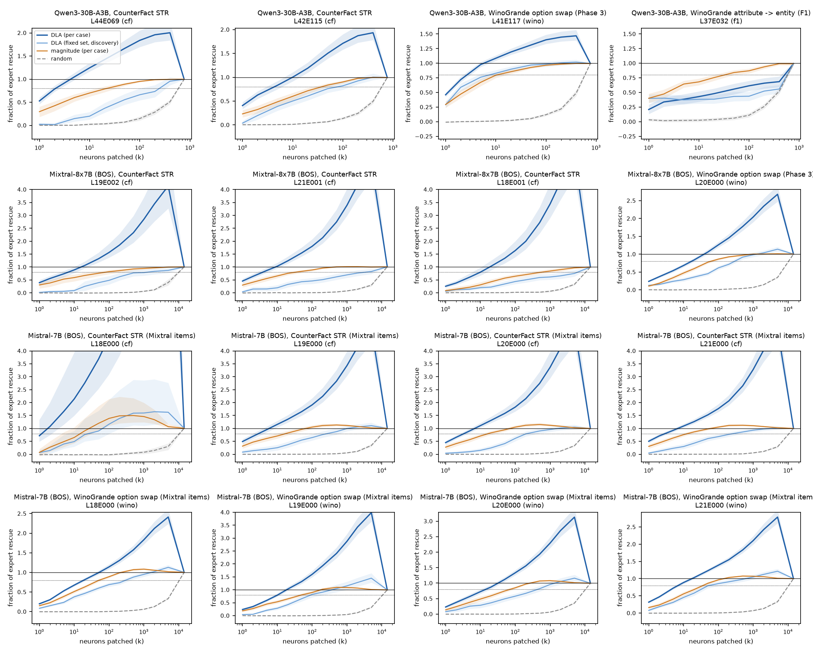
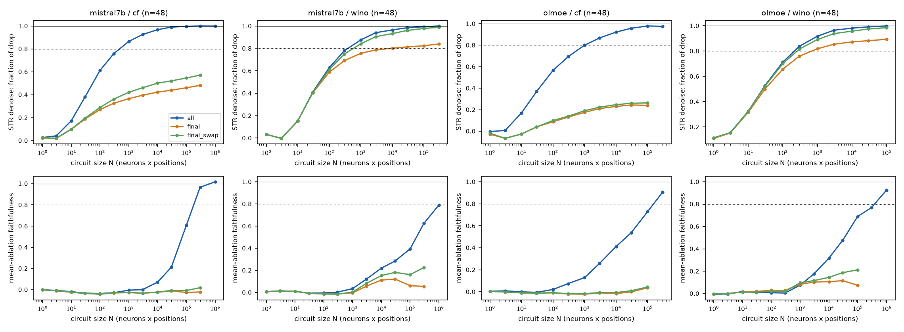

**Summary.** P6-5 asks whether the expert-level picture goes down to neurons, whether gradient circuit discovery on the neuron basis (RelP; Arora et al. 2026) can be ported to an MoE and adds something, and whether heads and experts form circuits that belong to a concept rather than a task.
- **C1: a handful of neurons carry a selected expert's effect.** Patching the top neurons of an expert (by their own direct logit attribution, final position) restores 80 % of the expert's own patch with L44E069 2.1, L42E115 4.3, L41E117 2.7 of 768 neurons (Qwen3) and L19E002 6.7, L21E001 3.8, L18E001 9.9, L20E000 17 of 14,336 (Mixtral); a random order needs ~590 / ~10,300. Pre-registered N1 (≤ 50 of 768, Qwen3) holds (for L37E032 only with the magnitude score), N2 (≤ 200 of 14,336, Mixtral) holds.
- **The indirect expert is the exception.** Qwen3 L37E032 (attribute → entity) writes almost nothing to the logits (direct share 0.01), so its neuron DLA is uninformative (k80 511); ranking by activation change × |W_down| needs 33, the exact single-neuron oracle 36.
- **Dense analogue: Mistral-7B's MLP is as sparse.** On the same items, 80 % of an MLP layer's rescue (L18–L21) takes L18 1.2, L19 2.9, L20 3.4, L21 3.0 neurons on CounterFact and L18 19, L19 10, L20 14, L21 7.0 on WinoGrande.
- **Mixtral's experts are upcycled Mistral-7B MLPs, neuron for neuron.** Every Mixtral L20 expert's neuron i best matches Mistral-7B L20 MLP neuron i (100 % of 14,336, mutual), and the experts' top task neurons are the dense model's top neurons: L20E000's top-10 WinoGrande neurons hold Mistral ranks 1, 2, 3, 5, 15, 14311, 8, 9, 7, 4.
- **C2 (RelP pilot, OLMoE and Mistral-7B, 48 STR cases per task): the port works, and its value is at positions C1 cannot see.** At the final position RelP ranks a focal expert's / MLP's neurons about as well as forward DLA (k80 1–8 vs 1–19 neurons; it is clearly better only where the MLP acts indirectly, Mistral WinoGrande subset r 0.95–0.96 vs 0.61–0.78). But on CounterFact three quarters of the exact MLP / MoE-output effect sits at the subject and relation positions (final-position share 0.24 / 0.26), and neuron circuits restricted to the final (+ swapped) position recover at most 0.23 (OLMoE) / 0.50 (Mistral) of the drop at 10,000 nodes, while all-position circuits reach 80 % with 997 / 478 nodes. On WinoGrande the final position dominates (share 0.60–0.67; final-only circuits 0.80–0.87). RelP is only moderately accurate off the final position (r vs exact 0.17–0.65), and in OLMoE 54–56 % of single sublayer patches switch a later top-k set (errors double there).
- **DP3 evidence (user decision):** a gradient method adds (i) the non-final positions, essential for factual recall, and (ii) joint multi-layer sets; it does not add much at the final position. A forward alternative for (i) exists without F3: neuron-level patches at non-final positions in the position executor (`ext5_subject`), ranked by forward scores. Recommendation in the C2 reading below.
- **C3 Qwen3:** SIZE_STATE (3 heads + 8 experts): own tasks lose 0.43 of the clean margin (net of random sets), other tasks 0.09 on average, the CounterFact control 0.05; add-back restores 0.63/0.52 of the drop; COUNTRY (8 heads + 7 experts): own tasks lose 0.70 of the clean margin (net of random sets), other tasks 0.16 on average, the CounterFact control 0.73 (as much as its own tasks: a CounterFact-recall circuit, not a country circuit); add-back restores 0.85/0.80 of the drop; PERSON_ROLE (4 heads + 3 experts): own tasks lose 0.21 of the clean margin (net of random sets), other tasks 0.04 on average, the CounterFact control 0.04; add-back restores 0.56/0.55/0.04 of the drop.
- **C3 Mixtral:** SIZE_STATE (4 heads + 6 experts): own tasks lose 0.32 of the clean margin (net of random sets), other tasks 0.11 on average, the CounterFact control 0.07; add-back restores 0.59/0.48 of the drop; COUNTRY (10 heads + 6 experts): own tasks lose 0.69 of the clean margin (net of random sets), other tasks 0.25 on average, the CounterFact control 0.75 (as much as its own tasks: a CounterFact-recall circuit, not a country circuit); add-back restores 0.91/0.81 of the drop; PERSON_ROLE (3 heads + 7 experts): own tasks lose 0.39 of the clean margin (net of random sets), other tasks 0.02 on average, the CounterFact control 0.02; add-back restores 0.90/0.52/0.03 of the drop.
- **N3 (experts more concept-specific than heads): fails** in 3 of 6 circuit comparisons (selectivity F_own / (|F_own| + mean |F_other|), experts vs heads: Qwen3 SIZE_STATE 0.98 vs 0.56; Qwen3 COUNTRY 0.71 vs 0.82; Qwen3 PERSON_ROLE 0.95 vs 0.82; Mixtral SIZE_STATE 0.93 vs 0.69; Mixtral COUNTRY -0.35 vs 0.74; Mixtral PERSON_ROLE 0.82 vs 0.88). The descriptive AUROC of single-patch effects (in-sample, only where a component was measured) points the other way: Qwen3 heads 0.79 vs experts 0.67; Mixtral heads 0.79 vs experts 0.79 — heads rank higher within their home tasks, but knocking them out also hurts other tasks.

### C1 Neurons inside the selected experts

**Method.** For each selected expert on its own task (STR rows, validation split; CounterFact rows = (case, donor), averaged per case; WinoGrande rows = directed cases), the engine records the expert's intermediate activations a = SiLU(W_gate x) ⊙ (W_up x) at the final position in the clean and corrupted runs (`DiagSpec.expert_neurons`). Scores per neuron: d_i = w_clean a_i,clean − w_corrupt a_i,corrupt (w = the routing weight, 0 when not routed); DLA_i = d_i (W_down[:, i] · u) / rms(h_final, corrupted), u = γ ⊙ (W_U[answer] − W_U[contrast]) (final norm frozen, as the expert DLA of Phase 3/4; Σ_i DLA_i = the slot DLA, r = 1.0000); magnitude_i = |d_i| · ‖W_down[:, i]‖. Validation is exact: kind `expert_neurons` sets a neuron subset to its clean values inside the corrupted run, everything downstream recomputed; the expert's own single-expert patch is 100 %. Rankings: the row's own DLA (per case), magnitude, one fixed order from the discovery-split mean DLA, two random orders. Rows where the expert is routed in neither run contribute 0 to numerator and denominator.

| model, task | expert | neurons | cases (active rows) | expert rescue T [95% CI] | T / drop | direct share (sum DLA / T) | k50 DLA | k80 DLA [95% CI] | k80 fixed set | k80 magnitude | k80 random | per-case k80 median (IQR; n) |
|---|---|---|---|---|---|---|---|---|---|---|---|---|
| Qwen3-30B-A3B, CounterFact STR | L44E069 | 768 | 108 (406) | +1.084 [+0.822, +1.380] | 0.093 | 1.31 | 1.0 | 2.1 [2, 3] | 247 | 22 | 589 | 2.1 (1.5-3.7; 62) |
| Qwen3-30B-A3B, CounterFact STR | L42E115 | 768 | 108 (425) | +0.829 [+0.670, +0.987] | 0.071 | 0.97 | 1.3 | 4.3 [3, 6] | 79 | 38 | 596 | 5.5 (2.3-11; 75) |
| Qwen3-30B-A3B, WinoGrande option swap (Phase 3) | L41E117 | 768 | 256 (229) | +0.987 [+0.835, +1.153] | 0.121 | 1.05 | 1.1 | 2.7 [2, 3] | 7.5 | 11 | 597 | 2.9 (1.7-5.0; 190) |
| Qwen3-30B-A3B, WinoGrande attribute -> entity (F1) | L37E032 | 768 | 256 (254) | +0.502 [+0.423, +0.590] | 0.109 | 0.01 | 25 | 511 [431, 567] | 575 | 33 | 589 | 142 (11-592; 177) |
| Mixtral-8x7B (BOS), CounterFact STR | L19E002 | 14336 | 106 (288) | +0.593 [+0.389, +0.839] | 0.046 | 0.75 | 1.6 | 6.7 [4, 11] | 1239 | 80 | 10030 | 11 (3.2-23; 51) |
| Mixtral-8x7B (BOS), CounterFact STR | L21E001 | 14336 | 106 (309) | +0.663 [+0.506, +0.830] | 0.051 | 0.91 | 1.2 | 3.8 [3, 5] | 3323 | 34 | 10524 | 4.0 (1.8-10; 58) |
| Mixtral-8x7B (BOS), CounterFact STR | L18E001 | 14336 | 106 (345) | +0.396 [+0.304, +0.494] | 0.031 | 0.52 | 3.2 | 9.9 [6, 15] | 6145 | 565 | 10479 | 23 (5.6-55; 53) |
| Mixtral-8x7B (BOS), WinoGrande option swap (Phase 3) | L20E000 | 14336 | 256 (246) | +1.112 [+1.017, +1.211] | 0.145 | 0.56 | 4.1 | 17 [13, 21] | 291 | 60 | 10324 | 17 (5.7-43; 238) |
| Mistral-7B (BOS), CounterFact STR (Mixtral items) | L18E000 | 14336 | 98 (369) | +0.178 [+0.091, +0.275] | 0.015 | 0.64 | 1.0 | 1.2 [1, 2] | 26 | 15 | 10526 | 6.6 (2.6-28; 33) |
| Mistral-7B (BOS), CounterFact STR (Mixtral items) | L19E000 | 14336 | 98 (369) | +0.910 [+0.743, +1.083] | 0.074 | 0.67 | 1.0 | 2.9 [2, 4] | 271 | 17 | 10396 | 4.3 (1.8-8.4; 73) |
| Mistral-7B (BOS), CounterFact STR (Mixtral items) | L20E000 | 14336 | 98 (369) | +1.093 [+0.874, +1.324] | 0.089 | 0.75 | 1.2 | 3.4 [3, 4] | 220 | 17 | 10471 | 4.7 (2.1-9.2; 78) |
| Mistral-7B (BOS), CounterFact STR (Mixtral items) | L21E000 | 14336 | 98 (369) | +1.299 [+1.095, +1.500] | 0.106 | 0.81 | 1.0 | 3.0 [2, 4] | 269 | 13 | 10659 | 3.3 (1.7-6.8; 80) |
| Mistral-7B (BOS), WinoGrande option swap (Mixtral items) | L18E000 | 14336 | 228 (228) | +1.036 [+0.939, +1.130] | 0.143 | 0.35 | 4.4 | 19 [15, 23] | 298 | 52 | 10425 | 23 (8.5-50; 223) |
| Mistral-7B (BOS), WinoGrande option swap (Mixtral items) | L19E000 | 14336 | 228 (228) | +0.692 [+0.605, +0.779] | 0.096 | 0.36 | 3.5 | 10 [8, 12] | 92 | 49 | 10558 | 13 (5.7-25; 194) |
| Mistral-7B (BOS), WinoGrande option swap (Mixtral items) | L20E000 | 14336 | 228 (228) | +1.038 [+0.923, +1.150] | 0.144 | 0.35 | 3.6 | 14 [10, 20] | 441 | 71 | 10368 | 20 (6.1-42; 207) |
| Mistral-7B (BOS), WinoGrande option swap (Mixtral items) | L21E000 | 14336 | 228 (228) | +1.361 [+1.236, +1.495] | 0.189 | 0.54 | 2.2 | 7.0 [6, 8] | 53 | 36 | 10465 | 6.9 (3.8-12; 218) |

k50 / k80 = the number of neurons whose joint patch (set to the clean values inside the corrupted run, final position, downstream recomputed) restores 50 / 80 % of the expert's own single-expert patch (ratio of case means, validation split; log-k interpolation; 'never' = not reached before all neurons). DLA = the row's own neuron DLA ranking; fixed set = one neuron order from the discovery-split mean DLA; magnitude = |w a change| x |W_down column|.
Per-case k80 on cases with T >= 0.25 logits.

**DLA vs exact patching, and how shared the neurons are across cases.**

| expert | task | sum DLA vs expert patch r | subset DLA vs patch r (slope) | single-neuron r (slope; sign agree; n) | top-10 Jaccard across cases (random) | top-50 Jaccard | neurons in >= half of cases' top-10 | pos. DLA mass in top-10 / 50 neurons |
|---|---|---|---|---|---|---|---|---|
| L44E069 | qwen3_cf | 0.93 | 0.95 (0.67) | 0.89 (0.64; 0.74; 3248) | 0.02 (0.0066) | 0.05 | 0 | 0.24 / 0.51 |
| L42E115 | qwen3_cf | 0.80 | 0.87 (0.90) | 0.74 (0.84; 0.64; 3400) | 0.03 (0.0066) | 0.06 | 0 | 0.27 / 0.44 |
| L41E117 | qwen3_wino | 0.86 | 0.90 (0.84) | 0.87 (0.80; 0.69; 1832) | 0.14 (0.0066) | 0.12 | 3 | 0.56 / 0.70 |
| L37E032 | qwen3_f1 | 0.19 | 0.14 (0.72) | 0.09 (1.03; 0.38; 2032) | 0.05 (0.0066) | 0.08 | 0 | 0.15 / 0.30 |
| L19E002 | mixtral_cf | 0.59 | 0.77 (1.08) | 0.53 (1.03; 0.57; 2304) | 0.01 (0.0003) | 0.02 | 0 | 0.07 / 0.14 |
| L21E001 | mixtral_cf | 0.65 | 0.88 (1.00) | 0.62 (0.73; 0.66; 2472) | 0.01 (0.0003) | 0.01 | 0 | 0.08 / 0.16 |
| L18E001 | mixtral_cf | 0.45 | 0.85 (0.98) | 0.40 (0.99; 0.60; 2760) | 0.02 (0.0003) | 0.02 | 0 | 0.04 / 0.08 |
| L20E000 | mixtral_wino | 0.54 | 0.87 (0.85) | 0.69 (0.91; 0.68; 1968) | 0.07 (0.0003) | 0.05 | 1 | 0.08 / 0.15 |
| L18E000 | mistral7b_cf | 0.41 | 0.84 (0.83) | 0.61 (1.08; 0.82; 2952) | 0.02 (0.0003) | 0.02 | 0 | 0.03 / 0.07 |
| L19E000 | mistral7b_cf | 0.62 | 0.85 (1.00) | 0.69 (1.09; 0.80; 2952) | 0.02 (0.0003) | 0.02 | 0 | 0.07 / 0.14 |
| L20E000 | mistral7b_cf | 0.77 | 0.89 (1.09) | 0.77 (1.13; 0.81; 2952) | 0.02 (0.0003) | 0.02 | 0 | 0.06 / 0.14 |
| L21E000 | mistral7b_cf | 0.70 | 0.89 (1.02) | 0.67 (0.90; 0.81; 2952) | 0.02 (0.0003) | 0.02 | 0 | 0.09 / 0.16 |
| L18E000 | mistral7b_wino | 0.75 | 0.82 (0.83) | 0.62 (1.29; 0.83; 1824) | 0.09 (0.0003) | 0.06 | 0 | 0.07 / 0.12 |
| L19E000 | mistral7b_wino | 0.59 | 0.86 (0.82) | 0.72 (1.45; 0.83; 1824) | 0.05 (0.0003) | 0.05 | 0 | 0.03 / 0.07 |
| L20E000 | mistral7b_wino | 0.54 | 0.83 (0.88) | 0.73 (1.51; 0.80; 1824) | 0.05 (0.0003) | 0.05 | 1 | 0.05 / 0.09 |
| L21E000 | mistral7b_wino | 0.64 | 0.87 (0.90) | 0.77 (1.22; 0.84; 1824) | 0.08 (0.0003) | 0.06 | 2 | 0.09 / 0.15 |

Reading:
- One or two neurons already carry half of a direct expert's effect (k50 ≈ 1–4); a positive-DLA ordering then overshoots the expert's net effect (curves above 1) because the expert's remaining neurons write against the answer — the expert's patch is a sum of a few large positive and many small negative terms.
- The top neurons are case-specific: the mean Jaccard overlap of two cases' top-10 sets is 0.01–0.14 (random 0.0003–0.007), and one fixed neuron set chosen on the discovery split needs far more neurons for 80 % (column 'fixed set'). The exception is Qwen3 L41E117 on the option swap (fixed set 7.5; three neurons sit in at least half of the cases' top-10), the most 'single-function' expert of the set.
- Neuron DLA predicts subset patches well for experts that write (r 0.77–0.95, slopes 0.7–1.1) and not for the indirect L37E032 (r 0.14).

**Exact single-neuron oracle (Qwen3 L37E032, the indirect expert).** Every one of the 768 neurons patched alone on 96 validation rows, then top-k sets ordered by these exact single effects ('oracle'); the other rankings on the same rows were measured up to k = 400 only ('never' = below 80 % at k = 400).

| task | expert | rows (cases) | k80 oracle | k80 DLA | k80 magnitude | k80 fixed set | k80 random | single-neuron DLA vs exact r (slope) | sum of singles / expert patch | neurons for 80 % of summed abs. single effects (median) |
|---|---|---|---|---|---|---|---|---|---|---|
| qwen3_f1 | L37E032 | 96 (96) | 36 | never | 17 | never | never | 0.01 (0.66) | -3.16 | 300.0 |

The exact single-neuron effects of L37E032 do not add up (their sum is −3.2× the expert's own patch) and are spread over ~300 neurons per row, so ordering by them is no better than ordering by the activation change × |W_down| (k80 36 vs 17): an expert that acts through later layers is a collective, not a sum of independent neurons.

**Dense analogue (Mistral-7B, BOS).** Items: the Mixtral CounterFact / WinoGrande STR rows (identical tokenizer), kept where Mistral passes its own margin (clean Δ ≥ 1, corrupted Δ ≤ −1; cf 98 of 106 validation cases, wino 228 of 256 validation cases). The MLP-layer patch peaks at L21 (cf), L21 (wino) (normalised MLP rescue at L18–L21: cf 0.01, 0.07, 0.09, 0.11; wino 0.14, 0.10, 0.14, 0.19). The neuron counts are in the table above (rows Mistral-7B; 'E000' = the dense MLP): the dense MLP of one layer is as sparse as a Mixtral expert on the same items (CounterFact 1.2–3.4 neurons for 80 % vs 3.8–9.9; WinoGrande 7–19 vs 17).

**Upcycling cross-check (weights only, CPU).**
- Attention: per-layer cosine Mistral-7B ↔ Mixtral q 0.66, k 0.76, v 0.85, o 0.77 (medians over 32 layers; minima 0.50–0.54; highest in L7–L16, lowest in the first and last layers); RMSNorm weights 0.999 / 0.999; embeddings 0.60, LM head 0.75, final norm 0.999. Mixtral's attention matrices are ≈ 2.8× larger in norm (relative difference ≈ 2.1) but point the same way: continued training from a common parent, not independent models.
- Expert FFNs: the cosine between expert e's neuron i and the dense MLP's neuron i (gate rows, up rows, down columns) is 0.26–0.51 (median over neurons, gate rows, by layer; highest mid-depth). At L20, for all 8 experts the best-matching Mistral neuron of every Mixtral neuron is the SAME index (1.00, 1.00, 1.00, 1.00, 1.00, 1.00, 1.00, 1.00; mutual best matches 1.00, 1.00, 1.00, 1.00, 1.00, 1.00, 1.00, 1.00), matched cosine 0.38–0.45 vs 0.16–0.19 for shuffled weights. Every expert is a copy of the dense MLP that drifted, with the neuron order kept (Lo et al. 2024 report cos ≈ 0.6 at the matrix level).
- Function: under that identity map the experts' top task neurons are the dense model's top neurons (per-neuron population DLA on the same items):

| Mixtral expert ~ Mistral MLP | common cases | Pearson r (Spearman) | top-10 / top-50 / top-200 overlap (chance) | Mistral rank of the expert's top-10 |
|---|---|---|---|---|
| L20E000 ~ L20E000 | 228 | 0.71 (0.14) | 8 / 27 / 79 (0.01 / 0.17 / 2.79) | 1, 2, 3, 5, 15, 14311, 8, 9, 7, 4 |
| L19E002 ~ L19E000 | 98 | 0.73 (0.13) | 7 / 37 / 117 (0.01 / 0.17 / 2.79) | 4, 5, 18, 3, 14, 8, 7, 20, 2, 1 |
| L21E001 ~ L21E000 | 98 | 0.84 (0.14) | 5 / 35 / 103 (0.01 / 0.17 / 2.79) | 1, 7, 5, 2, 8, 12, 23, 15, 20, 13 |
| L18E001 ~ L18E000 | 98 | 0.76 (0.10) | 6 / 32 / 103 (0.01 / 0.17 / 2.79) | 2, 3, 4, 1, 5, 51, 28, 36, 7, 27 |

Low Spearman with high Pearson: most neurons have DLA ≈ 0 in both models (ties in the bulk); the large-effect neurons coincide.

### C2 RelP on the neuron basis (pilot: OLMoE-1B-7B, Mistral-7B)

**Method.** `moetrace/ext14_circuit_relp.py` re-implements the forward pass over the transformers weights (verified: = HF in fp32 on tiny checkpoints; plain gradients = finite differences; bf16 Δ within the engine's noise of HF) with RelP's linearisation for the backward pass (Arora et al. 2026; Rezaei Jafari et al. 2025): RMSNorm denominators frozen (incl. OLMoE's q/k norms), attention pattern frozen, SiLU's sigmoid gate frozen (identity rule), half rule on SiLU(g) ⊙ u. MoE port: top-k set and routing weights frozen (q_e = w_e a_e, w_e a constant), so experts routed in only one run of a pair are scored through the residual gradient W_down_eᵀ ∂Δ/∂h (the gradient exists for every expert). Nodes = neuron × position (positions from the swapped token on for STR; OLMoE: all 64 experts, Mistral: the MLP). Scores: relp_o = (q_clean − q_corrupt) · ∇_RelP Δ at the corrupted run, relp_c at the clean run, atp_o = plain gradient, mean_c = (q_clean − q̄) · ∇_RelP Δ at the clean run (Arora's mean-ablation baseline; MoE: q̄ = the mean where the expert is routed, applied only to experts routed in the live run). Exact checks in the same forward: (V3) the MLP / MoE output at every (layer, position ≥ swap) set to its clean value; (V1) top-k neuron sets of a focal expert / MLP layer at the final position (OLMoE WinoGrande L12E011 / L13E040, CounterFact L13E056; Mistral L18–L21); (V5) top-k final-position nodes over all layers patched jointly; circuits = top-N nodes by |score| per case, evaluated by STR denoising (corrupted input, circuit := clean) and Arora's mean-ablation faithfulness / completeness, with node pools all positions / final + swap position / final position only. Routing switches (OLMoE) = a later layer's final-position top-k set differs from the unpatched corrupted run.

| model / task | cases | exact vs RelP r (all cells; final; non-final) | vs AtP r (all; non-final) | RelP slope | routing switch rate | final-pos share of exact sublayer mass | focal k80: RelP / DLA / AtP / mag / rand | single-neuron r RelP / DLA | multi-layer final-pos k80 of drop (RelP / DLA) |
|---|---|---|---|---|---|---|---|---|---|
| mistral7b / cf | 48 | 0.56; 0.88; 0.60 | 0.37; 0.20 | 1.46 | – | 0.26 | L18E000: 1 / 1 / 1 / 45 / 8817 L19E000: 2 / 2 / 1 / 20 / 9040 L20E000: 3 / 4 / 2 / 21 / 10264 L21E000: 2 / 3 / 2 / 15 / 9820 | L18E000: 0.83 / 0.64; L19E000: 0.92 / 0.73; L20E000: 0.96 / 0.83; L21E000: 0.94 / 0.76 | 276 / 296 |
| mistral7b / wino | 48 | 0.55; 0.93; 0.17 | 0.58; 0.14 | 0.98 | – | 0.60 | L18E000: 8 / 19 / 7 / 46 / 10542 L19E000: 4 / 9 / 4 / 43 / 10541 L20E000: 6 / 12 / 5 / 45 / 10405 L21E000: 5 / 7 / 5 / 35 / 10409 | L18E000: 0.89 / 0.69; L19E000: 0.93 / 0.73; L20E000: 0.93 / 0.76; L21E000: 0.96 / 0.79 | 53 / 62 |
| olmoe / cf | 48 | 0.69; 0.89; 0.65 | 0.60; 0.47 | 1.27 | 0.54 | 0.24 | L13E056: 2 / 2 / 1 / 32 / 738 | L13E056: 0.94 / 0.84 | 141 / 154 |
| olmoe / wino | 48 | 0.89; 0.93; 0.61 | 0.93; 0.67 | 1.04 | 0.56 | 0.67 | L12E011: 3 / 4 / 3 / 9 / 741 L13E040: 3 / 3 / 3 / 14 / 743 | L12E011: 0.95 / 0.89; L13E040: 0.96 / 0.92 | 43 / 49 |

| model / task | pool | STR denoise frac. of drop at N = 10 / 100 / 1000 / 10000 | N for 80 % (denoise) | mean-ablation faithfulness at N = 10 / 100 / 1000 / 10000 | N for F = 0.8 | completeness at N = 100 / 1000 |
|---|---|---|---|---|---|---|
| mistral7b / cf | all | 0.17 / 0.61 / 0.87 / 0.97 | 478 | -0.02 / -0.04 / -0.00 / 0.07 | 180161 | 0.34 / 0.10 |
| mistral7b / cf | final_swap | 0.10 / 0.29 / 0.42 / 0.50 | never | -0.02 / -0.04 / -0.03 / -0.02 | never | 0.84 / 0.70 |
| mistral7b / cf | final | 0.10 / 0.27 / 0.37 / 0.42 | never | -0.02 / -0.04 / -0.03 / -0.02 | never | 0.85 / 0.73 |
| mistral7b / wino | all | 0.15 / 0.63 / 0.88 / 0.96 | 388 | 0.01 / -0.00 / 0.03 / 0.22 | never | 0.38 / 0.09 |
| mistral7b / wino | final_swap | 0.15 / 0.61 / 0.84 / 0.93 | 580 | 0.01 / -0.01 / 0.00 / 0.15 | never | 0.44 / 0.23 |
| mistral7b / wino | final | 0.15 / 0.59 / 0.76 / 0.80 | 8600 | 0.01 / -0.01 / -0.00 / 0.11 | never | 0.50 / 0.37 |
| olmoe / cf | all | 0.17 / 0.57 / 0.80 / 0.92 | 997 | -0.00 / 0.02 / 0.13 / 0.41 | 155041 | 0.42 / 0.23 |
| olmoe / cf | final_swap | -0.03 / 0.10 / 0.19 / 0.25 | never | -0.01 / -0.01 / -0.02 / -0.01 | never | 0.92 / 0.82 |
| olmoe / cf | final | -0.03 / 0.09 / 0.18 / 0.23 | never | -0.01 / -0.01 / -0.02 / -0.02 | never | 0.93 / 0.82 |
| olmoe / wino | all | 0.33 / 0.71 / 0.92 / 0.98 | 215 | 0.02 / 0.01 / 0.08 / 0.32 | 381589 | 0.27 / 0.03 |
| olmoe / wino | final_swap | 0.32 / 0.70 / 0.89 / 0.96 | 258 | 0.01 / 0.02 / 0.10 / 0.15 | never | 0.32 / 0.11 |
| olmoe / wino | final | 0.32 / 0.66 / 0.82 / 0.87 | 685 | 0.01 / 0.03 / 0.08 / 0.11 | never | 0.44 / 0.28 |

Where the top nodes sit:

| model / task | mode | top-N | at final position | at swap position | in between | before swap | mean layer | share of |attr| |
|---|---|---|---|---|---|---|---|---|
| mistral7b / cf | mean | 10 | 0.74 | 0.03 | 0.23 | 0.00 | 20.6 | 0.01 |
| mistral7b / cf | mean | 100 | 0.70 | 0.02 | 0.27 | 0.00 | 18.7 | 0.03 |
| mistral7b / cf | mean | 1000 | 0.74 | 0.01 | 0.25 | 0.00 | 19.6 | 0.07 |
| mistral7b / cf | str | 10 | 0.80 | 0.02 | 0.18 | 0.00 | 23.1 | 0.01 |
| mistral7b / cf | str | 100 | 0.67 | 0.02 | 0.31 | 0.00 | 19.7 | 0.04 |
| mistral7b / cf | str | 1000 | 0.68 | 0.01 | 0.31 | 0.00 | 19.5 | 0.08 |
| mistral7b / wino | mean | 10 | 0.98 | 0.00 | 0.00 | 0.02 | 24.9 | 0.01 |
| mistral7b / wino | mean | 100 | 0.87 | 0.03 | 0.01 | 0.09 | 21.2 | 0.03 |
| mistral7b / wino | mean | 1000 | 0.83 | 0.04 | 0.02 | 0.11 | 20.9 | 0.07 |
| mistral7b / wino | str | 10 | 1.00 | 0.00 | 0.00 | 0.00 | 26.0 | 0.03 |
| mistral7b / wino | str | 100 | 0.94 | 0.04 | 0.02 | 0.00 | 23.2 | 0.07 |
| mistral7b / wino | str | 1000 | 0.90 | 0.07 | 0.03 | 0.00 | 22.4 | 0.13 |
| olmoe / cf | mean | 10 | 0.64 | 0.01 | 0.35 | 0.00 | 10.9 | 0.02 |
| olmoe / cf | mean | 100 | 0.68 | 0.00 | 0.30 | 0.01 | 10.9 | 0.04 |
| olmoe / cf | mean | 1000 | 0.66 | 0.00 | 0.33 | 0.00 | 10.4 | 0.13 |
| olmoe / cf | str | 10 | 0.57 | 0.08 | 0.34 | 0.00 | 10.6 | 0.02 |
| olmoe / cf | str | 100 | 0.58 | 0.07 | 0.35 | 0.00 | 10.2 | 0.05 |
| olmoe / cf | str | 1000 | 0.58 | 0.04 | 0.38 | 0.00 | 10.0 | 0.13 |
| olmoe / wino | mean | 10 | 0.93 | 0.03 | 0.00 | 0.04 | 12.7 | 0.01 |
| olmoe / wino | mean | 100 | 0.87 | 0.04 | 0.01 | 0.08 | 12.0 | 0.04 |
| olmoe / wino | mean | 1000 | 0.84 | 0.05 | 0.01 | 0.09 | 11.9 | 0.11 |
| olmoe / wino | str | 10 | 0.98 | 0.01 | 0.01 | 0.00 | 13.1 | 0.04 |
| olmoe / wino | str | 100 | 0.93 | 0.06 | 0.02 | 0.00 | 12.5 | 0.09 |
| olmoe / wino | str | 1000 | 0.91 | 0.07 | 0.02 | 0.00 | 12.5 | 0.21 |

**Reading and DP3 evidence.**
- *Validity of the port.* The functional forward equals transformers (tiny fp32 exact; bf16 max |ΔΔ| 0.05 Mistral, 0.16 OLMoE (one routing flip)); RelP leaves the forward values unchanged. Against exact sublayer patches, RelP is accurate at the final position (r 0.88–0.93; per-layer curves r 0.96–0.99) and moderately accurate elsewhere (r 0.60–0.65 CounterFact, 0.17–0.61 WinoGrande; slopes 1.0–1.9, i.e. it over-states). Plain AtP is as good at the final position and worse off it on CounterFact (0.20 / 0.47 vs 0.60 / 0.65). Freezing routing costs little on average (OLMoE r 0.87 on cells that switch a later top-k set vs 0.93 on cells that do not) although 54–56 % of cells switch.
- *What C1 already gives.* For one expert / MLP layer at the final position the forward scores are nearly enough: RelP k80 1–8, DLA 1–19, magnitude 9–46 (random 740 / 10,500). RelP helps where the component acts through later layers (Mistral WinoGrande: DLA covers 0.32–0.50 of the MLP's patch, RelP 0.59–0.78; neuron-subset r 0.95–0.96 vs 0.61–0.78). For the most indirect expert we have (Qwen3 L37E032) the exact single-neuron oracle does not beat the magnitude ranking (k80 36 vs 17 on 96 rows): single-neuron effects are not additive there (their sum is −3.2× the expert's patch), so no per-neuron score, gradient or exact, ranks them well.
- *What C1 cannot give.* (a) Non-final positions: CounterFact's neuron circuit lives mostly at the subject (top-1000 RelP nodes: 31–38 % between the swapped token and the final token, mean layer 10 / 20 of 16 / 32); final-position circuits cap at 0.23 / 0.50 of the drop. (b) Joint multi-layer sets at the final position: 43–296 nodes for 80 % of the drop, with RelP and DLA rankings within 10 % of each other.
- *Mean-ablation faithfulness (Arora et al.'s criterion)* is not reached by per-case circuits of practical size in either model (F ≤ 0.41 at 10,000 nodes; 0.8 at 155k–382k nodes or never), while completeness is high (removing the top 1,000 nodes leaves 0.03–0.23 of the effect). Mean-ablating every other neuron at every position takes the model off-distribution; the STR criterion, which only replaces what differs between the twins, is the one our project uses and there the circuits are compact.
- *Recommendation for DP3.* Building F3 (reverse layer streaming for Qwen3-30B / Mixtral) is justified only if the goal is gradient-ranked circuits over ALL positions at scale. For the questions asked so far (which neurons of a known expert, which position carries what), a forward extension is cheaper and exact: neuron-subset patches at a chosen non-final position (the `expert_neurons` vector applied by the position executor), with candidates from forward scores (DLA / magnitude) or from layer-level position grids that already exist (Direction 6b, Phase-6 T4). F3 would add speed of discovery, not new kinds of evidence, and its estimates off the final position need exact validation anyway (r 0.17–0.65 here).

### C3 Concept circuits (existing rows; scope cut 2026-10-17)

**Design.** Concepts and tasks (≥ 2 tasks per concept, the smallest set the existing rows allow): SIZE / STATE = the Phase-3 WinoGrande option swap (≈ Dial-E E3 entity → attribute) and Phase-6 E1 entity → attribute, both restricted to size / state answers; COUNTRY = CounterFact P17 and P27 + P495 (new STR pair sets, NEED HEADS cf_country); PERSON-ROLE = IOI (S2 → IO), Phase-5 F1 and Phase-6 E1 attribute → entity on name items; control = CounterFact language relations. Component effects = existing single head / expert patches at the final position (rescue / drop) on the source VALIDATION split (where the Phase-4 all-layer head runs live; COUNTRY experts by per-expert DLA); top set of a task = top-10 heads + top-10 experts; concept circuit = in the top sets of ≥ 2 of the concept's tasks and in no top set of another concept's task. Held-out test on the source DISCOVERY split (GPU): knockout of the circuit (all / heads only / experts only; heads zeroed by `head_mask`, experts rerouted by `route_mask`) in the clean run of every task, F = fraction of the clean margin lost, minus the mean of 2 matched random sets (same layers, same counts); add-back of the set (one multi spawn per case, denoising); edges A → B = rescue(A) + rescue(B) − rescue(A ∪ B) (the part of A's effect that runs through B). Head layers measured differ between runs (IOI, CounterFact, option swap: all layers; Phase-5/6 cells: their 5 top attention layers), and IOI has no expert singles, so a component can only enter the top sets where it was measured.

## qwen3: concept circuits from existing rows (selection: source validation split; evaluation: source discovery split)

| task | concept | selection units | evaluation pairs | head layers measured | expert rows |
|---|---|---|---|---|---|
| ss_e3 | SIZE_STATE | 172 | 48 | all | yes |
| ss_e1 | SIZE_STATE | 188 | 48 | 36,38,42,43,45 | yes |
| co_p17 | COUNTRY | 96 | 48 | 28,38,39,40,42,43 | yes |
| co_nat | COUNTRY | 192 | 48 | 28,38,39,40,42,43 | yes |
| pr_ioi | PERSON_ROLE | 256 | 48 | all | no |
| pr_f1n | PERSON_ROLE | 140 | 48 | 33,39,42,43,45 | yes |
| pr_e1n | PERSON_ROLE | 32 | 22 | 27,39,42,43,45 | yes |
| ct_lang | CONTROL | 96 | 48 | 28,38,39,40,42,43 | yes |

| concept | tasks | circuit heads | circuit experts | in top sets of other concepts (excluded) | also in the control's top set |
|---|---|---|---|---|---|
| SIZE_STATE | ss_e3, ss_e1 | L38H18, L38H20, L38H21 | L34E119, L38E021, L39E071, L41E053, L41E117, L43E081, L43E114, L44E122 | – | – |
| COUNTRY | co_p17, co_nat | L28H13, L28H15, L40H11, L40H12, L40H13, L40H14, L40H15, L43H11 | L40E030, L40E127, L41E001, L42E115, L43E005, L44E052, L44E069 | L43H15 | L28H13, L28H15, L40E127, L40H11, L40H12, L40H13, L40H14, L40H15, L41E001, L42E115, L43H11, L44E052, L44E069 |
| PERSON_ROLE | pr_ioi, pr_f1n, pr_e1n | L39H27, L39H29, L39H31, L43H22 | L37E032, L37E033, L39E036 | L42H10, L43H15, L43H24 | – |

| task | top heads (mean effect = rescue / drop) | top experts |
|---|---|---|
| ss_e3 | L46H24 +0.119, L41H27 +0.074, L38H18 +0.047, L29H0 +0.043, L38H21 +0.037 | L41E117 +0.145, L43E081 +0.098, L39E071 +0.076, L34E119 +0.054, L44E122 +0.043 |
| ss_e1 | L38H18 +0.051, L36H28 +0.034, L38H21 +0.025, L42H18 +0.022, L43H24 +0.013 | L39E071 +0.115, L38E021 +0.107, L43E081 +0.103, L41E117 +0.100, L34E119 +0.074 |
| co_p17 | L40H13 +0.219, L43H15 +0.067, L43H11 +0.067, L40H15 +0.065, L40H14 +0.057 | L44E069 +0.112, L42E115 +0.083, L43E005 +0.055, L44E052 +0.029, L40E127 +0.023 |
| co_nat | L40H13 +0.267, L43H11 +0.090, L40H15 +0.090, L40H14 +0.069, L43H15 +0.062 | L44E069 +0.186, L42E115 +0.088, L44E052 +0.032, L43E005 +0.029, L41E001 +0.023 |
| pr_ioi | L42H11 +0.180, L43H24 +0.102, L40H2 +0.071, L42H10 +0.069, L43H29 +0.063 | – (no expert rows) |
| pr_f1n | L42H10 +0.283, L39H29 +0.166, L43H24 +0.145, L39H27 +0.093, L39H31 +0.087 | L37E032 +0.176, L39E103 +0.044, L40E115 +0.021, L42E031 +0.018, L33E045 +0.015 |
| pr_e1n | L42H10 +0.294, L43H24 +0.160, L39H27 +0.136, L39H29 +0.119, L39H31 +0.116 | L37E032 +0.098, L37E033 +0.018, L39E036 +0.016, L43E041 +0.014, L45E002 +0.014 |
| ct_lang | L40H13 +0.299, L43H11 +0.098, L40H15 +0.094, L43H15 +0.080, L40H14 +0.069 | L42E115 +0.156, L44E069 +0.129, L41E001 +0.021, L40E127 +0.017, L33E076 +0.015 |

AUROC of each top component for its home concept (selection cases of the tasks where it was measured): heads median 0.786 (n 44), experts median 0.665 (n 42); Mann-Whitney experts > heads p = 0.982

### Knockout matrix: fraction of the clean margin lost F (circuit) minus the mean of 2 matched random sets; evaluation cases

| circuit (part) | ss_e3 (SIZE) | ss_e1 (SIZE) | co_p17 (COUN) | co_nat (COUN) | pr_ioi (PERS) | pr_f1n (PERS) | pr_e1n (PERS) | ct_lang (CONT) | own − other |
|---|---|---|---|---|---|---|---|---|---|
| COUNTRY (all) | -0.037 | -0.042 | +0.664 | +0.735 | +0.042 | +0.061 | +0.034 | +0.726 | +0.569 |
| COUNTRY (experts) | -0.022 | -0.006 | +0.126 | +0.102 | -0.032 | +0.000 | -0.010 | +0.210 | +0.091 |
| COUNTRY (heads) | -0.013 | -0.041 | +0.605 | +0.687 | +0.086 | +0.043 | +0.052 | +0.641 | +0.518 |
| PERSON_ROLE (all) | +0.018 | +0.081 | +0.011 | +0.036 | -0.012 | +0.327 | +0.321 | +0.040 | +0.174 |
| PERSON_ROLE (experts) | -0.011 | -0.002 | -0.002 | -0.002 | -0.004 | +0.099 | +0.104 | +0.001 | +0.070 |
| PERSON_ROLE (heads) | +0.023 | +0.083 | +0.013 | +0.034 | -0.009 | +0.287 | +0.253 | +0.038 | +0.139 |
| SIZE_STATE (all) | +0.369 | +0.488 | +0.003 | +0.000 | -0.007 | +0.234 | +0.241 | +0.048 | +0.342 |
| SIZE_STATE (experts) | +0.246 | +0.362 | -0.002 | -0.003 | -0.003 | -0.005 | +0.006 | +0.022 | +0.301 |
| SIZE_STATE (heads) | +0.125 | +0.101 | +0.005 | +0.003 | -0.007 | +0.239 | +0.246 | +0.026 | +0.027 |

Raw F of the circuits (draw 0) and of the random sets (mean of draws 1-2):

| circuit (part) | ss_e3 | ss_e1 | co_p17 | co_nat | pr_ioi | pr_f1n | pr_e1n | ct_lang |
|---|---|---|---|---|---|---|---|---|
| COUNTRY (all) | -0.001 (0.035) | 0.009 (0.051) | 0.666 (0.002) | 0.740 (0.005) | -0.035 (-0.077) | -0.013 (-0.074) | -0.013 (-0.047) | 0.721 (-0.005) |
| COUNTRY (experts) | -0.010 (0.012) | 0.001 (0.007) | 0.126 (-0.001) | 0.106 (0.005) | -0.025 (0.007) | -0.012 (-0.012) | 0.003 (0.014) | 0.208 (-0.002) |
| COUNTRY (heads) | 0.002 (0.015) | 0.007 (0.048) | 0.608 (0.004) | 0.690 (0.003) | 0.003 (-0.083) | -0.011 (-0.054) | -0.006 (-0.058) | 0.640 (-0.002) |
| PERSON_ROLE (all) | 0.015 (-0.003) | 0.067 (-0.013) | 0.012 (0.001) | 0.033 (-0.002) | -0.008 (0.004) | 0.319 (-0.008) | 0.334 (0.013) | 0.040 (-0.000) |
| PERSON_ROLE (experts) | -0.008 (0.003) | 0.008 (0.010) | -0.001 (0.001) | 0.000 (0.002) | -0.001 (0.003) | 0.089 (-0.010) | 0.109 (0.005) | 0.002 (0.001) |
| PERSON_ROLE (heads) | 0.014 (-0.009) | 0.062 (-0.020) | 0.015 (0.002) | 0.033 (-0.001) | -0.009 (0.000) | 0.283 (-0.003) | 0.268 (0.016) | 0.037 (-0.002) |
| SIZE_STATE (all) | 0.364 (-0.005) | 0.474 (-0.013) | 0.002 (-0.002) | -0.005 (-0.005) | -0.011 (-0.004) | 0.226 (-0.008) | 0.239 (-0.002) | 0.032 (-0.016) |
| SIZE_STATE (experts) | 0.242 (-0.003) | 0.359 (-0.002) | -0.001 (0.001) | -0.000 (0.003) | -0.001 (0.002) | 0.002 (0.007) | 0.002 (-0.004) | 0.020 (-0.002) |
| SIZE_STATE (heads) | 0.116 (-0.008) | 0.086 (-0.015) | 0.001 (-0.004) | -0.003 (-0.006) | -0.010 (-0.004) | 0.226 (-0.014) | 0.242 (-0.003) | 0.012 (-0.014) |

Specificity per circuit part (N3): F_own = mean net F on the concept's own tasks, F_other = mean |net F| on every other task (other concepts and the control), selectivity = F_own / (|F_own| + F_other):

| circuit (part) | F_own | F_other (mean abs) | F on the control task | selectivity |
|---|---|---|---|---|
| COUNTRY (all) | +0.700 | 0.157 | +0.726 | 0.82 |
| COUNTRY (experts) | +0.114 | 0.047 | +0.210 | 0.71 |
| COUNTRY (heads) | +0.646 | 0.146 | +0.641 | 0.82 |
| PERSON_ROLE (all) | +0.212 | 0.037 | +0.040 | 0.85 |
| PERSON_ROLE (experts) | +0.066 | 0.004 | +0.001 | 0.95 |
| PERSON_ROLE (heads) | +0.177 | 0.038 | +0.038 | 0.82 |
| SIZE_STATE (all) | +0.429 | 0.089 | +0.048 | 0.83 |
| SIZE_STATE (experts) | +0.304 | 0.007 | +0.022 | 0.98 |
| SIZE_STATE (heads) | +0.113 | 0.087 | +0.026 | 0.56 |

### Add-back of the concept set (fraction of the drop restored; matched random sets in parentheses)

| circuit (part) | ss_e3 | ss_e1 | co_p17 | co_nat | pr_ioi | pr_f1n | pr_e1n | ct_lang |
|---|---|---|---|---|---|---|---|---|
| COUNTRY (all) | 0.015 (0.031) | 0.005 (0.015) | 0.801 (0.020) | 0.852 (0.013) | 0.004 (-0.020) | 0.006 (-0.043) | 0.008 (-0.013) | 0.814 (0.026) |
| COUNTRY (experts) | -0.001 (0.028) | -0.001 (0.010) | 0.276 (0.001) | 0.329 (0.000) | 0.006 (0.002) | 0.010 (0.002) | 0.008 (0.006) | 0.329 (0.005) |
| COUNTRY (heads) | 0.015 (0.003) | 0.005 (0.006) | 0.795 (0.018) | 0.823 (0.011) | -0.001 (-0.024) | -0.004 (-0.048) | 0.002 (-0.015) | 0.783 (0.021) |
| PERSON_ROLE (all) | 0.003 (0.007) | 0.050 (-0.007) | 0.003 (-0.000) | 0.007 (-0.000) | 0.043 (0.006) | 0.554 (-0.007) | 0.557 (-0.000) | 0.010 (0.001) |
| PERSON_ROLE (experts) | -0.001 (0.005) | 0.001 (0.003) | -0.001 (-0.000) | -0.001 (-0.001) | 0.001 (0.002) | 0.173 (-0.003) | 0.154 (0.001) | -0.000 (0.001) |
| PERSON_ROLE (heads) | 0.004 (0.002) | 0.049 (-0.010) | 0.004 (-0.000) | 0.008 (-0.000) | 0.043 (0.004) | 0.443 (-0.005) | 0.455 (0.001) | 0.012 (0.002) |
| SIZE_STATE (all) | 0.523 (-0.002) | 0.626 (-0.002) | 0.001 (0.001) | 0.001 (0.001) | -0.003 (0.001) | 0.280 (-0.021) | 0.290 (-0.014) | 0.004 (0.000) |
| SIZE_STATE (experts) | 0.446 (0.000) | 0.527 (0.001) | -0.000 (0.001) | -0.001 (0.002) | 0.000 (0.000) | -0.002 (-0.004) | 0.001 (0.003) | 0.002 (0.002) |
| SIZE_STATE (heads) | 0.102 (-0.001) | 0.100 (-0.002) | 0.001 (0.000) | -0.000 (-0.003) | -0.002 (0.001) | 0.275 (-0.018) | 0.293 (-0.015) | 0.003 (-0.001) |

### Edges A -> B among circuit components (mediated effect rescue(A) + rescue(B) - rescue(A u B) / drop; top 12)

| concept | A | B | edge / drop | share of A's rescue through B |
|---|---|---|---|---|
| COUNTRY | L40H13 | L44E069 | +0.034 | 0.14 |
| SIZE_STATE | L34E119 | L43E081 | +0.011 | 0.15 |
| PERSON_ROLE | L39H29 | L43H22 | +0.009 | 0.14 |
| PERSON_ROLE | L39H27 | L43H22 | +0.009 | 0.19 |
| SIZE_STATE | L34E119 | L41E117 | +0.009 | 0.12 |
| PERSON_ROLE | L39H31 | L43H22 | +0.008 | 0.18 |
| COUNTRY | L40H13 | L42E115 | +0.008 | 0.03 |
| PERSON_ROLE | L37E032 | L43H22 | +0.008 | 0.15 |
| COUNTRY | L40H15 | L44E069 | +0.006 | 0.09 |
| SIZE_STATE | L38E021 | L43E081 | +0.006 | 0.10 |
| SIZE_STATE | L39E071 | L43E081 | +0.005 | 0.05 |
| COUNTRY | L40H14 | L44E069 | +0.005 | 0.08 |

## mixtral_bos: concept circuits from existing rows (selection: source validation split; evaluation: source discovery split)

| task | concept | selection units | evaluation pairs | head layers measured | expert rows |
|---|---|---|---|---|---|
| ss_e3 | SIZE_STATE | 172 | 48 | all | yes |
| ss_e1 | SIZE_STATE | 72 | 36 | 13,15,16,18,19 | yes |
| co_p17 | COUNTRY | 96 | 48 | 13,15,16,18,19,24 | yes |
| co_nat | COUNTRY | 192 | 48 | 13,15,16,18,19,24 | yes |
| pr_ioi | PERSON_ROLE | 256 | 48 | 16,19,21,22,31 | no |
| pr_f1n | PERSON_ROLE | 24 | 11 | 15,16,19,21,27 | yes |
| pr_e1n | PERSON_ROLE | 32 | 14 | 13,16,18,19,23 | yes |
| ct_lang | CONTROL | 96 | 48 | 13,15,16,18,19,24 | yes |

| concept | tasks | circuit heads | circuit experts | in top sets of other concepts (excluded) | also in the control's top set |
|---|---|---|---|---|---|
| SIZE_STATE | ss_e3, ss_e1 | L13H18, L13H4, L15H7, L19H13 | L21E004, L21E006, L24E002, L25E002, L26E002, L26E007 | L15H8, L19E006, L19H12, L20E000 | L15H7, L21E006, L26E007 |
| COUNTRY | co_p17, co_nat | L15H1, L15H3, L18H12, L18H14, L18H4, L19H29, L19H30, L24H21, L24H22, L24H23 | L19E002, L21E001, L22E001, L23E002, L25E003, L28E002 | L18E001 | L15H1, L15H3, L18H12, L18H4, L19H29, L19H30, L21E001, L22E001, L24H21, L24H22, L24H23 |
| PERSON_ROLE | pr_ioi, pr_f1n, pr_e1n | L16H1, L16H12, L16H14 | L15E002, L15E006, L16E005, L17E007, L19E007, L20E006, L28E003 | L16H0, L19H8 | – |

| task | top heads (mean effect = rescue / drop) | top experts |
|---|---|---|
| ss_e3 | L25H9 +0.084, L22H20 +0.068, L19H13 +0.059, L13H18 +0.034, L19H12 +0.029 | L20E000 +0.154, L19E006 +0.134, L21E006 +0.101, L24E002 +0.091, L26E002 +0.088 |
| ss_e1 | L19H13 +0.108, L15H8 +0.085, L19H12 +0.079, L16H0 +0.075, L15H7 +0.068 | L21E004 +0.112, L25E002 +0.104, L26E002 +0.101, L20E000 +0.083, L22E000 +0.080 |
| co_p17 | L24H22 +0.168, L18H4 +0.168, L19H29 +0.064, L24H23 +0.041, L24H21 +0.019 | L19E002 +0.065, L21E001 +0.045, L22E001 +0.028, L20E000 +0.025, L18E001 +0.018 |
| co_nat | L18H4 +0.273, L24H22 +0.233, L19H29 +0.111, L24H23 +0.071, L24H21 +0.061 | L21E001 +0.063, L19E002 +0.051, L25E003 +0.036, L22E001 +0.036, L20E005 +0.026 |
| pr_ioi | L21H6 +0.108, L19H10 +0.065, L31H5 +0.064, L16H15 +0.051, L19H8 +0.050 | – (no expert rows) |
| pr_f1n | L16H1 +0.145, L19H8 +0.136, L19H18 +0.121, L16H14 +0.116, L19H14 +0.090 | L17E007 +0.125, L16E005 +0.115, L18E001 +0.057, L15E002 +0.053, L15E006 +0.044 |
| pr_e1n | L16H1 +0.481, L19H8 +0.332, L13H11 +0.299, L16H0 +0.230, L18H10 +0.116 | L17E007 +0.239, L16E005 +0.101, L15E006 +0.096, L28E003 +0.084, L19E007 +0.043 |
| ct_lang | L18H4 +0.307, L24H22 +0.248, L19H29 +0.105, L24H21 +0.080, L24H23 +0.059 | L22E005 +0.036, L20E005 +0.035, L19E006 +0.029, L21E006 +0.025, L21E001 +0.023 |

AUROC of each top component for its home concept (selection cases of the tasks where it was measured): heads median 0.792 (n 41), experts median 0.794 (n 35); Mann-Whitney experts > heads p = 0.426

### Knockout matrix: fraction of the clean margin lost F (circuit) minus the mean of 2 matched random sets; evaluation cases

| circuit (part) | ss_e3 (SIZE) | ss_e1 (SIZE) | co_p17 (COUN) | co_nat (COUN) | pr_ioi (PERS) | pr_f1n (PERS) | pr_e1n (PERS) | ct_lang (CONT) | own − other |
|---|---|---|---|---|---|---|---|---|---|
| COUNTRY (all) | -0.059 | -0.159 | +0.613 | +0.776 | -0.132 | -0.241 | -0.164 | +0.754 | +0.695 |
| COUNTRY (experts) | -0.036 | -0.066 | -0.016 | -0.007 | +0.004 | -0.012 | +0.002 | +0.005 | +0.006 |
| COUNTRY (heads) | -0.029 | -0.106 | +0.610 | +0.766 | -0.140 | -0.256 | -0.170 | +0.743 | +0.681 |
| PERSON_ROLE (all) | +0.003 | +0.054 | +0.005 | +0.010 | +0.007 | +0.509 | +0.658 | +0.015 | +0.374 |
| PERSON_ROLE (experts) | -0.011 | -0.095 | -0.020 | -0.012 | -0.014 | +0.179 | +0.226 | -0.003 | +0.158 |
| PERSON_ROLE (heads) | +0.017 | +0.173 | +0.024 | +0.016 | +0.032 | +0.483 | +0.586 | +0.022 | +0.317 |
| SIZE_STATE (all) | +0.228 | +0.409 | +0.040 | +0.062 | +0.026 | +0.307 | +0.134 | +0.065 | +0.212 |
| SIZE_STATE (experts) | +0.107 | +0.162 | +0.005 | +0.005 | -0.001 | +0.044 | +0.000 | -0.004 | +0.126 |
| SIZE_STATE (heads) | +0.125 | +0.303 | +0.038 | +0.055 | +0.027 | +0.254 | +0.135 | +0.066 | +0.118 |

Raw F of the circuits (draw 0) and of the random sets (mean of draws 1-2):

| circuit (part) | ss_e3 | ss_e1 | co_p17 | co_nat | pr_ioi | pr_f1n | pr_e1n | ct_lang |
|---|---|---|---|---|---|---|---|---|
| COUNTRY (all) | 0.004 (0.063) | 0.003 (0.162) | 0.613 (0.000) | 0.768 (-0.008) | -0.030 (0.102) | -0.014 (0.227) | -0.011 (0.153) | 0.746 (-0.008) |
| COUNTRY (experts) | -0.002 (0.035) | -0.001 (0.065) | -0.011 (0.005) | -0.003 (0.004) | 0.009 (0.005) | 0.007 (0.019) | 0.016 (0.014) | 0.004 (-0.001) |
| COUNTRY (heads) | 0.008 (0.037) | -0.008 (0.098) | 0.606 (-0.004) | 0.757 (-0.009) | -0.042 (0.098) | -0.038 (0.218) | -0.021 (0.149) | 0.734 (-0.008) |
| PERSON_ROLE (all) | 0.031 (0.027) | 0.071 (0.018) | 0.028 (0.023) | 0.009 (-0.000) | 0.020 (0.013) | 0.601 (0.092) | 0.642 (-0.016) | 0.021 (0.006) |
| PERSON_ROLE (experts) | 0.028 (0.039) | 0.002 (0.097) | 0.004 (0.024) | -0.002 (0.010) | -0.012 (0.002) | 0.300 (0.121) | 0.232 (0.006) | 0.004 (0.007) |
| PERSON_ROLE (heads) | 0.007 (-0.010) | 0.074 (-0.098) | 0.024 (0.000) | 0.009 (-0.007) | 0.037 (0.005) | 0.454 (-0.029) | 0.585 (-0.001) | 0.022 (0.000) |
| SIZE_STATE (all) | 0.242 (0.015) | 0.452 (0.043) | 0.037 (-0.004) | 0.061 (-0.000) | 0.055 (0.028) | 0.328 (0.020) | 0.188 (0.054) | 0.068 (0.003) |
| SIZE_STATE (experts) | 0.106 (-0.001) | 0.149 (-0.013) | -0.000 (-0.006) | 0.001 (-0.004) | 0.003 (0.004) | 0.044 (0.000) | 0.014 (0.014) | -0.003 (0.001) |
| SIZE_STATE (heads) | 0.141 (0.016) | 0.352 (0.049) | 0.038 (0.000) | 0.060 (0.005) | 0.053 (0.027) | 0.276 (0.022) | 0.183 (0.048) | 0.070 (0.004) |

Specificity per circuit part (N3): F_own = mean net F on the concept's own tasks, F_other = mean |net F| on every other task (other concepts and the control), selectivity = F_own / (|F_own| + F_other):

| circuit (part) | F_own | F_other (mean abs) | F on the control task | selectivity |
|---|---|---|---|---|
| COUNTRY (all) | +0.695 | 0.251 | +0.754 | 0.73 |
| COUNTRY (experts) | -0.011 | 0.021 | +0.005 | -0.35 |
| COUNTRY (heads) | +0.688 | 0.240 | +0.743 | 0.74 |
| PERSON_ROLE (all) | +0.391 | 0.017 | +0.015 | 0.96 |
| PERSON_ROLE (experts) | +0.130 | 0.028 | -0.003 | 0.82 |
| PERSON_ROLE (heads) | +0.367 | 0.050 | +0.022 | 0.88 |
| SIZE_STATE (all) | +0.318 | 0.106 | +0.065 | 0.75 |
| SIZE_STATE (experts) | +0.135 | 0.010 | -0.004 | 0.93 |
| SIZE_STATE (heads) | +0.214 | 0.096 | +0.066 | 0.69 |

### Add-back of the concept set (fraction of the drop restored; matched random sets in parentheses)

| circuit (part) | ss_e3 | ss_e1 | co_p17 | co_nat | pr_ioi | pr_f1n | pr_e1n | ct_lang |
|---|---|---|---|---|---|---|---|---|
| COUNTRY (all) | 0.009 (0.158) | 0.030 (0.145) | 0.806 (-0.002) | 0.911 (-0.001) | 0.041 (0.058) | 0.060 (0.140) | 0.048 (0.125) | 0.824 (0.061) |
| COUNTRY (experts) | 0.006 (0.124) | 0.019 (0.106) | 0.180 (0.006) | 0.269 (0.013) | 0.033 (0.013) | 0.033 (0.037) | 0.017 (0.048) | 0.079 (0.073) |
| COUNTRY (heads) | 0.003 (0.037) | 0.013 (0.051) | 0.799 (-0.007) | 0.891 (-0.014) | 0.009 (0.046) | 0.041 (0.109) | 0.027 (0.075) | 0.815 (-0.012) |
| PERSON_ROLE (all) | 0.034 (0.095) | -0.012 (0.132) | 0.012 (0.041) | 0.014 (0.073) | 0.027 (0.013) | 0.519 (0.029) | 0.899 (0.022) | 0.013 (0.037) |
| PERSON_ROLE (experts) | 0.035 (0.087) | -0.026 (0.113) | 0.009 (0.041) | 0.013 (0.073) | 0.033 (0.012) | 0.368 (0.027) | 0.628 (0.002) | 0.010 (0.038) |
| PERSON_ROLE (heads) | 0.001 (0.009) | 0.015 (0.016) | 0.003 (-0.001) | 0.003 (-0.001) | -0.006 (0.001) | 0.313 (0.010) | 0.619 (0.019) | 0.004 (0.001) |
| SIZE_STATE (all) | 0.481 (0.004) | 0.587 (0.018) | 0.006 (0.019) | 0.026 (0.083) | 0.009 (0.011) | 0.129 (0.025) | 0.101 (0.028) | 0.050 (0.036) |
| SIZE_STATE (experts) | 0.369 (0.002) | 0.350 (0.005) | -0.000 (0.014) | 0.005 (0.073) | 0.003 (0.012) | 0.012 (0.025) | 0.008 (0.028) | 0.031 (0.031) |
| SIZE_STATE (heads) | 0.206 (0.003) | 0.391 (0.013) | 0.003 (0.003) | 0.020 (0.008) | 0.007 (-0.000) | 0.113 (0.003) | 0.093 (-0.002) | 0.020 (0.006) |

### Edges A -> B among circuit components (mediated effect rescue(A) + rescue(B) - rescue(A u B) / drop; top 12)

| concept | A | B | edge / drop | share of A's rescue through B |
|---|---|---|---|---|
| COUNTRY | L18H4 | L24H22 | +0.035 | 0.15 |
| COUNTRY | L18H4 | L24H23 | +0.013 | 0.05 |
| COUNTRY | L18H4 | L21E001 | +0.011 | 0.05 |
| SIZE_STATE | L21E006 | L26E002 | +0.009 | 0.09 |
| COUNTRY | L18H4 | L23E002 | +0.009 | 0.04 |
| COUNTRY | L18H4 | L25E003 | +0.008 | 0.03 |
| COUNTRY | L18H4 | L28E002 | +0.007 | 0.03 |
| SIZE_STATE | L19H13 | L21E004 | +0.006 | 0.09 |
| SIZE_STATE | L19H13 | L24E002 | +0.006 | 0.09 |
| SIZE_STATE | L19H13 | L25E002 | +0.005 | 0.08 |
| SIZE_STATE | L24E002 | L26E002 | +0.005 | 0.06 |
| SIZE_STATE | L19H13 | L21E006 | +0.005 | 0.07 |

**Reading.** The knockout matrix is the held-out test: circuits are chosen on the source validation split and knocked out on the discovery split, every circuit in every task. A circuit is concept-specific when its own tasks lose much of the clean margin and the other concepts' tasks (and the control) lose about what matched random sets lose. N3 is tested by knocking out the heads and the experts of each circuit separately (selectivity table). Edges are small compared with the components' own effects: the components act mostly in parallel on the final residual (a mover head → late expert path, e.g. Qwen3 L40H13 → L44E069, carries ≈ 0.03 of the drop).

**Caveats.**
- C1 is final-position only (as the engine's `expert_neurons` kind); CounterFact values are donor means; Mistral-7B uses the Mixtral items filtered by its own margin, so its case sets are subsets of Mixtral's. Neuron rankings are per case; a fixed population set is much less efficient (case-specific neurons).
- C2 is a pilot (48 cases per task, two small models): the RelP rules are our re-implementation from the paper's description, not Transluce's code; circuits are per case (no dataset-level aggregation, prompts differ in length); MoE mean ablation uses the routed-token mean (unconditional means wreck OLMoE); gradients use frozen routing while every exact check routes live.
- C3 uses existing rows (scope cut): head layers measured differ between runs (IOI, CounterFact Phase-4, option swap: all layers; Phase-5/6 cells and the new COUNTRY sets: 5–6 top attention layers), IOI has no expert singles, COUNTRY experts are scored by DLA, selection is on the source validation split and evaluation on the discovery split; some sets are small (Phase-6 E1 names 16–22 pairs); 2 random draws per set; knockouts act on the clean run only (heads zeroed, experts rerouted at every position). The concept rule excludes components that also rank high for another concept, which can remove a task's strongest components (IOI's L42H10 / L43H24 are shared with the size / state tasks, so the PERSON-ROLE circuit is the name-attribute part, not IOI's).

**Files.** `moetrace/ext14_circuit.py`, `ext14_circuit_an.py`, `ext14_circuit_relp.py`, `ext14_circuit_c3.py`; `scripts/ext14ci_*` (`ext14ci_all.py` re-runs every analysis and this section); runs `results/p6ci_c1_<task>/`, `results/p6ci_relp_<model>_<task>/`, `results/p6ci_c3_*`, `results/p6ci_upcycle/`; tables `results/tables/ext14ci_*`; summary `results/ext14ci_summary.json`.
