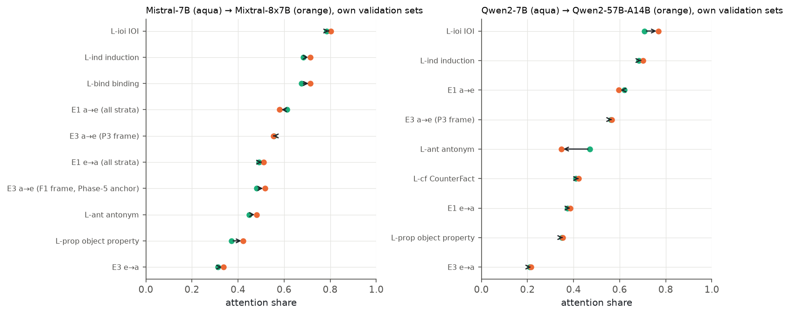
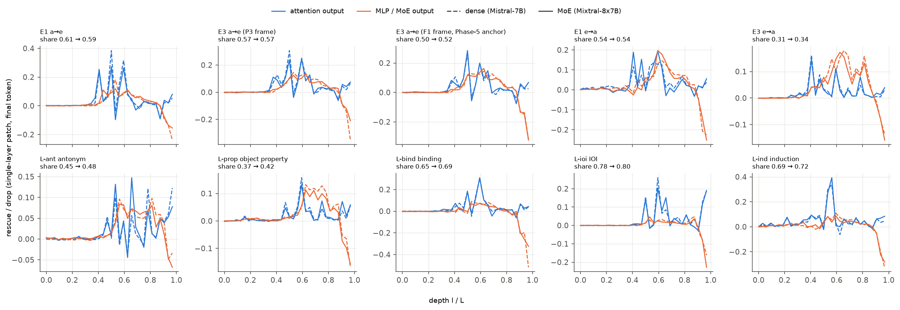
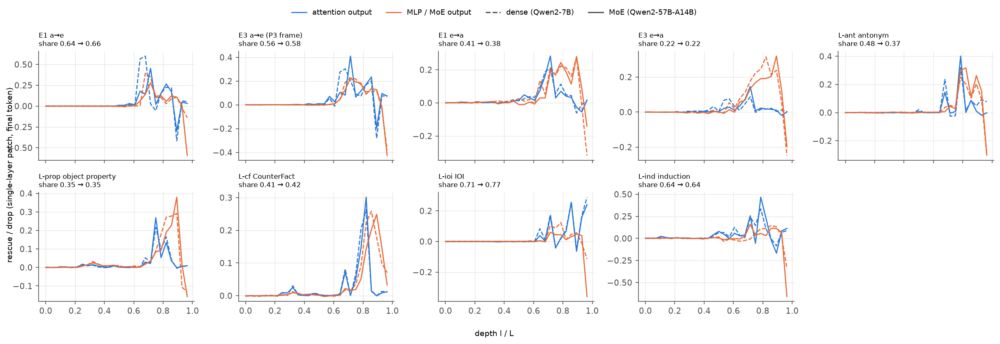

**Summary.** Dense parent vs MoE child (P6-3) on identical prompts (validation pairs common to both models; paired cluster bootstrap). Mistral-7B → Mixtral-8x7B (10 cells, identical prompts): |MoE − dense| ≤ 0.10 in 100% of the cells, MoE ≥ dense + 0.10 in 0%, cell order Spearman +0.98; knowledge cells L-ant antonym +0.03 [+0.01, +0.05], L-prop object property +0.06 [+0.04, +0.07], E3 e→a +0.03 [+0.01, +0.04]; copy cells L-ind induction +0.03 [-0.00, +0.07], L-ioi IOI +0.02 [+0.01, +0.03], L-bind binding +0.04 [+0.02, +0.06], E1 a→e -0.03 [-0.06, +0.01], E1 e→a +0.02 [-0.02, +0.06]. Qwen2-7B → Qwen2-57B-A14B (9 cells, identical prompts): |MoE − dense| ≤ 0.10 in 89% of the cells, MoE ≥ dense + 0.10 in 0%, cell order Spearman +0.90; knowledge cells L-ant antonym -0.11 [-0.13, -0.09], L-prop object property +0.00 [-0.01, +0.02], L-cf CounterFact +0.01 [-0.00, +0.03], E3 e→a -0.01 [-0.04, +0.02]; copy cells L-ind induction +0.02 [-0.01, +0.05], L-ioi IOI +0.06 [+0.05, +0.08], E1 a→e -0.02 [-0.04, -0.00], E1 e→a -0.03 [-0.07, +0.02]. Pre-registered predictions: held D0, D1, D4; failed D2, D3. The hypotheses are H-invariant (D1, best guess D0: the share is a property of the task), H-capacity (D2: more FFN capacity lowers the attention share in knowledge cells only) and H-sparsity (D3: sparse routing raises the attention share).

**Reading.** Mistral-7B → Mixtral-8x7B: 10 cells, MoE − dense between -0.03 and +0.06 (positive in 8), |Δ| > 0.10 only in no cell; the cell order is preserved (Spearman 0.98). Qwen2-7B → Qwen2-57B-A14B: 9 cells, MoE − dense between -0.11 and +0.06 (positive in 5), |Δ| > 0.10 only in L-ant antonym -0.11; the cell order is preserved (Spearman 0.90). Inside Qwen2-57B-A14B the always-on shared expert carries most of the MoE rescue where the answer is an entity or a stored antonym and about half where the answer is an attribute (shared / (shared + routed): L-ant antonym 0.75 [0.72, 0.78], L-prop object property 0.68 [0.66, 0.69], L-cf CounterFact 0.75 [0.72, 0.77], E1 a→e 0.76 [0.72, 0.79], E1 e→a 0.43 [0.40, 0.47], E3 e→a 0.51 [0.48, 0.54], E3 a→e (P3 frame) 0.77 [0.75, 0.80]). Over both twins 18 of 19 cell contrasts are within ±0.10 (H-invariant, D1 / D0); MoE ≥ dense + 0.10 in no cell (H-sparsity, D3); MoE ≤ dense − 0.10 in L-ant antonym (qwen2_57b) (the H-capacity direction, D2). At matched architecture the attention share is a property of the task far more than of the MLP / MoE type.

### What was computed

Twins: Mistral-7B-v0.1 ↔ Mixtral-8x7B-v0.1 (same 32 layers, d 4096, same attention geometry and tokenizer; Mixtral likely upcycled) and Qwen2-7B ↔ Qwen2-57B-A14B (28 layers, d 3584; officially upscaled from Qwen2-7B; one always-on shared expert + 64 routed). The Set-A cells are built once per tokenizer family, so both twins see the same prompts; each cell's comparison uses the pairs that pass the margin rule in both models (R6), with each model's own set reported in `ext14_cells.md`. Dense models: the MLP output plays the role of the MoE output in every readout (single-layer patch, all-MLP M, direct split). Curves on a depth-normalised axis l / (L − 1).

**Dense parent vs MoE child (validation; own sets and paired on the common pairs, which are identical prompts)**

| Twin (dense → MoE) | Cell | Dense, own set | MoE, own set | MoE − dense (own sets) | Common pairs | MoE − dense (paired) | paired, without the last ⌈L/12⌉ layers | Δ A_direct (paired) | Δ M, MoE vs MLP (paired) | Contrast used for D1–D4 |
|---|---|---|---|---|---|---|---|---|---|---|
| Mistral-7B → Mixtral-8x7B | E1 a→e (all strata) † | 0.61 [0.59, 0.63] | 0.58 [0.56, 0.60] | -0.03 [-0.06, -0.01] | 34.0 | -0.03 [-0.06, +0.01] | -0.04 [-0.07, -0.00] | -0.26 [-0.42, -0.10] | -0.09 [-0.18, -0.01] | -0.03 [-0.06, +0.01] (paired (34 common pairs)) |
| Mistral-7B → Mixtral-8x7B | E3 a→e (P3 frame) † | 0.56 [0.54, 0.57] | 0.55 [0.53, 0.57] | -0.00 [-0.03, +0.02] | 19.0 | -0.01 [-0.05, +0.03] | -0.01 [-0.05, +0.02] | -0.11 [-0.25, +0.02] | -0.07 [-0.14, +0.02] | -0.00 [-0.03, +0.02] (own sets (only 19 common pairs)) |
| Mistral-7B → Mixtral-8x7B | E3 a→e (F1 frame, Phase-5 anchor) † | 0.48 [0.46, 0.50] | 0.52 [0.50, 0.54] | +0.04 [+0.01, +0.06] | 36.0 | +0.02 [-0.00, +0.05] | +0.02 [-0.00, +0.05] | +0.12 [+0.01, +0.23] | -0.14 [-0.21, -0.08] | +0.02 [-0.00, +0.05] (paired (36 common pairs)) |
| Mistral-7B → Mixtral-8x7B | E1 e→a (all strata) † | 0.49 [0.46, 0.52] | 0.51 [0.49, 0.53] | +0.02 [-0.02, +0.06] | 26.0 | -0.00 [-0.03, +0.03] | -0.01 [-0.04, +0.02] | +0.01 [-0.10, +0.12] | -0.16 [-0.26, -0.05] | +0.02 [-0.02, +0.06] (own sets (only 26 common pairs)) |
| Mistral-7B → Mixtral-8x7B | E3 e→a | 0.31 [0.30, 0.33] | 0.34 [0.33, 0.35] | +0.03 [+0.01, +0.04] | 59.0 | +0.03 [+0.01, +0.04] | +0.02 [+0.00, +0.03] | +0.08 [+0.06, +0.10] | -0.08 [-0.10, -0.07] | +0.03 [+0.01, +0.04] (paired (59 common pairs)) |
| Mistral-7B → Mixtral-8x7B | L-ant antonym | 0.45 [0.42, 0.48] | 0.48 [0.45, 0.51] | +0.03 [-0.01, +0.07] | 123.0 | +0.03 [+0.01, +0.05] | +0.05 [+0.03, +0.07] | -0.04 [-0.08, -0.01] | +0.03 [-0.00, +0.06] | +0.03 [+0.01, +0.05] (paired (123 common pairs)) |
| Mistral-7B → Mixtral-8x7B | L-prop object property | 0.37 [0.35, 0.39] | 0.42 [0.40, 0.44] | +0.05 [+0.02, +0.08] | 122.0 | +0.06 [+0.04, +0.07] | +0.03 [+0.02, +0.04] | +0.16 [+0.13, +0.19] | -0.17 [-0.20, -0.15] | +0.06 [+0.04, +0.07] (paired (122 common pairs)) |
| Mistral-7B → Mixtral-8x7B | L-bind binding | 0.68 [0.66, 0.69] | 0.71 [0.70, 0.73] | +0.04 [+0.02, +0.06] | 14.0 | +0.04 [+0.02, +0.08] | +0.04 [+0.01, +0.08] | +0.22 [+0.06, +0.40] | -0.21 [-0.36, -0.10] | +0.04 [+0.02, +0.06] (own sets (only 14 common pairs)) |
| Mistral-7B → Mixtral-8x7B | L-ioi IOI | 0.78 [0.78, 0.79] | 0.80 [0.79, 0.81] | +0.02 [+0.00, +0.03] | 128.0 | +0.02 [+0.01, +0.03] | +0.02 [+0.01, +0.03] | +0.08 [+0.06, +0.09] | -0.15 [-0.17, -0.14] | +0.02 [+0.01, +0.03] (paired (128 common pairs)) |
| Mistral-7B → Mixtral-8x7B | L-ind induction | 0.68 [0.67, 0.70] | 0.71 [0.69, 0.73] | +0.03 [+0.01, +0.06] | 50.0 | +0.03 [-0.00, +0.07] | +0.02 [-0.01, +0.06] | +0.11 [+0.02, +0.20] | -0.30 [-0.38, -0.23] | +0.03 [-0.00, +0.07] (paired (50 common pairs)) |
| Mistral-7B → Mixtral-8x7B | D1: \|Δ\| ≤ 0.10 in 100% of 10 cells; D3: Δ ≥ +0.10 in 0%; D4: Spearman of the own-set cell order 0.98 |  |  |  |  |  |  |  |  |  |
| Qwen2-7B → Qwen2-57B-A14B | E1 a→e | 0.62 [0.61, 0.63] | 0.60 [0.58, 0.61] | -0.02 [-0.04, -0.00] | 18.0 | +0.02 [+0.00, +0.05] | +0.04 [+0.02, +0.06] | +0.36 [+0.21, +0.52] | -0.29 [-0.37, -0.20] | -0.02 [-0.04, -0.00] (own sets (only 18 common pairs)) |
| Qwen2-7B → Qwen2-57B-A14B | E3 a→e (P3 frame) | 0.56 [0.55, 0.58] | 0.57 [0.55, 0.58] | +0.00 [-0.02, +0.03] | 35.0 | +0.02 [-0.01, +0.04] | +0.01 [-0.01, +0.04] | -0.04 [-0.12, +0.04] | +0.05 [+0.00, +0.10] | +0.02 [-0.01, +0.04] (paired (35 common pairs)) |
| Qwen2-7B → Qwen2-57B-A14B | E1 e→a | 0.37 [0.35, 0.40] | 0.38 [0.36, 0.41] | +0.01 [-0.02, +0.05] | 32.0 | -0.03 [-0.07, +0.02] | +0.02 [-0.02, +0.06] | -0.18 [-0.31, -0.05] | +0.17 [+0.07, +0.25] | -0.03 [-0.07, +0.02] (paired (32 common pairs)) |
| Qwen2-7B → Qwen2-57B-A14B | E3 e→a | 0.21 [0.19, 0.23] | 0.21 [0.19, 0.24] | +0.01 [-0.02, +0.03] | 65.0 | -0.01 [-0.04, +0.02] | +0.03 [-0.01, +0.06] | -0.00 [-0.02, +0.01] | -0.02 [-0.03, -0.01] | -0.01 [-0.04, +0.02] (paired (65 common pairs)) |
| Qwen2-7B → Qwen2-57B-A14B | L-ant antonym | 0.47 [0.45, 0.49] | 0.35 [0.33, 0.37] | -0.12 [-0.15, -0.09] | 96.0 | -0.11 [-0.13, -0.09] | -0.03 [-0.05, -0.01] | -0.26 [-0.32, -0.19] | +0.25 [+0.19, +0.31] | -0.11 [-0.13, -0.09] (paired (96 common pairs)) |
| Qwen2-7B → Qwen2-57B-A14B | L-prop object property | 0.35 [0.33, 0.37] | 0.35 [0.34, 0.37] | +0.00 [-0.02, +0.02] | 110.0 | +0.00 [-0.01, +0.02] | +0.05 [+0.02, +0.07] | +0.01 [-0.01, +0.02] | -0.02 [-0.04, -0.00] | +0.00 [-0.01, +0.02] (paired (110 common pairs)) |
| Qwen2-7B → Qwen2-57B-A14B | L-cf CounterFact | 0.41 [0.38, 0.44] | 0.42 [0.40, 0.45] | +0.01 [-0.02, +0.05] | 85.0 | +0.01 [-0.00, +0.03] | +0.07 [+0.05, +0.09] | +0.03 [+0.02, +0.05] | -0.04 [-0.06, -0.03] | +0.01 [-0.00, +0.03] (paired (85 common pairs)) |
| Qwen2-7B → Qwen2-57B-A14B | L-ioi IOI | 0.71 [0.70, 0.72] | 0.77 [0.76, 0.78] | +0.06 [+0.05, +0.08] | 127.0 | +0.06 [+0.05, +0.08] | +0.12 [+0.10, +0.13] | +0.24 [+0.20, +0.28] | -0.30 [-0.33, -0.27] | +0.06 [+0.05, +0.08] (paired (127 common pairs)) |
| Qwen2-7B → Qwen2-57B-A14B | L-ind induction † | 0.68 [0.66, 0.70] | 0.70 [0.68, 0.72] | +0.02 [-0.01, +0.05] | 14.0 | +0.01 [-0.06, +0.09] | +0.01 [-0.05, +0.09] | +0.39 [+0.11, +0.83] | +0.02 [-0.24, +0.20] | +0.02 [-0.01, +0.05] (own sets (only 14 common pairs)) |
| Qwen2-7B → Qwen2-57B-A14B | D1: \|Δ\| ≤ 0.10 in 89% of 9 cells; D3: Δ ≥ +0.10 in 0%; D4: Spearman of the own-set cell order 0.90 |  |  |  |  |  |  |  |  |  |

Contrast used for the D predictions: paired on the common pairs when there are ≥ 32, else the difference of the two own validation sets (independent cluster bootstraps). E1-family cells use the all-association-strata variant when it exists for both models (coordinator 2026-10-17 03:19Z). Dense models are tier 1 only (no expert tables, Spec, controls or expert knockouts; the MLP output plays the MoE output's role). The depth-normalised interior variant drops the last ⌈L/12⌉ layers of both models (48 → 4, 32 → 3, 28 → 3, 36 → 3, 40 → 4). † = pooled cell in at least one model.

### Pre-registered predictions

| ID | Prediction | Observed | Verdict |
|---|---|---|---|
| D0 | all Set-A cells: H-invariant for Mistral-7B <-> Mixtral (prior: Li et al. ACL 2025) | mistral7b_bos->mixtral_bos: 1.00 (held) | **held** |
| D1 | Set A: |share_dense - share_MoE| <= 0.10 in >= 80 % of cells | mistral7b_bos->mixtral_bos: 1.00 (held); qwen2_7b->qwen2_57b: 0.89 (held) | **held** |
| D2 | Set A: share_MoE - share_dense <= -0.10 in knowledge cells (L-ant, L-prop, L-cf, E3-e2a) and |diff| <= 0.10 in copy cells (L-ind, L-ioi, L-bind, E1-*) | mistral7b_bos->mixtral_bos: failed; qwen2_7b->qwen2_57b: failed | **failed** |
| D3 | Set A: share_MoE - share_dense >= +0.10 in most cells | mistral7b_bos->mixtral_bos: 0.00 (failed); qwen2_7b->qwen2_57b: 0.00 (failed) | **failed** |
| D4 | Set A: >= 0.8 | mistral7b_bos->mixtral_bos: 0.98 (held); qwen2_7b->qwen2_57b: 0.90 (held) | **held** |

### Caveats

- The twins change capacity and sparsity together; the Qwen3 dense series (`ext14_scale.md`) and the Qwen2-57B shared-vs-routed split separate them only partly.
- Choe et al. (EMNLP 2025) report unusually strong early attention in Qwen dense models: compare the per-layer curves, not only the shares.
- The Mixtral-8x7B upcycling from Mistral-7B is likely (Lo et al. 2024) but not confirmed by Mistral.

### Files

`moetrace/ext14_analysis.py` (`twin_compare`), `scripts/ext14_all.py`; `results/ext14_summary.json` key `twins`; `results/tables/ext14_dense_twins.md`, `results/figures/ext14_dense_*.png`.
