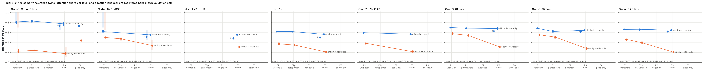
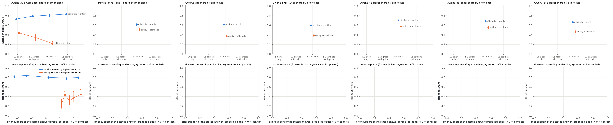
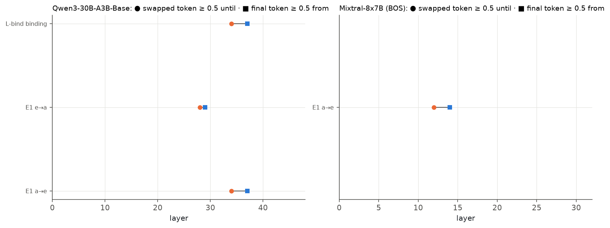
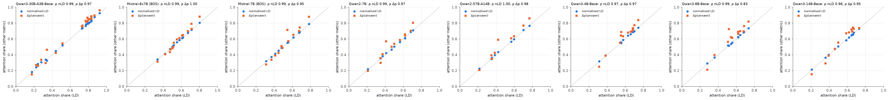
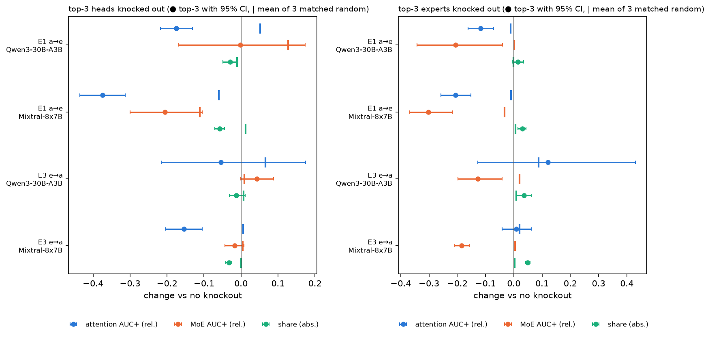
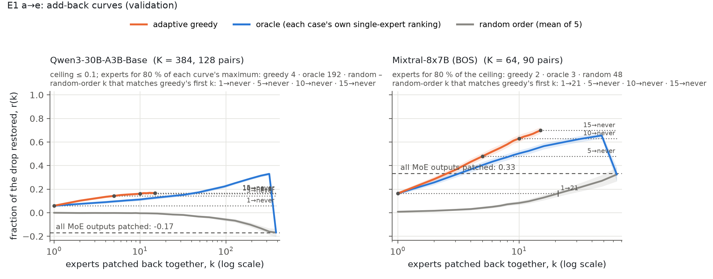

**Summary.** Dial E (P6-2) turns one dial on the same WinoGrande twins: the evidence part of the sentence changes from the binding stated verbatim (E1) to a paraphrase (E1p), a negation (E2) and the original event (E3), while the question line, the STR position and the frame stay fixed. Attention share (validation): Qwen3-30B-A3B-Base: attribute → entity: E1 0.81 [0.78, 0.83], E1p 0.83 [0.80, 0.85], E3 (P3) 0.77 [0.74, 0.80], E3 (F1) 0.73 [0.70, 0.76]; entity → attribute: E1 0.22 [0.20, 0.26], E1p 0.24 [0.21, 0.29], E3 0.18 [0.15, 0.21]; direction gap (a→e − e→a, common twins, n = 48 / 26) at E1 +0.57 [+0.52, +0.60] vs E3 +0.51 [+0.44, +0.55] → **H-type**. Mixtral-8x7B (BOS): attribute → entity: E1 0.62 [0.60, 0.64], E3 (P3) 0.55 [0.53, 0.57], E3 (F1) 0.52 [0.50, 0.54]; entity → attribute: E1 0.50 [0.47, 0.53], E1p 0.47 [0.44, 0.50], E3 0.34 [0.33, 0.35]; direction gap (a→e − e→a, common twins, n = 6 / 48) at E1 +0.12 [+0.03, +0.19] vs E3 +0.21 [+0.19, +0.24] → **not tested: a pooled cell**. Pre-registered predictions: held E1, E5, E11, E12; failed E2, E7, E9, E13; insufficient data E3, E4, E10, E14.

**Reading.** Qwen3: making the binding explicit barely moves the attention share within a direction — attribute → entity E1 0.81, E1p 0.83, E3 in the same frame 0.77, E3 in the F1 frame 0.73, and even with no evidence at all (E0, prior only) 0.73; entity → attribute E1 0.22, E1p 0.24, E3 0.18. The direction gap stays at E1: a→e − e→a = +0.57 [+0.52, +0.60] at E1 vs +0.51 [+0.44, +0.55] at E3 (pairwise (independent resamples of the two gaps); twins 48 / 26), gap(E1) − ½·gap(E3) = +0.32 [+0.26, +0.37]: H-type, not the best-guess H-inference (E13). The share follows the answer type (entity vs attribute), not the number of inference steps between the evidence and the answer. Mixtral: a→e E1 0.62, E3 (P3) 0.55; e→a E1 0.50 (pooled), E3 0.34; the gap shrinks from +0.21 [+0.19, +0.24] at E3 to +0.12 [+0.03, +0.19] at E1 (only 6 / 48 twins, a pooled cell: not usable for E13). Explicit statements raise Mixtral's entity → attribute share, so the two models differ in how much the explicit binding is moved by attention when the answer is an attribute. Direction gap at E1 vs E3 on the models' own sets (a→e − e→a): Qwen3-30B-A3B +0.59 [+0.54, +0.62] vs +0.60 [+0.54, +0.64]; Mixtral-8x7B +0.12 [+0.08, +0.15] vs +0.22 [+0.19, +0.24]; Mistral-7B +0.12 [+0.08, +0.16] vs +0.24 [+0.22, +0.26]; Qwen2-7B +0.25 [+0.22, +0.27] vs +0.35 [+0.33, +0.37]; Qwen2-57B-A14B +0.21 [+0.18, +0.24] vs +0.35 [+0.32, +0.38]; Qwen3-4B +0.12 [+0.09, +0.16] vs +0.37 [+0.34, +0.40]; Qwen3-8B +0.13 [+0.11, +0.16] vs +0.36 [+0.34, +0.39]; Qwen3-14B +0.20 [+0.17, +0.23] vs +0.44 [+0.41, +0.46]. In every model the gap is positive at both levels; whether it narrows at E1 depends on the model (ext14_direction_gap_models.md). E2 (negation) could not be patched in any model (too few pairs pass the margin rule); behaviourally the copy trap wins the attribute → entity cloze in the Qwen3 family (Qwen3-30B-A3B 0.59 [0.57, 0.61], Qwen3-4B 0.60 [0.58, 0.62], Qwen3-8B 0.41 [0.39, 0.43], Qwen3-14B 0.56 [0.54, 0.58], Qwen3-1.7B 0.04 [0.03, 0.05] of pairs by the margin rule, target 0.00), while Mistral / Mixtral / Qwen2 rarely pass either way. Dial A (Qwen3, attribute → entity): conflict 0.83 ≥ neutral 0.81 > agree 0.79 > E0 0.73 — the pre-registered order holds but spans only 0.10; in conflict items the MoE's direct write points against the stated answer (-0.30 [-0.35, -0.26], A2), i.e. the MoE writes the prior and attention overrides it.

### What was computed

Items: the Phase-3 776 WinoGrande twins (plus train_xl twins where a level had < 256 margin pairs), built once per tokenizer family by p6-data (`data/dial/`, `data/dial/build_report.md`). The discovery / validation split is fixed per twin, so a twin is in the same split at every level; paired contrasts use the twins common to the cells compared and the same cluster resamples (unit = twin, 5,000 resamples). Two-entity frames are built in both orders and an item counts only if both orders pass. Frames: attribute → entity, E1-family levels (E1, E1p, E2, E0, R-site, Dial A) and the frame-matched E3p3 = frame P3 `<evidence>. Fill in the blank: The _ was X.\nAnswer: the` (STR = the attribute X in the question; frame pilot below); the Phase-5 anchor E3 = the F1 cloze `Fill in the blank: <sentence>\nAnswer: the`; entity → attribute = the Phase-3 option-swap form at every level (STR = the entity before the copula). Readouts as Phase 5: attention share, A_direct, M_direct, all-MoE M, hand-off layers of the position × layer residual grid, head singles (`ext14_cells.md`).

### Frame pilot (behaviour, before the Dial-E runs)

The E1 attribute → entity cloze in the original frame P0 (`Fill in the blank: {A} and {B}, so the _ was X.`) gave chance-level behaviour, so before any Dial-E patching p6-data piloted five frames on the same 200 core twins (both statement orders, both models; `data/dial/qa/frame_pilot.md`). Frame P3 (`{A} and {B}. Fill in the blank: The _ was X.
Answer: the`) was adopted for every E1-family a→e cell (E1, E1p, E2, E0, R-site, Dial A); `e3p3_a2e` puts the E3 event clause into the same frame and is the frame-matched E3 of the paired a→e dial, while the F1 `e3_a2e` remains the Phase-5 anchor. The low P0 competence is itself a behavioural finding (a frame artefact, not a property of the evidence). All items, both models:

| Model | Frame | Stratum | Items | Margin both ways | Correct both directions | Items both orders margin | Order gap (o1 - o2) | First-mention bias | Median drop |
|---|---|---|---|---|---|---|---|---|---|
| qwen3 | P0 | all | 200 | 0.17 | 0.47 | 0.09 | +0.01 | +0.54 | 1.62 |
| qwen3 | P1 | all | 200 | 0.14 | 0.50 | 0.04 | +0.02 | +0.01 | 1.38 |
| qwen3 | P2 | all | 200 | 0.81 | 0.95 | 0.68 | -0.08 | +0.10 | 4.62 |
| qwen3 | P3 | all | 200 | 0.96 | 0.98 | 0.93 | +0.00 | +0.11 | 7.06 |
| qwen3 | P4 | all | 200 | 0.47 | 0.78 | 0.31 | -0.03 | -0.06 | 3.50 |
| mixtral_bos | P0 | all | 200 | 0.01 | 0.05 | 0.01 | -0.01 | +0.18 | -0.38 |
| mixtral_bos | P1 | all | 200 | 0.01 | 0.06 | 0.01 | +0.00 | +0.09 | -0.50 |
| mixtral_bos | P2 | all | 200 | 0.03 | 0.21 | 0.01 | -0.01 | -0.18 | 0.25 |
| mixtral_bos | P3 | all | 200 | 0.24 | 0.77 | 0.14 | -0.01 | +0.13 | 2.00 |
| mixtral_bos | P4 | all | 200 | 0.29 | 0.61 | 0.16 | +0.05 | -0.37 | 2.12 |

### Dial E: explicitness

**Direction gap a→e − e→a of the attention share per model and level (each cell's own validation set; independent cluster bootstraps)**

| Model | E1 | E1p | E3 (a→e in P3) | E3 (a→e in F1) | E0 |
|---|---|---|---|---|---|
| Qwen3-30B-A3B | +0.59 [+0.54, +0.62] | +0.59 [+0.53, +0.63] | +0.60 [+0.54, +0.64] | +0.56 [+0.51, +0.59] | +0.29 [+0.26, +0.31] † |
| Mixtral-8x7B | +0.12 [+0.08, +0.15] † |  | +0.22 [+0.19, +0.24] | +0.18 [+0.16, +0.20] † |  |
| Mistral-7B | +0.12 [+0.08, +0.16] † (all strata) |  | +0.24 [+0.22, +0.26] † | +0.17 [+0.15, +0.19] † |  |
| Qwen2-7B | +0.25 [+0.22, +0.27] | +0.27 [+0.24, +0.30] | +0.35 [+0.33, +0.37] | +0.29 [+0.26, +0.32] |  |
| Qwen2-57B-A14B | +0.21 [+0.18, +0.24] |  | +0.35 [+0.32, +0.38] |  |  |
| Qwen3-4B | +0.12 [+0.09, +0.16] | +0.14 [+0.12, +0.17] | +0.37 [+0.34, +0.40] | +0.32 [+0.29, +0.35] |  |
| Qwen3-8B | +0.13 [+0.11, +0.16] | +0.11 [+0.08, +0.14] | +0.36 [+0.34, +0.39] | +0.34 [+0.31, +0.37] |  |
| Qwen3-14B | +0.20 [+0.17, +0.23] | +0.27 [+0.24, +0.30] | +0.44 [+0.41, +0.46] | +0.41 [+0.38, +0.43] |  |

Own sets, so the two directions are not on identical twins (paired contrasts for Qwen3 / Mixtral in ext14_dial_e_paired.md). † = pooled cell.

**Dial E: attention share per level and direction (own validation sets)**

| Model | Direction | Level | Pairs | Share | norm. LD | Δp | A_direct | M_direct | All-MoE M | Clean top-1 |
|---|---|---|---|---|---|---|---|---|---|---|
| Qwen3-30B-A3B | attribute → entity | E1 stated verbatim | 128 | 0.81 [0.78, 0.83] | 0.81 [0.78, 0.82] | 0.85 [0.82, 0.87] | 1.33 [1.29, 1.37] | -0.33 [-0.37, -0.29] | -0.16 [-0.20, -0.13] | 0.95 [0.90, 0.98] |
| Qwen3-30B-A3B | attribute → entity | E1p paraphrase | 128 | 0.83 [0.80, 0.85] | 0.82 [0.80, 0.84] | 0.85 [0.83, 0.87] | 1.36 [1.31, 1.41] | -0.36 [-0.41, -0.31] | -0.15 [-0.21, -0.10] | 0.98 [0.96, 1.00] |
| Qwen3-30B-A3B | attribute → entity | E3 event, P3 frame (frame-matched) | 70 | 0.77 [0.74, 0.80] | 0.78 [0.75, 0.81] | 0.82 [0.78, 0.84] | 1.23 [1.16, 1.30] | -0.23 [-0.30, -0.16] | 0.11 [0.05, 0.17] | 0.85 [0.78, 0.91] |
| Qwen3-30B-A3B | attribute → entity | E3 event (original) | 84 | 0.73 [0.70, 0.76] | 0.74 [0.71, 0.76] | 0.77 [0.74, 0.79] | 1.15 [1.07, 1.23] | -0.15 [-0.23, -0.07] | 0.16 [0.10, 0.23] | 0.77 [0.69, 0.84] |
| Qwen3-30B-A3B | attribute → entity | E0 prior only | 128 | 0.73 [0.72, 0.74] | 0.73 [0.72, 0.74] | 0.76 [0.73, 0.78] | 0.97 [0.93, 1.02] | 0.03 [-0.02, 0.07] | 0.16 [0.12, 0.21] | 1.00 [1.00, 1.00] |
| Qwen3-30B-A3B | entity → attribute | E1 stated verbatim | 128 | 0.22 [0.20, 0.26] | 0.24 [0.21, 0.29] | 0.27 [0.22, 0.33] | 0.06 [0.02, 0.11] | 0.94 [0.89, 0.98] | 0.82 [0.79, 0.84] | 0.29 [0.21, 0.37] |
| Qwen3-30B-A3B | entity → attribute | E1p paraphrase | 128 | 0.24 [0.21, 0.29] | 0.28 [0.23, 0.33] | 0.26 [0.20, 0.32] | 0.14 [0.10, 0.18] | 0.86 [0.82, 0.90] | 0.84 [0.80, 0.87] | 0.18 [0.11, 0.24] |
| Qwen3-30B-A3B | entity → attribute | E3 event (original) | 128 | 0.18 [0.15, 0.21] | 0.18 [0.16, 0.22] | 0.15 [0.10, 0.21] | 0.03 [-0.00, 0.06] | 0.97 [0.94, 1.00] | 0.82 [0.81, 0.84] | 0.48 [0.40, 0.55] |
| Qwen3-30B-A3B | entity → attribute | E0 prior only † | 100 | 0.44 [0.42, 0.47] | 0.45 [0.42, 0.48] | 0.42 [0.36, 0.54] | 0.38 [0.35, 0.40] | 0.62 [0.60, 0.65] | 0.60 [0.58, 0.63] | 0.02 [0.00, 0.06] |
| Mixtral-8x7B | attribute → entity | E1 stated verbatim | 90 | 0.62 [0.60, 0.64] | 0.62 [0.60, 0.64] | 0.65 [0.62, 0.67] | 1.04 [0.91, 1.17] | -0.04 [-0.17, 0.09] | 0.33 [0.25, 0.41] | 0.99 [0.98, 1.00] |
| Mixtral-8x7B | attribute → entity | E3 event, P3 frame (frame-matched) | 80 | 0.55 [0.53, 0.57] | 0.56 [0.54, 0.58] | 0.59 [0.57, 0.62] | 0.84 [0.76, 0.91] | 0.16 [0.09, 0.24] | 0.46 [0.43, 0.50] | 0.82 [0.76, 0.89] |
| Mixtral-8x7B | attribute → entity | E3 event (original) † | 113 | 0.52 [0.50, 0.54] | 0.52 [0.50, 0.54] | 0.55 [0.52, 0.58] | 0.86 [0.78, 0.94] | 0.14 [0.06, 0.22] | 0.42 [0.38, 0.47] | 0.68 [0.61, 0.75] |
| Mixtral-8x7B | entity → attribute | E1 stated verbatim † | 80 | 0.50 [0.47, 0.53] | 0.50 [0.48, 0.53] | 0.48 [0.45, 0.51] | 0.69 [0.58, 0.80] | 0.31 [0.20, 0.42] | 0.29 [0.22, 0.36] | 0.70 [0.56, 0.82] |
| Mixtral-8x7B | entity → attribute | E1p paraphrase † | 110 | 0.47 [0.44, 0.50] | 0.47 [0.44, 0.51] | 0.43 [0.41, 0.47] | 0.52 [0.47, 0.57] | 0.48 [0.43, 0.53] | 0.51 [0.46, 0.56] | 0.11 [0.06, 0.17] |
| Mixtral-8x7B | entity → attribute | E3 event (original) | 128 | 0.34 [0.33, 0.35] | 0.34 [0.33, 0.36] | 0.31 [0.29, 0.33] | 0.27 [0.25, 0.29] | 0.73 [0.71, 0.75] | 0.79 [0.77, 0.81] | 0.50 [0.43, 0.58] |
| Mistral-7B | attribute → entity | E3 event, P3 frame (frame-matched) † | 106 | 0.56 [0.54, 0.57] | 0.56 [0.54, 0.57] | 0.57 [0.55, 0.59] | 0.92 [0.86, 0.99] | 0.08 [0.01, 0.14] | 0.52 [0.48, 0.55] | 0.89 [0.84, 0.94] |
| Mistral-7B | attribute → entity | E3 event (original) † | 111 | 0.48 [0.46, 0.50] | 0.49 [0.47, 0.51] | 0.51 [0.48, 0.53] | 0.74 [0.67, 0.81] | 0.26 [0.19, 0.33] | 0.56 [0.53, 0.59] | 0.68 [0.61, 0.76] |
| Mistral-7B | entity → attribute | E3 event (original) | 128 | 0.31 [0.30, 0.33] | 0.32 [0.31, 0.33] | 0.28 [0.25, 0.30] | 0.22 [0.20, 0.24] | 0.78 [0.76, 0.80] | 0.85 [0.83, 0.87] | 0.45 [0.38, 0.52] |
| Qwen2-7B | attribute → entity | E1 stated verbatim | 128 | 0.62 [0.61, 0.63] | 0.61 [0.60, 0.62] | 0.66 [0.65, 0.67] | 0.89 [0.85, 0.93] | 0.11 [0.07, 0.15] | 0.74 [0.72, 0.76] | 1.00 [1.00, 1.00] |
| Qwen2-7B | attribute → entity | E1p paraphrase | 128 | 0.62 [0.61, 0.63] | 0.61 [0.59, 0.62] | 0.64 [0.62, 0.66] | 0.93 [0.88, 0.97] | 0.07 [0.03, 0.12] | 0.65 [0.62, 0.68] | 1.00 [1.00, 1.00] |
| Qwen2-7B | attribute → entity | E3 event, P3 frame (frame-matched) | 96 | 0.56 [0.55, 0.58] | 0.56 [0.54, 0.57] | 0.59 [0.57, 0.60] | 0.92 [0.86, 0.98] | 0.08 [0.02, 0.14] | 0.66 [0.63, 0.69] | 0.92 [0.88, 0.96] |
| Qwen2-7B | attribute → entity | E3 event (original) | 68 | 0.50 [0.47, 0.53] | 0.50 [0.48, 0.53] | 0.54 [0.51, 0.56] | 0.78 [0.68, 0.88] | 0.22 [0.12, 0.32] | 0.71 [0.67, 0.74] | 0.78 [0.69, 0.86] |
| Qwen2-7B | entity → attribute | E1 stated verbatim | 128 | 0.37 [0.35, 0.40] | 0.38 [0.36, 0.41] | 0.41 [0.38, 0.44] | 0.34 [0.26, 0.41] | 0.66 [0.59, 0.74] | 0.68 [0.63, 0.73] | 0.60 [0.50, 0.71] |
| Qwen2-7B | entity → attribute | E1p paraphrase | 128 | 0.35 [0.33, 0.37] | 0.36 [0.34, 0.38] | 0.36 [0.32, 0.40] | 0.23 [0.20, 0.26] | 0.77 [0.74, 0.80] | 0.82 [0.79, 0.84] | 0.24 [0.16, 0.31] |
| Qwen2-7B | entity → attribute | E3 event (original) | 128 | 0.21 [0.19, 0.23] | 0.22 [0.20, 0.24] | 0.20 [0.15, 0.24] | 0.06 [0.05, 0.07] | 0.94 [0.93, 0.95] | 0.94 [0.93, 0.95] | 0.47 [0.40, 0.55] |
| Qwen2-57B-A14B | attribute → entity | E1 stated verbatim | 128 | 0.60 [0.58, 0.61] | 0.60 [0.58, 0.61] | 0.63 [0.62, 0.65] | 1.08 [1.01, 1.16] | -0.08 [-0.16, -0.01] | 0.52 [0.48, 0.55] | 0.99 [0.98, 1.00] |
| Qwen2-57B-A14B | attribute → entity | E3 event, P3 frame (frame-matched) | 128 | 0.57 [0.55, 0.58] | 0.56 [0.55, 0.58] | 0.61 [0.59, 0.63] | 1.00 [0.95, 1.05] | 0.00 [-0.05, 0.05] | 0.67 [0.65, 0.70] | 0.85 [0.79, 0.89] |
| Qwen2-57B-A14B | entity → attribute | E1 stated verbatim | 128 | 0.38 [0.36, 0.41] | 0.40 [0.37, 0.42] | 0.43 [0.38, 0.47] | 0.23 [0.19, 0.28] | 0.77 [0.72, 0.81] | 0.81 [0.79, 0.83] | 0.12 [0.06, 0.19] |
| Qwen2-57B-A14B | entity → attribute | E3 event (original) | 128 | 0.21 [0.19, 0.24] | 0.22 [0.20, 0.25] | 0.21 [0.16, 0.26] | 0.05 [0.03, 0.06] | 0.95 [0.94, 0.97] | 0.92 [0.91, 0.93] | 0.46 [0.39, 0.53] |
| Qwen3-4B | attribute → entity | E1 stated verbatim | 128 | 0.70 [0.69, 0.71] | 0.70 [0.69, 0.71] | 0.77 [0.76, 0.79] | 1.48 [1.42, 1.56] | -0.48 [-0.56, -0.42] | 0.12 [0.06, 0.17] | 0.87 [0.80, 0.92] |
| Qwen3-4B | attribute → entity | E1p paraphrase | 128 | 0.69 [0.67, 0.70] | 0.69 [0.67, 0.70] | 0.73 [0.71, 0.74] | 1.48 [1.41, 1.55] | -0.48 [-0.55, -0.41] | 0.18 [0.13, 0.23] | 0.96 [0.93, 0.99] |
| Qwen3-4B | attribute → entity | E3 event, P3 frame (frame-matched) | 76 | 0.68 [0.66, 0.70] | 0.69 [0.67, 0.71] | 0.71 [0.68, 0.73] | 1.26 [1.19, 1.33] | -0.26 [-0.33, -0.19] | 0.32 [0.27, 0.37] | 0.78 [0.71, 0.85] |
| Qwen3-4B | attribute → entity | E3 event (original) | 78 | 0.63 [0.61, 0.65] | 0.64 [0.62, 0.66] | 0.68 [0.65, 0.70] | 1.30 [1.22, 1.39] | -0.30 [-0.39, -0.22] | 0.40 [0.35, 0.44] | 0.78 [0.70, 0.85] |
| Qwen3-4B | entity → attribute | E1 stated verbatim | 128 | 0.58 [0.55, 0.61] | 0.59 [0.56, 0.62] | 0.63 [0.61, 0.66] | 0.67 [0.58, 0.76] | 0.33 [0.24, 0.42] | 0.32 [0.26, 0.38] | 0.54 [0.44, 0.64] |
| Qwen3-4B | entity → attribute | E1p paraphrase | 120 | 0.54 [0.52, 0.56] | 0.55 [0.53, 0.57] | 0.55 [0.53, 0.57] | 0.59 [0.54, 0.66] | 0.41 [0.34, 0.46] | 0.45 [0.41, 0.49] | 0.11 [0.06, 0.17] |
| Qwen3-4B | entity → attribute | E3 event (original) | 128 | 0.31 [0.29, 0.33] | 0.32 [0.30, 0.34] | 0.25 [0.22, 0.28] | 0.24 [0.22, 0.26] | 0.76 [0.74, 0.78] | 0.81 [0.79, 0.83] | 0.52 [0.45, 0.59] |
| Qwen3-8B | attribute → entity | E1 stated verbatim | 128 | 0.69 [0.67, 0.70] | 0.69 [0.67, 0.70] | 0.76 [0.75, 0.77] | 1.34 [1.28, 1.41] | -0.34 [-0.41, -0.28] | 0.14 [0.09, 0.19] | 0.99 [0.98, 1.00] |
| Qwen3-8B | attribute → entity | E1p paraphrase | 128 | 0.62 [0.60, 0.64] | 0.62 [0.60, 0.64] | 0.66 [0.64, 0.68] | 1.31 [1.25, 1.38] | -0.31 [-0.38, -0.25] | 0.21 [0.17, 0.26] | 1.00 [1.00, 1.00] |
| Qwen3-8B | attribute → entity | E3 event, P3 frame (frame-matched) | 110 | 0.64 [0.63, 0.66] | 0.65 [0.63, 0.67] | 0.70 [0.68, 0.72] | 1.20 [1.14, 1.26] | -0.20 [-0.26, -0.14] | 0.40 [0.37, 0.43] | 0.89 [0.84, 0.93] |
| Qwen3-8B | attribute → entity | E3 event (original) | 128 | 0.62 [0.60, 0.64] | 0.63 [0.60, 0.64] | 0.69 [0.67, 0.71] | 1.18 [1.11, 1.24] | -0.18 [-0.24, -0.11] | 0.39 [0.36, 0.42] | 0.83 [0.77, 0.88] |
| Qwen3-8B | entity → attribute | E1 stated verbatim | 118 | 0.55 [0.53, 0.58] | 0.55 [0.53, 0.57] | 0.61 [0.59, 0.64] | 0.64 [0.55, 0.74] | 0.36 [0.26, 0.45] | 0.28 [0.22, 0.35] | 0.63 [0.51, 0.73] |
| Qwen3-8B | entity → attribute | E1p paraphrase | 120 | 0.51 [0.48, 0.53] | 0.52 [0.49, 0.54] | 0.56 [0.53, 0.59] | 0.51 [0.47, 0.56] | 0.49 [0.44, 0.53] | 0.49 [0.45, 0.52] | 0.08 [0.04, 0.14] |
| Qwen3-8B | entity → attribute | E3 event (original) | 128 | 0.28 [0.26, 0.30] | 0.29 [0.27, 0.31] | 0.21 [0.17, 0.25] | 0.21 [0.19, 0.23] | 0.79 [0.77, 0.81] | 0.82 [0.81, 0.84] | 0.39 [0.31, 0.46] |
| Qwen3-14B | attribute → entity | E1 stated verbatim | 128 | 0.66 [0.65, 0.68] | 0.66 [0.64, 0.67] | 0.74 [0.72, 0.76] | 1.39 [1.31, 1.48] | -0.39 [-0.48, -0.31] | 0.29 [0.23, 0.34] | 1.00 [1.00, 1.00] |
| Qwen3-14B | attribute → entity | E1p paraphrase | 128 | 0.66 [0.64, 0.68] | 0.65 [0.64, 0.67] | 0.74 [0.72, 0.77] | 1.39 [1.31, 1.48] | -0.39 [-0.48, -0.31] | 0.31 [0.25, 0.36] | 1.00 [0.99, 1.00] |
| Qwen3-14B | attribute → entity | E3 event, P3 frame (frame-matched) | 128 | 0.65 [0.63, 0.66] | 0.65 [0.63, 0.66] | 0.72 [0.70, 0.74] | 1.19 [1.13, 1.25] | -0.19 [-0.25, -0.13] | 0.44 [0.40, 0.48] | 0.88 [0.84, 0.92] |
| Qwen3-14B | attribute → entity | E3 event (original) | 128 | 0.62 [0.61, 0.63] | 0.62 [0.60, 0.63] | 0.68 [0.66, 0.70] | 1.26 [1.20, 1.32] | -0.26 [-0.32, -0.20] | 0.40 [0.37, 0.43] | 0.83 [0.78, 0.88] |
| Qwen3-14B | entity → attribute | E1 stated verbatim | 128 | 0.46 [0.44, 0.49] | 0.47 [0.45, 0.50] | 0.48 [0.44, 0.51] | 0.42 [0.35, 0.50] | 0.58 [0.50, 0.65] | 0.58 [0.53, 0.62] | 0.47 [0.39, 0.56] |
| Qwen3-14B | entity → attribute | E1p paraphrase | 128 | 0.39 [0.37, 0.42] | 0.40 [0.37, 0.42] | 0.39 [0.28, 0.49] | 0.31 [0.27, 0.35] | 0.69 [0.65, 0.73] | 0.72 [0.68, 0.75] | 0.17 [0.11, 0.23] |
| Qwen3-14B | entity → attribute | E3 event (original) | 128 | 0.21 [0.19, 0.23] | 0.21 [0.20, 0.23] | 0.15 [0.14, 0.18] | 0.13 [0.11, 0.16] | 0.87 [0.84, 0.89] | 0.85 [0.83, 0.86] | 0.46 [0.38, 0.53] |

**Dial E: paired contrasts on the common WinoGrande twins (same cluster resamples for both cells)**

| Model | Direction | Contrast | Common twins | Share a | Share b | Δ share | Δ A_direct | Δ M |
|---|---|---|---|---|---|---|---|---|
| Qwen3-30B-A3B | attribute → entity | E1p − E1 | 43 | 0.83 [0.80, 0.85] | 0.83 [0.80, 0.85] | +0.01 [-0.01, +0.02] | +0.04 [+0.01, +0.08] | -0.02 [-0.06, +0.02] |
| Qwen3-30B-A3B | attribute → entity | E1 − E3 | 19 | 0.84 [0.80, 0.87] | 0.72 [0.67, 0.77] | +0.12 [+0.07, +0.18] | +0.16 [-0.01, +0.31] | -0.28 [-0.41, -0.15] |
| Qwen3-30B-A3B | attribute → entity | E1p − E3 | 17 | 0.86 [0.81, 0.89] | 0.74 [0.69, 0.78] | +0.12 [+0.07, +0.17] | +0.23 [+0.09, +0.39] | -0.38 [-0.48, -0.28] |
| Qwen3-30B-A3B | attribute → entity | E1 − E3p3 | 19 | 0.83 [0.77, 0.87] | 0.76 [0.69, 0.80] | +0.07 [+0.01, +0.13] | +0.09 [-0.04, +0.21] | -0.22 [-0.32, -0.12] |
| Qwen3-30B-A3B | attribute → entity | E1p − E3p3 | 16 | 0.86 [0.80, 0.89] | 0.77 [0.71, 0.82] | +0.09 [+0.04, +0.14] | +0.03 [-0.07, +0.12] | -0.17 [-0.24, -0.09] |
| Qwen3-30B-A3B | attribute → entity | E3p3 − E3 | 28 | 0.78 [0.73, 0.82] | 0.74 [0.69, 0.77] | +0.04 [-0.00, +0.09] | +0.09 [+0.02, +0.16] | -0.03 [-0.10, +0.04] |
| Qwen3-30B-A3B | entity → attribute | E1p − E1 | 46 | 0.21 [0.18, 0.26] | 0.21 [0.19, 0.25] | +0.00 [-0.04, +0.04] | +0.07 [+0.03, +0.11] | +0.03 [+0.01, +0.05] |
| Qwen3-30B-A3B | entity → attribute | E1 − E3 | 64 | 0.22 [0.20, 0.26] | 0.17 [0.14, 0.22] | +0.05 [+0.00, +0.10] | +0.00 [-0.04, +0.05] | -0.01 [-0.04, +0.01] |
| Qwen3-30B-A3B | entity → attribute | E1p − E3 | 56 | 0.24 [0.20, 0.29] | 0.16 [0.12, 0.21] | +0.08 [+0.02, +0.13] | +0.08 [+0.04, +0.13] | +0.01 [-0.02, +0.04] |
| Qwen3-30B-A3B | a→e − e→a | direction gap at E1 | 48 | 0.80 [0.76, 0.82] | 0.23 [0.20, 0.27] | +0.57 [+0.52, +0.60] | +1.27 [+1.19, +1.34] | -1.00 [-1.06, -0.95] |
| Qwen3-30B-A3B | a→e − e→a | direction gap at E1p | 38 | 0.84 [0.81, 0.86] | 0.22 [0.19, 0.28] | +0.61 [+0.56, +0.64] | +1.23 [+1.15, +1.32] | -1.01 [-1.09, -0.93] |
| Qwen3-30B-A3B | a→e − e→a | direction gap at E3 | 39 | 0.74 [0.70, 0.77] | 0.17 [0.14, 0.22] | +0.56 [+0.50, +0.61] | +1.21 [+1.07, +1.34] | -0.74 [-0.83, -0.64] |
| Qwen3-30B-A3B | a→e − e→a | direction gap at E3p3 | 26 | 0.77 [0.71, 0.80] | 0.26 [0.22, 0.31] | +0.51 [+0.44, +0.55] | +1.19 [+1.06, +1.32] | -0.71 [-0.81, -0.62] |
| Qwen3-30B-A3B | a→e − e→a | direction gap at E0 | 19 | 0.73 [0.70, 0.75] | 0.45 [0.42, 0.49] | +0.28 [+0.23, +0.31] | +0.61 [+0.53, +0.69] | -0.44 [-0.53, -0.36] |
| Qwen3-30B-A3B | a→e − e→a | PRIMARY gap(E1) − ½·gap(E3) with E3 a→e = e3p3_a2e (pairwise (independent resamples of the two gaps)) (H-type if > 0); gap(E1)/gap(E3) = 1.12 [0.99, 1.31]; 'Share a' = gap(E1), 'Share b' = gap(E3) | 48 / 26 | +0.57 [+0.52, +0.60] | +0.51 [+0.44, +0.55] | +0.32 [+0.26, +0.37] |  |  |
| Qwen3-30B-A3B | a→e − e→a | gap(E1) − ½·gap(E3) with E3 a→e = e3_a2e (pairwise (independent resamples of the two gaps)) (H-type if > 0); gap(E1)/gap(E3) = 1.01 [0.90, 1.16]; 'Share a' = gap(E1), 'Share b' = gap(E3) | 48 / 39 | +0.57 [+0.52, +0.60] | +0.56 [+0.50, +0.60] | +0.29 [+0.24, +0.34] |  |  |
| Qwen3-30B-A3B | a→e − e→a | gap(E1) − ½·gap(E3) with E3 a→e = e3p3_a2e (four cells on their common twins) (H-type if > 0); gap(E1)/gap(E3) = 0.98 [0.81, 1.19]; 'Share a' = gap(E1), 'Share b' = gap(E3) | 7 | +0.54 [+0.42, +0.63] | +0.55 [+0.44, +0.57] | +0.27 [+0.16, +0.35] |  |  |
| Qwen3-30B-A3B | a→e − e→a | gap(E1) − ½·gap(E3) with E3 a→e = e3_a2e (four cells on their common twins) (H-type if > 0); gap(E1)/gap(E3) = 1.01 [0.87, 1.30]; 'Share a' = gap(E1), 'Share b' = gap(E3) | 9 | +0.58 [+0.46, +0.65] | +0.57 [+0.44, +0.60] | +0.29 [+0.20, +0.39] |  |  |
| Mixtral-8x7B | attribute → entity | E1 − E3 | 6 | 0.57 [0.51, 0.63] | 0.52 [0.47, 0.58] | +0.05 [-0.06, +0.14] | +0.13 [-0.25, +0.54] | -0.19 [-0.41, +0.06] |
| Mixtral-8x7B | attribute → entity | E1 − E3p3 | 8 | 0.61 [0.56, 0.64] | 0.59 [0.51, 0.65] | +0.02 [-0.02, +0.08] | +0.19 [-0.12, +0.52] | -0.14 [-0.38, +0.08] |
| Mixtral-8x7B | attribute → entity | E3p3 − E3 | 27 | 0.52 [0.49, 0.54] | 0.48 [0.45, 0.51] | +0.04 [+0.01, +0.07] | +0.15 [+0.06, +0.24] | -0.07 [-0.13, -0.01] |
| Mixtral-8x7B | entity → attribute | E1p − E1 | 9 | 0.46 [0.39, 0.53] | 0.51 [0.45, 0.55] | -0.05 [-0.09, -0.00] | -0.17 [-0.34, +0.00] | +0.21 [+0.07, +0.32] |
| Mixtral-8x7B | entity → attribute | E1 − E3 | 11 | 0.49 [0.44, 0.55] | 0.35 [0.31, 0.39] | +0.14 [+0.08, +0.20] | +0.41 [+0.14, +0.68] | -0.55 [-0.70, -0.42] |
| Mixtral-8x7B | entity → attribute | E1p − E3 | 13 | 0.46 [0.40, 0.53] | 0.40 [0.35, 0.45] | +0.06 [+0.02, +0.10] | +0.10 [+0.03, +0.18] | -0.11 [-0.17, -0.04] |
| Mixtral-8x7B | a→e − e→a | direction gap at E1 | 6 | 0.59 [0.54, 0.63] | 0.47 [0.44, 0.53] | +0.12 [+0.03, +0.19] | +0.24 [-0.01, +0.57] | +0.23 [-0.04, +0.50] |
| Mixtral-8x7B | a→e − e→a | direction gap at E3 | 37 | 0.50 [0.46, 0.53] | 0.33 [0.31, 0.35] | +0.17 [+0.13, +0.20] | +0.57 [+0.44, +0.69] | -0.33 [-0.39, -0.26] |
| Mixtral-8x7B | a→e − e→a | direction gap at E3p3 | 48 | 0.55 [0.53, 0.57] | 0.34 [0.32, 0.35] | +0.21 [+0.19, +0.23] | +0.56 [+0.48, +0.65] | -0.33 [-0.38, -0.28] |
| Mixtral-8x7B | a→e − e→a | PRIMARY gap(E1) − ½·gap(E3) with E3 a→e = e3p3_a2e (pairwise (independent resamples of the two gaps)) (H-type if > 0); gap(E1)/gap(E3) = 0.54 [0.15, 0.89]; 'Share a' = gap(E1), 'Share b' = gap(E3) | 6 / 48 | +0.12 [+0.03, +0.19] | +0.21 [+0.19, +0.24] | +0.01 [-0.08, +0.08] |  |  |
| Mixtral-8x7B | a→e − e→a | gap(E1) − ½·gap(E3) with E3 a→e = e3_a2e (pairwise (independent resamples of the two gaps)) (H-type if > 0); gap(E1)/gap(E3) = 0.69 [0.18, 1.19]; 'Share a' = gap(E1), 'Share b' = gap(E3) | 6 / 37 | +0.12 [+0.03, +0.19] | +0.17 [+0.13, +0.20] | +0.03 [-0.06, +0.11] |  |  |
| Mixtral-8x7B | a→e − e→a | gap(E1) − ½·gap(E3) with E3 a→e = e3p3_a2e (four cells on their common twins) (H-type if > 0); gap(E1)/gap(E3) = 0.78 [0.53, 0.78]; 'Share a' = gap(E1), 'Share b' = gap(E3) | 2 | +0.22 [+0.11, +0.26] | +0.29 [+0.20, +0.36] | +0.08 [+0.01, +0.08] |  |  |
| Mixtral-8x7B | a→e − e→a | gap(E1) − ½·gap(E3) with E3 a→e = e3_a2e (four cells on their common twins) (H-type if > 0); gap(E1)/gap(E3) = 1.40 [1.40, 1.40]; 'Share a' = gap(E1), 'Share b' = gap(E3) | 1 | +0.26 [+0.26, +0.26] | +0.18 [+0.18, +0.18] | +0.17 [+0.17, +0.17] |  |  |
| Mistral-7B | attribute → entity | E3p3 − E3 | 57 | 0.55 [0.53, 0.57] | 0.49 [0.46, 0.51] | +0.06 [+0.04, +0.08] | +0.19 [+0.13, +0.25] | -0.03 [-0.07, +0.00] |
| Mistral-7B | a→e − e→a | direction gap at E3 | 30 | 0.48 [0.45, 0.51] | 0.30 [0.28, 0.32] | +0.18 [+0.15, +0.22] | +0.68 [+0.55, +0.82] | -0.36 [-0.43, -0.29] |
| Mistral-7B | a→e − e→a | direction gap at E3p3 | 41 | 0.56 [0.54, 0.59] | 0.32 [0.30, 0.34] | +0.24 [+0.22, +0.27] | +0.78 [+0.67, +0.88] | -0.34 [-0.38, -0.29] |
| Qwen2-7B | attribute → entity | E1p − E1 | 38 | 0.63 [0.62, 0.64] | 0.62 [0.61, 0.63] | +0.01 [+0.00, +0.02] | +0.04 [+0.02, +0.06] | -0.06 [-0.07, -0.05] |
| Qwen2-7B | attribute → entity | E1 − E3 | 11 | 0.62 [0.60, 0.63] | 0.56 [0.52, 0.60] | +0.06 [+0.02, +0.09] | +0.03 [-0.07, +0.11] | -0.02 [-0.07, +0.03] |
| Qwen2-7B | attribute → entity | E1p − E3 | 11 | 0.60 [0.57, 0.62] | 0.52 [0.47, 0.56] | +0.08 [+0.05, +0.11] | +0.19 [+0.05, +0.36] | -0.12 [-0.21, -0.07] |
| Qwen2-7B | attribute → entity | E1 − E3p3 | 29 | 0.62 [0.61, 0.63] | 0.60 [0.58, 0.62] | +0.02 [+0.00, +0.04] | -0.03 [-0.10, +0.03] | +0.02 [-0.01, +0.04] |
| Qwen2-7B | attribute → entity | E1p − E3p3 | 25 | 0.62 [0.59, 0.63] | 0.58 [0.56, 0.60] | +0.03 [+0.02, +0.05] | -0.04 [-0.11, +0.03] | -0.04 [-0.07, -0.00] |
| Qwen2-7B | attribute → entity | E3p3 − E3 | 26 | 0.55 [0.51, 0.58] | 0.49 [0.45, 0.53] | +0.06 [+0.03, +0.08] | +0.16 [+0.09, +0.24] | -0.07 [-0.11, -0.04] |
| Qwen2-7B | entity → attribute | E1p − E1 | 27 | 0.33 [0.30, 0.37] | 0.33 [0.29, 0.36] | +0.01 [-0.01, +0.03] | -0.02 [-0.08, +0.03] | +0.07 [+0.03, +0.12] |
| Qwen2-7B | entity → attribute | E1 − E3 | 35 | 0.39 [0.36, 0.42] | 0.23 [0.21, 0.26] | +0.16 [+0.12, +0.20] | +0.33 [+0.23, +0.44] | -0.30 [-0.36, -0.24] |
| Qwen2-7B | entity → attribute | E1p − E3 | 16 | 0.33 [0.28, 0.38] | 0.26 [0.21, 0.30] | +0.08 [+0.01, +0.13] | +0.11 [+0.03, +0.17] | -0.12 [-0.18, -0.06] |
| Qwen2-7B | a→e − e→a | direction gap at E1 | 19 | 0.62 [0.60, 0.64] | 0.30 [0.27, 0.33] | +0.32 [+0.28, +0.37] | +0.76 [+0.64, +0.87] | -0.11 [-0.16, -0.05] |
| Qwen2-7B | a→e − e→a | direction gap at E1p | 32 | 0.62 [0.60, 0.64] | 0.34 [0.31, 0.37] | +0.28 [+0.23, +0.32] | +0.72 [+0.64, +0.81] | -0.17 [-0.21, -0.13] |
| Qwen2-7B | a→e − e→a | direction gap at E3 | 31 | 0.50 [0.47, 0.54] | 0.20 [0.17, 0.24] | +0.31 [+0.24, +0.36] | +0.75 [+0.58, +0.94] | -0.25 [-0.32, -0.19] |
| Qwen2-7B | a→e − e→a | direction gap at E3p3 | 27 | 0.55 [0.52, 0.58] | 0.20 [0.17, 0.25] | +0.35 [+0.29, +0.40] | +0.90 [+0.76, +1.05] | -0.34 [-0.41, -0.27] |
| Qwen2-7B | a→e − e→a | PRIMARY gap(E1) − ½·gap(E3) with E3 a→e = e3p3_a2e (pairwise (independent resamples of the two gaps)) (H-type if > 0); gap(E1)/gap(E3) = 0.92 [0.76, 1.15]; 'Share a' = gap(E1), 'Share b' = gap(E3) | 19 / 27 | +0.32 [+0.28, +0.37] | +0.35 [+0.29, +0.40] | +0.15 [+0.10, +0.20] |  |  |
| Qwen2-7B | a→e − e→a | gap(E1) − ½·gap(E3) with E3 a→e = e3_a2e (pairwise (independent resamples of the two gaps)) (H-type if > 0); gap(E1)/gap(E3) = 1.06 [0.84, 1.38]; 'Share a' = gap(E1), 'Share b' = gap(E3) | 19 / 31 | +0.32 [+0.28, +0.37] | +0.31 [+0.24, +0.36] | +0.17 [+0.12, +0.22] |  |  |
| Qwen2-7B | a→e − e→a | gap(E1) − ½·gap(E3) with E3 a→e = e3p3_a2e (four cells on their common twins) (H-type if > 0); gap(E1)/gap(E3) = 1.37 [1.37, 1.44]; 'Share a' = gap(E1), 'Share b' = gap(E3) | 2 | +0.42 [+0.34, +0.46] | +0.31 [+0.25, +0.32] | +0.27 [+0.22, +0.30] |  |  |
| Qwen2-57B-A14B | attribute → entity | E1 − E3p3 | 43 | 0.60 [0.58, 0.62] | 0.57 [0.54, 0.59] | +0.03 [+0.01, +0.05] | +0.05 [-0.03, +0.13] | -0.16 [-0.19, -0.12] |
| Qwen2-57B-A14B | entity → attribute | E1 − E3 | 50 | 0.38 [0.36, 0.41] | 0.28 [0.24, 0.32] | +0.11 [+0.07, +0.14] | +0.15 [+0.09, +0.21] | -0.10 [-0.13, -0.07] |
| Qwen2-57B-A14B | a→e − e→a | direction gap at E1 | 34 | 0.59 [0.57, 0.61] | 0.37 [0.34, 0.40] | +0.22 [+0.18, +0.25] | +0.83 [+0.70, +0.96] | -0.29 [-0.34, -0.24] |
| Qwen2-57B-A14B | a→e − e→a | direction gap at E3p3 | 67 | 0.56 [0.54, 0.58] | 0.24 [0.22, 0.27] | +0.32 [+0.29, +0.35] | +0.97 [+0.89, +1.04] | -0.26 [-0.30, -0.22] |
| Qwen2-57B-A14B | a→e − e→a | PRIMARY gap(E1) − ½·gap(E3) with E3 a→e = e3p3_a2e (four cells on their common twins) (H-type if > 0); gap(E1)/gap(E3) = 0.86 [0.73, 1.07]; 'Share a' = gap(E1), 'Share b' = gap(E3) | 21 | +0.24 [+0.20, +0.28] | +0.28 [+0.23, +0.33] | +0.10 [+0.07, +0.14] |  |  |
| Qwen2-57B-A14B | a→e − e→a | gap(E1) − ½·gap(E3) with E3 a→e = e3p3_a2e (pairwise (independent resamples of the two gaps)) (H-type if > 0); gap(E1)/gap(E3) = 0.70 [0.57, 0.83]; 'Share a' = gap(E1), 'Share b' = gap(E3) | 34 / 67 | +0.22 [+0.18, +0.25] | +0.32 [+0.29, +0.35] | +0.06 [+0.02, +0.10] |  |  |
| Qwen3-4B | attribute → entity | E1p − E1 | 47 | 0.68 [0.67, 0.70] | 0.70 [0.69, 0.71] | -0.02 [-0.03, -0.01] | +0.06 [+0.02, +0.09] | +0.00 [-0.02, +0.02] |
| Qwen3-4B | attribute → entity | E1 − E3 | 29 | 0.69 [0.68, 0.71] | 0.63 [0.59, 0.66] | +0.07 [+0.03, +0.10] | +0.08 [-0.04, +0.19] | -0.16 [-0.25, -0.08] |
| Qwen3-4B | attribute → entity | E1p − E3 | 21 | 0.67 [0.66, 0.69] | 0.62 [0.58, 0.66] | +0.05 [+0.02, +0.08] | +0.16 [+0.00, +0.32] | -0.18 [-0.27, -0.09] |
| Qwen3-4B | attribute → entity | E1 − E3p3 | 20 | 0.71 [0.69, 0.73] | 0.65 [0.61, 0.69] | +0.06 [+0.03, +0.10] | +0.09 [-0.04, +0.21] | -0.06 [-0.17, +0.04] |
| Qwen3-4B | attribute → entity | E1p − E3p3 | 16 | 0.69 [0.66, 0.72] | 0.66 [0.62, 0.70] | +0.03 [-0.01, +0.06] | +0.07 [-0.06, +0.20] | +0.02 [-0.08, +0.13] |
| Qwen3-4B | attribute → entity | E3p3 − E3 | 28 | 0.63 [0.61, 0.66] | 0.62 [0.59, 0.64] | +0.02 [-0.00, +0.04] | +0.02 [-0.05, +0.10] | -0.10 [-0.16, -0.05] |
| Qwen3-4B | entity → attribute | E1p − E1 | 26 | 0.50 [0.48, 0.52] | 0.54 [0.50, 0.59] | -0.04 [-0.07, -0.00] | +0.03 [-0.05, +0.11] | +0.14 [+0.07, +0.21] |
| Qwen3-4B | entity → attribute | E1 − E3 | 25 | 0.60 [0.57, 0.63] | 0.38 [0.35, 0.41] | +0.22 [+0.18, +0.26] | +0.39 [+0.27, +0.53] | -0.50 [-0.61, -0.40] |
| Qwen3-4B | entity → attribute | E1p − E3 | 18 | 0.54 [0.51, 0.56] | 0.39 [0.35, 0.43] | +0.15 [+0.10, +0.20] | +0.22 [+0.14, +0.30] | -0.28 [-0.35, -0.21] |
| Qwen3-4B | a→e − e→a | direction gap at E1 | 16 | 0.69 [0.66, 0.71] | 0.58 [0.51, 0.65] | +0.11 [+0.03, +0.18] | +0.70 [+0.44, +0.94] | -0.12 [-0.24, +0.01] |
| Qwen3-4B | a→e − e→a | direction gap at E1p | 12 | 0.70 [0.66, 0.73] | 0.53 [0.48, 0.58] | +0.17 [+0.11, +0.23] | +0.67 [+0.41, +0.87] | -0.17 [-0.32, +0.01] |
| Qwen3-4B | a→e − e→a | direction gap at E3 | 47 | 0.63 [0.60, 0.66] | 0.34 [0.31, 0.37] | +0.29 [+0.24, +0.34] | +1.10 [+0.99, +1.21] | -0.43 [-0.50, -0.37] |
| Qwen3-4B | a→e − e→a | direction gap at E3p3 | 34 | 0.65 [0.63, 0.68] | 0.37 [0.33, 0.40] | +0.29 [+0.24, +0.34] | +1.06 [+0.94, +1.18] | -0.53 [-0.62, -0.43] |
| Qwen3-4B | a→e − e→a | PRIMARY gap(E1) − ½·gap(E3) with E3 a→e = e3p3_a2e (pairwise (independent resamples of the two gaps)) (H-type if > 0); gap(E1)/gap(E3) = 0.38 [0.12, 0.66]; 'Share a' = gap(E1), 'Share b' = gap(E3) | 16 / 34 | +0.11 [+0.03, +0.18] | +0.29 [+0.24, +0.34] | -0.04 [-0.11, +0.04] |  |  |
| Qwen3-4B | a→e − e→a | gap(E1) − ½·gap(E3) with E3 a→e = e3_a2e (pairwise (independent resamples of the two gaps)) (H-type if > 0); gap(E1)/gap(E3) = 0.37 [0.12, 0.64]; 'Share a' = gap(E1), 'Share b' = gap(E3) | 16 / 47 | +0.11 [+0.03, +0.18] | +0.29 [+0.24, +0.34] | -0.04 [-0.11, +0.04] |  |  |
| Qwen3-4B | a→e − e→a | gap(E1) − ½·gap(E3) with E3 a→e = e3p3_a2e (four cells on their common twins) (H-type if > 0); gap(E1)/gap(E3) = 0.26 [-0.02, 0.51]; 'Share a' = gap(E1), 'Share b' = gap(E3) | 3 | +0.06 [-0.01, +0.12] | +0.22 [+0.14, +0.27] | -0.05 [-0.14, +0.00] |  |  |
| Qwen3-4B | a→e − e→a | gap(E1) − ½·gap(E3) with E3 a→e = e3_a2e (four cells on their common twins) (H-type if > 0); gap(E1)/gap(E3) = 0.50 [0.28, 0.73]; 'Share a' = gap(E1), 'Share b' = gap(E3) | 9 | +0.10 [+0.05, +0.13] | +0.19 [+0.13, +0.26] | -0.00 [-0.04, +0.04] |  |  |
| Qwen3-8B | attribute → entity | E1p − E1 | 45 | 0.63 [0.61, 0.66] | 0.69 [0.68, 0.71] | -0.06 [-0.08, -0.05] | -0.02 [-0.06, +0.02] | +0.03 [+0.01, +0.06] |
| Qwen3-8B | attribute → entity | E1 − E3 | 49 | 0.69 [0.67, 0.70] | 0.61 [0.58, 0.63] | +0.08 [+0.05, +0.10] | +0.12 [+0.03, +0.22] | -0.18 [-0.25, -0.12] |
| Qwen3-8B | attribute → entity | E1p − E3 | 41 | 0.63 [0.61, 0.66] | 0.61 [0.58, 0.64] | +0.02 [-0.00, +0.04] | +0.10 [+0.00, +0.20] | -0.14 [-0.22, -0.08] |
| Qwen3-8B | attribute → entity | E1 − E3p3 | 37 | 0.68 [0.66, 0.70] | 0.61 [0.59, 0.64] | +0.07 [+0.05, +0.09] | +0.10 [+0.03, +0.18] | -0.19 [-0.24, -0.13] |
| Qwen3-8B | attribute → entity | E1p − E3p3 | 27 | 0.61 [0.59, 0.64] | 0.63 [0.60, 0.65] | -0.01 [-0.03, +0.01] | +0.07 [-0.01, +0.14] | -0.13 [-0.18, -0.07] |
| Qwen3-8B | attribute → entity | E3p3 − E3 | 77 | 0.64 [0.62, 0.66] | 0.63 [0.60, 0.64] | +0.01 [-0.00, +0.03] | +0.01 [-0.03, +0.06] | +0.00 [-0.03, +0.03] |
| Qwen3-8B | entity → attribute | E1p − E1 | 18 | 0.51 [0.49, 0.54] | 0.54 [0.50, 0.58] | -0.03 [-0.06, +0.02] | -0.05 [-0.18, +0.08] | +0.16 [+0.04, +0.29] |
| Qwen3-8B | entity → attribute | E1 − E3 | 34 | 0.55 [0.52, 0.58] | 0.31 [0.28, 0.34] | +0.25 [+0.21, +0.28] | +0.41 [+0.26, +0.56] | -0.55 [-0.65, -0.44] |
| Qwen3-8B | entity → attribute | E1p − E3 | 23 | 0.51 [0.48, 0.53] | 0.30 [0.26, 0.35] | +0.21 [+0.16, +0.25] | +0.28 [+0.20, +0.35] | -0.32 [-0.37, -0.26] |
| Qwen3-8B | a→e − e→a | direction gap at E1 | 18 | 0.66 [0.64, 0.68] | 0.56 [0.51, 0.60] | +0.10 [+0.05, +0.16] | +0.59 [+0.33, +0.85] | -0.09 [-0.24, +0.06] |
| Qwen3-8B | a→e − e→a | direction gap at E1p | 11 | 0.60 [0.56, 0.65] | 0.53 [0.49, 0.56] | +0.07 [+0.02, +0.14] | +0.75 [+0.59, +0.91] | -0.23 [-0.30, -0.14] |
| Qwen3-8B | a→e − e→a | direction gap at E3 | 81 | 0.62 [0.59, 0.64] | 0.27 [0.25, 0.30] | +0.34 [+0.30, +0.38] | +0.94 [+0.85, +1.03] | -0.44 [-0.48, -0.40] |
| Qwen3-8B | a→e − e→a | direction gap at E3p3 | 60 | 0.63 [0.61, 0.65] | 0.26 [0.23, 0.29] | +0.37 [+0.33, +0.41] | +1.01 [+0.93, +1.09] | -0.44 [-0.48, -0.40] |
| Qwen3-8B | a→e − e→a | PRIMARY gap(E1) − ½·gap(E3) with E3 a→e = e3p3_a2e (pairwise (independent resamples of the two gaps)) (H-type if > 0); gap(E1)/gap(E3) = 0.28 [0.14, 0.43]; 'Share a' = gap(E1), 'Share b' = gap(E3) | 18 / 60 | +0.10 [+0.05, +0.16] | +0.37 [+0.33, +0.41] | -0.08 [-0.14, -0.02] |  |  |
| Qwen3-8B | a→e − e→a | gap(E1) − ½·gap(E3) with E3 a→e = e3_a2e (pairwise (independent resamples of the two gaps)) (H-type if > 0); gap(E1)/gap(E3) = 0.30 [0.15, 0.48]; 'Share a' = gap(E1), 'Share b' = gap(E3) | 18 / 81 | +0.10 [+0.05, +0.16] | +0.34 [+0.30, +0.38] | -0.07 [-0.12, -0.01] |  |  |
| Qwen3-8B | a→e − e→a | gap(E1) − ½·gap(E3) with E3 a→e = e3p3_a2e (four cells on their common twins) (H-type if > 0); gap(E1)/gap(E3) = 0.19 [-0.00, 0.36]; 'Share a' = gap(E1), 'Share b' = gap(E3) | 8 | +0.06 [-0.00, +0.10] | +0.29 [+0.23, +0.34] | -0.09 [-0.15, -0.04] |  |  |
| Qwen3-8B | a→e − e→a | gap(E1) − ½·gap(E3) with E3 a→e = e3_a2e (four cells on their common twins) (H-type if > 0); gap(E1)/gap(E3) = 0.38 [0.20, 0.60]; 'Share a' = gap(E1), 'Share b' = gap(E3) | 12 | +0.10 [+0.04, +0.17] | +0.26 [+0.18, +0.33] | -0.03 [-0.07, +0.03] |  |  |
| Qwen3-14B | attribute → entity | E1p − E1 | 58 | 0.66 [0.64, 0.68] | 0.67 [0.65, 0.68] | -0.00 [-0.02, +0.01] | -0.01 [-0.04, +0.02] | +0.02 [+0.01, +0.03] |
| Qwen3-14B | attribute → entity | E1 − E3 | 46 | 0.66 [0.64, 0.68] | 0.61 [0.59, 0.63] | +0.05 [+0.03, +0.06] | +0.06 [-0.03, +0.15] | -0.07 [-0.12, -0.01] |
| Qwen3-14B | attribute → entity | E1p − E3 | 46 | 0.66 [0.63, 0.68] | 0.61 [0.59, 0.64] | +0.04 [+0.02, +0.06] | +0.03 [-0.05, +0.12] | -0.04 [-0.10, +0.02] |
| Qwen3-14B | attribute → entity | E1 − E3p3 | 46 | 0.67 [0.65, 0.68] | 0.62 [0.60, 0.65] | +0.04 [+0.03, +0.06] | +0.08 [-0.00, +0.16] | -0.07 [-0.12, -0.02] |
| Qwen3-14B | attribute → entity | E1p − E3p3 | 46 | 0.67 [0.64, 0.69] | 0.63 [0.61, 0.65] | +0.04 [+0.02, +0.06] | +0.05 [-0.03, +0.11] | -0.04 [-0.08, +0.01] |
| Qwen3-14B | attribute → entity | E3p3 − E3 | 74 | 0.63 [0.61, 0.65] | 0.62 [0.60, 0.64] | +0.01 [-0.00, +0.02] | -0.04 [-0.09, +0.00] | +0.03 [-0.00, +0.06] |
| Qwen3-14B | entity → attribute | E1p − E1 | 34 | 0.40 [0.38, 0.43] | 0.46 [0.43, 0.49] | -0.06 [-0.08, -0.03] | -0.07 [-0.15, -0.00] | +0.13 [+0.09, +0.17] |
| Qwen3-14B | entity → attribute | E1 − E3 | 56 | 0.47 [0.44, 0.49] | 0.19 [0.16, 0.22] | +0.28 [+0.24, +0.31] | +0.34 [+0.25, +0.42] | -0.32 [-0.37, -0.27] |
| Qwen3-14B | entity → attribute | E1p − E3 | 44 | 0.40 [0.38, 0.43] | 0.20 [0.17, 0.24] | +0.20 [+0.16, +0.24] | +0.17 [+0.11, +0.23] | -0.14 [-0.19, -0.10] |
| Qwen3-14B | a→e − e→a | direction gap at E1 | 46 | 0.65 [0.64, 0.67] | 0.47 [0.45, 0.50] | +0.18 [+0.15, +0.22] | +1.05 [+0.92, +1.18] | -0.36 [-0.42, -0.29] |
| Qwen3-14B | a→e − e→a | direction gap at E1p | 34 | 0.66 [0.63, 0.69] | 0.39 [0.36, 0.42] | +0.27 [+0.22, +0.31] | +1.11 [+1.00, +1.23] | -0.42 [-0.50, -0.34] |
| Qwen3-14B | a→e − e→a | direction gap at E3 | 89 | 0.61 [0.59, 0.63] | 0.20 [0.18, 0.22] | +0.41 [+0.38, +0.44] | +1.17 [+1.10, +1.25] | -0.49 [-0.53, -0.45] |
| Qwen3-14B | a→e − e→a | direction gap at E3p3 | 75 | 0.62 [0.60, 0.64] | 0.21 [0.18, 0.24] | +0.41 [+0.38, +0.44] | +1.10 [+1.03, +1.18] | -0.45 [-0.50, -0.40] |
| Qwen3-14B | a→e − e→a | PRIMARY gap(E1) − ½·gap(E3) with E3 a→e = e3p3_a2e (four cells on their common twins) (H-type if > 0); gap(E1)/gap(E3) = 0.40 [0.33, 0.50]; 'Share a' = gap(E1), 'Share b' = gap(E3) | 30 | +0.16 [+0.13, +0.20] | +0.41 [+0.35, +0.45] | -0.04 [-0.07, -0.00] |  |  |
| Qwen3-14B | a→e − e→a | gap(E1) − ½·gap(E3) with E3 a→e = e3p3_a2e (pairwise (independent resamples of the two gaps)) (H-type if > 0); gap(E1)/gap(E3) = 0.44 [0.36, 0.53]; 'Share a' = gap(E1), 'Share b' = gap(E3) | 46 / 75 | +0.18 [+0.15, +0.22] | +0.41 [+0.38, +0.44] | -0.02 [-0.06, +0.01] |  |  |
| Qwen3-14B | a→e − e→a | gap(E1) − ½·gap(E3) with E3 a→e = e3_a2e (pairwise (independent resamples of the two gaps)) (H-type if > 0); gap(E1)/gap(E3) = 0.44 [0.36, 0.53]; 'Share a' = gap(E1), 'Share b' = gap(E3) | 46 / 89 | +0.18 [+0.15, +0.22] | +0.41 [+0.38, +0.44] | -0.02 [-0.06, +0.01] |  |  |
| Qwen3-14B | a→e − e→a | gap(E1) − ½·gap(E3) with E3 a→e = e3_a2e (four cells on their common twins) (H-type if > 0); gap(E1)/gap(E3) = 0.40 [0.33, 0.50]; 'Share a' = gap(E1), 'Share b' = gap(E3) | 32 | +0.17 [+0.13, +0.20] | +0.41 [+0.36, +0.45] | -0.04 [-0.07, +0.00] |  |  |

### E2 (negation) as a behavioural level

E2 states each binding by negation ('The jug was not full and the pot was not empty'). Copying the stated word gives the wrong answer (the copy trap); the target needs elimination (a→e) or the antonym (e→a). Where too few pairs pass the margin rule in both directions, E2 is reported as a behavioural level only (no patching): Qwen3-30B-A3B attribute → entity (1789 twins, 3578 pairs): target by the margin rule 0.00 [0.00, 0.00], copy trap by the margin rule 0.59 [0.57, 0.61] (sign level 0.00 [0.00, 0.00] vs 0.83 [0.82, 0.85]); twins with the copy trap in every order 827, target in every order 0; degree adv=True: trap 0.77 [0.74, 0.79], target 0.00 [0.00, 0.00]; degree adv=False: trap 0.45 [0.43, 0.48], target 0.00 [0.00, 0.00]; antonym type=complementary: trap 0.25 [0.10, 0.40], target 0.00 [0.00, 0.00]; antonym type=gradable: trap 0.60 [0.58, 0.62], target 0.00 [0.00, 0.00]; Qwen3-30B-A3B entity → attribute (1789 twins, 3578 pairs): target by the margin rule 0.03 [0.03, 0.04], copy trap by the margin rule 0.02 [0.02, 0.03] (sign level 0.15 [0.14, 0.17] vs 0.13 [0.11, 0.14]); twins with the copy trap in every order 9, target in every order 12; degree adv=True: trap 0.04 [0.03, 0.05], target 0.02 [0.01, 0.03]; degree adv=False: trap 0.01 [0.01, 0.02], target 0.04 [0.03, 0.05]; antonym type=complementary: trap 0.00 [0.00, 0.00], target 0.06 [0.00, 0.12]; antonym type=gradable: trap 0.02 [0.02, 0.03], target 0.03 [0.03, 0.04]; Mixtral-8x7B attribute → entity (1586 twins, 3172 pairs): target by the margin rule 0.00 [0.00, 0.01], copy trap by the margin rule 0.03 [0.02, 0.04] (sign level 0.06 [0.05, 0.07] vs 0.29 [0.27, 0.31]); twins with the copy trap in every order 15, target in every order 2; degree adv=True: trap 0.04 [0.03, 0.05], target 0.00 [0.00, 0.01]; degree adv=False: trap 0.02 [0.01, 0.03], target 0.00 [0.00, 0.01]; antonym type=complementary: trap 0.00 [0.00, 0.00], target 0.00 [0.00, 0.00]; antonym type=gradable: trap 0.03 [0.02, 0.04], target 0.00 [0.00, 0.01]; Mixtral-8x7B entity → attribute (1572 twins, 3144 pairs): target by the margin rule 0.02 [0.02, 0.03], copy trap by the margin rule 0.00 [0.00, 0.01] (sign level 0.18 [0.16, 0.19] vs 0.06 [0.05, 0.06]); twins with the copy trap in every order 2, target in every order 11; degree adv=True: trap 0.01 [0.00, 0.01], target 0.03 [0.02, 0.04]; degree adv=False: trap 0.00 [0.00, 0.01], target 0.02 [0.01, 0.02]; antonym type=complementary: trap 0.00 [0.00, 0.00], target 0.03 [0.00, 0.08]; antonym type=gradable: trap 0.00 [0.00, 0.01], target 0.02 [0.02, 0.03]; Mistral-7B attribute → entity (1586 twins, 3172 pairs): target by the margin rule 0.00 [0.00, 0.00], copy trap by the margin rule 0.02 [0.02, 0.03] (sign level 0.02 [0.01, 0.02] vs 0.30 [0.29, 0.32]); twins with the copy trap in every order 3, target in every order 0; degree adv=True: trap 0.02 [0.02, 0.03], target 0.00 [0.00, 0.00]; degree adv=False: trap 0.02 [0.01, 0.03], target 0.00 [0.00, 0.00]; antonym type=complementary: trap 0.00 [0.00, 0.00], target 0.00 [0.00, 0.00]; antonym type=gradable: trap 0.02 [0.02, 0.03], target 0.00 [0.00, 0.00]; Mistral-7B entity → attribute (1572 twins, 3144 pairs): target by the margin rule 0.04 [0.03, 0.05], copy trap by the margin rule 0.00 [0.00, 0.00] (sign level 0.33 [0.31, 0.35] vs 0.04 [0.04, 0.05]); twins with the copy trap in every order 1, target in every order 25; degree adv=True: trap 0.00 [0.00, 0.00], target 0.04 [0.03, 0.05]; degree adv=False: trap 0.00 [0.00, 0.01], target 0.05 [0.04, 0.06]; antonym type=complementary: trap 0.00 [0.00, 0.00], target 0.00 [0.00, 0.00]; antonym type=gradable: trap 0.00 [0.00, 0.00], target 0.04 [0.04, 0.05]; Qwen2-7B attribute → entity (1789 twins, 3578 pairs): target by the margin rule 0.00 [0.00, 0.00], copy trap by the margin rule 0.03 [0.02, 0.04] (sign level 0.02 [0.01, 0.02] vs 0.39 [0.38, 0.41]); twins with the copy trap in every order 15, target in every order 1; degree adv=True: trap 0.03 [0.02, 0.04], target 0.00 [0.00, 0.00]; degree adv=False: trap 0.03 [0.02, 0.04], target 0.00 [0.00, 0.00]; antonym type=complementary: trap 0.08 [0.00, 0.19], target 0.00 [0.00, 0.00]; antonym type=gradable: trap 0.03 [0.02, 0.04], target 0.00 [0.00, 0.00]; Qwen2-7B entity → attribute (1789 twins, 3578 pairs): target by the margin rule 0.05 [0.04, 0.05], copy trap by the margin rule 0.00 [0.00, 0.01] (sign level 0.31 [0.29, 0.32] vs 0.05 [0.04, 0.06]); twins with the copy trap in every order 1, target in every order 13; degree adv=True: trap 0.01 [0.00, 0.01], target 0.02 [0.02, 0.03]; degree adv=False: trap 0.00 [0.00, 0.00], target 0.06 [0.05, 0.07]; antonym type=complementary: trap 0.00 [0.00, 0.00], target 0.04 [0.00, 0.10]; antonym type=gradable: trap 0.00 [0.00, 0.01], target 0.05 [0.04, 0.05]; Qwen2-57B-A14B attribute → entity (589 twins, 1178 pairs): target by the margin rule 0.00 [0.00, 0.01], copy trap by the margin rule 0.08 [0.07, 0.10] (sign level 0.04 [0.03, 0.06] vs 0.54 [0.51, 0.57]); twins with the copy trap in every order 14, target in every order 0; degree adv=True: trap 0.09 [0.07, 0.12], target 0.00 [0.00, 0.01]; degree adv=False: trap 0.07 [0.05, 0.10], target 0.00 [0.00, 0.01]; antonym type=complementary: trap 0.00 [0.00, 0.00], target 0.00 [0.00, 0.00]; antonym type=gradable: trap 0.08 [0.07, 0.10], target 0.00 [0.00, 0.01]; Qwen2-57B-A14B entity → attribute (589 twins, 1178 pairs): target by the margin rule 0.08 [0.06, 0.09], copy trap by the margin rule 0.01 [0.00, 0.01] (sign level 0.31 [0.28, 0.33] vs 0.09 [0.07, 0.11]); twins with the copy trap in every order 1, target in every order 13; degree adv=True: trap 0.01 [0.00, 0.02], target 0.07 [0.05, 0.09]; degree adv=False: trap 0.00 [0.00, 0.00], target 0.08 [0.06, 0.11]; antonym type=complementary: trap 0.00 [0.00, 0.00], target 0.10 [0.00, 0.30]; antonym type=gradable: trap 0.01 [0.00, 0.01], target 0.08 [0.06, 0.09]; Qwen3-4B attribute → entity (1789 twins, 3578 pairs): target by the margin rule 0.00 [0.00, 0.00], copy trap by the margin rule 0.60 [0.58, 0.62] (sign level 0.00 [0.00, 0.00] vs 0.84 [0.83, 0.85]); twins with the copy trap in every order 785, target in every order 0; degree adv=True: trap 0.73 [0.71, 0.76], target 0.00 [0.00, 0.00]; degree adv=False: trap 0.50 [0.48, 0.53], target 0.00 [0.00, 0.00]; antonym type=complementary: trap 0.25 [0.12, 0.40], target 0.00 [0.00, 0.00]; antonym type=gradable: trap 0.61 [0.59, 0.63], target 0.00 [0.00, 0.00]; Qwen3-4B entity → attribute (1789 twins, 3578 pairs): target by the margin rule 0.01 [0.01, 0.02], copy trap by the margin rule 0.02 [0.02, 0.03] (sign level 0.12 [0.10, 0.13] vs 0.11 [0.09, 0.12]); twins with the copy trap in every order 12, target in every order 4; degree adv=True: trap 0.03 [0.02, 0.04], target 0.01 [0.01, 0.02]; degree adv=False: trap 0.02 [0.01, 0.02], target 0.02 [0.01, 0.02]; antonym type=complementary: trap 0.00 [0.00, 0.00], target 0.00 [0.00, 0.00]; antonym type=gradable: trap 0.02 [0.02, 0.03], target 0.01 [0.01, 0.02]; Qwen3-8B attribute → entity (1789 twins, 3578 pairs): target by the margin rule 0.00 [0.00, 0.00], copy trap by the margin rule 0.41 [0.39, 0.43] (sign level 0.01 [0.01, 0.01] vs 0.65 [0.63, 0.67]); twins with the copy trap in every order 526, target in every order 0; degree adv=True: trap 0.69 [0.66, 0.71], target 0.00 [0.00, 0.00]; degree adv=False: trap 0.18 [0.16, 0.20], target 0.00 [0.00, 0.00]; antonym type=complementary: trap 0.08 [0.02, 0.17], target 0.00 [0.00, 0.00]; antonym type=gradable: trap 0.41 [0.39, 0.43], target 0.00 [0.00, 0.00]; Qwen3-8B entity → attribute (1789 twins, 3578 pairs): target by the margin rule 0.03 [0.02, 0.03], copy trap by the margin rule 0.01 [0.01, 0.01] (sign level 0.16 [0.15, 0.18] vs 0.06 [0.05, 0.07]); twins with the copy trap in every order 5, target in every order 6; degree adv=True: trap 0.01 [0.01, 0.02], target 0.01 [0.01, 0.02]; degree adv=False: trap 0.01 [0.00, 0.01], target 0.04 [0.03, 0.05]; antonym type=complementary: trap 0.00 [0.00, 0.00], target 0.04 [0.00, 0.10]; antonym type=gradable: trap 0.01 [0.01, 0.01], target 0.03 [0.02, 0.03]; Qwen3-14B attribute → entity (1789 twins, 3578 pairs): target by the margin rule 0.00 [0.00, 0.01], copy trap by the margin rule 0.56 [0.54, 0.58] (sign level 0.02 [0.01, 0.02] vs 0.79 [0.78, 0.81]); twins with the copy trap in every order 714, target in every order 2; degree adv=True: trap 0.76 [0.73, 0.78], target 0.00 [0.00, 0.00]; degree adv=False: trap 0.40 [0.38, 0.42], target 0.01 [0.00, 0.01]; antonym type=complementary: trap 0.08 [0.00, 0.19], target 0.02 [0.00, 0.06]; antonym type=gradable: trap 0.56 [0.55, 0.58], target 0.00 [0.00, 0.01]; Qwen3-14B entity → attribute (1789 twins, 3578 pairs): target by the margin rule 0.06 [0.05, 0.07], copy trap by the margin rule 0.01 [0.01, 0.01] (sign level 0.25 [0.23, 0.27] vs 0.09 [0.08, 0.10]); twins with the copy trap in every order 2, target in every order 19; degree adv=True: trap 0.02 [0.01, 0.02], target 0.05 [0.04, 0.06]; degree adv=False: trap 0.00 [0.00, 0.01], target 0.07 [0.06, 0.08]; antonym type=complementary: trap 0.00 [0.00, 0.00], target 0.06 [0.00, 0.14]; antonym type=gradable: trap 0.01 [0.01, 0.01], target 0.06 [0.05, 0.07]; Qwen3-1.7B attribute → entity (589 twins, 1178 pairs): target by the margin rule 0.00 [0.00, 0.00], copy trap by the margin rule 0.04 [0.03, 0.05] (sign level 0.00 [0.00, 0.01] vs 0.26 [0.23, 0.28]); twins with the copy trap in every order 8, target in every order 0; degree adv=True: trap 0.04 [0.02, 0.06], target 0.00 [0.00, 0.00]; degree adv=False: trap 0.04 [0.02, 0.06], target 0.00 [0.00, 0.00]; antonym type=complementary: trap 0.00 [0.00, 0.00], target 0.00 [0.00, 0.00]; antonym type=gradable: trap 0.04 [0.03, 0.05], target 0.00 [0.00, 0.00]; Qwen3-1.7B entity → attribute (589 twins, 1178 pairs): target by the margin rule 0.09 [0.07, 0.10], copy trap by the margin rule 0.00 [0.00, 0.00] (sign level 0.36 [0.33, 0.39] vs 0.02 [0.01, 0.03]); twins with the copy trap in every order 0, target in every order 15; degree adv=True: trap 0.00 [0.00, 0.00], target 0.05 [0.03, 0.07]; degree adv=False: trap 0.00 [0.00, 0.01], target 0.13 [0.10, 0.17]; antonym type=complementary: trap 0.00 [0.00, 0.00], target 0.00 [0.00, 0.00]; antonym type=gradable: trap 0.00 [0.00, 0.00], target 0.09 [0.07, 0.10].

**E2 (negation) and Dial-A conflict behaviour: target vs the other answer (copy trap / prior), all scanned pairs (twin-cluster bootstrap CIs)**

| Model | Cell | Stratum | Pairs (items) | Target wins, margin both ways | Other answer wins, margin both ways | Target, sign both ways | Other, sign both ways | Items: target in every order / other in every order | Other answer = |
|---|---|---|---|---|---|---|---|---|---|
| Mistral-7B | E2 a→e | all | 3172 (1586) | 0.00 [0.00, 0.00] | 0.02 [0.02, 0.03] | 0.02 [0.01, 0.02] | 0.30 [0.29, 0.32] | 0 / 3 | copy trap (word stated with the other entity) |
| Mistral-7B | E2 a→e | antonym_type=complementary | 38 (19) | 0.00 [0.00, 0.00] | 0.00 [0.00, 0.00] | 0.00 [0.00, 0.00] | 0.21 [0.11, 0.32] | 0 / 0 | copy trap (word stated with the other entity) |
| Mistral-7B | E2 a→e | antonym_type=gradable | 3134 (1567) | 0.00 [0.00, 0.00] | 0.02 [0.02, 0.03] | 0.02 [0.01, 0.03] | 0.30 [0.29, 0.32] | 0 / 3 | copy trap (word stated with the other entity) |
| Mistral-7B | E2 a→e | degree_adv=False | 1622 (811) | 0.00 [0.00, 0.00] | 0.02 [0.01, 0.03] | 0.03 [0.02, 0.04] | 0.28 [0.26, 0.30] | 0 / 3 | copy trap (word stated with the other entity) |
| Mistral-7B | E2 a→e | degree_adv=True | 1550 (775) | 0.00 [0.00, 0.00] | 0.02 [0.02, 0.03] | 0.01 [0.01, 0.01] | 0.32 [0.30, 0.34] | 0 / 0 | copy trap (word stated with the other entity) |
| Mistral-7B | E2 e→a | all | 3144 (1572) | 0.04 [0.03, 0.05] | 0.00 [0.00, 0.00] | 0.33 [0.31, 0.35] | 0.04 [0.04, 0.05] | 25 / 1 | copy trap (word stated with the other entity) |
| Mistral-7B | E2 e→a | antonym_type=complementary | 38 (19) | 0.00 [0.00, 0.00] | 0.00 [0.00, 0.00] | 0.26 [0.13, 0.39] | 0.05 [0.00, 0.13] | 0 / 0 | copy trap (word stated with the other entity) |
| Mistral-7B | E2 e→a | antonym_type=gradable | 3106 (1553) | 0.04 [0.04, 0.05] | 0.00 [0.00, 0.00] | 0.33 [0.31, 0.35] | 0.04 [0.04, 0.05] | 25 / 1 | copy trap (word stated with the other entity) |
| Mistral-7B | E2 e→a | degree_adv=False | 1596 (798) | 0.05 [0.04, 0.06] | 0.00 [0.00, 0.01] | 0.35 [0.32, 0.37] | 0.03 [0.02, 0.04] | 13 / 1 | copy trap (word stated with the other entity) |
| Mistral-7B | E2 e→a | degree_adv=True | 1548 (774) | 0.04 [0.03, 0.05] | 0.00 [0.00, 0.00] | 0.31 [0.28, 0.34] | 0.06 [0.05, 0.07] | 12 / 0 | copy trap (word stated with the other entity) |
| Mixtral-8x7B | E2 a→e | all | 3172 (1586) | 0.00 [0.00, 0.01] | 0.03 [0.02, 0.04] | 0.06 [0.05, 0.07] | 0.29 [0.27, 0.31] | 2 / 15 | copy trap (word stated with the other entity) |
| Mixtral-8x7B | E2 a→e | antonym_type=complementary | 38 (19) | 0.00 [0.00, 0.00] | 0.00 [0.00, 0.00] | 0.13 [0.03, 0.24] | 0.13 [0.03, 0.24] | 0 / 0 | copy trap (word stated with the other entity) |
| Mixtral-8x7B | E2 a→e | antonym_type=gradable | 3134 (1567) | 0.00 [0.00, 0.01] | 0.03 [0.02, 0.04] | 0.06 [0.05, 0.07] | 0.29 [0.27, 0.31] | 2 / 15 | copy trap (word stated with the other entity) |
| Mixtral-8x7B | E2 a→e | degree_adv=False | 1622 (811) | 0.00 [0.00, 0.01] | 0.02 [0.01, 0.03] | 0.08 [0.07, 0.10] | 0.23 [0.21, 0.26] | 1 / 7 | copy trap (word stated with the other entity) |
| Mixtral-8x7B | E2 a→e | degree_adv=True | 1550 (775) | 0.00 [0.00, 0.01] | 0.04 [0.03, 0.05] | 0.04 [0.03, 0.05] | 0.34 [0.32, 0.37] | 1 / 8 | copy trap (word stated with the other entity) |
| Mixtral-8x7B | A-conflict a→e | all | 24 (12) | 0.00 [0.00, 0.00] | 0.00 [0.00, 0.00] | 0.46 [0.21, 0.71] | 0.08 [0.00, 0.21] | 0 / 0 | prior |
| Mixtral-8x7B | E2 e→a | all | 3144 (1572) | 0.02 [0.02, 0.03] | 0.00 [0.00, 0.01] | 0.18 [0.16, 0.19] | 0.06 [0.05, 0.06] | 11 / 2 | copy trap (word stated with the other entity) |
| Mixtral-8x7B | E2 e→a | antonym_type=complementary | 38 (19) | 0.03 [0.00, 0.08] | 0.00 [0.00, 0.00] | 0.16 [0.05, 0.26] | 0.03 [0.00, 0.08] | 0 / 0 | copy trap (word stated with the other entity) |
| Mixtral-8x7B | E2 e→a | antonym_type=gradable | 3106 (1553) | 0.02 [0.02, 0.03] | 0.00 [0.00, 0.01] | 0.18 [0.16, 0.19] | 0.06 [0.05, 0.06] | 11 / 2 | copy trap (word stated with the other entity) |
| Mixtral-8x7B | E2 e→a | degree_adv=False | 1596 (798) | 0.02 [0.01, 0.02] | 0.00 [0.00, 0.01] | 0.19 [0.17, 0.21] | 0.03 [0.02, 0.04] | 1 / 0 | copy trap (word stated with the other entity) |
| Mixtral-8x7B | E2 e→a | degree_adv=True | 1548 (774) | 0.03 [0.02, 0.04] | 0.01 [0.00, 0.01] | 0.16 [0.13, 0.18] | 0.08 [0.07, 0.10] | 10 / 2 | copy trap (word stated with the other entity) |
| Mixtral-8x7B | A-conflict e→a | all | 24 (12) | 0.04 [0.00, 0.12] | 0.00 [0.00, 0.00] | 0.21 [0.04, 0.38] | 0.08 [0.00, 0.21] | 0 / 0 | prior |
| Qwen2-57B-A14B | E2 a→e | all | 1178 (589) | 0.00 [0.00, 0.01] | 0.08 [0.07, 0.10] | 0.04 [0.03, 0.06] | 0.54 [0.51, 0.57] | 0 / 14 | copy trap (word stated with the other entity) |
| Qwen2-57B-A14B | E2 a→e | antonym_type=complementary | 10 (5) | 0.00 [0.00, 0.00] | 0.00 [0.00, 0.00] | 0.20 [0.00, 0.40] | 0.40 [0.00, 0.80] | 0 / 0 | copy trap (word stated with the other entity) |
| Qwen2-57B-A14B | E2 a→e | antonym_type=gradable | 1168 (584) | 0.00 [0.00, 0.01] | 0.08 [0.07, 0.10] | 0.04 [0.03, 0.05] | 0.54 [0.51, 0.58] | 0 / 14 | copy trap (word stated with the other entity) |
| Qwen2-57B-A14B | E2 a→e | degree_adv=False | 490 (245) | 0.00 [0.00, 0.01] | 0.07 [0.05, 0.10] | 0.06 [0.04, 0.08] | 0.46 [0.40, 0.51] | 0 / 5 | copy trap (word stated with the other entity) |
| Qwen2-57B-A14B | E2 a→e | degree_adv=True | 688 (344) | 0.00 [0.00, 0.01] | 0.09 [0.07, 0.12] | 0.03 [0.02, 0.05] | 0.60 [0.56, 0.64] | 0 / 9 | copy trap (word stated with the other entity) |
| Qwen2-57B-A14B | E2 e→a | all | 1178 (589) | 0.08 [0.06, 0.09] | 0.01 [0.00, 0.01] | 0.31 [0.28, 0.33] | 0.09 [0.07, 0.11] | 13 / 1 | copy trap (word stated with the other entity) |
| Qwen2-57B-A14B | E2 e→a | antonym_type=complementary | 10 (5) | 0.10 [0.00, 0.30] | 0.00 [0.00, 0.00] | 0.30 [0.00, 0.70] | 0.10 [0.00, 0.30] | 0 / 0 | copy trap (word stated with the other entity) |
| Qwen2-57B-A14B | E2 e→a | antonym_type=gradable | 1168 (584) | 0.08 [0.06, 0.09] | 0.01 [0.00, 0.01] | 0.31 [0.28, 0.33] | 0.09 [0.07, 0.11] | 13 / 1 | copy trap (word stated with the other entity) |
| Qwen2-57B-A14B | E2 e→a | degree_adv=False | 490 (245) | 0.08 [0.06, 0.11] | 0.00 [0.00, 0.00] | 0.34 [0.30, 0.39] | 0.03 [0.02, 0.05] | 7 / 0 | copy trap (word stated with the other entity) |
| Qwen2-57B-A14B | E2 e→a | degree_adv=True | 688 (344) | 0.07 [0.05, 0.09] | 0.01 [0.00, 0.02] | 0.28 [0.25, 0.32] | 0.13 [0.10, 0.16] | 6 / 1 | copy trap (word stated with the other entity) |
| Qwen2-7B | E2 a→e | all | 3578 (1789) | 0.00 [0.00, 0.00] | 0.03 [0.02, 0.04] | 0.02 [0.01, 0.02] | 0.39 [0.38, 0.41] | 1 / 15 | copy trap (word stated with the other entity) |
| Qwen2-7B | E2 a→e | antonym_type=complementary | 48 (24) | 0.00 [0.00, 0.00] | 0.08 [0.00, 0.19] | 0.02 [0.00, 0.06] | 0.31 [0.17, 0.48] | 0 / 1 | copy trap (word stated with the other entity) |
| Qwen2-7B | E2 a→e | antonym_type=gradable | 3530 (1765) | 0.00 [0.00, 0.00] | 0.03 [0.02, 0.04] | 0.02 [0.01, 0.02] | 0.39 [0.38, 0.41] | 1 / 14 | copy trap (word stated with the other entity) |
| Qwen2-7B | E2 a→e | degree_adv=False | 1986 (993) | 0.00 [0.00, 0.00] | 0.03 [0.02, 0.04] | 0.03 [0.02, 0.03] | 0.37 [0.35, 0.40] | 1 / 7 | copy trap (word stated with the other entity) |
| Qwen2-7B | E2 a→e | degree_adv=True | 1592 (796) | 0.00 [0.00, 0.00] | 0.03 [0.02, 0.04] | 0.01 [0.01, 0.02] | 0.42 [0.39, 0.44] | 0 / 8 | copy trap (word stated with the other entity) |
| Qwen2-7B | E2 e→a | all | 3578 (1789) | 0.05 [0.04, 0.05] | 0.00 [0.00, 0.01] | 0.31 [0.29, 0.32] | 0.05 [0.04, 0.06] | 13 / 1 | copy trap (word stated with the other entity) |
| Qwen2-7B | E2 e→a | antonym_type=complementary | 50 (25) | 0.04 [0.00, 0.10] | 0.00 [0.00, 0.00] | 0.50 [0.36, 0.62] | 0.02 [0.00, 0.06] | 0 / 0 | copy trap (word stated with the other entity) |
| Qwen2-7B | E2 e→a | antonym_type=gradable | 3528 (1764) | 0.05 [0.04, 0.05] | 0.00 [0.00, 0.01] | 0.30 [0.29, 0.32] | 0.05 [0.04, 0.06] | 13 / 1 | copy trap (word stated with the other entity) |
| Qwen2-7B | E2 e→a | degree_adv=False | 1986 (993) | 0.06 [0.05, 0.07] | 0.00 [0.00, 0.00] | 0.38 [0.35, 0.40] | 0.02 [0.01, 0.03] | 8 / 0 | copy trap (word stated with the other entity) |
| Qwen2-7B | E2 e→a | degree_adv=True | 1592 (796) | 0.02 [0.02, 0.03] | 0.01 [0.00, 0.01] | 0.22 [0.20, 0.24] | 0.09 [0.07, 0.10] | 5 / 1 | copy trap (word stated with the other entity) |
| Qwen3-30B-A3B | E2 a→e | all | 3578 (1789) | 0.00 [0.00, 0.00] | 0.59 [0.57, 0.61] | 0.00 [0.00, 0.00] | 0.83 [0.82, 0.85] | 0 / 827 | copy trap (word stated with the other entity) |
| Qwen3-30B-A3B | E2 a→e | antonym_type=complementary | 48 (24) | 0.00 [0.00, 0.00] | 0.25 [0.10, 0.40] | 0.00 [0.00, 0.00] | 0.46 [0.29, 0.65] | 0 / 4 | copy trap (word stated with the other entity) |
| Qwen3-30B-A3B | E2 a→e | antonym_type=gradable | 3530 (1765) | 0.00 [0.00, 0.00] | 0.60 [0.58, 0.62] | 0.00 [0.00, 0.00] | 0.84 [0.82, 0.85] | 0 / 823 | copy trap (word stated with the other entity) |
| Qwen3-30B-A3B | E2 a→e | degree_adv=False | 1986 (993) | 0.00 [0.00, 0.00] | 0.45 [0.43, 0.48] | 0.00 [0.00, 0.01] | 0.76 [0.73, 0.78] | 0 / 294 | copy trap (word stated with the other entity) |
| Qwen3-30B-A3B | E2 a→e | degree_adv=True | 1592 (796) | 0.00 [0.00, 0.00] | 0.77 [0.74, 0.79] | 0.00 [0.00, 0.00] | 0.92 [0.91, 0.94] | 0 / 533 | copy trap (word stated with the other entity) |
| Qwen3-30B-A3B | A-conflict a→e | all | 340 (170) | 0.96 [0.94, 0.98] | 0.00 [0.00, 0.00] | 1.00 [0.99, 1.00] | 0.00 [0.00, 0.00] | 157 / 0 | prior |
| Qwen3-30B-A3B | E2 e→a | all | 3578 (1789) | 0.03 [0.03, 0.04] | 0.02 [0.02, 0.03] | 0.15 [0.14, 0.17] | 0.13 [0.11, 0.14] | 12 / 9 | copy trap (word stated with the other entity) |
| Qwen3-30B-A3B | E2 e→a | antonym_type=complementary | 50 (25) | 0.06 [0.00, 0.12] | 0.00 [0.00, 0.00] | 0.22 [0.12, 0.34] | 0.00 [0.00, 0.00] | 0 / 0 | copy trap (word stated with the other entity) |
| Qwen3-30B-A3B | E2 e→a | antonym_type=gradable | 3528 (1764) | 0.03 [0.03, 0.04] | 0.02 [0.02, 0.03] | 0.15 [0.14, 0.16] | 0.13 [0.12, 0.14] | 12 / 9 | copy trap (word stated with the other entity) |
| Qwen3-30B-A3B | E2 e→a | degree_adv=False | 1986 (993) | 0.04 [0.03, 0.05] | 0.01 [0.01, 0.02] | 0.18 [0.16, 0.19] | 0.07 [0.06, 0.09] | 8 / 2 | copy trap (word stated with the other entity) |
| Qwen3-30B-A3B | E2 e→a | degree_adv=True | 1592 (796) | 0.02 [0.01, 0.03] | 0.04 [0.03, 0.05] | 0.13 [0.11, 0.14] | 0.19 [0.17, 0.21] | 4 / 7 | copy trap (word stated with the other entity) |
| Qwen3-30B-A3B | A-conflict e→a | all | 340 (170) | 0.30 [0.25, 0.36] | 0.01 [0.00, 0.01] | 0.44 [0.39, 0.51] | 0.05 [0.03, 0.07] | 22 / 0 | prior |
| Qwen3-14B | E2 a→e | all | 3578 (1789) | 0.00 [0.00, 0.01] | 0.56 [0.54, 0.58] | 0.02 [0.01, 0.02] | 0.79 [0.78, 0.81] | 2 / 714 | copy trap (word stated with the other entity) |
| Qwen3-14B | E2 a→e | antonym_type=complementary | 48 (24) | 0.02 [0.00, 0.06] | 0.08 [0.00, 0.19] | 0.10 [0.02, 0.21] | 0.44 [0.29, 0.60] | 0 / 1 | copy trap (word stated with the other entity) |
| Qwen3-14B | E2 a→e | antonym_type=gradable | 3530 (1765) | 0.00 [0.00, 0.01] | 0.56 [0.55, 0.58] | 0.01 [0.01, 0.02] | 0.80 [0.78, 0.81] | 2 / 713 | copy trap (word stated with the other entity) |
| Qwen3-14B | E2 a→e | degree_adv=False | 1986 (993) | 0.01 [0.00, 0.01] | 0.40 [0.38, 0.42] | 0.02 [0.02, 0.03] | 0.70 [0.68, 0.73] | 2 / 213 | copy trap (word stated with the other entity) |
| Qwen3-14B | E2 a→e | degree_adv=True | 1592 (796) | 0.00 [0.00, 0.00] | 0.76 [0.73, 0.78] | 0.00 [0.00, 0.01] | 0.90 [0.89, 0.92] | 0 / 501 | copy trap (word stated with the other entity) |
| Qwen3-14B | E2 e→a | all | 3578 (1789) | 0.06 [0.05, 0.07] | 0.01 [0.01, 0.01] | 0.25 [0.23, 0.27] | 0.09 [0.08, 0.10] | 19 / 2 | copy trap (word stated with the other entity) |
| Qwen3-14B | E2 e→a | antonym_type=complementary | 50 (25) | 0.06 [0.00, 0.14] | 0.00 [0.00, 0.00] | 0.20 [0.08, 0.34] | 0.02 [0.00, 0.06] | 0 / 0 | copy trap (word stated with the other entity) |
| Qwen3-14B | E2 e→a | antonym_type=gradable | 3528 (1764) | 0.06 [0.05, 0.07] | 0.01 [0.01, 0.01] | 0.25 [0.24, 0.27] | 0.09 [0.08, 0.10] | 19 / 2 | copy trap (word stated with the other entity) |
| Qwen3-14B | E2 e→a | degree_adv=False | 1986 (993) | 0.07 [0.06, 0.08] | 0.00 [0.00, 0.01] | 0.28 [0.26, 0.30] | 0.04 [0.03, 0.05] | 11 / 0 | copy trap (word stated with the other entity) |
| Qwen3-14B | E2 e→a | degree_adv=True | 1592 (796) | 0.05 [0.04, 0.06] | 0.02 [0.01, 0.02] | 0.21 [0.19, 0.23] | 0.14 [0.12, 0.16] | 8 / 2 | copy trap (word stated with the other entity) |
| Qwen3-1.7B | E2 a→e | all | 1178 (589) | 0.00 [0.00, 0.00] | 0.04 [0.03, 0.05] | 0.00 [0.00, 0.01] | 0.26 [0.23, 0.28] | 0 / 8 | copy trap (word stated with the other entity) |
| Qwen3-1.7B | E2 a→e | antonym_type=complementary | 10 (5) | 0.00 [0.00, 0.00] | 0.00 [0.00, 0.00] | 0.00 [0.00, 0.00] | 0.10 [0.00, 0.30] | 0 / 0 | copy trap (word stated with the other entity) |
| Qwen3-1.7B | E2 a→e | antonym_type=gradable | 1168 (584) | 0.00 [0.00, 0.00] | 0.04 [0.03, 0.05] | 0.00 [0.00, 0.01] | 0.26 [0.23, 0.28] | 0 / 8 | copy trap (word stated with the other entity) |
| Qwen3-1.7B | E2 a→e | degree_adv=False | 490 (245) | 0.00 [0.00, 0.00] | 0.04 [0.02, 0.06] | 0.00 [0.00, 0.01] | 0.29 [0.25, 0.32] | 0 / 2 | copy trap (word stated with the other entity) |
| Qwen3-1.7B | E2 a→e | degree_adv=True | 688 (344) | 0.00 [0.00, 0.00] | 0.04 [0.02, 0.06] | 0.00 [0.00, 0.01] | 0.24 [0.20, 0.27] | 0 / 6 | copy trap (word stated with the other entity) |
| Qwen3-1.7B | E2 e→a | all | 1178 (589) | 0.09 [0.07, 0.10] | 0.00 [0.00, 0.00] | 0.36 [0.33, 0.39] | 0.02 [0.01, 0.03] | 15 / 0 | copy trap (word stated with the other entity) |
| Qwen3-1.7B | E2 e→a | antonym_type=complementary | 10 (5) | 0.00 [0.00, 0.00] | 0.00 [0.00, 0.00] | 0.20 [0.00, 0.40] | 0.00 [0.00, 0.00] | 0 / 0 | copy trap (word stated with the other entity) |
| Qwen3-1.7B | E2 e→a | antonym_type=gradable | 1168 (584) | 0.09 [0.07, 0.10] | 0.00 [0.00, 0.00] | 0.36 [0.33, 0.39] | 0.02 [0.01, 0.03] | 15 / 0 | copy trap (word stated with the other entity) |
| Qwen3-1.7B | E2 e→a | degree_adv=False | 490 (245) | 0.13 [0.10, 0.17] | 0.00 [0.00, 0.01] | 0.48 [0.44, 0.53] | 0.02 [0.01, 0.03] | 10 / 0 | copy trap (word stated with the other entity) |
| Qwen3-1.7B | E2 e→a | degree_adv=True | 688 (344) | 0.05 [0.03, 0.07] | 0.00 [0.00, 0.00] | 0.27 [0.24, 0.31] | 0.02 [0.01, 0.03] | 5 / 0 | copy trap (word stated with the other entity) |
| Qwen3-4B | E2 a→e | all | 3578 (1789) | 0.00 [0.00, 0.00] | 0.60 [0.58, 0.62] | 0.00 [0.00, 0.00] | 0.84 [0.83, 0.85] | 0 / 785 | copy trap (word stated with the other entity) |
| Qwen3-4B | E2 a→e | antonym_type=complementary | 48 (24) | 0.00 [0.00, 0.00] | 0.25 [0.12, 0.40] | 0.00 [0.00, 0.00] | 0.54 [0.40, 0.69] | 0 / 2 | copy trap (word stated with the other entity) |
| Qwen3-4B | E2 a→e | antonym_type=gradable | 3530 (1765) | 0.00 [0.00, 0.00] | 0.61 [0.59, 0.63] | 0.00 [0.00, 0.00] | 0.85 [0.83, 0.86] | 0 / 783 | copy trap (word stated with the other entity) |
| Qwen3-4B | E2 a→e | degree_adv=False | 1986 (993) | 0.00 [0.00, 0.00] | 0.50 [0.48, 0.53] | 0.00 [0.00, 0.00] | 0.79 [0.77, 0.81] | 0 / 307 | copy trap (word stated with the other entity) |
| Qwen3-4B | E2 a→e | degree_adv=True | 1592 (796) | 0.00 [0.00, 0.00] | 0.73 [0.71, 0.76] | 0.00 [0.00, 0.00] | 0.91 [0.89, 0.92] | 0 / 478 | copy trap (word stated with the other entity) |
| Qwen3-4B | E2 e→a | all | 3578 (1789) | 0.01 [0.01, 0.02] | 0.02 [0.02, 0.03] | 0.12 [0.10, 0.13] | 0.11 [0.09, 0.12] | 4 / 12 | copy trap (word stated with the other entity) |
| Qwen3-4B | E2 e→a | antonym_type=complementary | 50 (25) | 0.00 [0.00, 0.00] | 0.00 [0.00, 0.00] | 0.06 [0.00, 0.12] | 0.12 [0.04, 0.22] | 0 / 0 | copy trap (word stated with the other entity) |
| Qwen3-4B | E2 e→a | antonym_type=gradable | 3528 (1764) | 0.01 [0.01, 0.02] | 0.02 [0.02, 0.03] | 0.12 [0.10, 0.13] | 0.11 [0.09, 0.12] | 4 / 12 | copy trap (word stated with the other entity) |
| Qwen3-4B | E2 e→a | degree_adv=False | 1986 (993) | 0.02 [0.01, 0.02] | 0.02 [0.01, 0.02] | 0.12 [0.11, 0.14] | 0.10 [0.08, 0.11] | 2 / 3 | copy trap (word stated with the other entity) |
| Qwen3-4B | E2 e→a | degree_adv=True | 1592 (796) | 0.01 [0.01, 0.02] | 0.03 [0.02, 0.04] | 0.10 [0.09, 0.12] | 0.12 [0.10, 0.13] | 2 / 9 | copy trap (word stated with the other entity) |
| Qwen3-8B | E2 a→e | all | 3578 (1789) | 0.00 [0.00, 0.00] | 0.41 [0.39, 0.43] | 0.01 [0.01, 0.01] | 0.65 [0.63, 0.67] | 0 / 526 | copy trap (word stated with the other entity) |
| Qwen3-8B | E2 a→e | antonym_type=complementary | 48 (24) | 0.00 [0.00, 0.00] | 0.08 [0.02, 0.17] | 0.00 [0.00, 0.00] | 0.38 [0.23, 0.54] | 0 / 0 | copy trap (word stated with the other entity) |
| Qwen3-8B | E2 a→e | antonym_type=gradable | 3530 (1765) | 0.00 [0.00, 0.00] | 0.41 [0.39, 0.43] | 0.01 [0.01, 0.01] | 0.66 [0.64, 0.67] | 0 / 526 | copy trap (word stated with the other entity) |
| Qwen3-8B | E2 a→e | degree_adv=False | 1986 (993) | 0.00 [0.00, 0.00] | 0.18 [0.16, 0.20] | 0.01 [0.01, 0.02] | 0.50 [0.47, 0.52] | 0 / 64 | copy trap (word stated with the other entity) |
| Qwen3-8B | E2 a→e | degree_adv=True | 1592 (796) | 0.00 [0.00, 0.00] | 0.69 [0.66, 0.71] | 0.00 [0.00, 0.01] | 0.85 [0.83, 0.87] | 0 / 462 | copy trap (word stated with the other entity) |
| Qwen3-8B | E2 e→a | all | 3578 (1789) | 0.03 [0.02, 0.03] | 0.01 [0.01, 0.01] | 0.16 [0.15, 0.18] | 0.06 [0.05, 0.07] | 6 / 5 | copy trap (word stated with the other entity) |
| Qwen3-8B | E2 e→a | antonym_type=complementary | 50 (25) | 0.04 [0.00, 0.10] | 0.00 [0.00, 0.00] | 0.18 [0.08, 0.30] | 0.02 [0.00, 0.06] | 0 / 0 | copy trap (word stated with the other entity) |
| Qwen3-8B | E2 e→a | antonym_type=gradable | 3528 (1764) | 0.03 [0.02, 0.03] | 0.01 [0.01, 0.01] | 0.16 [0.15, 0.18] | 0.06 [0.05, 0.07] | 6 / 5 | copy trap (word stated with the other entity) |
| Qwen3-8B | E2 e→a | degree_adv=False | 1986 (993) | 0.04 [0.03, 0.05] | 0.01 [0.00, 0.01] | 0.21 [0.19, 0.22] | 0.05 [0.04, 0.06] | 5 / 1 | copy trap (word stated with the other entity) |
| Qwen3-8B | E2 e→a | degree_adv=True | 1592 (796) | 0.01 [0.01, 0.02] | 0.01 [0.01, 0.02] | 0.11 [0.10, 0.13] | 0.08 [0.06, 0.09] | 1 / 4 | copy trap (word stated with the other entity) |

Full table with every cell and stratum: ext14_behaviour_rates.md.

E2 robustness: negating a gradable adjective with a degree adverb ('not too heavy') does not entail the antonym, so E2 is also reported without degree-adverb twins and by antonym type (complementary vs gradable) wherever patching ran (none so far: E2 is behaviour-only in every model):

### Cells below the reporting threshold

Rule (coordinator, 2026-10-16): a cell with < 64 validation pairs but ≥ 64 pairs overall runs tier 1 on the pooled set (marked †: no held-out selection, layers / heads chosen on the same items) and is not used for prediction tests that need validation pairs ('insufficient (pooled only)'); a cell with < 64 pairs overall is reported by its behaviour only.

**Cells below the reporting threshold: behaviour only (< 64 pairs overall) and pooled (< 64 validation pairs, ≥ 64 overall)**

| Model | Cell | Status | Scanned pairs | Margin pairs (both ways) | Margin rate | Pass rate by order | Top-1 rate | Split sizes (pairs) | Which answer wins |
|---|---|---|---|---|---|---|---|---|---|
| Mistral-7B | E1 a→e | behaviour only | 3172 | 527 | 0.17 | o1 0.18, o2 0.16 | 0.9474 | {"discovery": 20, "validation": 18} |  |
| Mistral-7B | E1p a→e | behaviour only | 2220 | 184 | 0.08 | o1 0.08, o2 0.09 | 1.0 | {"discovery": 2, "validation": 2} |  |
| Mistral-7B | E1p a→e (all strata) | behaviour only | 2220 | 184 | 0.08 | o1 0.08, o2 0.09 | 1.0 | {"discovery": 6, "validation": 4} |  |
| Mistral-7B | E2 a→e | behaviour only | 3172 | 3 | 0.00 | o1 0.00, o2 0.00 | nan | {"discovery": 0, "validation": 0} |  |
| Mistral-7B | E1 e→a | behaviour only | 3144 | 283 | 0.09 | o1 0.09, o2 0.09 | 0.3529 | {"discovery": 18, "validation": 16} |  |
| Mistral-7B | E1p e→a | behaviour only | 2216 | 202 | 0.09 | o1 0.09, o2 0.09 | 0.02 | {"discovery": 30, "validation": 20} |  |
| Mistral-7B | E2 e→a | behaviour only | 3144 | 135 | 0.04 | o1 0.04, o2 0.04 | 0.25 | {"discovery": 8, "validation": 12} |  |
| Mistral-7B | Set C agree (a→e) | behaviour only | 3288 | 368 | 0.11 | o1 0.12, o2 0.10 | 0.9375 | {"discovery": 64, "validation": 64} |  |
| Mistral-7B | sc_conflict_event_a2e | behaviour only | 3288 | 24 | 0.01 | o1 0.01, o2 0.01 | 1.0 | {"discovery": 4, "validation": 0} |  |
| Mistral-7B | sc_conflict_stmt_a2e | behaviour only | 3288 | 54 | 0.02 | o1 0.02, o2 0.02 | 1.0 | {"discovery": 2, "validation": 2} |  |
| Mixtral-8x7B | E1p a→e | behaviour only | 2220 | 277 | 0.12 | o1 0.12, o2 0.13 | 0.8636 | {"discovery": 16, "validation": 28} |  |
| Mixtral-8x7B | E2 a→e | behaviour only | 3172 | 11 | 0.00 | o1 0.00, o2 0.00 | nan | {"discovery": 0, "validation": 0} |  |
| Mixtral-8x7B | E0 prior only a→e | behaviour only | 64 | 19 | 0.30 | o1 0.34, o2 0.25 | 0.8 | {"discovery": 6, "validation": 4} |  |
| Mixtral-8x7B | A-agree a→e | behaviour only | 62 | 27 | 0.44 | o1 0.45, o2 0.42 | 0.9 | {"discovery": 4, "validation": 16} |  |
| Mixtral-8x7B | A-conflict a→e | behaviour only | 24 | 0 | 0.00 | o1 0.00, o2 0.00 | nan | {"discovery": 0, "validation": 0} |  |
| Mixtral-8x7B | E2 e→a | behaviour only | 3144 | 70 | 0.02 | o1 0.02, o2 0.02 | 0.6667 | {"discovery": 8, "validation": 10} |  |
| Mixtral-8x7B | E0 prior only e→a | behaviour only | 62 | 11 | 0.18 | o1 0.16, o2 0.19 | 0.0 | {"discovery": 4, "validation": 4} |  |
| Mixtral-8x7B | A-agree e→a | behaviour only | 60 | 19 | 0.32 | o1 0.20, o2 0.43 | 0.3333 | {"discovery": 4, "validation": 8} |  |
| Mixtral-8x7B | A-conflict e→a | behaviour only | 24 | 1 | 0.04 | o1 0.08, o2 0.00 | nan | {"discovery": 0, "validation": 0} |  |
| Mixtral-8x7B | sc_conflict_event_a2e | behaviour only | 3288 | 30 | 0.01 | o1 0.01, o2 0.01 | 1.0 | {"discovery": 4, "validation": 0} |  |
| Mixtral-8x7B | sc_conflict_stmt_a2e | behaviour only | 3288 | 84 | 0.03 | o1 0.03, o2 0.02 | 1.0 | {"discovery": 12, "validation": 8} |  |
| Qwen2-57B-A14B | E1p a→e | behaviour only | 970 | 503 | 0.52 | o1 0.52, o2 0.52 | 0.9949 | {"discovery": 102, "validation": 94} |  |
| Qwen2-57B-A14B | E1p a→e (all strata) | behaviour only | 970 | 503 | 0.52 | o1 0.52, o2 0.52 | 0.9922 | {"discovery": 128, "validation": 128} |  |
| Qwen2-57B-A14B | E2 a→e | behaviour only | 1178 | 3 | 0.00 | o1 0.00, o2 0.00 | nan | {"discovery": 0, "validation": 0} |  |
| Qwen2-57B-A14B | E3 a→e (F1 frame, Phase-5 anchor) | behaviour only | 643 | 330 | 0.51 |  | 0.6738 | {"discovery": 97, "validation": 90} |  |
| Qwen2-57B-A14B | E1p e→a | behaviour only | 970 | 515 | 0.53 | o1 0.55, o2 0.52 | 0.024 | {"discovery": 108, "validation": 100} |  |
| Qwen2-57B-A14B | E1p e→a (all strata) | behaviour only | 970 | 515 | 0.53 | o1 0.55, o2 0.52 | 0.0117 | {"discovery": 128, "validation": 128} |  |
| Qwen2-57B-A14B | E2 e→a | behaviour only | 1178 | 89 | 0.08 | o1 0.08, o2 0.07 | 0.0 | {"discovery": 10, "validation": 2} |  |
| Qwen2-57B-A14B | L-bind binding | behaviour only | 3200 | 57 | 0.02 | o1 0.02, o2 0.01 | 1.0 | {"discovery": 6, "validation": 4} |  |
| Qwen2-57B-A14B | Set C agree (a→e) | behaviour only | 1286 | 713 | 0.55 | o1 0.57, o2 0.54 | 0.9766 | {"discovery": 128, "validation": 128} |  |
| Qwen2-57B-A14B | sc_conflict_event_a2e | behaviour only | 1286 | 36 | 0.03 | o1 0.02, o2 0.03 | 0.5 | {"discovery": 2, "validation": 4} |  |
| Qwen2-57B-A14B | sc_conflict_stmt_a2e | behaviour only | 1286 | 90 | 0.07 | o1 0.07, o2 0.07 | 1.0 | {"discovery": 8, "validation": 8} |  |
| Qwen2-7B | E2 a→e | behaviour only | 3578 | 3 | 0.00 | o1 0.00, o2 0.00 | nan | {"discovery": 0, "validation": 0} |  |
| Qwen2-7B | E2 e→a | behaviour only | 3578 | 164 | 0.05 | o1 0.05, o2 0.05 | 0.3636 | {"discovery": 12, "validation": 10} |  |
| Qwen2-7B | L-bind binding | behaviour only | 3200 | 396 | 0.12 | o1 0.12, o2 0.12 | 1.0 | {"discovery": 28, "validation": 34} |  |
| Qwen2-7B | Set C agree (a→e) | behaviour only | 3686 | 144 | 0.04 | o1 0.05, o2 0.03 | 0.9722 | {"discovery": 22, "validation": 14} |  |
| Qwen2-7B | sc_conflict_event_a2e | behaviour only | 3686 | 1 | 0.00 | o1 0.00, o2 0.00 | nan | {"discovery": 0, "validation": 0} |  |
| Qwen2-7B | sc_conflict_stmt_a2e | behaviour only | 3686 | 22 | 0.01 | o1 0.01, o2 0.01 | 1.0 | {"discovery": 4, "validation": 2} |  |
| Qwen3-30B-A3B | E2 a→e | behaviour only | 3578 | 0 | 0.00 | o1 0.00, o2 0.00 | nan | {"discovery": 0, "validation": 0} |  |
| Qwen3-30B-A3B | E2 e→a | behaviour only | 3578 | 122 | 0.03 | o1 0.03, o2 0.04 | 0.0 | {"discovery": 2, "validation": 4} |  |
| Qwen3-30B-A3B | A-conflict e→a | behaviour only | 340 | 102 | 0.30 | o1 0.31, o2 0.29 | 0.0 | {"discovery": 20, "validation": 24} |  |
| Qwen3-30B-A3B | sc_conflict_event_a2e | behaviour only | 3686 | 50 | 0.01 | o1 0.01, o2 0.02 | 1.0 | {"discovery": 4, "validation": 8} |  |
| Qwen3-14B | E2 a→e | behaviour only | 3578 | 17 | 0.00 | o1 0.00, o2 0.01 | 1.0 | {"discovery": 0, "validation": 2} |  |
| Qwen3-14B | E2 e→a | behaviour only | 3578 | 209 | 0.06 | o1 0.06, o2 0.06 | 0.1667 | {"discovery": 6, "validation": 6} |  |
| Qwen3-14B | Set C agree (a→e) | behaviour only | 1286 | 1108 | 0.86 | o1 0.86, o2 0.86 | 0.9531 | {"discovery": 128, "validation": 128} |  |
| Qwen3-14B | sc_conflict_event_a2e | behaviour only | 3686 | 198 | 0.05 | o1 0.05, o2 0.05 | 0.9868 | {"discovery": 88, "validation": 64} |  |
| Qwen3-14B | sc_conflict_stmt_a2e | behaviour only | 3686 | 1937 | 0.53 | o1 0.55, o2 0.50 | 0.9805 | {"discovery": 128, "validation": 128} |  |
| Qwen3-1.7B | E1 a→e | behaviour only | 1178 | 189 | 0.16 | o1 0.15, o2 0.17 | 0.8696 | {"discovery": 18, "validation": 28} |  |
| Qwen3-1.7B | E1p a→e | behaviour only | 970 | 107 | 0.11 | o1 0.13, o2 0.09 | 0.8333 | {"discovery": 8, "validation": 16} |  |
| Qwen3-1.7B | E2 a→e | behaviour only | 1178 | 0 | 0.00 | o1 0.00, o2 0.00 | nan | {"discovery": 0, "validation": 0} |  |
| Qwen3-1.7B | E3 a→e (P3 frame) | behaviour only | 624 | 32 | 0.05 |  | 0.4667 | {"discovery": 8, "validation": 7} |  |
| Qwen3-1.7B | E3 a→e (F1 frame, Phase-5 anchor) | behaviour only | 643 | 30 | 0.05 |  | 0.3 | {"discovery": 7, "validation": 3} |  |
| Qwen3-1.7B | E1 e→a | behaviour only | 1178 | 280 | 0.24 | o1 0.24, o2 0.23 | 0.2442 | {"discovery": 86, "validation": 86} |  |
| Qwen3-1.7B | E1p e→a | behaviour only | 970 | 213 | 0.22 | o1 0.24, o2 0.20 | 0.1111 | {"discovery": 24, "validation": 30} |  |
| Qwen3-1.7B | E2 e→a | behaviour only | 1178 | 101 | 0.09 | o1 0.08, o2 0.09 | 0.2 | {"discovery": 2, "validation": 8} |  |
| Qwen3-1.7B | E3 e→a | behaviour only | 648 | 474 | 0.73 |  | 0.2986 | {"discovery": 90, "validation": 121} |  |
| Qwen3-1.7B | L-ant antonym | behaviour only | 630 | 544 | 0.86 |  | 0.4484 | {"discovery": 126, "validation": 126} |  |
| Qwen3-1.7B | L-prop object property | behaviour only | 845 | 589 | 0.70 |  | 0.3725 | {"discovery": 127, "validation": 128} |  |
| Qwen3-1.7B | L-cf CounterFact | behaviour only | 198 | 146 | 0.74 |  | 0.2123 | {"discovery": 79, "validation": 67} |  |
| Qwen3-1.7B | L-bind binding | behaviour only | 3200 | 892 | 0.28 | o1 0.28, o2 0.28 | 0.98 | {"discovery": 72, "validation": 78} |  |
| Qwen3-1.7B | L-ioi IOI | behaviour only | 1600 | 1587 | 0.99 |  | 0.5898 | {"discovery": 128, "validation": 128} |  |
| Qwen3-1.7B | L-ind induction | behaviour only | 1600 | 350 | 0.22 | o1 0.21, o2 0.22 | 0.5568 | {"discovery": 82, "validation": 94} |  |
| Qwen3-1.7B | Set C agree (a→e) | behaviour only | 1286 | 23 | 0.02 | o1 0.02, o2 0.02 | 1.0 | {"discovery": 6, "validation": 0} |  |
| Qwen3-1.7B | sc_conflict_event_a2e | behaviour only | 1286 | 1 | 0.00 | o1 0.00, o2 0.00 | nan | {"discovery": 0, "validation": 0} |  |
| Qwen3-1.7B | sc_conflict_stmt_a2e | behaviour only | 1286 | 5 | 0.00 | o1 0.01, o2 0.00 | nan | {"discovery": 0, "validation": 0} |  |
| Qwen3-4B | E2 a→e | behaviour only | 3578 | 1 | 0.00 | o1 0.00, o2 0.00 | nan | {"discovery": 0, "validation": 0} |  |
| Qwen3-4B | E2 e→a | behaviour only | 3578 | 50 | 0.01 | o1 0.02, o2 0.01 | 0.0 | {"discovery": 2, "validation": 0} |  |
| Qwen3-4B | Set C agree (a→e) | behaviour only | 3686 | 2113 | 0.57 | o1 0.60, o2 0.54 | 0.9492 | {"discovery": 128, "validation": 128} |  |
| Qwen3-4B | sc_conflict_event_a2e | behaviour only | 3686 | 8 | 0.00 | o1 0.00, o2 0.00 | nan | {"discovery": 0, "validation": 0} |  |
| Qwen3-4B | sc_conflict_stmt_a2e | behaviour only | 3686 | 1177 | 0.32 | o1 0.36, o2 0.28 | 0.9844 | {"discovery": 128, "validation": 128} |  |
| Qwen3-8B | E2 a→e | behaviour only | 3578 | 4 | 0.00 | o1 0.00, o2 0.00 | nan | {"discovery": 0, "validation": 0} |  |
| Qwen3-8B | E2 e→a | behaviour only | 3578 | 97 | 0.03 | o1 0.02, o2 0.03 | 0.125 | {"discovery": 6, "validation": 2} |  |
| Qwen3-8B | L-ind induction | behaviour only | 1600 | 81 | 0.05 | o1 0.05, o2 0.05 | 0.7778 | {"discovery": 6, "validation": 12} |  |
| Qwen3-8B | Set C agree (a→e) | behaviour only | 3686 | 2334 | 0.63 | o1 0.66, o2 0.61 | 0.9805 | {"discovery": 128, "validation": 128} |  |
| Qwen3-8B | sc_conflict_event_a2e | behaviour only | 3686 | 97 | 0.03 | o1 0.03, o2 0.03 | 1.0 | {"discovery": 22, "validation": 10} |  |
| Qwen3-8B | sc_conflict_stmt_a2e | behaviour only | 3686 | 1070 | 0.29 | o1 0.32, o2 0.26 | 0.981 | {"discovery": 118, "validation": 92} |  |
| Qwen3-30B-A3B | E0 prior only e→a † | pooled (tier 1 on all pairs) | 416 | 142 | 0.34 | o1 0.34, o2 0.34 | 0.02 | {"discovery": 100, "validation": 100} |  |
| Mistral-7B | E1 a→e (all strata) † | pooled (tier 1 on all pairs) | 3172 | 527 | 0.17 | o1 0.18, o2 0.16 | 0.9468 | {"discovery": 94, "validation": 94} |  |
| Mixtral-8x7B | E1 e→a † | pooled (tier 1 on all pairs) | 3144 | 457 | 0.15 | o1 0.13, o2 0.16 | 0.65 | {"discovery": 80, "validation": 80} |  |
| Mistral-7B | E1 e→a (all strata) † | pooled (tier 1 on all pairs) | 3144 | 283 | 0.09 | o1 0.09, o2 0.09 | 0.4904 | {"discovery": 104, "validation": 104} |  |
| Mixtral-8x7B | E1p e→a † | pooled (tier 1 on all pairs) | 2216 | 365 | 0.16 | o1 0.17, o2 0.16 | 0.0273 | {"discovery": 110, "validation": 110} |  |
| Mistral-7B | E1p e→a (all strata) † | pooled (tier 1 on all pairs) | 2216 | 202 | 0.09 | o1 0.09, o2 0.09 | 0.0431 | {"discovery": 116, "validation": 116} |  |
| Mistral-7B | E3 a→e (F1 frame, Phase-5 anchor) † | pooled (tier 1 on all pairs) | 1642 | 258 | 0.16 |  | 0.5856 | {"discovery": 111, "validation": 111} |  |
| Mixtral-8x7B | E3 a→e (F1 frame, Phase-5 anchor) † | pooled (tier 1 on all pairs) | 1642 | 263 | 0.16 |  | 0.5398 | {"discovery": 113, "validation": 113} |  |
| Mistral-7B | E3 a→e (P3 frame) † | pooled (tier 1 on all pairs) | 1572 | 252 | 0.16 |  | 0.8302 | {"discovery": 106, "validation": 106} |  |
| Qwen3-8B | L-bind binding † | pooled (tier 1 on all pairs) | 3200 | 652 | 0.20 | o1 0.21, o2 0.20 | 1.0 | {"discovery": 80, "validation": 80} |  |
| Qwen2-7B | L-ind induction † | pooled (tier 1 on all pairs) | 1600 | 215 | 0.13 | o1 0.13, o2 0.14 | 0.8804 | {"discovery": 92, "validation": 92} |  |
| Qwen3-30B-A3B | L-ind induction † | pooled (tier 1 on all pairs) | 1600 | 194 | 0.12 | o1 0.12, o2 0.13 | 0.9091 | {"discovery": 66, "validation": 66} |  |
| Qwen3-14B | L-ind induction † | pooled (tier 1 on all pairs) | 1600 | 220 | 0.14 | o1 0.14, o2 0.14 | 0.8125 | {"discovery": 64, "validation": 64} |  |

Margin = logit(answer) − logit(contrast) ≥ 1 in both directions of the pair (for Dial A conflict cells the answer is the STATED one, so the margin rate is the rate at which the statement beats the prior in both directions).

### Dial A: prior support (associativity) and E0

Qwen3-30B-A3B attribute → entity: E0 0.73 [0.72, 0.74], agree 0.79 [0.77, 0.80], neutral 0.81 [0.78, 0.83], conflict 0.83 [0.81, 0.85]; conflict-cell MoE direct contribution toward the stated answer -0.30 [-0.35, -0.26]; dose–response Spearman over 5 prior bins -0.80; Qwen3-30B-A3B entity → attribute: E0 0.44 [0.42, 0.47], agree 0.34 [0.28, 0.42], neutral 0.22 [0.20, 0.26]; dose–response Spearman over 5 prior bins +0.70; Mixtral-8x7B attribute → entity: neutral 0.62 [0.60, 0.64]; Mixtral-8x7B entity → attribute: neutral 0.50 [0.47, 0.53].

**Dial A: attention share by prior class and five prior-support bins (validation)**

| Model | Direction | Prior class | Cell | Pairs | Share | A_direct | M_direct (toward stated answer) | DLA MoE | All-MoE M | Prior support (mean) |
|---|---|---|---|---|---|---|---|---|---|---|
| Qwen3-30B-A3B | attribute → entity | E0 | e0_a2e | 128 | 0.73 [0.72, 0.74] | 0.97 [0.93, 1.02] | +0.03 [-0.02, +0.07] | +0.03 [-0.02, +0.07] | 0.16 [0.12, 0.21] | +1.76 |
| Qwen3-30B-A3B | attribute → entity | agree | aagr_a2e | 128 | 0.79 [0.77, 0.80] | 1.09 [1.07, 1.12] | -0.09 [-0.12, -0.07] | -0.09 [-0.12, -0.06] | 0.02 [-0.00, 0.05] | +1.70 |
| Qwen3-30B-A3B | attribute → entity | neutral | e1_a2e | 128 | 0.81 [0.78, 0.83] | 1.33 [1.29, 1.37] | -0.33 [-0.37, -0.29] | -0.33 [-0.37, -0.28] | -0.16 [-0.20, -0.13] | +0.00 |
| Qwen3-30B-A3B | attribute → entity | conflict | acon_a2e | 128 | 0.83 [0.81, 0.85] | 1.30 [1.26, 1.35] | -0.30 [-0.35, -0.26] | -0.30 [-0.35, -0.25] | -0.10 [-0.15, -0.06] | -1.69 |
| Qwen3-30B-A3B | entity → attribute | E0 † | e0_e2a | 100 | 0.44 [0.42, 0.47] | 0.38 [0.35, 0.40] | +0.62 [+0.60, +0.65] | +0.63 [+0.60, +0.65] | 0.60 [0.58, 0.63] | +1.81 |
| Qwen3-30B-A3B | entity → attribute | agree | aagr_e2a | 74 | 0.34 [0.28, 0.42] | 0.19 [0.13, 0.26] | +0.81 [+0.74, +0.87] | +0.82 [+0.75, +0.88] | 0.67 [0.63, 0.72] | +1.71 |
| Qwen3-30B-A3B | entity → attribute | neutral | e1_e2a | 128 | 0.22 [0.20, 0.26] | 0.06 [0.02, 0.11] | +0.94 [+0.89, +0.98] | +0.94 [+0.90, +0.98] | 0.82 [0.79, 0.84] | -0.03 |
| Qwen3-30B-A3B | attribute → entity | bin 1 (prior -2.26) | aagr + acon | 52 | 0.82 [0.80, 0.85] |  |  |  |  |  |
| Qwen3-30B-A3B | attribute → entity | bin 2 (prior -1.39) | aagr + acon | 54 | 0.84 [0.81, 0.85] |  |  |  |  |  |
| Qwen3-30B-A3B | attribute → entity | bin 3 (prior +0.19) | aagr + acon | 52 | 0.80 [0.77, 0.82] |  |  |  |  |  |
| Qwen3-30B-A3B | attribute → entity | bin 4 (prior +1.48) | aagr + acon | 52 | 0.78 [0.76, 0.80] |  |  |  |  |  |
| Qwen3-30B-A3B | attribute → entity | bin 5 (prior +2.32) | aagr + acon | 46 | 0.80 [0.77, 0.81] |  |  |  |  | Spearman over bins -0.80 |
| Qwen3-30B-A3B | entity → attribute | bin 1 (prior +1.11) | aagr + acon | 16 | 0.23 [0.15, 0.35] |  |  |  |  |  |
| Qwen3-30B-A3B | entity → attribute | bin 2 (prior +1.35) | aagr + acon | 14 | 0.44 [0.37, 0.50] |  |  |  |  |  |
| Qwen3-30B-A3B | entity → attribute | bin 3 (prior +1.68) | aagr + acon | 14 | 0.31 [0.22, 0.42] |  |  |  |  |  |
| Qwen3-30B-A3B | entity → attribute | bin 4 (prior +1.95) | aagr + acon | 16 | 0.36 [0.28, 0.51] |  |  |  |  |  |
| Qwen3-30B-A3B | entity → attribute | bin 5 (prior +2.49) | aagr + acon | 14 | 0.44 [0.36, 0.55] |  |  |  |  | Spearman over bins +0.70 |
| Mixtral-8x7B | attribute → entity | neutral | e1_a2e | 90 | 0.62 [0.60, 0.64] | 1.04 [0.91, 1.17] | -0.04 [-0.17, +0.09] | -0.04 [-0.17, +0.09] | 0.33 [0.25, 0.41] | +0.02 |
| Mixtral-8x7B | entity → attribute | neutral † | e1_e2a | 80 | 0.50 [0.47, 0.53] | 0.69 [0.58, 0.80] | +0.31 [+0.20, +0.42] | +0.31 [+0.20, +0.41] | 0.29 [0.22, 0.36] | +0.08 |
| Qwen2-7B | attribute → entity | neutral | e1_a2e | 128 | 0.62 [0.61, 0.63] | 0.89 [0.85, 0.93] | +0.11 [+0.07, +0.15] | +0.11 [+0.07, +0.15] | 0.74 [0.72, 0.76] | +0.01 |
| Qwen2-7B | entity → attribute | neutral | e1_e2a | 128 | 0.37 [0.35, 0.40] | 0.34 [0.26, 0.41] | +0.66 [+0.59, +0.74] | +0.67 [+0.59, +0.74] | 0.68 [0.63, 0.73] | -0.01 |
| Qwen2-57B-A14B | attribute → entity | neutral | e1_a2e | 128 | 0.60 [0.58, 0.61] | 1.08 [1.01, 1.16] | -0.08 [-0.16, -0.01] | -0.08 [-0.15, -0.01] | 0.52 [0.48, 0.55] | -0.05 |
| Qwen2-57B-A14B | entity → attribute | neutral | e1_e2a | 128 | 0.38 [0.36, 0.41] | 0.23 [0.19, 0.28] | +0.77 [+0.72, +0.81] | +0.78 [+0.73, +0.82] | 0.81 [0.79, 0.83] | -0.04 |
| Qwen3-4B | attribute → entity | neutral | e1_a2e | 128 | 0.70 [0.69, 0.71] | 1.48 [1.42, 1.56] | -0.48 [-0.56, -0.42] | -0.48 [-0.55, -0.41] | 0.12 [0.06, 0.17] | +0.03 |
| Qwen3-4B | entity → attribute | neutral | e1_e2a | 128 | 0.58 [0.55, 0.61] | 0.67 [0.58, 0.76] | +0.33 [+0.24, +0.42] | +0.33 [+0.24, +0.42] | 0.32 [0.26, 0.38] | +0.06 |
| Qwen3-8B | attribute → entity | neutral | e1_a2e | 128 | 0.69 [0.67, 0.70] | 1.34 [1.28, 1.41] | -0.34 [-0.41, -0.28] | -0.34 [-0.41, -0.28] | 0.14 [0.09, 0.19] | +0.06 |
| Qwen3-8B | entity → attribute | neutral | e1_e2a | 118 | 0.55 [0.53, 0.58] | 0.64 [0.55, 0.74] | +0.36 [+0.26, +0.45] | +0.36 [+0.26, +0.45] | 0.28 [0.22, 0.35] | +0.04 |
| Qwen3-14B | attribute → entity | neutral | e1_a2e | 128 | 0.66 [0.65, 0.68] | 1.39 [1.31, 1.48] | -0.39 [-0.48, -0.31] | -0.39 [-0.47, -0.31] | 0.29 [0.23, 0.34] | -0.02 |
| Qwen3-14B | entity → attribute | neutral | e1_e2a | 128 | 0.46 [0.44, 0.49] | 0.42 [0.35, 0.50] | +0.58 [+0.50, +0.65] | +0.60 [+0.52, +0.67] | 0.58 [0.53, 0.62] | -0.04 |

### Set C: event + statement (which source wins)

Qwen3-30B-A3B Set C agree (a→e): behaviour in the registry, share 0.83 [0.81, 0.85]; Qwen3-30B-A3B sc_conflict_stmt_a2e: statement followed in 94% of margin items, share 0.87 [0.84, 0.89]; Qwen3-30B-A3B sc_conflict_event_a2e: statement followed in 94% of margin items; Mixtral-8x7B Set C agree (a→e): behaviour in the registry, share 0.61 [0.59, 0.63]; Mixtral-8x7B sc_conflict_stmt_a2e: statement followed in 76% of margin items; Mixtral-8x7B sc_conflict_event_a2e: statement followed in 76% of margin items; Mistral-7B Set C agree (a→e): behaviour in the registry; Mistral-7B sc_conflict_stmt_a2e: statement followed in 57% of margin items; Mistral-7B sc_conflict_event_a2e: statement followed in 57% of margin items; Qwen2-7B Set C agree (a→e): behaviour in the registry; Qwen2-7B sc_conflict_stmt_a2e: statement followed in 100% of margin items; Qwen2-7B sc_conflict_event_a2e: statement followed in 100% of margin items; Qwen2-57B-A14B Set C agree (a→e): behaviour in the registry; Qwen2-57B-A14B sc_conflict_stmt_a2e: statement followed in 61% of margin items; Qwen2-57B-A14B sc_conflict_event_a2e: statement followed in 61% of margin items; Qwen3-4B Set C agree (a→e): behaviour in the registry; Qwen3-4B sc_conflict_stmt_a2e: statement followed in 100% of margin items; Qwen3-4B sc_conflict_event_a2e: statement followed in 100% of margin items; Qwen3-8B Set C agree (a→e): behaviour in the registry; Qwen3-8B sc_conflict_stmt_a2e: statement followed in 92% of margin items; Qwen3-8B sc_conflict_event_a2e: statement followed in 92% of margin items; Qwen3-14B Set C agree (a→e): behaviour in the registry; Qwen3-14B sc_conflict_stmt_a2e: statement followed in 90% of margin items; Qwen3-14B sc_conflict_event_a2e: statement followed in 90% of margin items; Qwen3-1.7B Set C agree (a→e): behaviour in the registry; Qwen3-1.7B sc_conflict_stmt_a2e: statement followed in 100% of margin items; Qwen3-1.7B sc_conflict_event_a2e: statement followed in 100% of margin items.

**Set C (event + statement): behaviour and attention share per subset**

| Model | Cell | Behaviour | Pairs | Share | Reference | Δ share vs reference |
|---|---|---|---|---|---|---|
| Qwen3-30B-A3B | Set C agree (a→e) | n_pool 3686, n_margin 1609, top1_rate 0.9336 | 128 | 0.83 [0.81, 0.85] | e1_a2e | +0.01 [-0.03, +0.05] |
| Qwen3-30B-A3B | sc_conflict_stmt_a2e | statement 167 / event 10 of 1843 items (statement rate among margin items 0.94) | 72 | 0.87 [0.84, 0.89] | e1_a2e | -0.04 [-0.12, +0.03] |
| Qwen3-30B-A3B | sc_conflict_event_a2e | statement 167 / event 10 of 1843 items (statement rate among margin items 0.94) |  |  |  |  |
| Mixtral-8x7B | Set C agree (a→e) | n_pool 3288, n_margin 639, top1_rate 0.9563 | 86 | 0.61 [0.59, 0.63] | e1_a2e | -0.03 [-0.13, +0.04] |
| Mixtral-8x7B | sc_conflict_stmt_a2e | statement 19 / event 6 of 1644 items (statement rate among margin items 0.76) |  |  |  |  |
| Mixtral-8x7B | sc_conflict_event_a2e | statement 19 / event 6 of 1644 items (statement rate among margin items 0.76) |  |  |  |  |
| Mistral-7B | Set C agree (a→e) | n_pool 3288, n_margin 368, top1_rate 0.9375 |  |  |  |  |
| Mistral-7B | sc_conflict_stmt_a2e | statement 4 / event 3 of 1644 items (statement rate among margin items 0.57) |  |  |  |  |
| Mistral-7B | sc_conflict_event_a2e | statement 4 / event 3 of 1644 items (statement rate among margin items 0.57) |  |  |  |  |
| Qwen2-7B | Set C agree (a→e) | n_pool 3686, n_margin 144, top1_rate 0.9722 |  |  |  |  |
| Qwen2-7B | sc_conflict_stmt_a2e | statement 3 / event 0 of 1843 items (statement rate among margin items 1.00) |  |  |  |  |
| Qwen2-7B | sc_conflict_event_a2e | statement 3 / event 0 of 1843 items (statement rate among margin items 1.00) |  |  |  |  |
| Qwen2-57B-A14B | Set C agree (a→e) | n_pool 1286, n_margin 713, top1_rate 0.9766 |  |  |  |  |
| Qwen2-57B-A14B | sc_conflict_stmt_a2e | statement 11 / event 7 of 643 items (statement rate among margin items 0.61) |  |  |  |  |
| Qwen2-57B-A14B | sc_conflict_event_a2e | statement 11 / event 7 of 643 items (statement rate among margin items 0.61) |  |  |  |  |
| Qwen3-4B | Set C agree (a→e) | n_pool 3686, n_margin 2113, top1_rate 0.9492 |  |  |  |  |
| Qwen3-4B | sc_conflict_stmt_a2e | statement 350 / event 1 of 1843 items (statement rate among margin items 1.00) |  |  |  |  |
| Qwen3-4B | sc_conflict_event_a2e | statement 350 / event 1 of 1843 items (statement rate among margin items 1.00) |  |  |  |  |
| Qwen3-8B | Set C agree (a→e) | n_pool 3686, n_margin 2334, top1_rate 0.9805 |  |  |  |  |
| Qwen3-8B | sc_conflict_stmt_a2e | statement 306 / event 28 of 1843 items (statement rate among margin items 0.92) |  |  |  |  |
| Qwen3-8B | sc_conflict_event_a2e | statement 306 / event 28 of 1843 items (statement rate among margin items 0.92) |  |  |  |  |
| Qwen3-14B | Set C agree (a→e) | n_pool 1286, n_margin 1108, top1_rate 0.9531 |  |  |  |  |
| Qwen3-14B | sc_conflict_stmt_a2e | statement 768 / event 88 of 1843 items (statement rate among margin items 0.90) |  |  |  |  |
| Qwen3-14B | sc_conflict_event_a2e | statement 768 / event 88 of 1843 items (statement rate among margin items 0.90) |  |  |  |  |
| Qwen3-1.7B | Set C agree (a→e) | n_pool 1286, n_margin 23, top1_rate 1.0 |  |  |  |  |
| Qwen3-1.7B | sc_conflict_stmt_a2e | statement 1 / event 0 of 643 items (statement rate among margin items 1.00) |  |  |  |  |
| Qwen3-1.7B | sc_conflict_event_a2e | statement 1 / event 0 of 643 items (statement rate among margin items 1.00) |  |  |  |  |

### Hand-off layers

**Hand-off layers from the position × layer residual grid (validation; CIs: cluster bootstrap of the layer index, 1,000 resamples)**

| Model | Cell | L | Swapped token ≥ 0.5 until | Final ≥ 0.1 from | Final ≥ 0.5 from | Final ≥ 0.9 from | Crossing |
|---|---|---|---|---|---|---|---|
| Qwen3-30B-A3B | E1 a→e | 48 | 34 [34, 34] | 30 [30, 33] | 37 [37, 37] | 42 [41, 42] | 36 [36, 36] |
| Qwen3-30B-A3B | E1 e→a | 48 | 28 [28, 28] | 23 [23, 23] | 29 [29, 31] | 40 [38, 41] | 29 [29, 29] |
| Qwen3-30B-A3B | L-bind binding | 48 | 34 [34, 34] | 32 [31, 33] | 37 [37, 37] | 41 [41, 41] | 35 [35, 37] |
| Mixtral-8x7B | E1 a→e | 32 | 12 [12, 12] | 13 [12, 13] | 14 [13, 15] | 21 [20, 24] | 13 [13, 13] |

### Robustness: metric (R-metric) and corruption site (R-site)

R-metric. Qwen3-30B-A3B: Spearman of the cell ranking LD vs normalised LD +0.99, LD vs Δp +0.97 (22 cells; largest |share difference| 0.04 / 0.12); Mixtral-8x7B: Spearman of the cell ranking LD vs normalised LD +0.99, LD vs Δp +1.00 (15 cells; largest |share difference| 0.01 / 0.08).

R-site (corruption in the evidence: the two entity mentions swapped, which flips the answer; two swapped tokens, a documented exception to R2). Qwen3-30B-A3B: evidence-site share 0.83 [0.81, 0.85], question-site 0.81 [0.78, 0.83], difference on 59 common twins +0.03 [+0.00, +0.05]; Mixtral-8x7B: evidence-site share 0.67 [0.65, 0.69], question-site 0.63 [0.60, 0.65], difference on 23 common twins +0.05 [+0.02, +0.07].

**R-metric: attention share under LD, normalised LD and Δp (validation)**

| Model | Cell | Pairs | Share (LD) | Share (norm. LD) | Share (Δp) |
|---|---|---|---|---|---|
| Qwen3-30B-A3B | E1 a→e | 128 | 0.81 [0.78, 0.83] | 0.81 [0.78, 0.82] | 0.85 [0.82, 0.87] |
| Qwen3-30B-A3B | E1 a→e (all strata) | 128 | 0.80 [0.78, 0.82] | 0.79 [0.77, 0.81] | 0.84 [0.82, 0.87] |
| Qwen3-30B-A3B | E1p a→e | 128 | 0.83 [0.81, 0.85] | 0.82 [0.80, 0.84] | 0.85 [0.83, 0.87] |
| Qwen3-30B-A3B | E3 a→e (P3 frame) | 70 | 0.77 [0.74, 0.80] | 0.78 [0.75, 0.81] | 0.82 [0.78, 0.84] |
| Qwen3-30B-A3B | E3 a→e (F1 frame, Phase-5 anchor) | 84 | 0.73 [0.70, 0.76] | 0.74 [0.71, 0.76] | 0.77 [0.74, 0.79] |
| Qwen3-30B-A3B | E0 prior only a→e | 128 | 0.73 [0.72, 0.74] | 0.73 [0.72, 0.74] | 0.76 [0.73, 0.78] |
| Qwen3-30B-A3B | A-agree a→e | 128 | 0.79 [0.77, 0.80] | 0.79 [0.77, 0.80] | 0.87 [0.84, 0.89] |
| Qwen3-30B-A3B | A-conflict a→e | 128 | 0.83 [0.81, 0.85] | 0.84 [0.82, 0.85] | 0.89 [0.86, 0.90] |
| Qwen3-30B-A3B | E1 e→a | 128 | 0.22 [0.20, 0.26] | 0.24 [0.21, 0.29] | 0.27 [0.22, 0.33] |
| Qwen3-30B-A3B | E1 e→a (all strata) | 128 | 0.28 [0.24, 0.32] | 0.31 [0.26, 0.35] | 0.34 [0.27, 0.38] |
| Qwen3-30B-A3B | E1p e→a | 128 | 0.24 [0.21, 0.29] | 0.28 [0.24, 0.33] | 0.26 [0.20, 0.32] |
| Qwen3-30B-A3B | E3 e→a | 128 | 0.18 [0.15, 0.21] | 0.18 [0.16, 0.22] | 0.15 [0.11, 0.21] |
| Qwen3-30B-A3B | E0 prior only e→a | 100 | 0.44 [0.42, 0.47] | 0.45 [0.42, 0.48] | 0.42 [0.36, 0.54] |
| Qwen3-30B-A3B | A-agree e→a | 74 | 0.34 [0.28, 0.41] | 0.33 [0.26, 0.41] | 0.46 [0.40, 0.58] |
| Qwen3-30B-A3B | L-ant antonym | 126 | 0.51 [0.49, 0.54] | 0.52 [0.49, 0.54] | 0.54 [0.50, 0.58] |
| Qwen3-30B-A3B | L-prop object property | 127 | 0.33 [0.30, 0.36] | 0.34 [0.31, 0.37] | 0.30 [0.25, 0.35] |
| Qwen3-30B-A3B | L-bind binding | 128 | 0.79 [0.77, 0.80] | 0.80 [0.77, 0.81] | 0.82 [0.78, 0.85] |
| Qwen3-30B-A3B | L-ioi IOI | 128 | 0.92 [0.90, 0.94] | 0.93 [0.91, 0.94] | 0.96 [0.94, 0.98] |
| Qwen3-30B-A3B | L-ind induction | 66 | 0.77 [0.72, 0.80] | 0.76 [0.71, 0.80] | 0.83 [0.78, 0.86] |
| Qwen3-30B-A3B | R-site E1 a→e (evidence swap) | 128 | 0.83 [0.81, 0.85] | 0.83 [0.81, 0.84] | 0.88 [0.85, 0.90] |
| Qwen3-30B-A3B | Set C agree (a→e) | 128 | 0.83 [0.81, 0.85] | 0.83 [0.81, 0.85] | 0.86 [0.81, 0.90] |
| Qwen3-30B-A3B | sc_conflict_stmt_a2e | 72 | 0.87 [0.84, 0.89] | 0.87 [0.85, 0.89] | 0.90 [0.88, 0.91] |
| Qwen3-30B-A3B | Spearman of the cell ranking: LD vs norm. LD 0.99, LD vs Δp 0.97 |  |  |  |  |
| Mixtral-8x7B | E1 a→e | 90 | 0.62 [0.59, 0.64] | 0.62 [0.59, 0.64] | 0.65 [0.62, 0.67] |
| Mixtral-8x7B | E1 a→e (all strata) | 128 | 0.58 [0.56, 0.60] | 0.58 [0.56, 0.60] | 0.61 [0.58, 0.64] |
| Mixtral-8x7B | E3 a→e (P3 frame) | 80 | 0.55 [0.54, 0.57] | 0.56 [0.54, 0.58] | 0.59 [0.57, 0.62] |
| Mixtral-8x7B | E3 a→e (F1 frame, Phase-5 anchor) | 113 | 0.52 [0.50, 0.54] | 0.52 [0.50, 0.54] | 0.55 [0.52, 0.58] |
| Mixtral-8x7B | E1 e→a | 80 | 0.50 [0.48, 0.53] | 0.50 [0.48, 0.53] | 0.48 [0.45, 0.51] |
| Mixtral-8x7B | E1 e→a (all strata) | 110 | 0.51 [0.49, 0.53] | 0.51 [0.49, 0.53] | 0.50 [0.48, 0.52] |
| Mixtral-8x7B | E1p e→a | 110 | 0.47 [0.45, 0.50] | 0.47 [0.44, 0.51] | 0.43 [0.41, 0.47] |
| Mixtral-8x7B | E3 e→a | 128 | 0.34 [0.33, 0.35] | 0.34 [0.33, 0.36] | 0.31 [0.29, 0.33] |
| Mixtral-8x7B | L-ant antonym | 126 | 0.48 [0.45, 0.51] | 0.47 [0.44, 0.50] | 0.47 [0.43, 0.51] |
| Mixtral-8x7B | L-prop object property | 128 | 0.42 [0.40, 0.44] | 0.41 [0.39, 0.43] | 0.41 [0.38, 0.43] |
| Mixtral-8x7B | L-bind binding | 128 | 0.71 [0.70, 0.73] | 0.71 [0.70, 0.73] | 0.73 [0.71, 0.74] |
| Mixtral-8x7B | L-ioi IOI | 128 | 0.80 [0.79, 0.81] | 0.80 [0.79, 0.81] | 0.88 [0.87, 0.89] |
| Mixtral-8x7B | L-ind induction | 128 | 0.71 [0.69, 0.73] | 0.72 [0.70, 0.73] | 0.79 [0.77, 0.81] |
| Mixtral-8x7B | R-site E1 a→e (evidence swap) | 128 | 0.67 [0.65, 0.69] | 0.67 [0.65, 0.70] | 0.70 [0.67, 0.73] |
| Mixtral-8x7B | Set C agree (a→e) | 86 | 0.61 [0.59, 0.63] | 0.61 [0.59, 0.63] | 0.64 [0.62, 0.67] |
| Mixtral-8x7B | Spearman of the cell ranking: LD vs norm. LD 0.99, LD vs Δp 1.00 |  |  |  |  |
| Mistral-7B | E1 a→e (all strata) | 94 | 0.61 [0.60, 0.63] | 0.62 [0.60, 0.63] | 0.65 [0.63, 0.67] |
| Mistral-7B | E3 a→e (P3 frame) | 106 | 0.56 [0.54, 0.57] | 0.56 [0.54, 0.57] | 0.57 [0.55, 0.59] |
| Mistral-7B | E3 a→e (F1 frame, Phase-5 anchor) | 111 | 0.48 [0.46, 0.50] | 0.49 [0.47, 0.51] | 0.51 [0.49, 0.53] |
| Mistral-7B | E1 e→a (all strata) | 104 | 0.49 [0.46, 0.52] | 0.49 [0.46, 0.52] | 0.49 [0.45, 0.52] |
| Mistral-7B | E1p e→a (all strata) | 116 | 0.41 [0.39, 0.43] | 0.41 [0.39, 0.43] | 0.39 [0.35, 0.43] |
| Mistral-7B | E3 e→a | 128 | 0.31 [0.30, 0.32] | 0.32 [0.31, 0.33] | 0.28 [0.25, 0.31] |
| Mistral-7B | L-ant antonym | 126 | 0.45 [0.43, 0.48] | 0.45 [0.43, 0.49] | 0.42 [0.38, 0.46] |
| Mistral-7B | L-prop object property | 128 | 0.37 [0.35, 0.39] | 0.37 [0.36, 0.39] | 0.34 [0.31, 0.36] |
| Mistral-7B | L-cf CounterFact | 98 | 0.55 [0.52, 0.57] | 0.55 [0.53, 0.57] | 0.71 [0.62, 0.79] |
| Mistral-7B | L-bind binding | 128 | 0.68 [0.66, 0.69] | 0.68 [0.66, 0.69] | 0.70 [0.68, 0.71] |
| Mistral-7B | L-ioi IOI | 128 | 0.78 [0.77, 0.79] | 0.79 [0.78, 0.80] | 0.88 [0.87, 0.89] |
| Mistral-7B | L-ind induction | 128 | 0.68 [0.67, 0.70] | 0.69 [0.67, 0.71] | 0.74 [0.72, 0.76] |
| Mistral-7B | Spearman of the cell ranking: LD vs norm. LD 0.99, LD vs Δp 0.95 |  |  |  |  |
| Qwen2-7B | E1 a→e | 128 | 0.62 [0.61, 0.63] | 0.61 [0.60, 0.62] | 0.66 [0.65, 0.67] |
| Qwen2-7B | E1p a→e | 128 | 0.62 [0.61, 0.63] | 0.61 [0.59, 0.62] | 0.64 [0.62, 0.66] |
| Qwen2-7B | E3 a→e (P3 frame) | 96 | 0.56 [0.55, 0.58] | 0.56 [0.54, 0.57] | 0.59 [0.57, 0.60] |
| Qwen2-7B | E3 a→e (F1 frame, Phase-5 anchor) | 68 | 0.50 [0.47, 0.53] | 0.50 [0.48, 0.53] | 0.54 [0.51, 0.56] |
| Qwen2-7B | E1 e→a | 128 | 0.37 [0.35, 0.40] | 0.38 [0.36, 0.41] | 0.41 [0.38, 0.44] |
| Qwen2-7B | E1p e→a | 128 | 0.35 [0.33, 0.37] | 0.36 [0.34, 0.38] | 0.36 [0.32, 0.40] |
| Qwen2-7B | E3 e→a | 128 | 0.21 [0.19, 0.23] | 0.22 [0.20, 0.24] | 0.20 [0.15, 0.24] |
| Qwen2-7B | L-ant antonym | 126 | 0.47 [0.45, 0.49] | 0.47 [0.44, 0.49] | 0.50 [0.46, 0.54] |
| Qwen2-7B | L-prop object property | 128 | 0.35 [0.33, 0.37] | 0.36 [0.34, 0.37] | 0.30 [0.27, 0.32] |
| Qwen2-7B | L-cf CounterFact | 88 | 0.41 [0.39, 0.44] | 0.42 [0.40, 0.45] | 0.57 [0.52, 0.61] |
| Qwen2-7B | L-ioi IOI | 128 | 0.71 [0.70, 0.72] | 0.71 [0.70, 0.72] | 0.80 [0.78, 0.82] |
| Qwen2-7B | L-ind induction | 92 | 0.68 [0.66, 0.70] | 0.69 [0.67, 0.71] | 0.70 [0.67, 0.73] |
| Qwen2-7B | Spearman of the cell ranking: LD vs norm. LD 0.99, LD vs Δp 0.97 |  |  |  |  |
| Qwen2-57B-A14B | E1 a→e | 128 | 0.60 [0.58, 0.61] | 0.60 [0.58, 0.61] | 0.63 [0.62, 0.65] |
| Qwen2-57B-A14B | E3 a→e (P3 frame) | 128 | 0.57 [0.55, 0.58] | 0.56 [0.55, 0.58] | 0.61 [0.59, 0.63] |
| Qwen2-57B-A14B | E1 e→a | 128 | 0.38 [0.36, 0.41] | 0.40 [0.37, 0.42] | 0.43 [0.38, 0.47] |
| Qwen2-57B-A14B | E3 e→a | 128 | 0.21 [0.19, 0.24] | 0.22 [0.21, 0.25] | 0.21 [0.16, 0.26] |
| Qwen2-57B-A14B | L-ant antonym | 126 | 0.35 [0.33, 0.37] | 0.35 [0.32, 0.37] | 0.39 [0.34, 0.44] |
| Qwen2-57B-A14B | L-prop object property | 128 | 0.35 [0.34, 0.37] | 0.36 [0.34, 0.38] | 0.35 [0.32, 0.38] |
| Qwen2-57B-A14B | L-cf CounterFact | 98 | 0.42 [0.40, 0.45] | 0.43 [0.41, 0.46] | 0.59 [0.54, 0.65] |
| Qwen2-57B-A14B | L-ioi IOI | 128 | 0.77 [0.76, 0.78] | 0.77 [0.76, 0.78] | 0.86 [0.84, 0.88] |
| Qwen2-57B-A14B | L-ind induction | 128 | 0.70 [0.69, 0.72] | 0.71 [0.70, 0.73] | 0.77 [0.75, 0.78] |
| Qwen2-57B-A14B | Spearman of the cell ranking: LD vs norm. LD 1.00, LD vs Δp 0.98 |  |  |  |  |
| Qwen3-4B | E1 a→e | 128 | 0.70 [0.69, 0.71] | 0.70 [0.69, 0.71] | 0.77 [0.76, 0.79] |
| Qwen3-4B | E1p a→e | 128 | 0.69 [0.67, 0.70] | 0.69 [0.67, 0.70] | 0.73 [0.71, 0.74] |
| Qwen3-4B | E3 a→e (P3 frame) | 76 | 0.68 [0.66, 0.70] | 0.69 [0.67, 0.71] | 0.71 [0.68, 0.73] |
| Qwen3-4B | E3 a→e (F1 frame, Phase-5 anchor) | 78 | 0.63 [0.61, 0.65] | 0.64 [0.62, 0.66] | 0.68 [0.65, 0.70] |
| Qwen3-4B | E1 e→a | 128 | 0.58 [0.55, 0.61] | 0.59 [0.56, 0.62] | 0.63 [0.60, 0.66] |
| Qwen3-4B | E1p e→a | 120 | 0.54 [0.52, 0.56] | 0.55 [0.53, 0.57] | 0.55 [0.53, 0.57] |
| Qwen3-4B | E3 e→a | 128 | 0.31 [0.29, 0.33] | 0.32 [0.30, 0.34] | 0.25 [0.23, 0.28] |
| Qwen3-4B | L-ant antonym | 126 | 0.55 [0.52, 0.58] | 0.56 [0.52, 0.59] | 0.64 [0.60, 0.68] |
| Qwen3-4B | L-prop object property | 128 | 0.38 [0.36, 0.40] | 0.39 [0.37, 0.41] | 0.39 [0.37, 0.41] |
| Qwen3-4B | L-cf CounterFact | 83 | 0.56 [0.53, 0.58] | 0.55 [0.52, 0.58] | 0.69 [0.62, 0.75] |
| Qwen3-4B | L-bind binding | 128 | 0.66 [0.65, 0.67] | 0.66 [0.65, 0.67] | 0.69 [0.68, 0.70] |
| Qwen3-4B | L-ioi IOI | 128 | 0.74 [0.74, 0.75] | 0.74 [0.74, 0.75] | 0.84 [0.82, 0.85] |
| Qwen3-4B | L-ind induction | 128 | 0.68 [0.66, 0.70] | 0.69 [0.67, 0.71] | 0.74 [0.71, 0.75] |
| Qwen3-4B | Spearman of the cell ranking: LD vs norm. LD 0.97, LD vs Δp 0.97 |  |  |  |  |
| Qwen3-8B | E1 a→e | 128 | 0.69 [0.67, 0.70] | 0.69 [0.68, 0.70] | 0.76 [0.75, 0.77] |
| Qwen3-8B | E1p a→e | 128 | 0.62 [0.60, 0.64] | 0.62 [0.60, 0.64] | 0.66 [0.64, 0.68] |
| Qwen3-8B | E3 a→e (P3 frame) | 110 | 0.64 [0.63, 0.66] | 0.65 [0.63, 0.67] | 0.70 [0.68, 0.72] |
| Qwen3-8B | E3 a→e (F1 frame, Phase-5 anchor) | 128 | 0.62 [0.60, 0.64] | 0.63 [0.60, 0.64] | 0.69 [0.67, 0.71] |
| Qwen3-8B | E1 e→a | 118 | 0.55 [0.53, 0.58] | 0.55 [0.53, 0.57] | 0.61 [0.59, 0.64] |
| Qwen3-8B | E1p e→a | 120 | 0.51 [0.48, 0.53] | 0.52 [0.49, 0.54] | 0.56 [0.53, 0.59] |
| Qwen3-8B | E3 e→a | 128 | 0.28 [0.26, 0.30] | 0.29 [0.27, 0.31] | 0.21 [0.17, 0.25] |
| Qwen3-8B | L-ant antonym | 126 | 0.54 [0.51, 0.57] | 0.54 [0.50, 0.57] | 0.62 [0.56, 0.68] |
| Qwen3-8B | L-prop object property | 128 | 0.36 [0.34, 0.38] | 0.37 [0.35, 0.39] | 0.40 [0.38, 0.41] |
| Qwen3-8B | L-cf CounterFact | 95 | 0.52 [0.49, 0.55] | 0.51 [0.48, 0.54] | 0.72 [0.63, 0.79] |
| Qwen3-8B | L-bind binding | 80 | 0.68 [0.67, 0.69] | 0.68 [0.67, 0.69] | 0.69 [0.68, 0.71] |
| Qwen3-8B | L-ioi IOI | 128 | 0.73 [0.72, 0.74] | 0.73 [0.72, 0.74] | 0.82 [0.81, 0.83] |
| Qwen3-8B | Spearman of the cell ranking: LD vs norm. LD 0.99, LD vs Δp 0.83 |  |  |  |  |
| Qwen3-14B | E1 a→e | 128 | 0.66 [0.65, 0.68] | 0.66 [0.64, 0.67] | 0.74 [0.72, 0.76] |
| Qwen3-14B | E1p a→e | 128 | 0.66 [0.64, 0.68] | 0.65 [0.64, 0.67] | 0.74 [0.72, 0.76] |
| Qwen3-14B | E3 a→e (P3 frame) | 128 | 0.65 [0.63, 0.66] | 0.65 [0.63, 0.66] | 0.72 [0.70, 0.74] |
| Qwen3-14B | E3 a→e (F1 frame, Phase-5 anchor) | 128 | 0.62 [0.61, 0.63] | 0.62 [0.60, 0.63] | 0.68 [0.66, 0.70] |
| Qwen3-14B | E1 e→a | 128 | 0.46 [0.44, 0.49] | 0.47 [0.45, 0.50] | 0.48 [0.44, 0.51] |
| Qwen3-14B | E1p e→a | 128 | 0.39 [0.37, 0.42] | 0.40 [0.37, 0.42] | 0.39 [0.28, 0.49] |
| Qwen3-14B | E3 e→a | 128 | 0.21 [0.19, 0.23] | 0.21 [0.20, 0.23] | 0.15 [0.13, 0.18] |
| Qwen3-14B | L-ant antonym | 126 | 0.59 [0.56, 0.62] | 0.58 [0.55, 0.62] | 0.67 [0.62, 0.72] |
| Qwen3-14B | L-prop object property | 128 | 0.36 [0.34, 0.38] | 0.36 [0.35, 0.38] | 0.29 [0.27, 0.31] |
| Qwen3-14B | L-cf CounterFact | 88 | 0.50 [0.47, 0.53] | 0.50 [0.47, 0.54] | 0.55 [0.45, 0.65] |
| Qwen3-14B | L-bind binding | 128 | 0.65 [0.65, 0.66] | 0.66 [0.65, 0.66] | 0.69 [0.69, 0.70] |
| Qwen3-14B | L-ioi IOI | 128 | 0.73 [0.72, 0.74] | 0.73 [0.72, 0.74] | 0.74 [0.72, 0.76] |
| Qwen3-14B | L-ind induction | 64 | 0.67 [0.65, 0.70] | 0.68 [0.66, 0.70] | 0.73 [0.71, 0.75] |
| Qwen3-14B | Spearman of the cell ranking: LD vs norm. LD 0.98, LD vs Δp 0.95 |  |  |  |  |

**R-site: corruption in the evidence (two entity mentions swapped) vs in the question (E1 a→e)**

| Model | Evidence-site share | Question-site share (E1 a→e) | Δ (evidence − question), common twins | Common twins | Hand-off evidence site | Hand-off question site |
|---|---|---|---|---|---|---|
| Qwen3-30B-A3B | 0.83 [0.81, 0.85] | 0.81 [0.78, 0.83] | +0.03 [+0.00, +0.05] | 59 |  | L34.0 → L37.0 |
| Mixtral-8x7B | 0.67 [0.65, 0.69] | 0.63 [0.60, 0.65] | +0.05 [+0.02, +0.07] | 23 |  | L12.0 → L14.0 |

### Causal handle on the share (R-causal)

e1_a2e/qwen3 heads (L42H10, L39H27, L43H24): attention AUC+ change -0.17 [-0.22, -0.13] (random +0.05 [+0.02, +0.08]), MoE AUC+ change -0.00 [-0.17, +0.17] (random +0.13 [+0.00, +0.25]), share change -0.03 [-0.05, -0.01] (random -0.01 [-0.02, +0.00]), task margin change -0.23 [-0.25, -0.22]; e1_a2e/qwen3 experts (L37E032, L44E116, L43E070): attention AUC+ change -0.12 [-0.16, -0.07] (random -0.01 [-0.05, +0.02]), MoE AUC+ change -0.21 [-0.34, -0.04] (random +0.00 [-0.12, +0.11]), share change +0.01 [-0.01, +0.04] (random -0.00 [-0.01, +0.01]), task margin change -0.10 [-0.11, -0.08]; e1_a2e/mixtral_bos heads (L13H11, L19H8, L16H0): attention AUC+ change -0.37 [-0.44, -0.31] (random -0.06 [-0.10, -0.02]), MoE AUC+ change -0.21 [-0.30, -0.11] (random -0.11 [-0.16, -0.05]), share change -0.06 [-0.07, -0.04] (random +0.01 [+0.00, +0.02]), task margin change -0.43 [-0.47, -0.38]; e1_a2e/mixtral_bos experts (L17E007, L15E006, L14E005): attention AUC+ change -0.21 [-0.26, -0.15] (random -0.01 [-0.06, +0.04]), MoE AUC+ change -0.30 [-0.37, -0.22] (random -0.03 [-0.10, +0.04]), share change +0.03 [+0.01, +0.04] (random +0.01 [-0.00, +0.01]), task margin change -0.21 [-0.25, -0.18]; e3_e2a/qwen3 heads (L42H30, L39H5, L42H29): attention AUC+ change -0.05 [-0.22, +0.17] (random +0.07 [-0.06, +0.21]), MoE AUC+ change +0.04 [-0.00, +0.09] (random +0.01 [-0.02, +0.04]), share change -0.01 [-0.03, +0.01] (random +0.01 [-0.01, +0.02]), task margin change +0.01 [-0.00, +0.01]; e3_e2a/qwen3 experts (L43E081, L41E117, L31E124): attention AUC+ change +0.12 [-0.13, +0.43] (random +0.09 [-0.11, +0.38]), MoE AUC+ change -0.13 [-0.20, -0.04] (random +0.02 [-0.02, +0.08]), share change +0.04 [+0.01, +0.06] (random +0.01 [-0.01, +0.03]), task margin change -0.10 [-0.12, -0.08]; e3_e2a/mixtral_bos heads (L25H9, L19H13, L13H18): attention AUC+ change -0.15 [-0.21, -0.10] (random +0.01 [-0.03, +0.04]), MoE AUC+ change -0.02 [-0.04, +0.01] (random +0.00 [-0.01, +0.02]), share change -0.03 [-0.04, -0.02] (random +0.00 [-0.00, +0.00]), task margin change -0.10 [-0.11, -0.09]; e3_e2a/mixtral_bos experts (L20E000, L19E006, L21E006): attention AUC+ change +0.01 [-0.04, +0.06] (random +0.02 [-0.02, +0.06]), MoE AUC+ change -0.19 [-0.21, -0.16] (random +0.00 [-0.02, +0.02]), share change +0.05 [+0.04, +0.06] (random +0.00 [-0.00, +0.01]), task margin change -0.10 [-0.12, -0.08].

**R-causal: zero-mode knockout of the top-3 mover heads (discovery single-head rescue) or the top-3 experts (discovery all-case single-expert rescue) in both prefill rows and every spawned row, then the T2 sweep and the T3 all-MoE joint re-run; relative changes vs the unmasked baseline in the same code path; random = mean of 3 matched draws (heads: same layers; experts: same layer, nearest final-position routing frequency); paired cluster bootstrap over twins (validation pairs)**

| Cell | Model | Knockout | Attention AUC+ change (top / random) | MoE AUC+ change (top / random) | Share change (top / random) | Top − random: attention / MoE / share | Clean margin change (top / random) | Verdict |
|---|---|---|---|---|---|---|---|---|
| E1 a→e | Qwen3-30B-A3B | top-3 heads: L42H10, L39H27, L43H24 | -0.17 [-0.22, -0.13] / +0.05 [+0.02, +0.08] | -0.00 [-0.17, +0.17] / +0.13 [+0.00, +0.25] | -0.03 [-0.05, -0.01] / -0.01 [-0.02, +0.00] | -0.23 [-0.27, -0.18] / -0.13 [-0.27, +0.01] / -0.02 [-0.04, -0.00] | -0.23 [-0.25, -0.22] / +0.04 [+0.03, +0.05] | failed |
| E1 a→e | Qwen3-30B-A3B | top-3 experts: L37E032, L44E116, L43E070 | -0.12 [-0.16, -0.07] / -0.01 [-0.05, +0.02] | -0.21 [-0.34, -0.04] / +0.00 [-0.12, +0.11] | +0.01 [-0.01, +0.04] / -0.00 [-0.01, +0.01] | -0.11 [-0.14, -0.07] / -0.21 [-0.32, -0.07] / +0.02 [-0.00, +0.03] | -0.10 [-0.11, -0.08] / -0.01 [-0.02, -0.01] | held |
| E1 a→e | Mixtral-8x7B | top-3 heads: L13H11, L19H8, L16H0 | -0.37 [-0.44, -0.31] / -0.06 [-0.10, -0.02] | -0.21 [-0.30, -0.11] / -0.11 [-0.16, -0.05] | -0.06 [-0.07, -0.04] / +0.01 [+0.00, +0.02] | -0.31 [-0.38, -0.25] / -0.09 [-0.18, -0.01] / -0.07 [-0.08, -0.06] | -0.43 [-0.47, -0.38] / -0.08 [-0.09, -0.07] | held |
| E1 a→e | Mixtral-8x7B | top-3 experts: L17E007, L15E006, L14E005 | -0.21 [-0.26, -0.15] / -0.01 [-0.06, +0.04] | -0.30 [-0.37, -0.22] / -0.03 [-0.10, +0.04] | +0.03 [+0.01, +0.04] / +0.01 [-0.00, +0.01] | -0.20 [-0.26, -0.14] / -0.27 [-0.34, -0.18] / +0.02 [+0.01, +0.04] | -0.21 [-0.25, -0.18] / -0.01 [-0.03, +0.00] | held |
| E3 e→a | Qwen3-30B-A3B | top-3 heads: L42H30, L39H5, L42H29 | -0.05 [-0.22, +0.17] / +0.07 [-0.06, +0.21] | +0.04 [-0.00, +0.09] / +0.01 [-0.02, +0.04] | -0.01 [-0.03, +0.01] / +0.01 [-0.01, +0.02] | -0.12 [-0.28, +0.08] / +0.03 [-0.01, +0.08] / -0.02 [-0.04, +0.00] | +0.01 [-0.00, +0.01] / -0.00 [-0.00, +0.00] | failed |
| E3 e→a | Qwen3-30B-A3B | top-3 experts: L43E081, L41E117, L31E124 | +0.12 [-0.13, +0.43] / +0.09 [-0.11, +0.38] | -0.13 [-0.20, -0.04] / +0.02 [-0.02, +0.08] | +0.04 [+0.01, +0.06] / +0.01 [-0.01, +0.03] | +0.03 [-0.26, +0.31] / -0.15 [-0.23, -0.06] / +0.03 [-0.00, +0.05] | -0.10 [-0.12, -0.08] / -0.00 [-0.01, +0.00] | failed |
| E3 e→a | Mixtral-8x7B | top-3 heads: L25H9, L19H13, L13H18 | -0.15 [-0.21, -0.10] / +0.01 [-0.03, +0.04] | -0.02 [-0.04, +0.01] / +0.00 [-0.01, +0.02] | -0.03 [-0.04, -0.02] / +0.00 [-0.00, +0.00] | -0.16 [-0.20, -0.12] / -0.02 [-0.04, +0.00] / -0.03 [-0.04, -0.03] | -0.10 [-0.11, -0.09] / +0.01 [+0.01, +0.01] | failed |
| E3 e→a | Mixtral-8x7B | top-3 experts: L20E000, L19E006, L21E006 | +0.01 [-0.04, +0.06] / +0.02 [-0.02, +0.06] | -0.19 [-0.21, -0.16] / +0.00 [-0.02, +0.02] | +0.05 [+0.04, +0.06] / +0.00 [-0.00, +0.01] | -0.01 [-0.05, +0.03] / -0.19 [-0.22, -0.16] / +0.05 [+0.04, +0.05] | -0.10 [-0.12, -0.08] / -0.00 [-0.00, +0.00] | failed |

### Tier 2 on E1 (selected experts, add-back, mixed circuit, knockout, writers)

e1_a2e/qwen3: selected L37E032 (pattern A, Spec +0.21 [+0.16, +0.27]); all-MoE ceiling -0.17 [-0.21, -0.14], k80 greedy / oracle / random 1 / 1 / 1; mixed head + expert greedy r(20) 0.93 [0.92, 0.95], heads among the first 10 picks 9.6; knockout F of the selected expert +0.065 [+0.054, +0.075]; e1_a2e/mixtral_bos: selected L17E007 (pattern A, Spec +0.21 [+0.13, +0.28]); all-MoE ceiling 0.33 [0.28, 0.39], k80 greedy / oracle / random 2 / 3 / 48; mixed head + expert greedy r(20) 1.17 [1.11, 1.25], heads among the first 10 picks 7.1; knockout F of the selected expert -0.008 [-0.028, +0.011].

**Tier 2 at E1 (Phase 6) next to E3 (the Phase-5 dir_f1 / dir_opt runs on the Phase-5 item set; not paired)**

| Model | Direction | Level | Selected expert | Spec | All-MoE ceiling | k80 greedy / random | Mixed r(20) | Heads in first 10 | KO F selected | Writer D/T |
|---|---|---|---|---|---|---|---|---|---|---|
| Qwen3-30B-A3B | attribute → entity | E1 (Phase 6) | L37E032 (A) | +0.21 [+0.16, +0.27] | -0.17 [-0.21, -0.14] | own-max k80 4 / never | 0.93 [0.92, 0.95] | 9.6 | +0.065 [+0.054, +0.075] | -0.01 [-0.03, 0.01] |
| Qwen3-30B-A3B | attribute → entity | E3 (Phase 5 dir_f1) | L44E116 (A) | +0.17 [+0.11, +0.24] | 0.10 [0.03, 0.16] | 1 / 384 | 0.87 [0.84, 0.89] | 8.2 | +0.021 [+0.007, +0.036] | 2.25 [1.93, 2.63] |
| Qwen3-30B-A3B | entity → attribute | E3 (Phase 5 dir_opt) | L41E117 (A) | +0.46 [+0.29, +0.66] | 0.81 [0.80, 0.83] | 11 / 320 | 0.88 [0.86, 0.92] | 3.6 | +0.025 [+0.011, +0.041] | 0.99 [0.91, 1.08] |
| Mixtral-8x7B | attribute → entity | E1 (Phase 6) | L17E007 (A) | +0.21 [+0.13, +0.28] | 0.33 [0.28, 0.39] | 2 / 48 | 1.17 [1.11, 1.25] | 7.1 | -0.008 [-0.028, +0.011] | 0.04 [-0.00, 0.10] |
| Mixtral-8x7B | attribute → entity | E3 (Phase 5 dir_f1) | L20E001 (A) | +0.11 [+0.02, +0.20] | 0.41 [0.36, 0.46] | 3 / 64 | 1.00 [0.97, 1.04] | 5.9 | -0.005 [-0.021, +0.011] | 0.84 [0.73, 0.99] |
| Mixtral-8x7B | entity → attribute | E3 (Phase 5 dir_opt) | L20E000 (A) | +0.90 [+0.79, +1.02] | 0.75 [0.73, 0.78] | 8 / 48 | 0.89 [0.88, 0.90] | 2.6 | +0.025 [+0.016, +0.034] | 0.74 [0.67, 0.81] |

**Phase 6 tier 2: selected expert, add-back, mixed head + expert greedy, knockout, writer (validation; cluster bootstrap)**

| Cell | Model | Selected expert | Pattern | Spec [95% CI] | All-MoE ceiling | k80 greedy / oracle / random | random k for greedy 1·5·10·15 | Mixed r(20) | Heads in first 10 | KO F selected | KO top-10 vs random | Writer D/T selected |
|---|---|---|---|---|---|---|---|---|---|---|---|---|
| E1 a→e | Qwen3-30B-A3B-Base | L37E032 | A | +0.21 [+0.16, +0.27] | -0.17 [-0.21, -0.14] | own-max k80: 4 / 192 / n/a | 1→never · 5→never · 10→never · 15→never | 0.93 [0.92, 0.95] | 9.6 | +0.065 [+0.054, +0.075] | +0.145 vs +0.008 | -0.01 [-0.03, 0.01] |
| E1 a→e | Mixtral-8x7B (BOS) | L17E007 | A | +0.21 [+0.13, +0.28] | 0.33 [0.28, 0.39] | 2 / 3 / 48 | 1→21 · 5→never · 10→never · 15→never | 1.17 [1.11, 1.25] | 7.1 | -0.008 [-0.028, +0.011] | +0.192 vs -0.004 | 0.04 [-0.00, 0.10] |

**Random-order k that reaches greedy's (oracle's) r at k = 1, 5, 10, 15 (P6-0 definition, interpolated in log k)**

| Cell | Model | Curve | k=1 | k=5 | k=10 | k=15 |
|---|---|---|---|---|---|---|
| E1 a→e | Qwen3-30B-A3B-Base | greedy | never | never | never | never |
| E1 a→e | Qwen3-30B-A3B-Base | oracle | never | never | never | never |
| E1 a→e | Mixtral-8x7B (BOS) | greedy | 21 | never | never | never |
| E1 a→e | Mixtral-8x7B (BOS) | oracle | 21 | never | never | never |

'never' = the random order (which ends at the all-MoE ceiling) never reaches that value.

### Pre-registered predictions

| ID | Prediction | Observed | Verdict |
|---|---|---|---|
| E1 | E1-a2e: >= 0.80 | qwen3: 0.81 [0.78, 0.83] (held) | **held** |
| E2 | E1-a2e: >= 0.70 | mixtral_bos: 0.62 [0.60, 0.64] (failed) | **failed** |
| E3 | E1p-a2e vs E1-a2e: |E1p - E1| <= 0.10 | qwen3: 0.01 [-0.01, 0.02] (held); mixtral_bos: insufficient data | **insufficient data** |
| E4 | E2-a2e vs E1-a2e: E1 - E2 >= 0.10 | qwen3: insufficient data; mixtral_bos: insufficient data | **insufficient data** |
| E5 | E3-a2e: 0.65-0.80 (= Phase-5 F1 level) | qwen3: 0.73 [0.70, 0.76] (held) | **held** |
| E6 | E3-a2e: 0.45-0.65 | mixtral_bos: 0.52 [0.50, 0.54] (insufficient (pooled only)) | **insufficient (pooled only)** |
| E7 | E1-e2a: >= 0.70 | qwen3: 0.22 [0.20, 0.26] (failed) | **failed** |
| E8 | E1-e2a: >= 0.65 | mixtral_bos: 0.50 [0.47, 0.53] (insufficient (pooled only)) | **insufficient (pooled only)** |
| E9 | E1p-e2a vs E1-e2a: E1 - E1p >= 0.10 | qwen3: 0.00 [-0.04, 0.04] (failed); mixtral_bos: -0.05 [-0.09, -0.00] (insufficient (pooled only)) | **failed** |
| E10 | E2-e2a vs E1p-e2a: E1p - E2 > 0 | qwen3: insufficient data; mixtral_bos: insufficient data | **insufficient data** |
| E11 | E3-e2a: 0.10-0.30 (= option swap level) | qwen3: 0.18 [0.15, 0.21] (held) | **held** |
| E12 | E3-e2a: 0.25-0.45 | mixtral_bos: 0.34 [0.33, 0.35] (held) | **held** |
| E13 | direction gap a2e - e2a at E1: H-inference (best guess): |gap(E1)| <= 0.10; H-type: gap(E1) >= 0.5 * gap(E3) | qwen3:  → H-type (failed); mixtral_bos: insufficient (pooled only) | **failed** |
| E14 | dial E monotonicity: a2e: E1 >= E1p > E2 and E1 > E3; e2a: E1 > E1p > E2 >= E3 | qwen3:a2e: e1 0.81, e1p 0.83, e2 , e3p3 0.77 (insufficient data); qwen3:e2a: e1 0.22, e1p 0.24, e2 , e3 0.18 (insufficient data); mixtral_bos:a2e: e1 0.62, e1p , e2 , e3p3 0.55 (insufficient data); mixtral_bos:e2a: e1 0.50, e1p 0.47, e2 , e3 0.34 (insufficient data) | **insufficient data** |
| A1 | Dial A (a2e and e2a): conflict >= neutral(E1) > agree > E0 | qwen3:a2e: conflict 0.83, neutral 0.81, agree 0.79, E0 0.73 (held); qwen3:e2a: conflict , neutral 0.22, agree 0.34, E0 0.44 (insufficient data); mixtral_bos:a2e: conflict , neutral 0.62, agree , E0  (insufficient data); mixtral_bos:e2a: conflict , neutral 0.50, agree , E0  (insufficient data) | **insufficient data** |
| A2 | A-conf: < 0 | qwen3:a2e: -0.30 [-0.35, -0.26] (held); qwen3:e2a: insufficient data; mixtral_bos:a2e: insufficient data; mixtral_bos:e2a: insufficient data | **insufficient data** |
| A3 | E0: <= 0.35 | qwen3:e0_a2e: 0.73 [0.72, 0.74] (failed); qwen3:e0_e2a: 0.44 [0.42, 0.47] (insufficient (pooled only)) | **failed** |
| A4 | E0: <= 0.45 | mixtral_bos:e0_a2e: insufficient data; mixtral_bos:e0_e2a: insufficient data | **insufficient data** |
| A5 | Dial A dose-response: monotone decreasing with prior support (5 bins) | qwen3:a2e: -0.80 (held); qwen3:e2a: 0.70 (failed); mixtral_bos:a2e: insufficient data; mixtral_bos:e2a: insufficient data | **failed** |
| C1 | Set C conflict (E3 + contradicting statement): the explicit statement wins in >= 60 % of margin items | qwen3: 0.94 (held); mixtral_bos: 0.76 (held); mistral7b_bos: 0.57 (failed); qwen2_7b: 1.00 (held); qwen2_57b: 0.61 (held); qwen3_4b: 1.00 (held); qwen3_8b: 0.92 (held); qwen3_14b: 0.90 (held); qwen3_1p7b: 1.00 (held) | **failed** |
| C2 | Set C statement-following subset: within 0.10 of E1-a2e | qwen3: -0.04 [-0.12, 0.03] (held); mixtral_bos: insufficient data | **insufficient data** |
| C3 | Set C event-following subset (if >= 64 val pairs): within 0.10 of E3-a2e | qwen3: insufficient data; mixtral_bos: insufficient data | **insufficient data** |
| R1 | all Stage-1 cells: >= 0.8 | qwen3: nld 0.99, dp 0.97 (held); mixtral_bos: nld 0.99, dp 1.00 (held) | **held** |
| R2 | E1-a2e evidence-site vs question-site: |diff| <= 0.15 | qwen3: 0.03 [0.00, 0.05] (held); mixtral_bos: 0.05 [0.02, 0.07] (held) | **held** |
| R3 | E1-a2e, E3-e2a: knockout top-3 mover heads: attention AUC+ drops >= 20 % and share drops >= 0.05 more than with matched random heads | R3:e1_a2e/qwen3: rel_attn_vs_rand -0.23 [-0.27, -0.18], d_share_vs_rand -0.02 [-0.04, -0.00] (failed); R3:e1_a2e/mixtral_bos: rel_attn_vs_rand -0.31 [-0.38, -0.25], d_share_vs_rand -0.07 [-0.08, -0.06] (held); R3:e3_e2a/qwen3: rel_attn_vs_rand -0.12 [-0.28, 0.08], d_share_vs_rand -0.02 [-0.04, 0.00] (failed); R3:e3_e2a/mixtral_bos: rel_attn_vs_rand -0.16 [-0.20, -0.12], d_share_vs_rand -0.03 [-0.04, -0.03] (failed) | **failed** |
| R4 | E1-a2e, E3-e2a: knockout top-3 experts: drops >= 20 % more than with matched random experts | R4:e1_a2e/qwen3: rel_moe_vs_rand -0.21 [-0.32, -0.07] (held); R4:e1_a2e/mixtral_bos: rel_moe_vs_rand -0.27 [-0.34, -0.18] (held); R4:e3_e2a/qwen3: rel_moe_vs_rand -0.15 [-0.23, -0.06] (failed); R4:e3_e2a/mixtral_bos: rel_moe_vs_rand -0.19 [-0.22, -0.16] (failed) | **failed** |

### Caveats

- E1p and E2 exclude twins without an acceptable paraphrase / without a `_ was [too] X` blank clause (counts in `data/dial/build_report.md`), so their own sets are subsets of E1; paired contrasts restrict to the common twins.
- Shares are ratios of AUC+ over layers; they are descriptions of where single-layer patches restore the drop, not additive decompositions (block ≈ attention + MoE only to bf16 noise, Phase 3).
- The direction comparison changes the readout token type (entity vs attribute) together with the direction; Dial E holds the items fixed but not the answer vocabulary.
- Dial-A strong-prior items come partly from a controlled noun-pair set, not only from WinoGrande twins; its comparison with E1 (neutral) is therefore not paired unless the twins overlap (the paired rows list the overlap).

### Files

`moetrace/ext14_analysis.py` (`dial_e`, `dial_a`, `set_c`, `r_metric`, `r_site`, `grid_summary`, `evaluate_predictions`), `scripts/ext14_all.py`, tier 2 `scripts/ext14_t2_*.py` (results `results/p6_<cell>_<proto>_t2/`), R-causal `scripts/ext14_causal_*.py` (results `results/p6_causal_*`); `results/ext14_summary.json` keys `dial_e`, `dial_a`, `set_c`, `r_metric`, `r_site`, `handoff`, `r_causal`, `tier2`, `predictions`.
