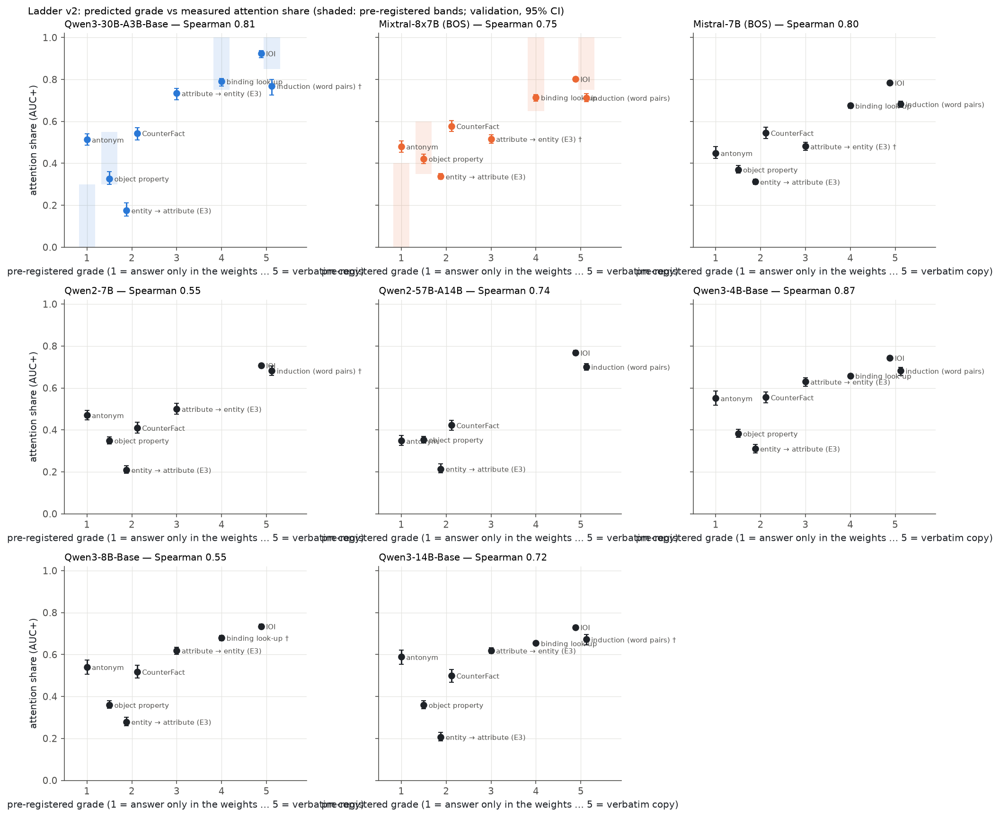

**Summary.** Ladder v2 (P6-1): four new tasks (antonym, object property, explicit binding, induction on unrelated word pairs) were placed on the dial before any run (grades 1–5 in `data/dial/preregistration.md`) and measured with the Phase-5 readout (attention share = AUC+ of the single-layer final-token attention patch / (AUC+ attention + AUC+ MoE or MLP), validation pairs, cluster-bootstrap CIs) together with the four anchors. Qwen3-30B-A3B-Base (7 of 8 tasks): antonym 0.51 [0.49, 0.54], object property 0.33 [0.30, 0.36], WG entity → attribute (E3) 0.18 [0.15, 0.21], CounterFact 0.54 [0.51, 0.57], WG attribute → entity (E3) 0.73 [0.70, 0.76], binding look-up 0.79 [0.77, 0.81], IOI 0.92 [0.90, 0.94], induction (word pairs) † 0.77 [0.73, 0.80]; Spearman(grade, share) +0.81 (CI over the cells' bootstrap draws 0.81 [0.72, 0.81]), partial Spearman given the cue distance +0.59. Mixtral-8x7B (BOS) (7 of 8 tasks): antonym 0.48 [0.45, 0.51], object property 0.42 [0.40, 0.44], WG entity → attribute (E3) 0.34 [0.33, 0.35], CounterFact 0.58 [0.55, 0.60], WG attribute → entity (E3) † 0.52 [0.50, 0.54], binding look-up 0.71 [0.70, 0.73], IOI 0.80 [0.79, 0.81], induction (word pairs) 0.71 [0.69, 0.73]; Spearman(grade, share) +0.75 (CI over the cells' bootstrap draws 0.75 [0.75, 0.80]), partial Spearman given the cue distance +0.72. Mistral-7B (BOS) (7 of 8 tasks): antonym 0.45 [0.42, 0.48], object property 0.37 [0.35, 0.39], WG entity → attribute (E3) 0.31 [0.30, 0.33], CounterFact 0.55 [0.52, 0.57], WG attribute → entity (E3) † 0.48 [0.46, 0.50], binding look-up 0.68 [0.66, 0.69], IOI 0.78 [0.78, 0.79], induction (word pairs) 0.68 [0.67, 0.70]; Spearman(grade, share) +0.80 (CI over the cells' bootstrap draws 0.80 [0.75, 0.80]), partial Spearman given the cue distance +0.78. Qwen2-7B (6 of 8 tasks): antonym 0.47 [0.45, 0.49], object property 0.35 [0.33, 0.37], WG entity → attribute (E3) 0.21 [0.19, 0.23], CounterFact 0.41 [0.38, 0.44], WG attribute → entity (E3) 0.50 [0.47, 0.53], IOI 0.71 [0.70, 0.72], induction (word pairs) † 0.68 [0.66, 0.70]; Spearman(grade, share) +0.55 (CI over the cells' bootstrap draws 0.55 [0.32, 0.55]), partial Spearman given the cue distance +0.06. Qwen2-57B-A14B (6 of 8 tasks): antonym 0.35 [0.33, 0.37], object property 0.35 [0.34, 0.37], WG entity → attribute (E3) 0.21 [0.19, 0.24], CounterFact 0.42 [0.40, 0.45], IOI 0.77 [0.76, 0.78], induction (word pairs) 0.70 [0.68, 0.72]; Spearman(grade, share) +0.74 (CI over the cells' bootstrap draws 0.74 [0.68, 0.74]), partial Spearman given the cue distance +0.71. Qwen3-4B-Base (8 of 8 tasks): antonym 0.55 [0.52, 0.59], object property 0.38 [0.36, 0.40], WG entity → attribute (E3) 0.31 [0.29, 0.33], CounterFact 0.56 [0.53, 0.58], WG attribute → entity (E3) 0.63 [0.61, 0.65], binding look-up 0.66 [0.65, 0.67], IOI 0.74 [0.74, 0.75], induction (word pairs) 0.68 [0.66, 0.70]; Spearman(grade, share) +0.87 (CI over the cells' bootstrap draws 0.87 [0.81, 0.87]), partial Spearman given the cue distance +0.85. Qwen3-8B-Base (6 of 8 tasks): antonym 0.54 [0.51, 0.57], object property 0.36 [0.34, 0.38], WG entity → attribute (E3) 0.28 [0.26, 0.30], CounterFact 0.52 [0.49, 0.55], WG attribute → entity (E3) 0.62 [0.60, 0.64], binding look-up † 0.68 [0.67, 0.69], IOI 0.73 [0.72, 0.74]; Spearman(grade, share) +0.55 (CI over the cells' bootstrap draws 0.55 [0.55, 0.70]), partial Spearman given the cue distance -0.03. Qwen3-14B-Base (7 of 8 tasks): antonym 0.59 [0.55, 0.62], object property 0.36 [0.34, 0.38], WG entity → attribute (E3) 0.21 [0.19, 0.23], CounterFact 0.50 [0.47, 0.53], WG attribute → entity (E3) 0.62 [0.61, 0.63], binding look-up 0.65 [0.65, 0.66], IOI 0.73 [0.72, 0.74], induction (word pairs) † 0.67 [0.65, 0.70]; Spearman(grade, share) +0.72 (CI over the cells' bootstrap draws 0.72 [0.58, 0.72]), partial Spearman given the cue distance +0.51. Pre-registered test L9 (Spearman ≥ 0.8 in every model): **failed**.

**Reading.** The bottom of the pre-registered order does not hold: the antonym task (grade 1, predicted ≤ 0.30 / 0.40) has an attention share of 0.35–0.59 across the 8 models, above object property (0.33–0.42) in 7 of 8 models and above the WinoGrande entity → attribute anchor (0.18–0.34) in 8 of 8. Interpretation: the antonym cue is the word itself, one token before the answer, so part of the answer is read off the cue by late attention even though the mapping is stored in the weights; 'answer only in the weights' does not imply a low final-token attention share. The top of the order holds: IOI (0.71–0.92), induction (0.67–0.77) and explicit binding (0.65–0.79) are the most attention-heavy tasks; the three highest shares are copy / look-up tasks (or the attribute → entity anchor) in 5 of 8 models with ≥ 5 non-pooled ladder cells. Spearman(grade, share) per model: Qwen3-30B-A3B +0.81 (without antonym +0.90; 7 cells), Mixtral-8x7B +0.75 (without antonym +0.79; 7 cells), Mistral-7B +0.80 (without antonym +0.88; 7 cells), Qwen2-7B +0.55 (without antonym +0.82; 6 cells), Qwen2-57B-A14B +0.74 (without antonym +0.79; 6 cells), Qwen3-4B +0.87 (without antonym +0.93; 8 cells), Qwen3-8B +0.55 (without antonym +0.82; 6 cells), Qwen3-14B +0.72 (without antonym +0.90; 7 cells). The pre-registered threshold 0.8 is met only where the antonym cell is not too far out of place; dropping it raises the rank correlation in most models. CounterFact stays in the middle (0.41–0.58), between entity → attribute and attribute → entity, in every model that has it.

### What was computed

Tasks and grades (fixed in the pre-registration before any Phase-6 GPU job): L-ant antonym 1, L-prop object property 1.5, L-e2a (= Dial-E E3 entity → attribute) 2, L-cf CounterFact 2, L-a2e (= E3 attribute → entity) 3, L-bind explicit binding look-up 4, L-ioi IOI 5, L-ind induction on unrelated word pairs 5. Each task is an STR pair set (one swapped token, equal length, margin ≥ 1 both ways, both orders where two entities are named; RESEARCH_PLAN.md 'Common rules'), with the Phase-3 tier-1 runners. Per model: Spearman of the grade with the measured share; the cue distance (tokens between the swapped token and the final token, median per task) is recorded as a covariate because across tasks it is confounded with the dial (partial Spearman given the cue distance). The Spearman CI uses the cells' independent bootstrap draws (2,000 each). CounterFact for Qwen3 / Mixtral is the Phase-3 donor-level attention sweep (`results/<proto>_str_attnsweep`, no direct-path split or Δp), IOI the Phase-3 S2 → IO run.

**Ladder v2: pre-registered grade vs measured attention share (validation; CIs: cluster bootstrap; Spearman CI over the cells' bootstrap draws)**

| Model | Grade | Task | Pairs | Attention share | norm. LD | Δp | A_direct | All-MoE M | Cue distance (tokens) |
|---|---|---|---|---|---|---|---|---|---|
| Qwen3-30B-A3B | 1.0 | antonym | 126 | 0.51 [0.49, 0.54] | 0.52 [0.49, 0.54] | 0.54 [0.50, 0.58] | 0.14 [0.05, 0.21] | 0.83 [0.77, 0.91] | 1 |
| Qwen3-30B-A3B | 1.5 | object property | 127 | 0.33 [0.30, 0.36] | 0.34 [0.31, 0.37] | 0.30 [0.25, 0.35] | 0.28 [0.24, 0.32] | 0.68 [0.63, 0.72] | 3 |
| Qwen3-30B-A3B | 2.0 | WG entity → attribute (E3) | 128 | 0.18 [0.15, 0.21] | 0.18 [0.16, 0.22] | 0.15 [0.10, 0.21] | 0.03 [-0.00, 0.06] | 0.82 [0.81, 0.84] | 1 |
| Qwen3-30B-A3B | 2.0 | CounterFact | 108 | 0.54 [0.51, 0.57] | 0.54 [0.51, 0.57] | n/a | n/a | n/a | 3 |
| Qwen3-30B-A3B | 3.0 | WG attribute → entity (E3) | 84 | 0.73 [0.70, 0.76] | 0.74 [0.71, 0.76] | 0.77 [0.74, 0.79] | 1.15 [1.07, 1.23] | 0.16 [0.10, 0.23] | 4 |
| Qwen3-30B-A3B | 4.0 | binding look-up | 128 | 0.79 [0.77, 0.81] | 0.80 [0.77, 0.81] | 0.82 [0.78, 0.85] | 1.73 [1.67, 1.79] | -0.43 [-0.50, -0.38] | 3 |
| Qwen3-30B-A3B | 5.0 | induction (word pairs) † | 66 | 0.77 [0.73, 0.80] | 0.76 [0.72, 0.80] | 0.83 [0.78, 0.86] | 1.06 [0.98, 1.14] | -0.09 [-0.17, -0.01] | 1 |
| Qwen3-30B-A3B | 5.0 | IOI | 128 | 0.92 [0.90, 0.94] | 0.93 [0.91, 0.94] | 0.96 [0.94, 0.98] | 1.40 [1.38, 1.43] | -0.27 [-0.29, -0.25] | 4 |
| Qwen3-30B-A3B |  | Spearman(grade, share) = 0.81 (CI 0.81 [0.72, 0.81]), partial given cue distance 0.59; Spearman(cue distance, share) 0.76 |  |  |  |  |  |  |  |
| Mixtral-8x7B | 1.0 | antonym | 126 | 0.48 [0.45, 0.51] | 0.47 [0.44, 0.50] | 0.47 [0.43, 0.51] | 0.20 [0.12, 0.28] | 0.85 [0.76, 0.94] | 1 |
| Mixtral-8x7B | 1.5 | object property | 128 | 0.42 [0.40, 0.44] | 0.41 [0.39, 0.43] | 0.41 [0.38, 0.43] | 0.59 [0.56, 0.63] | 0.40 [0.36, 0.44] | 3 |
| Mixtral-8x7B | 2.0 | WG entity → attribute (E3) | 128 | 0.34 [0.33, 0.35] | 0.34 [0.33, 0.36] | 0.31 [0.29, 0.33] | 0.27 [0.25, 0.29] | 0.79 [0.77, 0.81] | 2 |
| Mixtral-8x7B | 2.0 | CounterFact | 106 | 0.58 [0.55, 0.60] | 0.59 [0.56, 0.62] | n/a | n/a | n/a | 3 |
| Mixtral-8x7B | 3.0 | WG attribute → entity (E3) † | 113 | 0.52 [0.50, 0.54] | 0.52 [0.50, 0.54] | 0.55 [0.52, 0.58] | 0.86 [0.78, 0.94] | 0.42 [0.38, 0.47] | 6 |
| Mixtral-8x7B | 4.0 | binding look-up | 128 | 0.71 [0.70, 0.73] | 0.71 [0.70, 0.73] | 0.73 [0.71, 0.74] | 1.75 [1.66, 1.84] | -0.72 [-0.79, -0.66] | 3 |
| Mixtral-8x7B | 5.0 | induction (word pairs) | 128 | 0.71 [0.69, 0.73] | 0.72 [0.70, 0.73] | 0.79 [0.77, 0.81] | 1.39 [1.32, 1.46] | -0.03 [-0.09, 0.02] | 1 |
| Mixtral-8x7B | 5.0 | IOI | 128 | 0.80 [0.79, 0.81] | 0.80 [0.79, 0.81] | 0.88 [0.87, 0.89] | 1.17 [1.14, 1.19] | -0.02 [-0.05, -0.00] | 4 |
| Mixtral-8x7B |  | Spearman(grade, share) = 0.75 (CI 0.75 [0.75, 0.80]), partial given cue distance 0.72; Spearman(cue distance, share) 0.45 |  |  |  |  |  |  |  |
| Mistral-7B | 1.0 | antonym | 126 | 0.45 [0.42, 0.48] | 0.45 [0.42, 0.48] | 0.42 [0.38, 0.47] | 0.26 [0.19, 0.32] | 0.80 [0.74, 0.87] | 1 |
| Mistral-7B | 1.5 | object property | 128 | 0.37 [0.35, 0.39] | 0.37 [0.36, 0.39] | 0.34 [0.31, 0.36] | 0.44 [0.41, 0.47] | 0.56 [0.53, 0.59] | 3 |
| Mistral-7B | 2.0 | WG entity → attribute (E3) | 128 | 0.31 [0.30, 0.33] | 0.32 [0.31, 0.33] | 0.28 [0.25, 0.30] | 0.22 [0.20, 0.24] | 0.85 [0.83, 0.87] | 2 |
| Mistral-7B | 2.0 | CounterFact | 98 | 0.55 [0.52, 0.57] | 0.55 [0.53, 0.58] | 0.71 [0.62, 0.79] | 0.57 [0.54, 0.60] | 0.47 [0.43, 0.50] | 3 |
| Mistral-7B | 3.0 | WG attribute → entity (E3) † | 111 | 0.48 [0.46, 0.50] | 0.49 [0.47, 0.51] | 0.51 [0.48, 0.53] | 0.74 [0.67, 0.81] | 0.56 [0.53, 0.59] | 6 |
| Mistral-7B | 4.0 | binding look-up | 128 | 0.68 [0.66, 0.69] | 0.68 [0.66, 0.69] | 0.70 [0.69, 0.71] | 1.63 [1.55, 1.71] | -0.53 [-0.59, -0.47] | 3 |
| Mistral-7B | 5.0 | induction (word pairs) | 128 | 0.68 [0.67, 0.70] | 0.69 [0.67, 0.70] | 0.74 [0.73, 0.76] | 1.32 [1.26, 1.39] | 0.25 [0.20, 0.29] | 1 |
| Mistral-7B | 5.0 | IOI | 128 | 0.78 [0.78, 0.79] | 0.79 [0.78, 0.80] | 0.88 [0.87, 0.89] | 1.09 [1.07, 1.11] | 0.13 [0.11, 0.15] | 4 |
| Mistral-7B |  | Spearman(grade, share) = 0.80 (CI 0.80 [0.75, 0.80]), partial given cue distance 0.78; Spearman(cue distance, share) 0.32 |  |  |  |  |  |  |  |
| Qwen2-7B | 1.0 | antonym | 126 | 0.47 [0.45, 0.49] | 0.47 [0.44, 0.49] | 0.50 [0.46, 0.54] | 0.20 [0.13, 0.26] | 0.76 [0.71, 0.82] | 1 |
| Qwen2-7B | 1.5 | object property | 128 | 0.35 [0.33, 0.37] | 0.36 [0.34, 0.37] | 0.30 [0.27, 0.32] | 0.24 [0.22, 0.27] | 0.76 [0.74, 0.78] | 3 |
| Qwen2-7B | 2.0 | WG entity → attribute (E3) | 128 | 0.21 [0.19, 0.23] | 0.22 [0.20, 0.24] | 0.20 [0.15, 0.24] | 0.06 [0.05, 0.07] | 0.94 [0.93, 0.95] | 2 |
| Qwen2-7B | 2.0 | CounterFact | 88 | 0.41 [0.38, 0.44] | 0.42 [0.40, 0.45] | 0.57 [0.52, 0.62] | 0.27 [0.25, 0.30] | 0.74 [0.72, 0.77] | 3 |
| Qwen2-7B | 3.0 | WG attribute → entity (E3) | 68 | 0.50 [0.47, 0.53] | 0.50 [0.48, 0.53] | 0.54 [0.51, 0.56] | 0.78 [0.68, 0.88] | 0.71 [0.67, 0.74] | 4 |
| Qwen2-7B | 5.0 | induction (word pairs) † | 92 | 0.68 [0.66, 0.70] | 0.69 [0.66, 0.71] | 0.70 [0.67, 0.73] | 0.84 [0.76, 0.92] | 0.15 [0.09, 0.20] | 1 |
| Qwen2-7B | 5.0 | IOI | 128 | 0.71 [0.70, 0.72] | 0.71 [0.70, 0.72] | 0.80 [0.78, 0.82] | 1.04 [1.02, 1.07] | 0.39 [0.36, 0.41] | 4 |
| Qwen2-7B |  | Spearman(grade, share) = 0.55 (CI 0.55 [0.32, 0.55]), partial given cue distance 0.06; Spearman(cue distance, share) 0.62 |  |  |  |  |  |  |  |
| Qwen2-57B-A14B | 1.0 | antonym | 126 | 0.35 [0.33, 0.37] | 0.35 [0.32, 0.37] | 0.39 [0.35, 0.44] | -0.09 [-0.17, -0.02] | 1.05 [0.98, 1.12] | 1 |
| Qwen2-57B-A14B | 1.5 | object property | 128 | 0.35 [0.34, 0.37] | 0.36 [0.34, 0.38] | 0.35 [0.32, 0.38] | 0.25 [0.23, 0.27] | 0.74 [0.72, 0.76] | 3 |
| Qwen2-57B-A14B | 2.0 | WG entity → attribute (E3) | 128 | 0.21 [0.19, 0.24] | 0.22 [0.20, 0.25] | 0.21 [0.16, 0.26] | 0.05 [0.03, 0.06] | 0.92 [0.91, 0.93] | 2 |
| Qwen2-57B-A14B | 2.0 | CounterFact | 98 | 0.42 [0.40, 0.45] | 0.43 [0.41, 0.46] | 0.59 [0.53, 0.65] | 0.31 [0.29, 0.33] | 0.70 [0.67, 0.72] | 3 |
| Qwen2-57B-A14B | 5.0 | induction (word pairs) | 128 | 0.70 [0.68, 0.72] | 0.71 [0.70, 0.73] | 0.77 [0.75, 0.78] | 1.38 [1.27, 1.48] | 0.07 [-0.02, 0.15] | 1 |
| Qwen2-57B-A14B | 5.0 | IOI | 128 | 0.77 [0.76, 0.78] | 0.77 [0.76, 0.78] | 0.86 [0.84, 0.88] | 1.28 [1.25, 1.32] | 0.09 [0.06, 0.12] | 4 |
| Qwen2-57B-A14B |  | Spearman(grade, share) = 0.74 (CI 0.74 [0.68, 0.74]), partial given cue distance 0.71; Spearman(cue distance, share) 0.44 |  |  |  |  |  |  |  |
| Qwen3-4B | 1.0 | antonym | 126 | 0.55 [0.52, 0.59] | 0.56 [0.52, 0.59] | 0.64 [0.60, 0.68] | 0.46 [0.40, 0.51] | 0.56 [0.49, 0.63] | 1 |
| Qwen3-4B | 1.5 | object property | 128 | 0.38 [0.36, 0.40] | 0.39 [0.37, 0.41] | 0.39 [0.37, 0.41] | 0.48 [0.45, 0.52] | 0.56 [0.53, 0.60] | 3 |
| Qwen3-4B | 2.0 | WG entity → attribute (E3) | 128 | 0.31 [0.29, 0.33] | 0.32 [0.30, 0.34] | 0.25 [0.22, 0.28] | 0.24 [0.22, 0.26] | 0.81 [0.79, 0.83] | 1 |
| Qwen3-4B | 2.0 | CounterFact | 83 | 0.56 [0.53, 0.58] | 0.55 [0.52, 0.58] | 0.69 [0.62, 0.75] | 0.73 [0.68, 0.79] | 0.38 [0.31, 0.44] | 3 |
| Qwen3-4B | 3.0 | WG attribute → entity (E3) | 78 | 0.63 [0.61, 0.65] | 0.64 [0.62, 0.66] | 0.68 [0.65, 0.70] | 1.30 [1.22, 1.39] | 0.40 [0.35, 0.44] | 4 |
| Qwen3-4B | 4.0 | binding look-up | 128 | 0.66 [0.65, 0.67] | 0.66 [0.65, 0.67] | 0.69 [0.68, 0.70] | 1.54 [1.47, 1.60] | 0.13 [0.08, 0.17] | 3 |
| Qwen3-4B | 5.0 | induction (word pairs) | 128 | 0.68 [0.66, 0.70] | 0.69 [0.67, 0.71] | 0.74 [0.71, 0.75] | 1.02 [0.95, 1.09] | 0.18 [0.12, 0.23] | 1 |
| Qwen3-4B | 5.0 | IOI | 128 | 0.74 [0.74, 0.75] | 0.74 [0.74, 0.75] | 0.84 [0.82, 0.85] | 1.16 [1.14, 1.18] | 0.41 [0.39, 0.42] | 4 |
| Qwen3-4B |  | Spearman(grade, share) = 0.87 (CI 0.87 [0.81, 0.87]), partial given cue distance 0.85; Spearman(cue distance, share) 0.44 |  |  |  |  |  |  |  |
| Qwen3-8B | 1.0 | antonym | 126 | 0.54 [0.51, 0.57] | 0.54 [0.50, 0.57] | 0.62 [0.57, 0.68] | 0.46 [0.37, 0.54] | 0.58 [0.48, 0.67] | 1 |
| Qwen3-8B | 1.5 | object property | 128 | 0.36 [0.34, 0.38] | 0.37 [0.35, 0.39] | 0.40 [0.38, 0.42] | 0.44 [0.41, 0.47] | 0.61 [0.57, 0.64] | 3 |
| Qwen3-8B | 2.0 | WG entity → attribute (E3) | 128 | 0.28 [0.26, 0.30] | 0.29 [0.27, 0.31] | 0.21 [0.17, 0.25] | 0.21 [0.19, 0.23] | 0.82 [0.81, 0.84] | 1 |
| Qwen3-8B | 2.0 | CounterFact | 95 | 0.52 [0.49, 0.55] | 0.51 [0.48, 0.54] | 0.72 [0.63, 0.79] | 0.71 [0.64, 0.76] | 0.39 [0.33, 0.45] | 3 |
| Qwen3-8B | 3.0 | WG attribute → entity (E3) | 128 | 0.62 [0.60, 0.64] | 0.63 [0.60, 0.64] | 0.69 [0.67, 0.71] | 1.18 [1.11, 1.24] | 0.39 [0.36, 0.42] | 4 |
| Qwen3-8B | 4.0 | binding look-up † | 80 | 0.68 [0.67, 0.69] | 0.68 [0.67, 0.69] | 0.69 [0.68, 0.71] | 1.85 [1.74, 1.95] | -0.01 [-0.08, 0.05] | 3 |
| Qwen3-8B | 5.0 | IOI | 128 | 0.73 [0.72, 0.74] | 0.73 [0.72, 0.74] | 0.82 [0.80, 0.83] | 1.20 [1.18, 1.23] | 0.41 [0.39, 0.42] | 4 |
| Qwen3-8B |  | Spearman(grade, share) = 0.55 (CI 0.55 [0.55, 0.70]), partial given cue distance -0.03; Spearman(cue distance, share) 0.72 |  |  |  |  |  |  |  |
| Qwen3-14B | 1.0 | antonym | 126 | 0.59 [0.55, 0.62] | 0.58 [0.54, 0.61] | 0.67 [0.62, 0.72] | 0.56 [0.47, 0.65] | 0.42 [0.33, 0.52] | 1 |
| Qwen3-14B | 1.5 | object property | 128 | 0.36 [0.34, 0.38] | 0.36 [0.35, 0.38] | 0.29 [0.27, 0.31] | 0.45 [0.42, 0.48] | 0.62 [0.58, 0.65] | 3 |
| Qwen3-14B | 2.0 | WG entity → attribute (E3) | 128 | 0.21 [0.19, 0.23] | 0.21 [0.20, 0.23] | 0.15 [0.14, 0.18] | 0.13 [0.11, 0.16] | 0.85 [0.83, 0.86] | 2 |
| Qwen3-14B | 2.0 | CounterFact | 88 | 0.50 [0.47, 0.53] | 0.50 [0.47, 0.54] | 0.55 [0.45, 0.65] | 0.58 [0.54, 0.62] | 0.51 [0.47, 0.56] | 3 |
| Qwen3-14B | 3.0 | WG attribute → entity (E3) | 128 | 0.62 [0.61, 0.63] | 0.62 [0.60, 0.63] | 0.68 [0.66, 0.70] | 1.26 [1.20, 1.32] | 0.40 [0.37, 0.43] | 4 |
| Qwen3-14B | 4.0 | binding look-up | 128 | 0.65 [0.65, 0.66] | 0.66 [0.65, 0.66] | 0.69 [0.69, 0.70] | 1.43 [1.38, 1.49] | 0.11 [0.06, 0.15] | 3 |
| Qwen3-14B | 5.0 | induction (word pairs) † | 64 | 0.67 [0.65, 0.70] | 0.68 [0.66, 0.70] | 0.73 [0.71, 0.75] | 1.23 [1.13, 1.33] | 0.05 [-0.02, 0.12] | 1 |
| Qwen3-14B | 5.0 | IOI | 128 | 0.73 [0.72, 0.74] | 0.73 [0.72, 0.74] | 0.74 [0.72, 0.76] | 1.14 [1.12, 1.16] | 0.38 [0.36, 0.39] | 4 |
| Qwen3-14B |  | Spearman(grade, share) = 0.72 (CI 0.72 [0.58, 0.72]), partial given cue distance 0.51; Spearman(cue distance, share) 0.60 |  |  |  |  |  |  |  |

### Pre-registered predictions

| ID | Prediction | Observed | Verdict |
|---|---|---|---|
| L1 | L-ant: <= 0.30 | qwen3: 0.51 [0.49, 0.54] (failed) | **failed** |
| L2 | L-ant: <= 0.40 | mixtral_bos: 0.48 [0.45, 0.51] (failed) | **failed** |
| L3 | L-prop: 0.30-0.55 | qwen3: 0.33 [0.30, 0.36] (held) | **held** |
| L4 | L-prop: 0.35-0.60 | mixtral_bos: 0.42 [0.40, 0.44] (held) | **held** |
| L5 | L-bind: >= 0.75 | qwen3: 0.79 [0.77, 0.81] (held) | **held** |
| L6 | L-bind: >= 0.65 | mixtral_bos: 0.71 [0.70, 0.73] (held) | **held** |
| L7 | L-ind: >= 0.85 | qwen3: 0.77 [0.73, 0.80] (insufficient (pooled only)) | **insufficient (pooled only)** |
| L8 | L-ind: >= 0.75 | mixtral_bos: 0.71 [0.69, 0.73] (failed) | **failed** |
| L9 | ladder: >= 0.8 in every model | qwen3: 0.81 (held); mixtral_bos: 0.75 (failed); mistral7b_bos: 0.80 (held); qwen2_7b: 0.55 (failed); qwen2_57b: 0.74 (failed); qwen3_4b: 0.87 (held); qwen3_8b: 0.55 (failed); qwen3_14b: 0.72 (failed) | **failed** |

### Caveats

- Grades are ordinal and assigned by hand; ties (grade 2: L-e2a and L-cf; grade 5: L-ioi and L-ind) enter Spearman as ties.
- Across tasks, prompt length, cue distance, answer type and item source change together with the dial; only the Dial-E contrasts (same WinoGrande twins, `ext14_dial.md`) hold the items fixed.
- A task reaches the table only with ≥ 64 validation pairs (R5); smaller tasks are listed as insufficient in the registry.

### Files

`moetrace/ext14_analysis.py` (`ladder`, `CellData`, `summarise`), `scripts/ext14_all.py`; `results/ext14_summary.json` keys `ladder`, `cells`, `predictions`; `results/tables/ext14_ladder.md`, `results/figures/ext14_ladder.png`.
