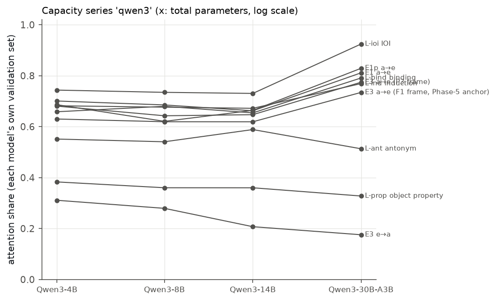
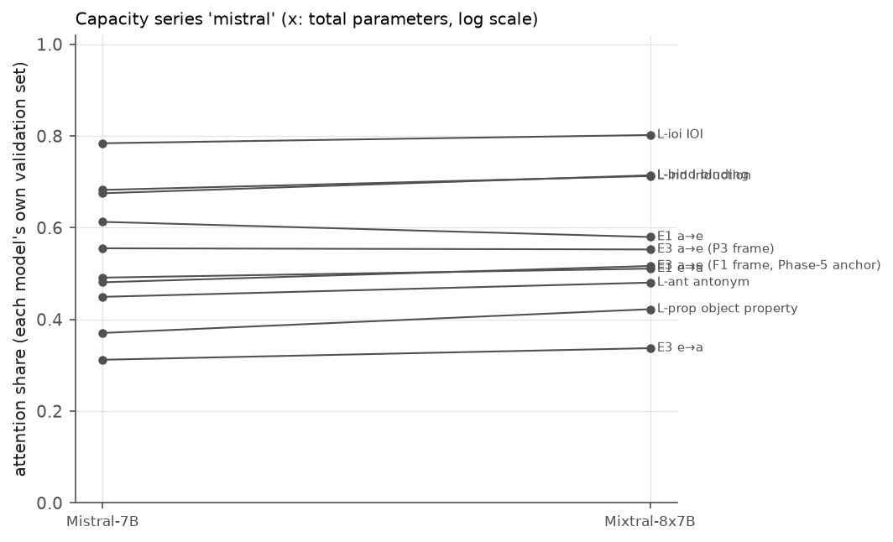
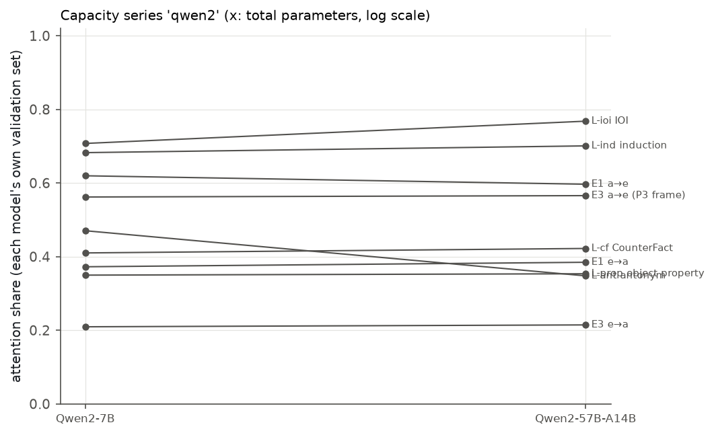

**Summary.** Capacity (P6-4 before the Stage-3 gate): attention share along the families' capacity series, each model on its own validation set (paired values on the common pairs in the tables). series qwen3 (Qwen3-4B → Qwen3-8B → Qwen3-14B → Qwen3-30B-A3B): E1 a→e 0.70 [0.69, 0.71] → 0.69 [0.67, 0.70] → 0.66 [0.65, 0.68] → 0.81 [0.78, 0.83]; E1p a→e 0.69 [0.67, 0.70] → 0.62 [0.60, 0.64] → 0.66 [0.64, 0.68] → 0.83 [0.80, 0.85]; E3 a→e (F1 frame, Phase-5 anchor) 0.63 [0.61, 0.65] → 0.62 [0.60, 0.64] → 0.62 [0.61, 0.63] → 0.73 [0.70, 0.76]; E3 e→a 0.31 [0.29, 0.33] → 0.28 [0.26, 0.30] → 0.21 [0.19, 0.23] → 0.18 [0.15, 0.21]; E3 a→e (P3 frame) 0.68 [0.66, 0.70] → 0.64 [0.63, 0.66] → 0.65 [0.63, 0.66] → 0.77 [0.74, 0.80]; L-ant antonym 0.55 [0.52, 0.59] → 0.54 [0.51, 0.57] → 0.59 [0.55, 0.62] → 0.51 [0.49, 0.54]; L-bind binding 0.66 [0.65, 0.67] → 0.68 [0.67, 0.69] → 0.65 [0.65, 0.66] → 0.79 [0.77, 0.81]; L-ind induction 0.68 [0.66, 0.70] → 0.67 [0.65, 0.70] → 0.77 [0.73, 0.80]; L-ioi IOI 0.74 [0.74, 0.75] → 0.73 [0.72, 0.74] → 0.73 [0.72, 0.74] → 0.92 [0.90, 0.94]; L-prop object property 0.38 [0.36, 0.40] → 0.36 [0.34, 0.38] → 0.36 [0.34, 0.38] → 0.33 [0.30, 0.36]. series mistral (Mistral-7B → Mixtral-8x7B): E1 a→e (all strata) 0.61 [0.59, 0.63] → 0.58 [0.56, 0.60]; E1 e→a (all strata) 0.49 [0.46, 0.52] → 0.51 [0.49, 0.53]; E3 a→e (F1 frame, Phase-5 anchor) 0.48 [0.46, 0.50] → 0.52 [0.50, 0.54]; E3 e→a 0.31 [0.30, 0.33] → 0.34 [0.33, 0.35]; E3 a→e (P3 frame) 0.56 [0.54, 0.57] → 0.55 [0.53, 0.57]; L-ant antonym 0.45 [0.42, 0.48] → 0.48 [0.45, 0.51]; L-bind binding 0.68 [0.66, 0.69] → 0.71 [0.70, 0.73]; L-ind induction 0.68 [0.67, 0.70] → 0.71 [0.69, 0.73]; L-ioi IOI 0.78 [0.78, 0.79] → 0.80 [0.79, 0.81]; L-prop object property 0.37 [0.35, 0.39] → 0.42 [0.40, 0.44]. series qwen2 (Qwen2-7B → Qwen2-57B-A14B): E1 a→e 0.62 [0.61, 0.63] → 0.60 [0.58, 0.61]; E1 e→a 0.37 [0.35, 0.40] → 0.38 [0.36, 0.41]; E3 e→a 0.21 [0.19, 0.23] → 0.21 [0.19, 0.24]; E3 a→e (P3 frame) 0.56 [0.55, 0.58] → 0.57 [0.55, 0.58]; L-ant antonym 0.47 [0.45, 0.49] → 0.35 [0.33, 0.37]; L-cf CounterFact 0.41 [0.38, 0.44] → 0.42 [0.40, 0.45]; L-ind induction 0.68 [0.66, 0.70] → 0.70 [0.68, 0.72]; L-ioi IOI 0.71 [0.70, 0.72] → 0.77 [0.76, 0.78]; L-prop object property 0.35 [0.33, 0.37] → 0.35 [0.34, 0.37]. Pre-registered predictions: held D5, D6; failed none.

**Reading.** Qwen3 dense 4B → 8B → 14B: the share is flat with capacity in 9 of 10 cells (range ≤ 0.10 across the three dense models; D5). The 30B-A3B MoE departs from the dense series: higher on L-ioi IOI 0.73–0.74 → 0.92, L-bind binding 0.65–0.68 → 0.79, L-ind induction 0.67–0.68 → 0.77, E1 a→e 0.66–0.70 → 0.81, E1p a→e 0.62–0.69 → 0.83, E3 a→e (F1 frame, Phase-5 anchor) 0.62–0.63 → 0.73, E3 a→e (P3 frame) 0.64–0.68 → 0.77; lower on L-prop object property 0.36–0.38 → 0.33, E3 e→a 0.21–0.31 → 0.18 (own validation sets). Because the dense Qwen3 series is mostly flat, the 30B-A3B departure is not a capacity trend: it comes with the MoE model (different depth, width, training run and sparsity together; there is no Qwen3 dense twin), and it goes in opposite directions for the cells listed as higher and lower.

### What was computed

Series: Qwen3-4B → 8B → 14B-Base (dense, same tokenizer and generation as Qwen3-30B-A3B; 36 / 36 / 40 layers) → Qwen3-30B-A3B (MoE, 48 layers); Mistral-7B → Mixtral-8x7B; Qwen2-7B → Qwen2-57B-A14B. Qwen3-1.7B enters the competence scan only. D5 = per cell |share(14B) − share(4B)| ≤ 0.10 (paired on common pairs) and the dense models' cell order vs Qwen3-30B-A3B (Spearman ≥ 0.8). Mixtral-8x22B (Stage 3) is gated by the user's decision after Stage R and is not part of this section yet.

**Capacity series 'qwen3' (Qwen3-4B → Qwen3-8B → Qwen3-14B → Qwen3-30B-A3B): attention share on each model's own validation set and on the pairs common to every member present (validation)**

| Cell | Qwen3-4B (own set) | Qwen3-8B (own set) | Qwen3-14B (own set) | Qwen3-30B-A3B (own set) | Common pairs | paired shares (common pairs) Qwen3-4B → Qwen3-8B → Qwen3-14B → Qwen3-30B-A3B | last − first (paired) | interior variant, paired | 14B − 4B (paired on their common pairs) | paired shares (common pairs) Qwen3-4B → Qwen3-14B → Qwen3-30B-A3B |
|---|---|---|---|---|---|---|---|---|---|---|
| E1 a→e | 0.70 [0.69, 0.71] | 0.69 [0.67, 0.70] | 0.66 [0.65, 0.68] | 0.81 [0.78, 0.83] | 26 | 0.71 → 0.71 → 0.67 → 0.86 | +0.14 [+0.10, +0.17] | 0.69 → 0.69 → 0.66 → 0.86 | -0.04 [-0.06, -0.02] |  |
| E1p a→e | 0.69 [0.67, 0.70] | 0.62 [0.60, 0.64] | 0.66 [0.64, 0.68] | 0.83 [0.80, 0.85] | 18 | 0.71 → 0.66 → 0.70 → 0.83 | +0.13 [+0.07, +0.17] | 0.68 → 0.63 → 0.69 → 0.82 | -0.02 [-0.04, -0.00] |  |
| E3 a→e (P3 frame) | 0.68 [0.66, 0.70] | 0.64 [0.63, 0.66] | 0.65 [0.63, 0.66] | 0.77 [0.74, 0.80] | 7 | 0.74 → 0.67 → 0.71 → 0.82 | +0.08 [+0.04, +0.12] | 0.71 → 0.65 → 0.70 → 0.82 | -0.01 [-0.03, +0.01] |  |
| E3 a→e (F1 frame, Phase-5 anchor) | 0.63 [0.61, 0.65] | 0.62 [0.60, 0.64] | 0.62 [0.61, 0.63] | 0.73 [0.70, 0.76] | 6 | 0.64 → 0.61 → 0.62 → 0.68 | +0.04 [-0.06, +0.14] | 0.61 → 0.58 → 0.60 → 0.66 | -0.03 [-0.05, -0.01] |  |
| E3 e→a | 0.31 [0.29, 0.33] | 0.28 [0.26, 0.30] | 0.21 [0.19, 0.23] | 0.18 [0.15, 0.21] | 23 | 0.29 → 0.25 → 0.22 → 0.19 | -0.10 [-0.14, -0.04] | 0.26 → 0.24 → 0.23 → 0.20 | -0.08 [-0.12, -0.04] |  |
| L-ant antonym | 0.55 [0.52, 0.59] | 0.54 [0.51, 0.57] | 0.59 [0.55, 0.62] | 0.51 [0.49, 0.54] | 111 | 0.55 → 0.54 → 0.58 → 0.52 | -0.03 [-0.06, -0.01] | 0.51 → 0.50 → 0.55 → 0.51 | +0.03 [-0.00, +0.05] |  |
| L-prop object property | 0.38 [0.36, 0.40] | 0.36 [0.34, 0.38] | 0.36 [0.34, 0.38] | 0.33 [0.30, 0.36] | 97 | 0.38 → 0.36 → 0.35 → 0.32 | -0.06 [-0.08, -0.03] | 0.36 → 0.33 → 0.31 → 0.35 | -0.03 [-0.05, -0.01] |  |
| L-bind binding † | 0.66 [0.65, 0.67] | 0.68 [0.67, 0.69] | 0.65 [0.65, 0.66] | 0.79 [0.77, 0.81] | 2 | 0.68 → 0.72 → 0.63 → 0.79 | +0.11 [+0.11, +0.11] | 0.66 → 0.72 → 0.63 → 0.78 | -0.02 [-0.03, -0.00] |  |
| L-ioi IOI | 0.74 [0.74, 0.75] | 0.73 [0.72, 0.74] | 0.73 [0.72, 0.74] | 0.92 [0.90, 0.94] | 128 | 0.74 → 0.73 → 0.73 → 0.92 | +0.18 [+0.16, +0.20] | 0.68 → 0.68 → 0.69 → 0.90 | -0.01 [-0.02, -0.00] |  |
| L-ind induction † | 0.68 [0.66, 0.70] | – | 0.67 [0.65, 0.70] | 0.77 [0.73, 0.80] | 4 |  | +0.24 [+0.23, +0.26] | 0.58 → 0.67 → 0.81 | +0.04 [-0.01, +0.08] | 0.58 → 0.67 → 0.81 |

Own sets differ in items between models; the paired columns use the common pairs only (few for cells whose models select different twins). † = pooled cell in at least one model.

**Capacity series 'mistral' (Mistral-7B → Mixtral-8x7B): attention share on each model's own validation set and on the pairs common to every member present (validation)**

| Cell | Mistral-7B (own set) | Mixtral-8x7B (own set) | Common pairs | paired shares (common pairs) Mistral-7B → Mixtral-8x7B | last − first (paired) | interior variant, paired |
|---|---|---|---|---|---|---|
| E1 a→e (all strata) † | 0.61 [0.59, 0.63] | 0.58 [0.56, 0.60] | 34 | 0.61 → 0.59 | -0.03 [-0.06, +0.01] | 0.60 → 0.56 |
| E3 a→e (P3 frame) † | 0.56 [0.54, 0.57] | 0.55 [0.53, 0.57] | 19 | 0.57 → 0.57 | -0.01 [-0.05, +0.03] | 0.55 → 0.54 |
| E3 a→e (F1 frame, Phase-5 anchor) † | 0.48 [0.46, 0.50] | 0.52 [0.50, 0.54] | 36 | 0.50 → 0.52 | +0.02 [-0.00, +0.05] | 0.47 → 0.49 |
| E1 e→a (all strata) † | 0.49 [0.46, 0.52] | 0.51 [0.49, 0.53] | 26 | 0.54 → 0.54 | -0.00 [-0.03, +0.03] | 0.52 → 0.51 |
| E3 e→a | 0.31 [0.30, 0.33] | 0.34 [0.33, 0.35] | 59 | 0.31 → 0.34 | +0.03 [+0.01, +0.04] | 0.30 → 0.32 |
| L-ant antonym | 0.45 [0.42, 0.48] | 0.48 [0.45, 0.51] | 123 | 0.45 → 0.48 | +0.03 [+0.01, +0.05] | 0.37 → 0.42 |
| L-prop object property | 0.37 [0.35, 0.39] | 0.42 [0.40, 0.44] | 122 | 0.37 → 0.42 | +0.06 [+0.04, +0.07] | 0.33 → 0.36 |
| L-bind binding | 0.68 [0.66, 0.69] | 0.71 [0.70, 0.73] | 14 | 0.65 → 0.69 | +0.04 [+0.02, +0.08] | 0.63 → 0.67 |
| L-ioi IOI | 0.78 [0.78, 0.79] | 0.80 [0.79, 0.81] | 128 | 0.78 → 0.80 | +0.02 [+0.01, +0.03] | 0.72 → 0.74 |
| L-ind induction | 0.68 [0.67, 0.70] | 0.71 [0.69, 0.73] | 50 | 0.69 → 0.72 | +0.03 [-0.00, +0.07] | 0.66 → 0.69 |

Own sets differ in items between models; the paired columns use the common pairs only (few for cells whose models select different twins). † = pooled cell in at least one model.

**Capacity series 'qwen2' (Qwen2-7B → Qwen2-57B-A14B): attention share on each model's own validation set and on the pairs common to every member present (validation)**

| Cell | Qwen2-7B (own set) | Qwen2-57B-A14B (own set) | Common pairs | paired shares (common pairs) Qwen2-7B → Qwen2-57B-A14B | last − first (paired) | interior variant, paired |
|---|---|---|---|---|---|---|
| E1 a→e | 0.62 [0.61, 0.63] | 0.60 [0.58, 0.61] | 18 | 0.64 → 0.66 | +0.02 [+0.00, +0.05] | 0.64 → 0.68 |
| E3 a→e (P3 frame) | 0.56 [0.55, 0.58] | 0.57 [0.55, 0.58] | 35 | 0.56 → 0.58 | +0.02 [-0.01, +0.04] | 0.56 → 0.57 |
| E1 e→a | 0.37 [0.35, 0.40] | 0.38 [0.36, 0.41] | 32 | 0.41 → 0.38 | -0.03 [-0.07, +0.02] | 0.45 → 0.47 |
| E3 e→a | 0.21 [0.19, 0.23] | 0.21 [0.19, 0.24] | 65 | 0.22 → 0.22 | -0.01 [-0.04, +0.02] | 0.25 → 0.27 |
| L-ant antonym | 0.47 [0.45, 0.49] | 0.35 [0.33, 0.37] | 96 | 0.48 → 0.37 | -0.11 [-0.13, -0.09] | 0.49 → 0.46 |
| L-prop object property | 0.35 [0.33, 0.37] | 0.35 [0.34, 0.37] | 110 | 0.35 → 0.35 | +0.00 [-0.01, +0.02] | 0.40 → 0.44 |
| L-cf CounterFact | 0.41 [0.38, 0.44] | 0.42 [0.40, 0.45] | 85 | 0.41 → 0.42 | +0.01 [-0.00, +0.03] | 0.50 → 0.58 |
| L-ioi IOI | 0.71 [0.70, 0.72] | 0.77 [0.76, 0.78] | 127 | 0.71 → 0.77 | +0.06 [+0.05, +0.08] | 0.62 → 0.73 |
| L-ind induction † | 0.68 [0.66, 0.70] | 0.70 [0.68, 0.72] | 14 | 0.64 → 0.64 | +0.01 [-0.06, +0.09] | 0.68 → 0.69 |

Own sets differ in items between models; the paired columns use the common pairs only (few for cells whose models select different twins). † = pooled cell in at least one model.

### Qwen2-57B-A14B: shared vs routed experts

Shared expert's share of the MoE rescue (shared-only / (shared-only + routed-only) joint patches, denoising): L-ant antonym 0.75 [0.72, 0.78], L-prop object property 0.68 [0.66, 0.69], L-cf CounterFact 0.75 [0.72, 0.77], E3 e→a 0.51 [0.48, 0.54].

**Qwen2-57B-A14B: every layer's whole MoE output vs only its routed experts vs only the shared expert patched at the final token (joint patches, validation pairs; cluster bootstrap)**

| Cell | Pairs | All-MoE / drop (routed + shared) | Routed only / drop | Shared only / drop | Shared / (shared + routed) | Shared / all-MoE | Routed / all-MoE | All − (shared + routed) / drop |
|---|---|---|---|---|---|---|---|---|
| E1 a→e | 128 | 0.52 [0.48, 0.55] | 0.13 [0.11, 0.15] | 0.42 [0.38, 0.46] | 0.76 [0.72, 0.79] | 0.81 [0.77, 0.85] | 0.26 [0.22, 0.30] | -0.04 [-0.05, -0.02] |
| E3 a→e (P3 frame) | 128 | 0.67 [0.65, 0.70] | 0.17 [0.15, 0.19] | 0.57 [0.54, 0.60] | 0.77 [0.75, 0.80] | 0.85 [0.82, 0.87] | 0.25 [0.22, 0.28] | -0.06 [-0.08, -0.05] |
| E1 e→a | 128 | 0.81 [0.79, 0.83] | 0.54 [0.51, 0.58] | 0.41 [0.37, 0.46] | 0.43 [0.40, 0.47] | 0.51 [0.46, 0.56] | 0.67 [0.63, 0.71] | -0.15 [-0.18, -0.11] |
| E3 e→a | 128 | 0.92 [0.91, 0.93] | 0.57 [0.54, 0.59] | 0.59 [0.54, 0.64] | 0.51 [0.48, 0.54] | 0.64 [0.59, 0.69] | 0.61 [0.59, 0.64] | -0.24 [-0.27, -0.20] |
| L-ant antonym | 126 | 1.05 [0.98, 1.12] | 0.28 [0.24, 0.31] | 0.83 [0.75, 0.91] | 0.75 [0.72, 0.78] | 0.79 [0.75, 0.83] | 0.26 [0.23, 0.30] | -0.06 [-0.08, -0.03] |
| L-prop object property | 128 | 0.74 [0.72, 0.76] | 0.28 [0.26, 0.30] | 0.57 [0.54, 0.60] | 0.68 [0.66, 0.69] | 0.78 [0.75, 0.80] | 0.37 [0.35, 0.40] | -0.11 [-0.13, -0.09] |
| L-cf CounterFact | 98 | 0.70 [0.67, 0.72] | 0.21 [0.18, 0.23] | 0.61 [0.58, 0.64] | 0.75 [0.72, 0.77] | 0.87 [0.85, 0.89] | 0.30 [0.27, 0.33] | -0.12 [-0.14, -0.10] |
| L-ioi IOI | 128 | 0.09 [0.06, 0.12] | 0.03 [0.02, 0.03] | 0.05 [0.02, 0.08] | n/a | n/a | n/a | +0.01 [+0.00, +0.02] |
| L-ind induction | 128 | 0.07 [-0.02, 0.15] | 0.06 [0.04, 0.08] | 0.00 [-0.08, 0.08] | n/a | n/a | n/a | +0.01 [-0.01, +0.03] |

Denoising direction (the noising direction is identical after averaging the two directed cases of each symmetric pair). Routed-only numbers cover the 64 routed experts only; the all-MoE column is the only 'all experts' value. Ratios are n/a where the all-MoE effect is < 0.1 of the drop.

### Pre-registered predictions

| ID | Prediction | Observed | Verdict |
|---|---|---|---|
| D5 | Set A: |trend| <= 0.10 per cell; ordering preserved (Spearman >= 0.8 with Qwen3-30B-A3B) | qwen3 series: held | **held** |
| D6 | Set A knowledge cells: >= 0.5 | qwen2_57b: l_ant 0.75 [0.72, 0.78], l_prop 0.68 [0.66, 0.69], l_cf 0.75 [0.72, 0.77], e3_e2a 0.51 [0.48, 0.54] (held) | **held** |

### Caveats

- Model size changes depth (36–48 layers) and width together; the shares are layer sums, compare the depth-normalised curves.
- The Qwen3 dense series has no architecture twin of Qwen3-30B-A3B (no Qwen3-32B-Base).
- For Qwen3-30B-A3B and Mixtral the IOI and CounterFact cells are the Phase-3 anchors (IOI S2 → IO run; CounterFact donor-level attention sweep); the Stage-2 models have their own runs built the same way, so these two cells are comparable in protocol but not item for item.
- Own validation sets differ in items between models; the paired values on the common pairs are in the tables (few common pairs for cells whose case sets prioritise different twins).

### Files

`moetrace/ext14_analysis.py` (`series_compare`), `scripts/ext14_all.py`; `results/ext14_summary.json` keys `series`, `qwen2_shared`; `results/tables/ext14_capacity_series.md`, `results/figures/ext14_capacity_*.png`.
