# Phase 8: where RelP can be trusted in an MoE, and why it fails where it does

This phase follows up Phase 7 (`results/sections/relp_moe_sva.md`) with the questions raised at the team meeting in the week of
2026-11-09. The notes are reproduced verbatim in `docs/relp_moe_phase8_plan.md`, section 1.
- **Models:** Qwen3-30B-A3B-Base and Mixtral-8x7B-v0.1 (with `<s>`).
- **Data:** the same SVA pairs, paper profile: 300 discovery, 40 validation and 40 test pairs per task (Mixtral simple has 236
  discovery pairs).
- **Engine:** the same streamed engine.
- **Stages:** stage 1 (existing data) and stage 2 (new GPU runs) are on SVA (sections 1-2). Stage 3 repeats the comparison on
  CounterFact and on two-hop state capitals (section 3; WinoGrande and IOI were not run, by the user's decision).
- **Deferred:** stage 4 (larger models).

## Summary

**SVA (stages 1-2; sections 1-2).**

1. **Add-back curves (held-out pairs).**
   - Qwen3:
     - RelP's ranking matches exact patching's up to K = 20 expert-positions and beats it from K = 50 (share restored 0.96 vs
       0.88).
     - With the RelP paper's mean-baseline faithfulness the gap is larger: 0.71 vs 0.45 at K = 50.
     - Lu's layer-first order is the worst ranking (0.50 at K = 20).
   - Mixtral: exact patching wins at K <= 10 only through one unit (L0E002, 0.96 at K = 1); RelP reaches 0.94 at K = 20 and
     0.99 at K = 50.
2. **Location of the top experts.**
   - Qwen3: clustered in the last 8 of 48 layers (80-95 % of the top-20).
   - Mixtral: spread over its second half (50-75 % in the last 8 of 32 layers, the rest in L15-L27).
   - Both methods give the same layer histograms, except for the early subject-site units that only exact patching sees.
3. **"RelP gets noisier down the list" is reversed.**
   - Exact single patches carry a numerical noise floor. bf16 rounding differences between batch shapes become switched
     experts at routing near-ties.
   - Repeating a patch in another batch changes it by SD 0.16-0.23 logits for Qwen3 experts in layers 0-23. That is larger
     than their mean effect (~0.1); the repeat correlation is about 0.
   - Below rank ~30, RelP's list is more reproducible than exact patching's. The agreement between the two methods is bounded
     by exact patching's own reliability.
4. **RelP is attribution patching with four rules changed.**
   - RelP ranks slightly better than the plain gradient (top-20 overlap with exact 0.96 vs 0.90).
   - The half rule behaves differently by perturbation size:
     - single neurons (small perturbations): it is calibrated (slope about 1);
     - whole strong experts (large writes): the model responds super-linearly, and the rule causes RelP's underestimate
       (slope 1.18; 0.95 without the rule).
5. **Where freezing fails.** Exact patches re-run with later quantities frozen split RelP's error into causes:

   | site | main causes of the error |
   |---|---|
   | Qwen3, layer 0 at the subject | later top-k set switches 60-87 %, routing weights 7-28 %; a routing channel, mostly discrete |
   | Mixtral L0E002 | the expert's own nonlinearity and higher-order terms 52-69 %, half rule 15-27 %, attention 5-20 %, routing ~1-2 % |
   | late experts | the half rule |

   - Per unit, agreement collapses with the number of later top-k sets a patch switches (Pearson 0.85-0.91 when it switches
     0-5 sets, 0.06-0.26 when it switches more than about 10).
   - Splitting pairs by how much the gates differ between the two runs does not isolate unreliable pairs. Unreliability is a
     property of units (early, subject-site, routing-switching), not of pairs or grammatical categories.
6. **Router-aware attribution.**
   - Single-pass variants (gradient through the routing weights, soft top-k boundary) change nothing. This is expected,
     because the routing channel is mostly discrete set switches.
   - An 8-step path average of the gradient through the routing weights does recover the early effects: 83 % (Qwen3 layer 0)
     and 64 % (Mixtral layer 0, essentially L0E002). It gives the best small-K add-back curves (Qwen3 K = 10: 0.86 vs RelP 0.60; Mixtral K = 1:
     0.98 vs 0.16).
   - It is a poor estimator of single units: unit-level Pearson 0.48 in Qwen3, and it overshoots layers 1-2 by 6x.
   - It was run on two tasks only and is exploratory.
7. **Single neurons.** RelP's top 100 neurons match exact single-neuron patches (Pearson 0.93-1.00, slope 0.92-1.04). Further
   down they fall into the noise floor: at ranks 301-1000, 31-80 % are above it.

**Other tasks (stage 3: CounterFact and two-hop state capitals; section 3).**

8. **The agreement on late experts carries over.**
   - Both methods name the same top unit in all four model-task cells, and their final-token experts of the last 8 layers agree at
     Pearson 0.96-1.00 (slope 0.90-1.11).
   - On CounterFact, RelP's top units are the experts of the base reproduction: Qwen3 L44E069 and L42E115, Mixtral L21E001 and
     L19E002.
   - On two-hop capitals, Qwen3's L44E069 alone carries 60 % of the paired difference (exact 11.7, RelP 10.8 of 19.6 logits) and
     restores 0.59 on held-out pairs from states never seen in discovery.
9. **The early subject site exists in every task, and RelP underestimates it.**
   - Exact patches at the last subject token in layers 0-2 restore 5.6-15.3 logits; RelP gives 8-22 % of that, and the plain
     gradient gives nothing (-3 to 2 %).
   - The cause is a mixture that depends on the task, not a constant of the model. Later routing explains 61 % (CounterFact) and
     36 % (two-hop) of the gap in Qwen3, and 20 % and 46 % in Mixtral. The rest is the linearisation (expert nonlinearity and the
     half rule). SVA's clean split (Qwen3 91 % routing, Mixtral 1 %) was the extreme case.
10. **Rankings on held-out pairs.**
    - The 8-step path gradient is the best or equal-best ranking at K = 20 in all four cells; at K = 5-10 it is ahead on two-hop.
    - RelP equals exact patching on Qwen3 CounterFact. Where early subject-token experts matter, exact patching is ahead at
      small K: Mixtral CounterFact (0.43 vs 0.55 at K = 20) and both models' two-hop at K = 5-10.
    - Lu's layer-first order is the worst ranking in every cell from K = 5 on (0.17-0.26 on CounterFact at K = 20).
    - RelP's list is again at least as reproducible between halves of the data as exact patching's.

## 1. What was run

| item | what | GPU |
|---|---|---|
| S1.1-S1.7 | layer distribution, rank-rank scatter, agreement down the list, split-half reliability, bias map, routing classes, route switches, per-pair agreement | none (Phase-7 grids) |
| S2.5 | the same exact patches repeated in another batch composition (40 discovery pairs per task) | 26 min |
| S2.2 | gate probe: router logits, top-k sets, routing weights, SiLU gates, norm denominators and attention patterns of both runs | ~15 min |
| S2.4 / S2.6 | 12 backward-rule variants at both endpoints in one reverse stream; 3 multi-step (8-step path) variants on simple and nounpp | ~50 min |
| S2.3 | 8 freeze variants of each exact patch: later routing (set and weights), set only, attention patterns, norm denominators, combinations | ~45 min |
| S2.7 | single-neuron exact patches: RelP's top 1,000, 1,000 matched random neurons, the neurons of the top expert-position | ~70 min |
| S2.1 | add-back and removal curves on held-out pairs under 9 rankings, expert-positions and whole experts | ~55 min |

Total: about 4.0 GPU-h, including tests and the smoke run (plan: 6.5). One job ran out of GPU memory (Mixtral nounpp add-back) and was rerun after the evaluation
was split into memory-sized passes.

**Checks** (all passed):
- **Unit tests:** 21 tests on tiny random checkpoints of the three families (`tests/test_relp_moe_p8.py`). Finite-difference
  tests identify what each backward rule is the derivative of:
  - the plain gradient: the model with later routing frozen;
  - RelP without the half rule: the model with later routing, attention patterns, norm denominators and SiLU gates frozen;
  - the gradient through the routing weights: the natural model, wherever no top-k set switches.
- **D1:** the new multi-variant backward reproduces Phase 7's per-pair RelP scores bit for bit, at both endpoints, in 8 / 8
  tasks.
- **D2:** the held-out interventions of the RelP list reproduce Phase 7's within 0.024 (largest difference, Qwen3 remove).
- **D3:** the natural freeze variant reproduces Phase 7's exact patches. Unit means agree at r 0.998-1.000; single pair-units
  at r 0.91-1.00, which is the batch noise quantified in S2.5.

**Conventions.**
- Exact patch: complete replacement at one layer, later layers natural (Phase 7).
- Directions: denoise (Lu's rescue) is compared with RelP at endpoint B, noise with the protocol's endpoint A.
- Unit means count a pair in which the expert is routed at neither endpoint as 0.
- "Non-zero" means |mean| > 2 SE.
- Tables: `results/tables/relp_moe_p8_*.md`; figures: `results/figures/relp_moe_p8_*.png`.

## 2. The meeting's questions

### 2.1 Experts added back vs faithfulness and completeness (S2.1)

Setup:
- Rankings are fixed on discovery pairs; curves are measured on the 80 validation and test pairs per task.
- **Faithfulness:** only the K units carry the clean run, and the curve gives the share of the paired difference restored.
- **Completeness:** the K units carry the corrupted run, and the curve gives the share left (ideal 0).
- **Keep / remove:** the RelP paper's definitions, with the other units, or these units, set to the mean_q_routed baseline.

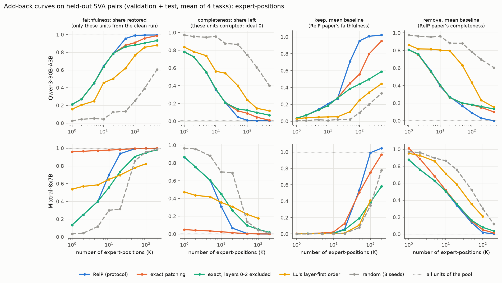

| expert-positions K | 1 | 5 | 10 | 20 | 50 | 100 | 200 |
|---|---|---|---|---|---|---|---|
| Qwen3 faithfulness: RelP / exact / Lu / random | 0.21 / 0.21 / 0.16 / 0.03 | 0.45 / 0.45 / 0.25 / 0.05 | 0.64 / 0.63 / 0.46 / 0.05 | 0.78 / 0.79 / 0.50 / 0.12 | **0.96 / 0.88** / 0.62 / 0.13 | 0.99 / 0.91 / 0.77 / 0.25 | 0.99 / 0.96 / 0.86 / 0.39 |
| Qwen3 keep (mean baseline): RelP / exact | 0.04 / 0.04 | 0.14 / 0.13 | 0.21 / 0.19 | 0.27 / 0.28 | **0.71 / 0.45** | 0.95 / 0.56 | 1.01 / 0.80 |
| Mixtral faithfulness: RelP / exact / exact without L0-2 / random | 0.14 / **0.96** / 0.13 / 0.03 | 0.40 / 0.97 / 0.40 / 0.12 | 0.70 / 0.98 / 0.56 / 0.30 | 0.94 / 0.98 / 0.73 / 0.31 | 0.99 / 0.99 / 0.90 / 0.86 | 1.00 / 1.00 / 0.95 / 0.95 | 1.00 / 1.00 / 0.98 / 0.99 |
| Mixtral keep (mean baseline): RelP / exact | 0.00 / 0.00 | 0.00 / 0.01 | 0.01 / 0.02 | 0.06 / 0.13 | 0.53 / 0.51 | 0.99 / 0.75 | 1.05 / 0.97 |

- **Qwen3.**
  - The two rankings are interchangeable up to K = 20. From K = 50, RelP's ranking is better: its 21st-50th units restore
    more, and when they are kept they hold the answer up better.
  - Exact patching's list deteriorates there, because its single-patch estimates are noise below rank ~30 (section 2.4).
  - Excluding layers 0-2 from the exact ranking makes it worse at large K (0.93 at K = 500), so its tail is not driven by the
    early units.
  - Lu's order (layers by whole-layer rescue, then experts inside the layer) is the worst ranking at every K.
- **Mixtral.**
  - One unit, L0E002 at the subject, restores 0.96 of the difference on its own. RelP ranks it 8th-26th, so the RelP curve
    jumps once the list reaches it (0.70 at K = 10, 0.94 at K = 20).
  - Once the late experts are in, both rankings saturate; RelP's keep curve is again higher from K = 100.
- **Whole experts** (all positions together; `results/figures/relp_moe_p8_addback_expert_all_positions.png`): the same
  picture.
  - Qwen3: equal up to K = 20; RelP better at K = 50 (0.96 vs 0.89; keep 0.73 vs 0.46).
  - Mixtral: exact better below K = 20 because of L0E002; equal from K = 20.
- **Additivity of exact single effects** (held-out pairs, the exact ranking's top-K):
  - Qwen3: the sum of single effects is close to the joint effect (K = 20: 0.64-0.88 vs 0.76-0.81).
  - Mixtral: strongly sub-additive (K = 20: 1.4-2.0 vs 0.95-1.00). L0E002 alone carries the difference, and the late experts
    then add nothing.

### 2.2 Are the top experts clustered in the last layers? (S1.1)

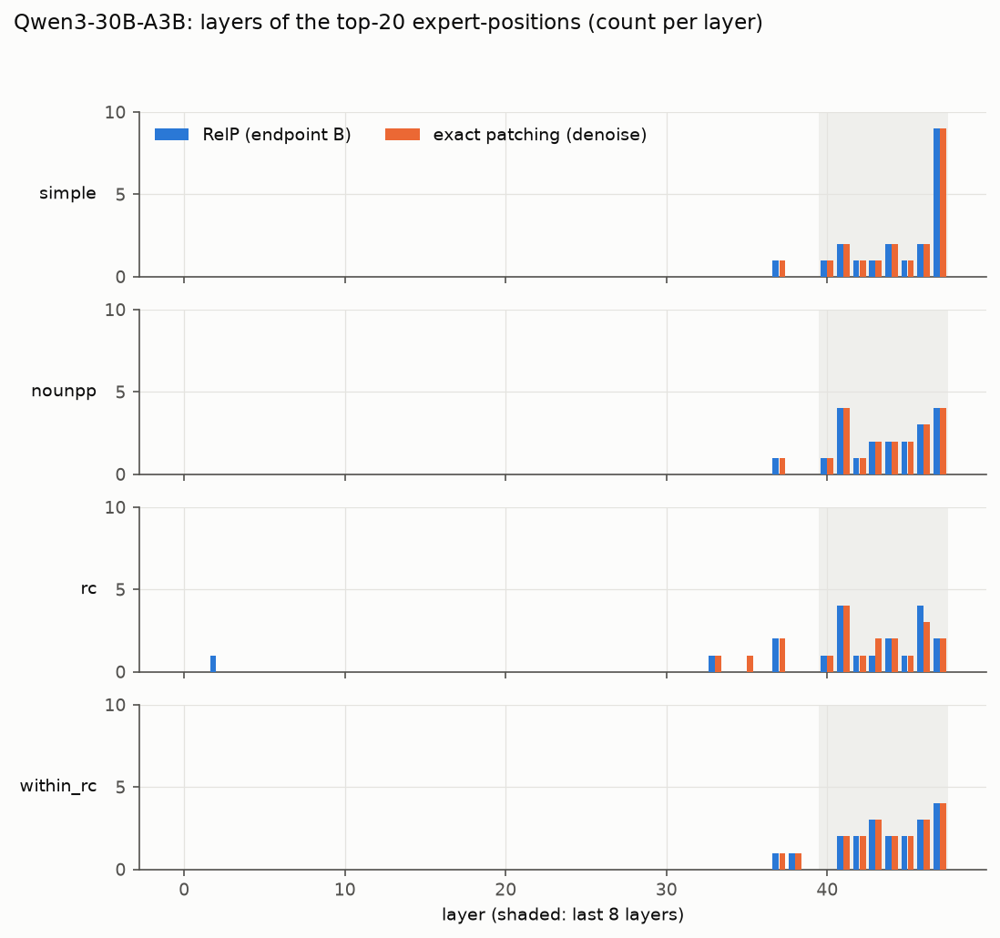
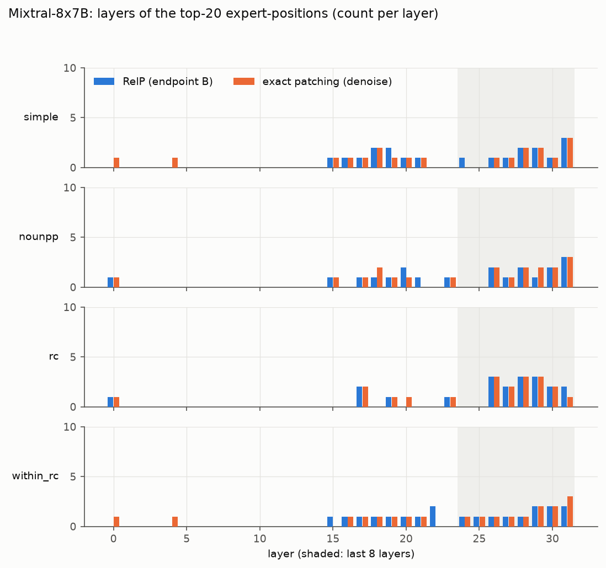

- **Qwen3: clustered.**
  - 80-95 % of the top-20 expert-positions sit in the last 8 of 48 layers (median layer 42-46); the rest are L33-L38.
  - RelP and exact patching give identical top-20 layer histograms in simple, nounpp and within_rc, and differ by one unit in
    rc.
- **Mixtral: spread over the second half.**
  - 50-75 % of the top-20 sit in the last 8 of 32 layers; the rest are L15-L27 (median layer 24-27).
  - Exact patching ranks one layer-0 unit first in every task: L0E002 at the subject. RelP ranks it 8th-26th, with a score of
    0.09-0.15 against an exact effect of 5.8-9.9.
- **Score mass**, counting only units outside noise:

  | | Qwen3 | Mixtral |
  |---|---|---|
  | RelP, share in the last 8 layers | 63-77 % | 48-63 % |
  | exact, share in the last 8 layers | 51-74 % | 30-35 % (L0E002 alone 41-49 %) |

  Without the noise filter the exact grid looks spread out, because it sums thousands of middle-layer means that are noise.

### 2.3 Rank against rank, coloured by layer (S1.2)

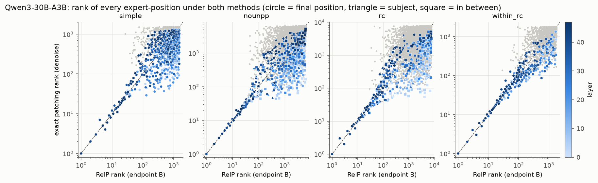
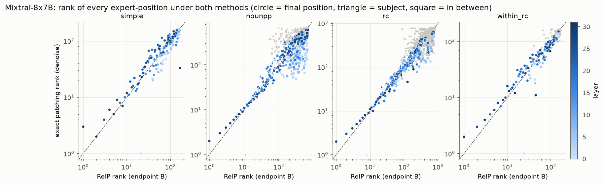

- **Ranks 1 to about 50 lie on the diagonal in every task.** These are dark points, i.e. late layers.
  - Top-10 overlap: 0.9-1.0 in Qwen3 and 0.8-0.9 in Mixtral, where the missing unit is L0E002.
  - The ranking only coincides between the methods: RelP underestimates the strongest late experts (slope 1.18, section 2.5).
- **Below rank ~50 the cloud widens.**
  - Early-layer units (light blue) lie below the diagonal: exact patching ranks them higher than RelP. These are the units
    whose patches switch later experts (section 2.8).
  - Grey units, whose exact mean is within 2 SE of zero, fill the upper part. Exact patching cannot rank them.
- Signed values: `results/figures/relp_moe_p8_valscatter_{qwen3,mixtral}.png`.

### 2.4 "RelP gets noisier down the list; one-by-one patching does not" (S1.3, S2.5, S2.7)

The data show the opposite: going down the list, it is exact patching that becomes noisy.

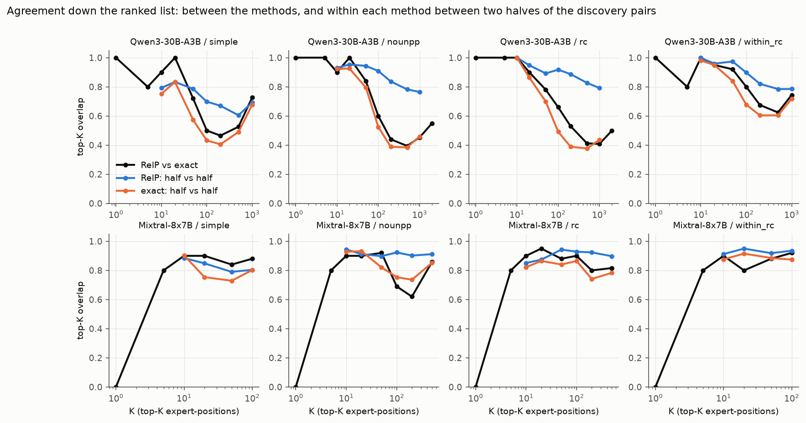

**Noise floor of exact patching** (S2.5; the same patch of the same pair repeated in another batch composition):

| | Qwen3 L0-L23 experts | Qwen3 L24-L39 | Qwen3 last 8 layers | Mixtral, all bands |
|---|---|---|---|---|
| SD of repeat - original (logits) | 0.16-0.23 | 0.11 | 0.07 | 0.04-0.08 |
| mean \|effect\| | 0.09-0.11 | 0.07 | 0.11 | 0.08-2.1 |
| repeat-vs-original correlation | -0.06 to 0.15 | 0.36 | 0.95 | 0.75-0.99 |

- **Mechanism.**
  - bf16 GEMM results depend on the batch shape, and a patched row runs the later layers in other shapes than the unpatched
    row.
  - Qwen3's top-8-of-128 router has near-ties that turn these rounding differences into switched experts. Qwen3 patches that
    switch no later top-k set have SD 0.05-0.07; patches that do, 0.08-0.26.
  - Single early-layer expert patches in Qwen3 are therefore mostly noise. Their 300-pair means are still usable down to
    about ±0.015.
- **Common offset.**
  - The same mechanism gives every patch of a pair a small common offset, harmless for single strong units.
  - Summed over hundreds of weak units it dominates. The 768 single-neuron effects of Qwen3 L46E030 (simple) sum to -8.4
    logits, while the whole expert's effect is +1.1.
  - A per-(pair, layer) offset correction brings such sums within 1-2 logits of the expert effect, but no closer.
- **Split-half reliability.** Each method is ranked on two random halves of the discovery groups, 100 splits.

  | | top-K overlap, K = 10-20 | top-K overlap, K = 100-200 | Spearman of half means (all units) |
  |---|---|---|---|
  | Qwen3, RelP | 0.8-1.0 | 0.67-0.92 | 0.31-0.68 |
  | Qwen3, exact | 0.8-1.0 | 0.39-0.68 | 0.07-0.22 |
  | Mixtral, RelP | 0.85-0.95 | 0.80-0.93 | 0.73-0.96 |
  | Mixtral, exact | 0.75-0.93 | 0.74-0.87 | 0.56-0.87 |
- **Agreement between the methods is bounded by exact patching's reliability.** In Qwen3 their top-K overlap falls from
  0.9-1.0 (K <= 20) to 0.39-0.68 (K = 200-500), tracking exact patching's split-half curve, not RelP's.
- **Rank bins** (Qwen3, mean of 4 tasks):

  | RelP ranks | sign agreement | exact means non-zero | RelP means non-zero |
  |---|---|---|---|
  | 1-10 | 1.00 | 100 % | 100 % |
  | 101-300 | 0.73 | 31 % | 92 % |
  | above 1000 | 0.51 | 14 % | 20 % |
- **Reading.**
  - RelP has lower variance: one backward pass with a frozen router does not react to routing near-ties.
  - Reproducible does not mean correct. Below rank ~100, 300 pairs of exact patching cannot check RelP's order.
  - The add-back curves (2.1) can, because they patch whole sets and are far less noisy. There, RelP's deeper ranking wins in
    Qwen3.

### 2.5 Is RelP attribution patching? (S2.4)

- **Shared:** both score a unit as activation difference x a coefficient from one backward pass at one endpoint, with the
  router frozen.
- **Plain gradient (attribution patching):** uses the ordinary local derivatives.
- **RelP:** holds three quantities constant (norm denominators, attention pattern, SiLU gate) and replaces the product rule on
  SiLU(g)·u by the half rule.

Expert-position discovery means, endpoint B vs denoise, mean of 4 tasks:

| rule | Qwen3 Pearson | Qwen3 slope exact on score | Qwen3 top-20 overlap | Qwen3 last-8 Pearson | Mixtral last-8 Pearson | Mixtral last-8 slope |
|---|---|---|---|---|---|---|
| plain gradient (attribution patching) | 0.968 | 1.32 | 0.90 | 0.979 | 0.994 | 1.09 |
| plain gradient through the routing weights | 0.969 | 1.31 | 0.90 | 0.979 | 0.994 | 1.09 |
| **RelP** | **0.975** | 1.18 | **0.96** | 0.986 | 0.992 | 1.05 |
| RelP without the half rule | 0.958 | **0.95** | 0.85 | **0.991** | 0.991 | 0.98 |
| RelP, norm rule off | 0.976 | 1.20 | 0.96 | 0.986 | 0.994 | 1.09 |
| RelP, attention rule off | 0.973 | 1.18 | 0.93 | 0.986 | 0.992 | 1.05 |
| RelP, gate rule off | 0.968 | 1.36 | 0.93 | 0.978 | 0.991 | 1.08 |

- RelP ranks slightly better than attribution patching and underestimates less. The difference comes mainly from the SiLU
  gate rule (with it off, the slope is 1.36).
- Over all Mixtral units the Pearson r is 0.21-0.32 for every single-pass rule except RelP without the half rule (0.77),
  because L0E002 dominates the variance (section 2.8).
- **The half rule is calibrated for small perturbations, not for large ones.**

  | regime | true gradient | RelP | RelP without the half rule |
  |---|---|---|---|
  | single neurons (S2.7), slope exact on score | 1.00-1.14 | 0.92-1.04 | 0.47-0.88 (overestimates) |
  | late experts (last 8 layers), slope exact on score, Qwen3 / Mixtral | | 1.18 / 1.05 (underestimates) | 1.02 / 0.98 |

  - For small perturbations the half rule compensates for the frozen gate and norm derivatives.
  - Large writes of late experts are amplified super-linearly by later layers, and the rule then underestimates them.

### 2.6 Over- or underestimation at a layer and position (S1.4)

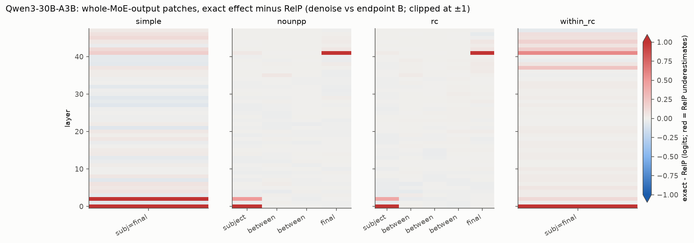
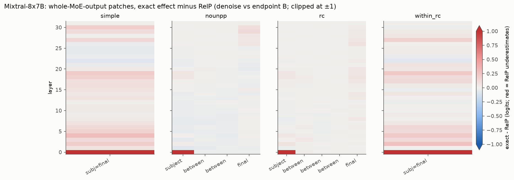

- **Whole-MoE-output patches.** RelP underestimates three places and is close everywhere else:
  - layer 0 at the subject: exact 3.8-5.8 logits (Qwen3) and 5.8-9.9 (Mixtral), RelP 0.1-0.2, i.e. 2-3 %;
  - Qwen3 L41 at the final position in nounpp and rc: exact 2.1-2.5, RelP 1.4-1.5;
  - Qwen3 layers 1-2 at the subject: RelP about 30 % of exact.
- **Single experts by layer band** (slope of exact on RelP):
  - last 8 layers: 0.95-1.46 (Qwen3), 1.02-1.08 (Mixtral);
  - Mixtral layer 0: 38-79, all of it L0E002.
  - Qwen3's early and middle bands: the exact sums there are noise (section 2.4).

### 2.7 Experts routed in one run only (the "same-expert" table, S1.5)

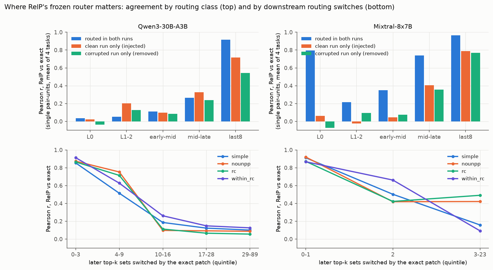

Per single (pair, expert) patch, denoise vs RelP at endpoint B, last 8 layers:

| routing class | Qwen3 Pearson | Qwen3 slope | Mixtral Pearson | Mixtral slope |
|---|---|---|---|---|
| routed in both runs (contribution replaced) | 0.88-0.94 | 0.98-1.38 | 0.95-0.98 | 1.04-1.06 |
| clean run only (injected into the corrupted run) | 0.61-0.86 | 1.03-1.37 | 0.62-0.89 | 1.31-1.73 |
| corrupted run only (removed) | 0.48-0.63 | 0.58-0.78 | 0.70-0.83 | 0.64-0.83 |

- In every task, one-sided experts agree less than experts routed in both runs.
  - RelP underestimates injected experts and overestimates removed ones.
  - In Qwen3's layers 0-23 every class agrees poorly (Pearson < 0.2), because the exact values there are noise.
- **The selected lists do not depend on the one-sided cases.**
  - Both methods' top lists have the same class composition: 58-84 % of their top-20 instances are routed in both runs, 5-15 %
    injected, 5-15 % removed.
  - Recomputing either ranking from both-routed instances only keeps 80-95 % of its top-20.
- **Why one-sided cases agree less.** For a one-sided expert, RelP's score (q_A - 0) · beta is still the correct first-order
  term of that patch; RelP holds fixed the routing of later layers. Such patches move the residual more and switch more later
  experts.

### 2.8 Where freezing fails, and why (S1.6, S2.3, S2.2, S1.7)

**Route switches decide per-unit agreement (S1.6).** Pearson r between RelP and exact over single pair-units, binned by how
many later top-k sets the exact patch switches (`results/tables/relp_moe_p8_switches.md`):

| later top-k sets switched | Qwen3, 4 tasks | Mixtral, 4 tasks |
|---|---|---|
| fewest (Qwen3 0-5, Mixtral 0-1) | 0.85-0.91 | 0.87-0.92 |
| next (Qwen3 3-10, Mixtral 1-3) | 0.51-0.75 | 0.42-0.66 |
| more (Qwen3 > 6-16, Mixtral > 2-3) | 0.06-0.26 | 0.09-0.49 |

**Which frozen quantity causes the gap (S2.3).**
- Each exact patch was re-run with later quantities held at the corrupted run's values (denoise; unit means over the first
  100 discovery pairs).
- Gap = exact - RelP, split in a fixed order into five terms that add up to the gap exactly:
  1. later top-k set switches;
  2. later routing weights;
  3. later attention patterns;
  4. later norm denominators together with the experts' own activation nonlinearity and higher-order terms;
  5. the half rule.

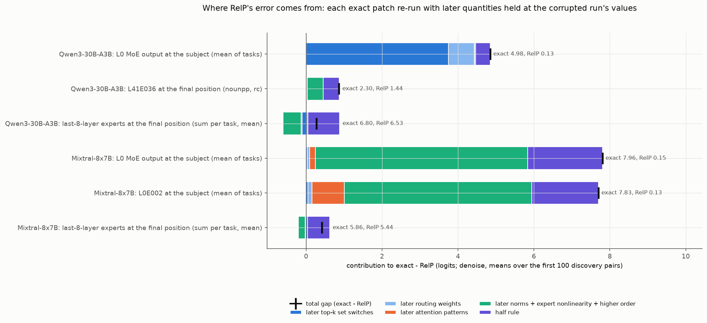

| unit | exact | RelP | set switches | routing weights | attention | norms + nonlinearity | half rule |
|---|---|---|---|---|---|---|---|
| Qwen3 L0 MoE output at the subject (simple; nounpp; rc; within_rc) | 5.84; 4.90; 3.82; 5.38 | 0.15; 0.13; 0.14; 0.11 | 4.96; 3.43; 2.21; 4.40 | 0.38; 0.72; 1.04; 0.56 | ~0 | -0.12; 0.23; -0.15; 0.13 | 0.45; 0.40; 0.53; 0.17 |
| Qwen3 L41E036 at the final position (nounpp; rc) | 2.48; 2.13 | 1.42; 1.46 | ~0 | ~0 | ~0 | 0.78; 0.06 | 0.28; 0.58 |
| Qwen3 last-8 experts at the final position (126 units; nounpp and rc) | 12.72 | 10.91 | -0.06 | 0.05 | 0.02 | -0.02 | 1.81 |
| Mixtral L0E002 at the subject (simple; nounpp; rc; within_rc) | 9.98; 7.81; 5.92; 7.63 | 0.13; 0.15; 0.16; 0.10 | ~0.05 | ~0.1 | 0.52; 0.89; 0.46; 1.53 | 6.45; 5.47; 3.79; 4.03 | 2.70; 1.19; 1.36; 1.80 |
| Mixtral L30E002 / L31E000 at the final position | 0.61-1.80 / 0.19-1.80 | 0.62-1.65 / 0.19-1.79 | ~0 | ~0 | ~0 | -0.04-0.06 | -0.01-0.09 |

- **Qwen3 layer 0 (a routing channel, mostly discrete).**
  - Later top-k set switches account for 60-87 % of the gap, later routing weights for 7-28 %; together 87-94 %.
  - Attention patterns and norms play no role.
- **Mixtral L0E002 (a large-write nonlinearity).**
  - Routing accounts for about 1 % of the gap.
  - Where the norm term can be separated, the expert's own nonlinearity and higher-order terms carry 52-69 % of the gap. The
    half rule carries 15-27 % and attention 5-20 %.
- **Late experts (calibration of the half rule).**
  - In Qwen3 the half rule is the whole systematic underestimate (1.81 of a 1.80 gap over the 126 units of nounpp and rc).
  - The exception is L41E036 in nounpp, whose write later layers amplify (nonlinearity 0.78).
  - Mixtral's late experts are nearly exact.
- **Divergence when norms are frozen.**
  - Holding the norm denominators fixed as well makes some early patches diverge, to 10^4-10^20 logits: without
    normalisation nothing bounds a large early perturbation.
  - The split between norms and nonlinearity is therefore reported only where that patch stays bounded.

**The metric along the straight line from the corrupted to the clean input (path runs).**
- Over 8 equal steps of the subject embedding, more than half of the change of F happens within one step in 93-100 % of the
  pairs. The median largest step is 84-92 % of the total change.
- The decision is close to a step function of the subject token's embedding. No linear method at a single point can follow it
  at the subject site.

**Can the dataset be split by how much the gates change? (S2.2, S1.7)**
- **The runs differ more in routing than in anything else** RelP freezes. From the changed position on, the top-k sets of the
  clean and the corrupted run overlap only partly:

  | quantity (clean vs corrupted run) | difference |
  |---|---|
  | top-k set overlap (Jaccard, by layer band) | 0.48-0.91 |
  | SiLU gate sigmoid(g), experts routed in both runs (mean \|change\|) | 0.01-0.14 |
  | RMSNorm denominators (\|log ratio\|) | 0.01-0.10 |
  | attention patterns (total variation) | 0.01-0.13 |

  (`results/tables/relp_moe_p8_probe.md`.)
- **Per pair, forward-only features predict agreement only weakly.**
  - Best Spearman with per-pair late-layer agreement: Mixtral late routing-weight change -0.46; Qwen3 late SiLU-gate change
    -0.36.
  - Grammatical case does not matter: per-pair agreement is flat across the four number combinations.
- **Splitting held-out pairs at the discovery median of any probe feature does not change RelP's add-back faithfulness relative
  to exact patching's.** At K = 20 the RelP-minus-exact difference is the same in both halves: within 0.007 in Qwen3, and
  -0.04 to -0.05 in Mixtral, which is L0E002.
- **Conclusion:** no data split isolates "pairs where RelP is wrong". RelP is wrong at certain units in every pair:
  - early subject-site units, by 2-3 % of exact;
  - units whose patch switches later experts;
  - strong late experts amplified by later layers.
- **A usable rule:** trust RelP's scores for units whose patch switches no more than ~3 later top-k sets (in practice, late
  layers and the final position); treat early subject-site scores as a lower bound.

### 2.9 Router-aware attribution (S2.6)

Criterion stated before the runs:
1. On Qwen3's layer 0-2 subject-position units the score reaches at least 0.5 of the exact effect (RelP: 0.06).
2. Last-8 expert Pearson falls by no more than 0.02.
3. Held-out faithfulness at K = 20 is no more than 0.02 below RelP's.

Simple and nounpp, where the path runs exist:

| variant | Qwen3 L0-2 subject: score / exact | Qwen3 L0 alone | Mixtral L0 alone | Qwen3 last-8 Pearson | Qwen3 all-unit Pearson | faithfulness K = 20, Qwen3 / Mixtral |
|---|---|---|---|---|---|---|
| RelP | 0.06 | 0.03 | 0.02 | 0.981 | 0.964 | 0.77 / 0.95 |
| RelP + gradient through routing weights (rw) | 0.06 | 0.03 | 0.02 | 0.980 | 0.965 | |
| RelP + soft top-k boundary (3 temperatures) | 0.06 | 0.03 | 0.02 | 0.980 | 0.965 | 0.77 / 0.99 (selected variant) |
| RelP without the half rule | 0.25 | 0.12 | 0.25 | 0.985 | 0.938 | |
| RelP, 8-step path | 0.21 | 0.08 | 0.06 | 0.976 | 0.927 | 0.78 / 1.00 |
| RelP + rw, 8-step path | **0.57** | 0.24 | 0.06 | 0.976 | 0.803 | |
| gradient + rw, 8-step path | 1.65 (L0 0.83, L1-2 6.0x) | **0.83** | **0.64** | 0.980 | 0.482 | **0.98 / 1.00** |

- **Single-pass router-aware rules fail criterion 1.** This follows from S2.3: the routing channel is mostly discrete set
  switches, which no derivative at one point sees, and the weight part is small at the patched point. The variant selected on
  discovery for the add-back runs (soft top-k) is indistinguishable from RelP in every measure.
- **The multi-step variants with routing weights meet criteria 1 and 2.** The 8-step path of the plain gradient also meets
  criterion 3 on both models.
- **What the path gradient does.**
  - It recovers 83 % of Qwen3's layer-0 subject effect and 64 % of Mixtral's (essentially L0E002).
  - Its top units are several layer 0-5 experts at the subject, which jointly restore most of the difference. Exact patching
    misses them, because each alone does little (Phase 7: no single Qwen3 layer-0 expert matters).
- **What it does not do.** It is a poor estimator of single units: it overshoots layers 1-2 six-fold, its unit-level Pearson is
  0.48 (Qwen3), and its top-20 overlap with exact is 0.25-0.33.
- **Reading.** A path-integrated gradient through the routing weights is a better selector of the units that matter jointly.
  It does not estimate any one unit's effect better.
- **Status:** exploratory. Two tasks only, 8 trapezoid steps, about 7 extra minutes of GPU per task and model.

### 2.10 Single neurons (S2.7)

| RelP neuron ranks | Qwen3 Pearson | Mixtral Pearson | share above the random-neuron noise floor |
|---|---|---|---|
| 1-10 | 0.93-1.00 | 0.99-1.00 | 100 % |
| 11-100 | 0.95-1.00 | 0.97-0.99 | 97-100 % |
| 101-300 | 0.78-0.97 | 0.89-0.96 | 73-99 % |
| 301-1000 | 0.58-0.88 | 0.77-0.89 | 31-80 % |

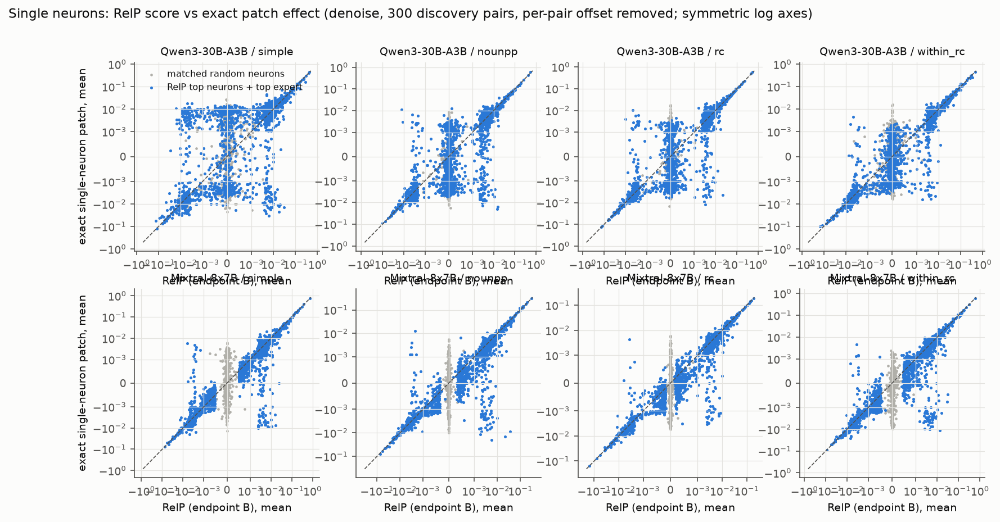

- RelP's top 1,000 neurons agree with exact single-neuron patches with slope 0.92-1.04; the top 100 have sign agreement
  0.98-1.00. Below rank ~300, 20-69 % are inside the noise floor.
- The true gradient through the routing weights fits single neurons best: Pearson 0.975-0.997, slope 1.00-1.14.
- RelP without the half rule overestimates them (slope 0.47-0.88; section 2.5).
- This is the level at which exhaustive exact patching is impossible (4.7 M / 3.7 M neurons per position in Qwen3 / Mixtral)
  and RelP is needed. Where checked, it holds for the top few hundred neurons.

## 3. Other tasks: CounterFact and two-hop state capitals (stage 3)

### 3.1 What was run

| | CounterFact | two-hop state capitals |
|---|---|---|
| pairs | the STR pairs of Direction 6: a case and a donor subject of the same relation whose object is the case's foil (donor slots 0-1) | `Fact: the capital of the state containing {city} is`, two cities in different states with the same token count; both directions as rows |
| answer / foil | true object / the donor's object (first token) | first token of the capital of the clean / corrupted city's state |
| discovery / held-out pairs | Qwen3 200 / 175, Mixtral 201 / 176 (the paper's discovery / validation cases) | 300 / 80 each; validation and test use states that never appear in discovery |
| prompt length (tokens) | 3-15 (Qwen3), 5-16 (Mixtral) | 10-12, 12-15 |
| clean prompt answered correctly | 98 %, 99 % | 100 %, 100 % |
| paired difference (logits) | 12.6, 12.5 | 19.6, 15.5 |

- **Two-hop selection.** 128 candidate cities; a city is kept if its own capital's first token is at least 1 logit above every
  other capital's. 108 (Qwen3) and 123 (Mixtral) pass; no relaxation of the rule was needed.
- **Units.** Prompt lengths vary, so units are read at each pair's own positions of two roles: **subject** = the last token of
  the changed word (last subject token; last city token) and **final** = the last token. The exact grid still covers every
  position from the first changed token on.
- **Engine.** Rows are bucketed by length and all buckets share each pass over the checkpoint (`lockstep`; tested bit for bit
  against separate runs). The protocol's verification gate passes for all four cells (2,148 / 1,444 checks).
- **Commands per cell:** probe, 5 rule variants at both endpoints, 3 path variants, exact grid (CounterFact both directions,
  two-hop denoise), noise repeats, freeze decomposition, add-back. About 4.0 GPU-h in total. One job ran out of memory
  (Mixtral two-hop path) and was rerun in chunks.
- **Cross-check with the old engine** (CounterFact, the Direction-6 run, same case and donor, final position):
  whole-layer rescues agree at r 1.000 (largest difference 0.024 / 0.016 logits); single experts with at least 30 pairs at
  r 0.977 / 0.994 (largest difference 0.08 / 0.05). Single pairs in the first half of the layers do not agree (r 0.33 in Qwen3),
  which is the noise floor of section 2.4 again.
- **Not in stage 3:** neuron-level scores (expert level only) and the mean-baseline keep / remove curves (no per-position means
  exist across templates).

### 3.2 Where the exact effects sit

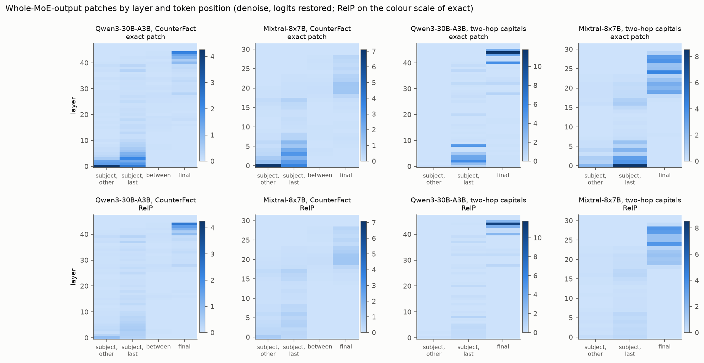

Whole-MoE-output patches (denoise, discovery means, logits restored; sums over the layers):

| position, layers | Qwen3 CounterFact exact / RelP | Mixtral CounterFact | Qwen3 two-hop | Mixtral two-hop |
|---|---|---|---|---|
| last subject token, layers 0-2 | 5.6 / 1.2 | 8.4 / 1.3 | 8.7 / 1.3 | 15.3 / 1.3 |
| last subject token, middle layers | 10.0 / 6.1 | 11.8 / 6.6 | 17.9 / 5.9 | 10.0 / 5.2 |
| final token, middle layers | 2.1 / 1.6 | 5.9 / 5.7 | 2.7 / 1.1 | 10.1 / 6.6 |
| final token, last 8 layers | 5.3 / 5.3 | 0.9 / 0.9 | 23.0 / 17.8 | 11.7 / 10.1 |

- Both tasks have the two sites of SVA: the subject token in early and middle layers, and the final token in late layers
  (Mixtral: middle and late).
- CounterFact also has effects at the earlier subject tokens in layer 0 (4.3 / 7.1 logits); they are outside the two roles.

### 3.3 Late final-token experts: the methods agree

| | Qwen3 CounterFact | Mixtral CounterFact | Qwen3 two-hop | Mixtral two-hop |
|---|---|---|---|---|
| top units, exact | L44E069 1.08; L42E115 0.83; L47E086 -0.64 | L21E001 0.69; L0E001@subject 0.60; L19E002 0.59 | L44E069 11.7; L8E032@subject 4.6; L40E030 4.5 | L24E007 4.1; L27E007 2.6; L28E002 2.2 |
| top units, RelP | L44E069 1.21; L42E115 0.89; L47E086 -0.68 | L21E001 0.73; L19E002 0.63; L17E005@subject 0.43 | L44E069 10.8; L45E002 3.4; L40E030 2.6 | L24E007 3.4; L27E007 2.5; L28E002 2.3 |
| same top-1 | yes | yes | yes | yes |
| final token, last 8 layers: Pearson / slope | 0.996 / 0.90 | 0.960 / 0.90 | 0.992 / 1.11 | 0.990 / 1.05 |
| all role units: Pearson | 0.955 | 0.788 | 0.933 | 0.969 |
| top-K overlap, K = 5 / 20 / 100 | 1.0 / 0.85 / 0.66 | 0.4 / 0.4 / 0.83 | 0.6 / 0.8 / 0.48 | 0.6 / 0.9 / 0.91 |

(Units are at the final token unless marked.)

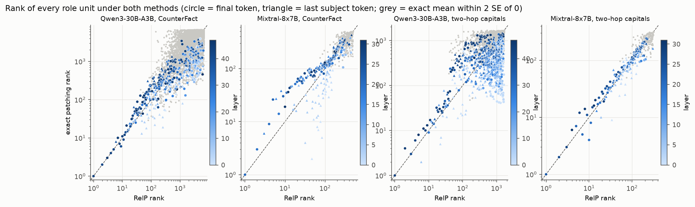

- **The same experts as in the base reproduction.** On CounterFact both methods return L44E069 and L42E115 (Qwen3) and L21E001
  and L19E002 (Mixtral); the top five Qwen3 units are identical and in the same order.
- **The fact experts are reused.**
  - Qwen3's L44E069 is also the top unit of the two-hop task. One expert at one position restores 11.7 of 19.6 logits.
  - Mixtral's L19E002 and L21E001 are 4th and 5th on two-hop (1.65, 1.55).
- **Where the lists differ, the units are early subject-token experts.** Mixtral CounterFact is the clearest case: 35 % of exact
  patching's top-20 are in layers 0-2, and none of RelP's (L0E001, L1E004, L0E002 and, in layer 3, L3E007: each 0.4-0.6).
- **Layers of the top-20:** Qwen3 CounterFact 70-75 % in the last 8 layers; two-hop 45-55 % (Qwen3) and 55-60 % (Mixtral);
  Mixtral CounterFact 5 % (exact) and 15 % (RelP).

### 3.4 The early subject site: underestimated in every cell, for mixed reasons

Share of the exact whole-MoE-output effect that each rule gives at the last subject token, layers 0-2:

| rule | Qwen3 CounterFact | Mixtral CounterFact | Qwen3 two-hop | Mixtral two-hop |
|---|---|---|---|---|
| plain gradient (attribution patching) | -0.01 | 0.02 | -0.03 | 0.00 |
| RelP | 0.22 | 0.15 | 0.15 | 0.08 |
| RelP + gradient through routing weights | 0.45 | 0.20 | 0.19 | 0.10 |
| RelP without the half rule | 2.04 | 1.70 | 0.88 | 0.76 |
| RelP + routing weights, 8-step path | 0.90 | 0.32 | 0.42 | 0.23 |
| gradient + routing weights, 8-step path | 1.11 | 0.98 | 1.65 | 1.32 |

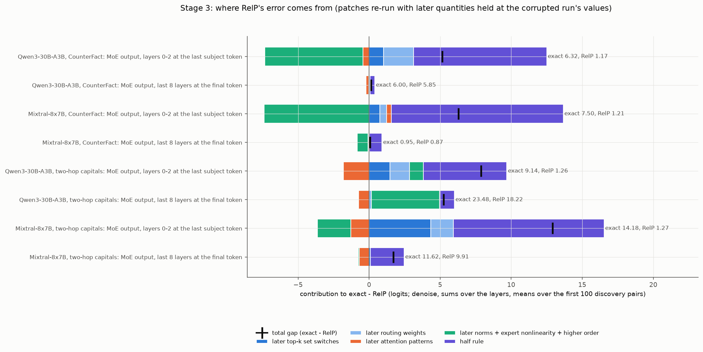

Decomposition of exact - RelP at that site (first 100 discovery pairs; shares of the gap):

| | exact | RelP | later routing (set switches + weights) | later attention patterns | linearisation (expert nonlinearity + half rule) |
|---|---|---|---|---|---|
| Qwen3 SVA, layer 0 | 5.0 | 0.13 | 91 % | 0 % | 8 % |
| Qwen3 CounterFact, layers 0-2 | 6.3 | 1.2 | 61 % | -8 % | 47 % |
| Qwen3 two-hop, layers 0-2 | 9.1 | 1.3 | 36 % | -23 % | 87 % |
| Mixtral SVA, layer 0 | 8.0 | 0.15 | 1 % | 2 % | 97 % |
| Mixtral CounterFact, layers 0-2 | 7.5 | 1.2 | 20 % | 5 % | 75 % |
| Mixtral two-hop, layers 0-2 | 14.2 | 1.3 | 46 % | -10 % | 64 % |

- **Underestimated everywhere.** RelP gives 8-22 % of the exact effect at this site; attribution patching gives nothing. Further
  up at the subject token (middle layers) RelP gives 33-61 %.
- **The cause is task-dependent in both models.** Later routing accounts for 20-61 % of the gap in stage 3. SVA showed the two
  extremes (91 % and 1 %); neither is a property of the model.
- **Routing weights matter more here than in SVA.** In Qwen3 CounterFact two thirds of the routing part are weights, and letting
  the gradient through them doubles the recovery (0.22 to 0.45). In SVA that variant did nothing.
- **The linear estimate has no good setting at this site.** Without the half rule RelP overshoots on CounterFact (1.7-2.0 x the
  exact effect) and is close on two-hop (0.76-0.88); with it, RelP undershoots 5-12 x.
- **Two-hop: early-middle experts at the city token** (the "city to state" candidates). Qwen3: L8E032 (exact 4.6), L2E104 (3.6),
  L4E096 (1.5).
  - RelP finds L8E032 (rank 6) but scores it 0.96, and scores L2E104 0.28.
  - Their gap is the experts' own nonlinearity (2.6-3.0 of 2.8-3.7 logits); later routing accounts for -0.2 to 0.5.
  - The path gradient ranks them 2nd and 3rd.
- **How step-like the decision is** (share of pairs whose metric makes more than half of its change within one eighth of the
  path): CounterFact 61 % and 57 %, two-hop 98 % and 90 % (SVA: 93-100 %).

### 3.5 Experts added back on held-out pairs

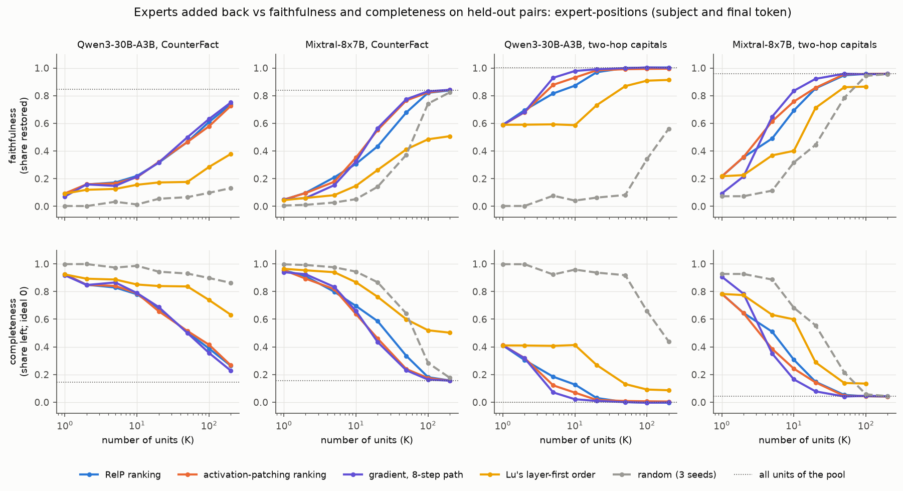

Faithfulness (share of the paired difference restored when only the K units carry the clean run), role units:

| K | 1 | 5 | 10 | 20 | 50 | 100 |
|---|---|---|---|---|---|---|
| Qwen3 CounterFact: RelP / exact / path gradient / Lu | 0.09 / 0.09 / 0.07 / 0.09 | 0.17 / 0.17 / 0.15 / 0.13 | 0.22 / 0.21 / 0.21 / 0.16 | 0.32 / 0.32 / 0.32 / 0.17 | 0.47 / 0.46 / 0.50 / 0.18 | 0.61 / 0.58 / 0.63 / 0.28 |
| Mixtral CounterFact | 0.05 / 0.05 / 0.05 / 0.04 | 0.21 / 0.18 / 0.15 / 0.08 | 0.31 / 0.35 / 0.32 / 0.15 | 0.43 / 0.55 / 0.57 / 0.26 | 0.68 / 0.77 / 0.77 / 0.41 | 0.82 / 0.82 / 0.83 / 0.48 |
| Qwen3 two-hop | 0.59 / 0.59 / 0.59 / 0.59 | 0.82 / 0.88 / 0.93 / 0.59 | 0.87 / 0.93 / 0.98 / 0.59 | 0.97 / 0.98 / 0.99 / 0.73 | 1.00 / 0.99 / 1.00 / 0.87 | 1.00 / 0.99 / 1.00 / 0.91 |
| Mixtral two-hop | 0.22 / 0.22 / 0.09 / 0.22 | 0.49 / 0.61 / 0.65 / 0.37 | 0.69 / 0.76 / 0.84 / 0.40 | 0.85 / 0.86 / 0.92 / 0.71 | 0.95 / 0.95 / 0.96 / 0.86 | 0.96 / 0.96 / 0.95 / 0.87 |

- **Qwen3:** RelP's ranking equals exact patching's on CounterFact at every K and is slightly ahead from K = 100; on two-hop
  exact is ahead at K = 5-10 (0.88 / 0.93 vs 0.82 / 0.87) because it includes the early city-token experts.
- **Mixtral:** exact is ahead at K = 10-50 on CounterFact and at K = 5-10 on two-hop, for the same reason.
- **The path gradient** matches or beats both from K = 5 on two-hop and from K = 20 on CounterFact. At K = 1 it can pick an early
  unit that does little alone (Mixtral two-hop 0.09).
- **Lu's layer-first order** is the worst ranking in every cell from K = 5 on. On Qwen3 two-hop it stays at 0.59 up to K = 10.
- **CounterFact is distributed.** 20 units restore 0.32-0.55 and 100 restore 0.6-0.8; on two-hop 20 units restore 0.85-0.99.
  All role units together restore 0.84-0.85 on CounterFact (the earlier subject tokens are outside the pool) and 0.96-1.00 on
  two-hop.
- **Completeness** (share left when the K units are corrupted) mirrors this: at K = 20, CounterFact 0.68 / 0.66 (Qwen3, RelP /
  exact) and 0.59 / 0.46 (Mixtral); two-hop 0.03 / 0.02 and 0.15 / 0.14.
- **Whole experts** (`results/figures/relp_moe_p8s3_addback_all.png`): the same order of the rankings. Mixtral CounterFact shows the
  largest gap (K = 10: exact 0.78, path gradient 0.87, RelP 0.46).

### 3.6 Noise, reliability, routing classes

| | Qwen3 CounterFact | Mixtral CounterFact | Qwen3 two-hop | Mixtral two-hop |
|---|---|---|---|---|
| split-half top-20 overlap, RelP / exact | 0.84 / 0.71 | 0.80 / 0.52 | 0.91 / 0.89 | 0.93 / 0.93 |
| split-half top-100 overlap, RelP / exact | 0.66 / 0.49 | 0.80 / 0.80 | 0.88 / 0.71 | 0.96 / 0.89 |
| repeat SD of single expert patches, layers 0-2 (mean \|effect\|) | 0.22-0.23 (0.18-0.19) | 0.36-0.41 (0.46-0.60) | 0.47-0.52 (0.24-0.44) | 0.22-0.25 (0.25-0.28) |
| repeat SD, last 8 layers | 0.05 | 0.05 | 0.11 | 0.15 |
| Pearson by later route switches, fewest / most | 0.91 / 0.47 | 0.85 / 0.47 | 0.95 / 0.40 | 0.93 / 0.42 |
| last 8 layers: routed in both runs / clean only / corrupted only | 0.94 / 0.91 / 0.69 | 0.91 / 0.87 / 0.61 | 0.96 / 0.46 / 0.39 | 0.95 / 0.95 / 0.35 |

- Every stage-2 finding about noise and reliability repeats: RelP's list is at least as reproducible as exact patching's; single
  early patches are of the size of their own repeat noise; agreement falls with later route switches; experts routed in one run
  only agree less.
- **RelP vs the plain gradient** (role units, Pearson with exact): 0.96 vs 0.94, 0.79 vs 0.69, 0.93 vs 0.91, 0.97 vs 0.97. At the
  final token in the last 8 layers the plain gradient also underestimates more (0.26-0.77 of exact vs RelP 0.78-1.00).

## 4. Expectations written down before the runs (plan section 12)

| # | expectation | outcome |
|---|---|---|
| 1 | Add-back: Qwen3 RelP and exact curves within 0.03 up to K = 50 | **failed in RelP's favour**: equal up to K = 20, RelP higher at K = 50 (0.96 vs 0.88) |
| 1 | Add-back: Mixtral exact ranking >= 0.9 at K = 1 | held (0.96) |
| 1 | Add-back: Mixtral exact without layers 0-2 matches RelP | **partly**: equal at K <= 5, below RelP at K = 10-50 |
| 2 | >= 80 % of RelP's top-20 in the last 8 layers in both models | held for Qwen3 (80-95 %); **failed** for Mixtral (50-75 %) |
| 2 | Exact patching adds the layer-0 subject unit in Mixtral and nothing early in Qwen3 | held |
| 3 | Top-K overlap >= 0.8 up to K = 20, < 0.5 by K = 200-500 | Qwen3 held (0.9-1.0; 0.39-0.62); **Mixtral failed** (stays 0.6-0.9) |
| 3 | At K >= 100 RelP at least as reproducible between halves as exact (Qwen3) | held (0.67-0.92 vs 0.39-0.68) |
| 4 | One-sided units agree less than both-routed ones in the last 8 layers, every task | held |
| 5 | Qwen3 early position units: routing >= 70 % of the gap | held (set + weights 87-94 %) |
| 5 | Mixtral L0E002: finite size dominates | held (nonlinearity + higher order 52-69 %) |
| 5 | Amplified late experts (Qwen3 L41E036): the half rule dominates | **mixed**: rc yes (0.58 of 0.67); nounpp no (nonlinearity 0.78, half 0.28) |
| 6 | Plain gradient and RelP both >= 0.9 with exact; RelP without the half rule has slope closer to 1 | Qwen3 held; Mixtral over all units **failed** (0.21-0.30, L0E002); last-8 held |
| 7 | Router-aware variants | single-pass: no effect; 8-step path: meets the criterion with caveats (2.9) |
| 8 | Neurons r >= 0.9 for the top 100; below rank ~300 inside the noise floor | held / **partly** (31-80 % still above the floor) |
| 9 | CounterFact: RelP's final-token top-1 is Qwen3 L44E069 or L42E115, Mixtral L21E001 or L19E002 | held (L44E069; L21E001) |
| 9 | CounterFact: the early subject site has no shared expert and is again underestimated | underestimated: held. No shared expert: held in Qwen3; **partly** in Mixtral (several early experts of 0.4-0.6) |
| 10 | Two-hop (open): do middle-layer experts at the city token appear, and do the methods agree on them? | they appear in Qwen3's layers 2-8 (L8E032, L2E104); RelP finds L8E032 but underestimates it 5 x; the path gradient ranks them 2nd-3rd |
| 11 | IOI | not run (user decision) |

## 5. What is new

1. **Two different reasons why gradient attribution misses early MoE effects, separated and quantified** (numbers of this item:
   SVA; the other tasks are in item 7).
   - Qwen3: a routing channel. 60-87 % of the gap at the early subject site is later top-k set switches, 7-28 % later routing
     weights.
   - Mixtral: a large-write nonlinearity in one expert (routing ~1 %). The two models fail at the same site for unrelated
     reasons.
   - Dense models have no routing channel. A frozen-router method cannot attribute information carried by which experts later
     layers choose.
2. **Exhaustive activation patching in a bf16 MoE has a routing-amplified noise floor.**
   - Per single patch the noise reaches SD 0.26 logits (Qwen3 early layers), larger than most single-expert effects.
   - As a result, attribution gives more reproducible deep rankings, and better held-out add-back curves, than patching every
     unit one by one. This is the opposite of the usual assumption that patching is the ground truth and attribution its
     approximation.
3. **Reliability lives in units, not in pairs.**
   - The number of later top-k sets a patch switches predicts per-unit agreement (Pearson 0.85-0.91 vs 0.06-0.26).
   - Forward-only gate differences do not separate reliable from unreliable pairs or categories.
   - Practical rule: trust late / final-position units; treat early subject-site scores as lower bounds.
4. **Calibration of the half rule depends on perturbation size.** It is correct for small perturbations and underestimates large
   writes that later layers amplify.
5. **A path-integrated gradient through the routing weights** recovers the early effects RelP misses and selects collectively
   important early experts that single-unit patching cannot see (exploratory).
6. **Engineering.** Exact RelP, 12 rule variants, freeze decompositions and neuron-level patching on 30-47 B MoE models on one
   24 GB GPU, with bit-level agreement to the Phase-7 engine.
7. **Three task families, one picture** (stage 3).
   - Late final-token experts: RelP and exact patching agree (same top unit in 4 / 4 new cells).
   - The early subject site is always underestimated (8-22 % recovered), by a task-dependent mixture of later routing (20-61 %) and
     linearisation.
   - The path gradient through the routing weights is the best or equal-best held-out ranking at K = 20-50 in every cell, and
     Lu's layer-first rule is the worst.
8. **Shared fact experts.** Qwen3's L44E069 serves CounterFact and two-hop capitals and alone carries 60 % of the two-hop
   decision; Mixtral's L19E002 and L21E001 reappear on two-hop.

Items 1-3 and 7 are the candidates for a paper. After stage 3, item 1 has to be stated as a mixture: routing is a real channel
in both models (36-91 % of the early gap in Qwen3, 1-46 % in Mixtral, depending on the task), not a property that separates
Qwen3 from Mixtral.

## 6. Implications and possible next steps

- **Method to use.** For ranking experts: RelP for late units, plus the 8-step path gradient through the routing weights when
  early units matter (about 7 extra GPU-minutes per task and model on SVA). Exhaustive single patches are trustworthy for strong
  units only.
- **Open follow-ups on the present models:**
  - the path gradient as an add-back ranking on all four SVA tasks (run on two so far), and with more steps;
  - a role for the earlier subject tokens in CounterFact (they hold 4-7 logits in layer 0 and cap the add-back at 0.84-0.85);
  - neuron-level scores on the stage-3 tasks;
  - what L44E069 writes in the two-hop task (the vocabulary projection of Phase 4 applied to capitals).
- **Stage 4 (larger models).** Mixtral-8x22B needs no new engine code (about 4-5 GPU-h after the download). gpt-oss needs a new
  engine family, a decision on dequantised MXFP4 weights and a chat prompt format (several days). Awaiting the user's decision.

## 7. Caveats

- Two models. Stage 2 (SVA) uses the paper profile only.
- **Stage 3 scope:**
  - units at two roles only (last subject token, final token); expert level only; add-back with noise / denoise only;
  - CounterFact pairs are the paper's cases that have a qualifying STR donor (Direction 6), not a fresh sample;
  - the two-hop task uses one template and a competence filter; it does not show that the model computes the state as an
    intermediate step;
  - length buckets give small batches, so bf16 batch effects differ between rows;
  - the freeze decomposition on CounterFact has large linearisation terms of opposite sign (nonlinearity negative, half rule
    positive); only their sum is interpreted.
- Path variants were run on two tasks, with 8 trapezoid steps; the step-function responses make 8 steps coarse.
- **Exact effects** contain the per-pair offset of section 2.4, so sums over many weak units are unreliable. The neuron offset
  correction is an estimate.
- **The freeze decomposition** uses a fixed order of the terms (set, weights, attention, norms + nonlinearity, half). Solo
  effects are given in `results/tables/relp_moe_p8_freeze.md`. The norm-frozen patches diverge for some early units, so norms
  and nonlinearity are reported together there.
- **The gate probe** summarises each pair by layer and position means. Other per-pair features might predict better; per unit,
  the realised route switches do.
- The add-back "exact" whole-expert ranking sums the single expert-position effects (additive approximation). Lu's order covers
  final-position units only.
- The router-aware variant used in the add-back runs was selected on discovery Pearson, where the candidates differ by less than
  0.01.

## 8. Files

- **Plan and live status:** `docs/relp_moe_phase8_plan.md` (meeting notes verbatim, work items, decisions taken during the
  analysis).
- **Code:**
  - `moetrace/relp_moe_p8.py`: rule-switchable RelP, multi-variant backward, path forward, gate probe, freeze / neuron patches;
  - `scripts/relp_moe_p8_run.py`: commands probe, rules, path, freeze, neuron, addback;
  - `scripts/relp_moe_p8_{data,select,analyze,figures,smoke}.py`;
  - chains: `scripts/relp_moe_p8_chain_{noise,a}.sh`;
  - tests: `tests/test_relp_moe_p8.py`.
- **Outputs:** `results/relp_sva_moe/<model>/paper/<task>/p8_{noise,probe,rules,path,freeze,neuron,addback}/`;
  `results/relp_sva_moe/p8/` (unit tables, per-pair tables, analysis parquet, `selected_rw.json`);
  `results/relp_sva_moe/p8_summary.json`.
- **Tables:** `results/tables/relp_moe_p8_{layerdist,depth,biasmap,classes,switches,pairs,noisefloor,rules,freeze,neuron,addback,probe}.md`.
- **Figures:** `results/figures/relp_moe_p8_{layerdist,rankscatter,valscatter}_{qwen3,mixtral}.png`,
  `relp_moe_p8_{depth,classes,rules,freeze,neuron}.png`, `relp_moe_p8_biasmap_{qwen3,mixtral}.png`,
  `relp_moe_p8_addback_{expert_position,expert_all_positions}.png`.
- **Stage 3:**
  - manifests `data/relp_p8/{qwen3,mixtral}_{counterfact,twohop}_v1/` (builder `scripts/relp_moe_p8_prepare.py`), candidate lists
    `data/relp_p8/twohop_candidates_{qwen3,mixtral}.json`;
  - runner `scripts/relp_moe_p8_run3.py` (scan, verify, probe, rules, path, patch, noise, freeze, addback), chain
    `scripts/relp_moe_p8_chain_b.sh`, analysis `scripts/relp_moe_p8_analyze3.py`, figures `scripts/relp_moe_p8_figures3.py`;
  - outputs `results/relp_p8/<model>/<task>/<command>/`, `results/relp_p8/analysis/`, `results/relp_p8/summary.json`;
  - tables `results/tables/relp_moe_p8s3_{overview,agreement,rules,freeze,addback,probe,tasks}.md`;
  - figures `results/figures/relp_moe_p8s3_{sites,rankscatter,addback_role,addback_all,freeze}.png`.
- **Logs:** `logs/relp_moe_p8_chain.log`, `logs/relp_moe_p8_jobs_{qwen3,mixtral}.log`, `logs/PROGRESS.md` (`[relp-p8]`).
