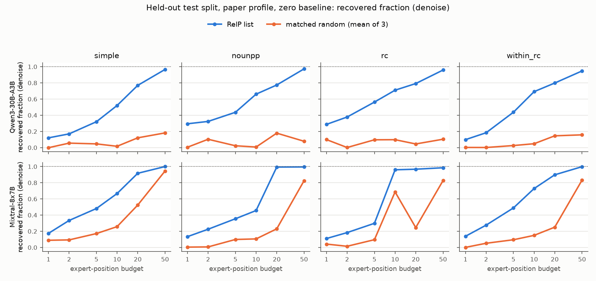
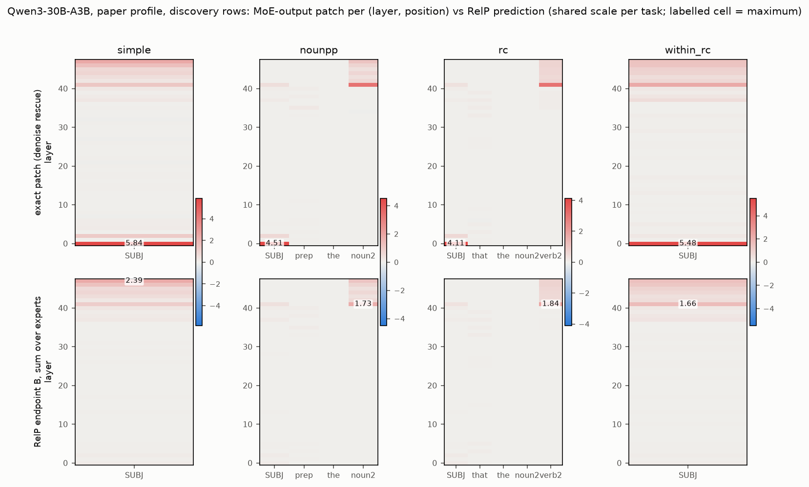
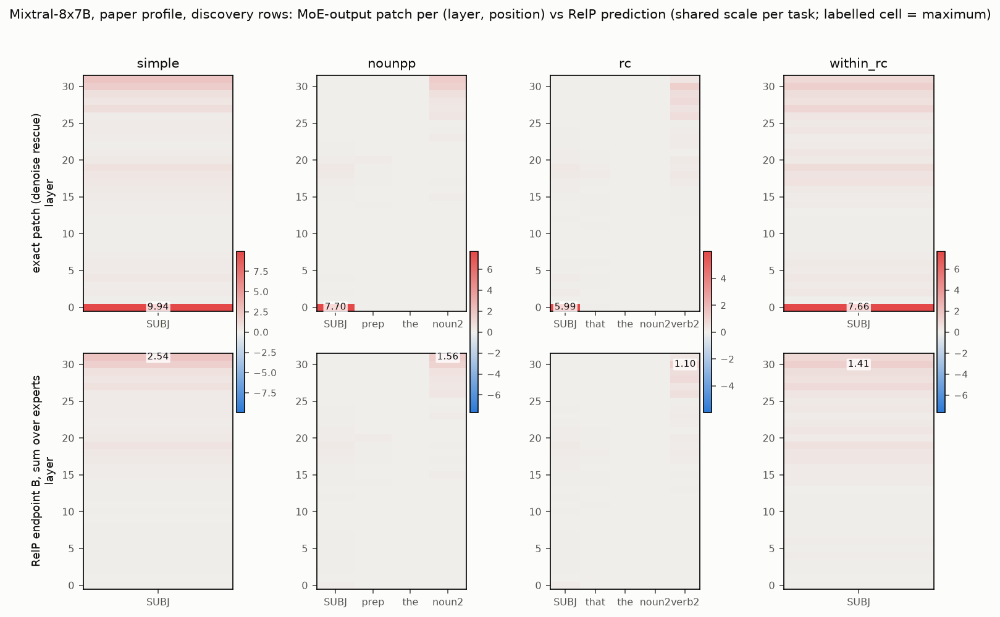
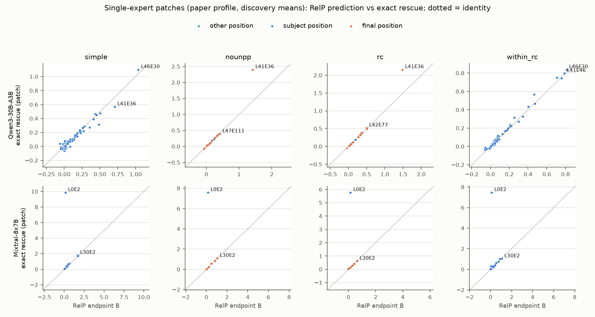

# Phase 7: RelP on SVA for Qwen3-30B-A3B and Mixtral-8x7B, and RelP vs Lu-style activation patching

**Summary.** We applied RelP to two full-size MoE models on the SVA subject–verb agreement tasks. RelP follows
`docs/relp_moe_implementation_guide.md` and `docs/relp_sva_experiment_protocol.md` without changes to any definition:
paired score, coefficients at the clean endpoint, frozen router, signed means, expert = sum of its neurons.
- RelP finds a few late experts at the final position in each model (Qwen3 L41E036, L46E030; Mixtral L30E002, L31E000).
  On held-out test pairs, patching RelP's top-20 expert-positions from the clean into the corrupted run recovers 0.78 /
  0.94 of the paired difference (matched random sets: 0.12 / 0.31).
- On the same pairs, Lu et al.-style activation patching (STR, the paper's layer → expert rule) agrees with RelP wherever
  the deciding unit is a late, direct-writing expert. In both models RelP and exact patching pick the same top-1
  final-position expert in every task where the paper's rule ends at a late layer.
- They disagree at one site: the subject token in layer 0. There, exact patching restores 4–10 logits and RelP predicts
  about 0.15. The reason differs between the models:
  - Qwen3: the layer-0 effect is spread over many experts and works through downstream routing changes. Freezing later
    routing removes 85–90 % of it, and RelP freezes the router by construction.
  - Mixtral: one expert (L0E002) writes a change of about 41 % of the residual norm and carries the whole difference by
    itself. A first-order score cannot follow a perturbation that large at the bottom of the network.

## 1. Setup

**Models.** Qwen3-30B-A3B-Base (rev `1b75feb`, 48 layers, 128 experts, top-8) and Mixtral-8x7B-v0.1 (rev `fc7ac94`,
32 layers, 8 experts, top-2), bf16, single A10G 24 GB.
- Mixtral keeps its tokenizer-default `<s>` (protocol rule 1, "no artificial BOS"). `<s>` is a special token, so the
  `non_special` pool excludes it.

**Data.** Official SVA files of `TransluceAI/circuits` @ `2d215d4`, four tasks: simple, nounpp, rc, within_rc. Manifests
are rebuilt per tokenizer with the protocol's alignment rules (`data/relp_sva/{qwen3,mixtral}_{smoke,paper,grouped}_v1`).
- *paper* profile: 300 discovery / 40 calibration / 40 validation / 40 test pairs per task. Mixtral simple has 236
  discovery pairs because only 316 aligned train rows remain (`--short-discovery`; no duplicated rows).
- *grouped* profile: content-disjoint splits, the protocol's generalisation check.
- Both endpoints of each pair are answered correctly 98–100 % of the time (accuracy at A, `results/tables/relp_moe_overview.md`).

**Engine.** FModel needs the whole model on the GPU, so the protocol runs on a new layer-streamed engine
(`moetrace/relp_moe_stream.py`; implementation, evidence and deviations in `docs/relp_moe_stream_notes.md`).
- **Forward:** reproduces the transformers 5.22.2 eager modules operation by operation.
- **RelP backward:** a reverse layer stream; each layer is recomputed with the RelP rules, then
  β_e = W_down,eᵀ λ_{l+1} (guide 2.3 / 9.2).
- **Verification gate:** every task's `verify` passes at the protocol tolerances (atol 1e-4, rtol 1e-3, relative L2
  1e-3): 20 / 20 runs, 2,148 checks per Qwen3 task and 1,444 per Mixtral task. Within the same batch the forward is
  bit-identical to native HF.
- **Cross-check against the guide's own implementation:** on real OLMoE in fp32, the engine reproduces FModel's scores
  (relative L2 9e-7, identical top-1,000 neurons) and its interventions (192 margins within 7e-6).

**Patching.** The STR version of Lu et al. (Direction 6): the SVA pair is the corruption, and the metric is RelP's
F = logit(clean answer) − logit(patch answer).
- Units are complete replacements at one layer: the MoE output at (layer, position), or one expert's contribution
  w_e·E_e(x) at (layer, position).
- Directions: denoise (Lu's rescue, F(B←A) − F_B) and noise (F_A − F(A←B)).
- Later layers run naturally. Patched rows start from the base run's exact state (`moetrace/relp_moe_patch.py`); tests
  match brute force through the engine's verified intervention paths.
- Grids:
  - paper profile: every position from the changed word on × every layer × every expert routed at A or B, 380 pairs
    (discovery + validation + test);
  - grouped profile: the layer × position grid plus Lu's original scope (final position, all layers' experts).
- Lu's selection runs through the project's unchanged `moetrace/analysis.py`: layer by final-position rescue, recurrence
  gate at half the discovery pairs, Spec with 3 (Qwen3) / 1 (Mixtral) controls.

**Runs.** About 7.7 h of GPU wall time, with no failed job. The RelP protocol took 3 h 18 min; stability re-scores and RelP at
endpoint B 1 h 25 min; patching grids 2 h 12 min; diagnostics 35 min.

## 2. RelP results (protocol)

**Top units** (paper profile, discovery means of the signed paired score, endpoint A):

| model | task | top expert-positions (layer, position, expert, score) | top whole experts | top neurons |
|---|---|---|---|---|
| Qwen3 | simple | L46 SUBJ E030 1.03; L41 E036 0.71; L44 E099 0.50 | L46E030, L41E036, L44E099 | L46E030 #620, #496 |
| Qwen3 | nounpp | L41 final E036 1.52; L47 E111 0.41; L46 E030 0.37 | L41E036 1.77, L41E046, L47E111 | L41E036 #767, #433 |
| Qwen3 | rc | L41 final E036 1.49; L42 E077 0.50; L45 E017 0.50 | L41E036 1.69, L45E017, L42E077 | L41E036 #433, #767 |
| Qwen3 | within_rc | L46 SUBJ E030 0.82; L41 E046 0.80; L41 E036 0.78 | L46E030, L41E046, L41E036 | L47E111 #574, L41E036 #97 |
| Mixtral | simple | L31 SUBJ E000 1.71; L30 E002 1.65; L27 E002 0.65 | L31E000, L30E002, L27E002 | L31E000 #9173, L30E002 #7361 |
| Mixtral | nounpp | L30 final E002 1.03; L31 E000 0.82; L31 E001 0.48 | L30E002, L31E000, L31E001 | L31E000 #9173, L30E002 #7361 |
| Mixtral | rc | L30 final E002 0.61; L28 E004 0.41; L30 E006 0.30 | L30E002, L28E004, L30E006 | L31E000 #1269 |
| Mixtral | within_rc | L30 SUBJ E002 1.07; L27 E002 0.91; L31 E000 0.76 | L30E002, L27E002, L31E000 | L31E000 #9173, L27E002 #1202 |

(SUBJ = the subject is the final token; "final" = the token before the verb is the distractor noun (nounpp) or the
embedded verb (rc).)
- The same few experts recur across all four tasks (Qwen3 L41E036 / L46E030 / L47E111 / L44E099; Mixtral L30E002 /
  L31E000 / L27E002), and so do the same neurons (Qwen3 L41E036 #767 and #433; Mixtral L31E000 #9173).
- The attribution is spread out: the top expert-position carries 7–15 % of the absolute score mass, the top ten 30–56 %,
  and 8–31 expert-positions reach 50 %.
- Where the subject is not the final word, 16–29 % of the signed score sits at the subject position. The ranked units are
  nevertheless all at the final position.

**Held-out interventions** (paper profile, test split, macro mean over the four tasks; recovery normalised as in the
protocol; RelP list / mean of 3 matched random sets; `results/tables/relp_moe_macro_test.md`):

| unit (zero baseline) | budget | denoise: recovered | remove: remaining | keep: faithfulness |
|---|---|---|---|---|
| Qwen3 expert-position | 1 / 5 / 20 / 50 | 0.20 / 0.44 / 0.78 / 0.96 (random 0.03 / 0.05 / 0.12 / 0.13) | 0.89 / 0.70 / 0.37 / 0.25 (random ≈ 1.0) | ≈ 0 |
| Mixtral expert-position | 1 / 5 / 20 / 50 | 0.14 / 0.41 / 0.94 / 0.99 (random 0.03 / 0.12 / 0.31 / 0.86) | 0.96 / 0.74 / 0.62 / 0.53 (random 0.98–0.71) | ≈ 0 |
| Qwen3 neurons | 10 / 100 / 1000 | 0.29 / 0.65 / 0.97 (random 0.00) | 0.72 / 0.36 / 0.05 (random 1.00) | ≈ 0 |
| Mixtral neurons | 10 / 100 / 1000 | 0.23 / 0.64 / 0.99 (random 0.00) | 0.77 / 0.42 / 0.05 (random 1.00) | ≈ 0 |

- **Denoise:** the RelP lists carry the number information. A few dozen expert-positions, or about 1,000 neurons, restore
  the clean answer in the corrupted run.
- **Remove:** zeroing the same units removes less than patching restores (25–53 % of the margin remains at 50
  expert-positions). Zeroing is an off-distribution intervention, and other paths partly compensate.
- **Keep:** "keep only the list" is near 0 with the zero baseline, because zeroing everything else breaks the model. With
  the protocol's `mean_q_routed` baseline, keep reaches 0.70 (Qwen3) / 0.51 (Mixtral) at 50 expert-positions.
- **Random controls in Mixtral:** they catch up at large budgets (0.86 at 50). With 2–4 eligible experts per position, a
  matched random set often contains the same experts; at budget 1 a random set once coincided with RelP's top-1.
- **Grouped profile:** the same picture on content-disjoint splits (Qwen3 0.21 / 0.44 / 0.77 / 0.95; Mixtral 0.13 / 0.40
  / 0.96 / 0.99).
- **Stability (S2):** re-scoring the paper discovery split with another batch composition (3 × 100 instead of 300 pairs)
  keeps the top-1 and the top-10 set in 8 / 8 tasks (one top-10 swap near rank 10), with top-50 expert-position overlap
  0.96–1.00 and expert-level correlation ≥ 0.9998.
  - Native HF's own bf16 batch-composition noise is up to 0.94 logits on single Qwen3 prompts (8th-expert near-ties;
    verify diagnostics). It does not move the aggregate rankings.

## 3. Lu-style activation patching on the same pairs

Exact MoE-output patches show two sites in both models.

- **Site 1, the subject token in layer 0 (and weakly layer 2):** denoise rescue 4.1–5.8 logits in Qwen3 and 6.0–9.9 in
  Mixtral, out of a paired difference of 6–10.
- **Site 2, the final token in the late layers:** Qwen3 L41 2.2–3.4 and L46–L47; Mixtral L26–L31 0.6–1.8.

The paper's rule looks only at the final position: it picks the best layer there, then the best recurrent expert in it.

| task | Qwen3: L*, e* (val rescue, Spec, test rescue) | Mixtral: L*, e* (val rescue, Spec, test rescue) |
|---|---|---|
| simple | L0, E091 (0.04, 0.02, 0.00) | L0, E002 (9.93, 9.89, 10.51) |
| nounpp | L41, E036 (2.69, 2.65, 2.38) | L31, E000 (0.89, 0.22, 0.72) |
| rc | L41, E036 (2.33, 2.27, 1.89) | L30, E002 (0.50, 0.18, 0.67) |
| within_rc | L0, E064 (−0.01, −0.02, −0.02) | L0, E002 (7.33, 7.31, 7.49) |

The grouped profile gives the same selections (`results/tables/relp_moe_compare.md`).
- **Subject not the final word (nounpp, rc):** the rule ends at a late expert. Qwen3 L41E036 is strongly specific
  (Spec ≈ 2.3–2.6).
- **Subject is the final word (simple, within_rc):** the final position IS the subject token, so the layer stage picks
  layer 0.
  - Mixtral: one expert there, L0E002, restores the whole difference (rescue 7–10, Spec equal to the rescue).
  - Qwen3: no single layer-0 expert matters (rescue ≤ 0.07), and the rule ends at an arbitrary expert. Qwen3's layer-0
    effect is collective.

## 4. RelP vs patching: which experts each finds

Directions are matched: denoise rescue ↔ RelP at endpoint B, (q_A − q_B)·β_B; noise drop ↔ the protocol's endpoint A.
- Per pair the two endpoints differ (correlation 0.80). Their discovery means nearly coincide (2.8 % apart) because SVA
  contains every pair in both directions: for the mirrored pair, score_A = score_B of the original.
- The noise / endpoint-A comparison therefore repeats the denoise / endpoint-B numbers: Pearson within 0.007, rank
  correlations within 0.05, and the same top-1 except one near-tie (Qwen3 grouped/within_rc).

| comparison | Qwen3 (8 task-profiles) | Mixtral (8 task-profiles) |
|---|---|---|
| (a) same rule (RelP-B through Lu's two stages) gives the same (L*, e*) | 4 / 8 (all nounpp, rc) | 4 / 8 (all nounpp, rc) |
| (b) protocol RelP top-1 = best final-position expert by exact patching (joint search) | 7 / 8 | 4 / 8 (nounpp, rc) |
| (c) protocol RelP top-1 = best single expert anywhere by exact patching | 7 / 8 (8 / 8 with RelP at endpoint B) | 2 / 8 (grouped nounpp, rc: final-position grid only) |
| Pearson r, all expert units (RelP-B vs exact rescue) | 0.94–0.99 | 0.27–0.31 with L0E002 in the grid; 0.99–1.00 without (grouped nounpp, rc) |
| rank corr., units with effect ≥ 0.05 | 0.86–0.97 | 0.77–0.98 |
| slope of exact on RelP | 0.95–1.46 | 1.0–1.7 |
| group bootstrap, top-1 kept | exact 0.71–1.00, RelP 0.58–1.00 (same unit) | 1.00 each (different units where they disagree) |

- **Late final-position experts:** everywhere the paper's rule ends at a late layer, RelP and exact patching name the
  same expert (Qwen3 L41E036; Mixtral L30E002 for rc and L31E000 for nounpp under the paper's rule). Their unit-level
  effects agree closely.
- **Qwen3's best expert anywhere is late and final-position:** in all 8 task-profiles, RelP and the exact grid agree on
  it (L46E030 where the subject is final, L41E036 otherwise).
  - The one exception under the protocol's own ranking (endpoint A, |mean|) is a near-tie: in grouped/within_rc it puts
    L41E046 a hair above L46E030.
  - RelP at endpoint B and the exact grid both rank L46E030 first, with bootstrap stability 58 % and 71 %.
- **RelP underestimates the strongest units:** slope up to 1.5 (Qwen3 L41E036: exact 2.2–2.4 vs RelP 1.4–1.5). The
  ranking is unaffected.
- **Every disagreement in rows (a)–(c)** involves the layer-0 subject site.

## 5. Why they disagree: diagnostics

For the units that decide agreement, each patch was re-run with later routing frozen to the unpatched run (top-k set and
weights), with later attention patterns frozen, and with both. For final-position units the direct (DLA) part was also
computed (`results/tables/relp_moe_diagnostics.md`; denoise, discovery means):

| unit | exact | routing frozen | attention frozen | both | direct | RelP | verdict |
|---|---|---|---|---|---|---|---|
| Qwen3 L0 MoE output, subject (simple; nounpp; rc; within_rc) | 5.84; 4.54; 4.12; 5.47 | 0.56; 0.72; 0.65; 0.49 | 5.89; 4.55; 3.91; 5.95 | 0.55; 0.76; 0.63; 0.49 | ≈ 0 | 0.12–0.16 | routing-mediated |
| Qwen3 L41E036, final (nounpp; rc) | 2.42; 2.16 | 2.39; 2.14 | 2.42; 2.18 | 2.39; 2.15 | 1.61; 1.34 | 1.41; 1.48 | RelP ≈ direct; indirect amplification missed |
| Qwen3 L46E030, final (simple; within_rc) | 1.11; 0.83 | 1.11; 0.84 | 1.11; 0.84 | 1.12; 0.84 | 0.94; 0.72 | 1.04; 0.81 | agree |
| Mixtral L0E002, subject (simple; nounpp; rc; within_rc) | 9.89; 7.60; 5.80; 7.48 | 9.71; 7.51; 5.65; 7.24 | 9.73; 7.30; 5.44; 6.04 | 9.13; 6.78; 5.19; 5.46 | ≈ 0 | 0.09–0.14 | not routing, not attention: linearisation |
| Mixtral L30E002, final (simple; nounpp; rc; within_rc) | 1.81; 1.10; 0.62; 1.03 | same | same | same | 1.62; 0.97; 0.62; 1.05 | 1.66; 1.04; 0.62; 1.06 | agree |
| Mixtral L31E000, final (simple; nounpp) | 1.74; 0.84 | same | same | same | 1.72; 0.83 | 1.72; 0.83 | agree |

- **Qwen3, layer 0 is routing-mediated.**
  - Patching the subject's layer-0 MoE output switches on average 59–174 later top-8 sets per pair (median over all
    position units: 16–20).
  - With later routing frozen, only 0.35–0.72 of its 4.0–6.6 logits remain, in all 8 task-profiles (paper and grouped).
  - Attention-pattern changes play no role.
  - The layer-0 output difference is 29 % of the residual norm, spread over its 8 routed experts; single late experts
    move the residual by 6–12 % (`results/relp_moe_dev/probe_size_qwen3_nounpp.json`).
  - RelP freezes routing by construction (the guide's stated scope: router-decision paths are not explained). Its 0.15
    is close to the frozen-routing effect, not the natural one.
- **Mixtral, layer 0 is not routing-mediated.**
  - The subject token is routed to E002 in layer 0 in every pair, at both endpoints.
  - E002's write differs between "parents" and "parent" by 41 % of the residual norm at that point. The late experts
    differ by 10–16 % (`results/relp_moe_dev/probe_size_mixtral_nounpp.json`).
  - Freezing later routing and attention leaves 5.2–9.4 of the 5.8–9.9 logits, in all 8 task-profiles. The patch also switches 14–38 later top-2
    sets per pair (median over all position units: 1–2), but that does not carry the effect.
  - The patch is a large perturbation at the bottom of a 32-layer nonlinear stack. RelP is a first-order score at B with
    frozen gates and norm denominators, and gives 1–2 % of the exact effect.
- **Late experts are direct writers.** Their effect is mostly the direct path (direct / exact 0.6–1.0), and RelP matches
  it. Where later layers add to a write (Qwen3 L41E036), RelP stays near the direct part and underestimates.

Across all 143 diagnosed units (16 task-profiles), 77 agree within max(0.1, 25 %). Of the rest:
- every large disagreement is a layer-0 subject unit: Qwen3 routing-mediated 8 / 8, Mixtral linearisation 8 / 8;
- the remaining small gaps are mostly RelP's underestimate of strong late experts.

## 6. Conclusions

1. **RelP works on full MoE models when run as the guide specifies.** It identifies a few late, final-position experts
   and their neurons that carry the agreement decision in both models. Its lists transfer to held-out and
   content-disjoint pairs and are stable to bf16 batch effects.
2. **Single experts.** RelP and Lu-style patching find the same expert whenever the deciding unit is a late expert that
   writes the answer directly. For Qwen3 this includes the best single expert anywhere in the network, in all tasks.
3. **The disagreements are not noise, and they are not mainly the selection rule.** They come from the early subject
   site, which RelP cannot see by construction:
   - In Qwen3 this is a distributed, routing-mediated effect. It matters for interpretation: number information at the
     subject is carried partly by which experts later layers choose, and a frozen-router method cannot attribute that.
   - In Mixtral it is a single first-layer expert that writes a large token-identity change, beyond any linear
     approximation.
4. **Lu's two-stage rule is itself fragile when the subject is the last token.** In Qwen3 it selects layer 0 and then an
   arbitrary expert, because the layer-0 effect is collective.

## 7. Post-hoc analyses (2026-11-08/09, CPU only, from the recorded grids)

`scripts/relp_moe_posthoc.py` → `results/relp_sva_moe/posthoc.json`, `results/tables/relp_moe_posthoc_{picks,lu_floor,consistency,coverage}.md`.

**Exact rescue of each method's first pick** (paper profile; % of the paired difference; discovery / test):

| model / task | RelP top-1 | rescue | Lu's rule | rescue |
|---|---|---|---|---|
| Qwen3 simple | L46E030 (subject = final) | 11 % / 12 % | L0E091 | 0 % / 0 % |
| Qwen3 nounpp | L41E036 (final) | 31 % / 31 % | L41E036 | same |
| Qwen3 rc | L41E036 (final) | 31 % / 27 % | L41E036 | same |
| Qwen3 within_rc | L46E030 (subject = final) | 10 % / 10 % | L0E064 | 0 % / 0 % |
| Mixtral simple | L31E000 (subject = final) | 17 % / 18 % | L0E002 | 98 % / 104 % |
| Mixtral nounpp | L30E002 (final) | 14 % / 13 % | L31E000 | 11 % / 10 % |
| Mixtral rc | L30E002 (final) | 10 % / 11 % | L30E002 | same |
| Mixtral within_rc | L30E002 (subject = final) | 13 % / 14 % | L0E002 | 95 % / 95 % |

**The measurements are as consistent across tasks as RelP; the selection rule is not.**
- Mean Jaccard of the top-10 experts between the four tasks: Qwen3 RelP 0.57, exact patching 0.57; Mixtral RelP 0.36,
  exact 0.40.
- Exact patching ranks Mixtral L0E002 first in all four tasks, so it too is consistent.
- Within a task, RelP's and exact patching's top-10 overlap 0.9–1.0 (Mixtral's one difference is L0E002).
- What varies with the task form is Lu's final-position, layer-first rule:
  - When the subject is the final token (simple, within_rc), the rule patches the subject's own layer-0 output.
  - Early-layer effects at the corrupted token mainly reflect token identity (Zhang & Nanda 2024).
  - Our base reproduction of Lu et al. excluded subject-final prompts (`data.prepare_case`, "subject_is_final"); in
    their CounterFact prompts the subject is never the final token anyway.

**Lu's rule without the earliest layers.** Re-running the rule with layer 0 excluded (layers 0–2 give identical picks)
removes every large disagreement:
- Mixtral: simple → L31E000, within_rc → L30E002, both = RelP top-1.
- Qwen3: simple → L47E111 (RelP rank 5, test rescue 4 % vs RelP top-1 12 %), within_rc → L41E046 (RelP rank 2,
  9 % vs 10 %).
- What remains is the rule's layer-first step: the best single expert can sit in a layer whose whole-layer rescue is not
  the largest, as in the base reproduction's joint search.

**Grid coverage.**
- Paper grids: every layer × every position from the changed word to the final word × (whole MoE output + every expert
  routed at A or B), both directions, 380 pairs.
- Units per task: Qwen3 0.40–1.96 M, Mixtral 71 k–401 k.
- Grouped: the layer × position grid plus single experts at the final position only.

**What a held-out denoise patch does to routing** (RelP top-20 expert-positions, test pairs):
- 73–74 % of units are routed at both endpoints (contribution replaced);
- 8–10 % at the clean endpoint only (the clean contribution w·E(x) is injected; no renormalisation, so the weights at that
  token sum to more than 1, as the protocol specifies);
- 8–12 % at the corrupt endpoint only (removed);
- 5–11 % at neither (no-op).

**What the RelP paper's circuits contain** (arXiv 2601.22594 v2, checked in the text).
- The agreement circuits are MLP neurons only: MLP activations, each neuron at each token a separate node (§3.1, §4).
- Attention outputs, MLP outputs, the residual stream and SAE features appear only as alternative node types, one type
  per circuit, for comparison. No agreement circuit mixes attention and MLP nodes.
- Faithfulness / completeness ablate only the circuit's node type and keep "the remaining computation" (§3.2). Attention is
  never ablated; it is recomputed from its (possibly changed) inputs.
- Edges (§5.4) are computed between MLP neurons; paths through attention are inside the edge weights.
- Attention heads are nodes only in the MIB appendix (component-level graphs).
- Our design matches this: the candidate pool is MoE expert neurons, and attention, norms and later routing are
  recomputed.
- Unresolved in the paper: §3.2 says mean ablation for all experiments, while Appendix C says its counterfactual
  ablation is "identical to SVA". The authors' code would settle which one the paired SVA evaluation used.

## 8. Caveats

- The paper profile keeps the official file split; its content overlaps (protocol §3). The grouped profile is the
  content-disjoint check and agrees.
- RelP endpoint B and the diagnostics (frozen routing / attention, size probe) are additions labelled as such. They are
  not part of the protocol's verification.
- Patching units are complete replacements at one layer (the protocol's q-level semantics), with downstream routing
  recomputed. Neuron-level patching was not run, and the comparison is at the expert level.
- Lu's selection uses the paper's final-position scope and recurrence gate. The patch grids add all positions, so
  "best expert anywhere" is our extension, not the paper's rule.
- Mixtral keeps `<s>`. Under the Lu et al. reproduction's no-BOS protocol its final-position routing differs
  (Direction 3); not rerun here.
- Matched random sets in a top-2 MoE often overlap the RelP list at the expert level.
- Not run: an add-back curve of top-k sets ranked by exact patching (expected identical to RelP's for Qwen3; for Mixtral
  it would jump to ~95 % at k = 1 because of L0E002); neuron-to-neuron edges; neuron-level patching.

**Files.**
- Plan and live status: `docs/relp_moe_plan.md`.
- Implementation and evidence: `docs/relp_moe_stream_notes.md`.
- Code: `moetrace/relp_moe_stream.py`, `moetrace/relp_moe_patch.py`, `scripts/relp_sva_moe_run.py`,
  `scripts/relp_moe_compare_run.py`.
- Chains: `scripts/relp_moe_{chain,patch_chain,diag_chain}.sh`.
- Analysis: `scripts/relp_moe_{analyze,figures,posthoc}.py`.
- Results: `results/relp_sva_moe/<model>/<profile>/<task>/` and `results/relp_sva_moe/summary.json`.
- Tables: `results/tables/relp_moe_*.md`. Figures: `results/figures/relp_moe_*.png`.
